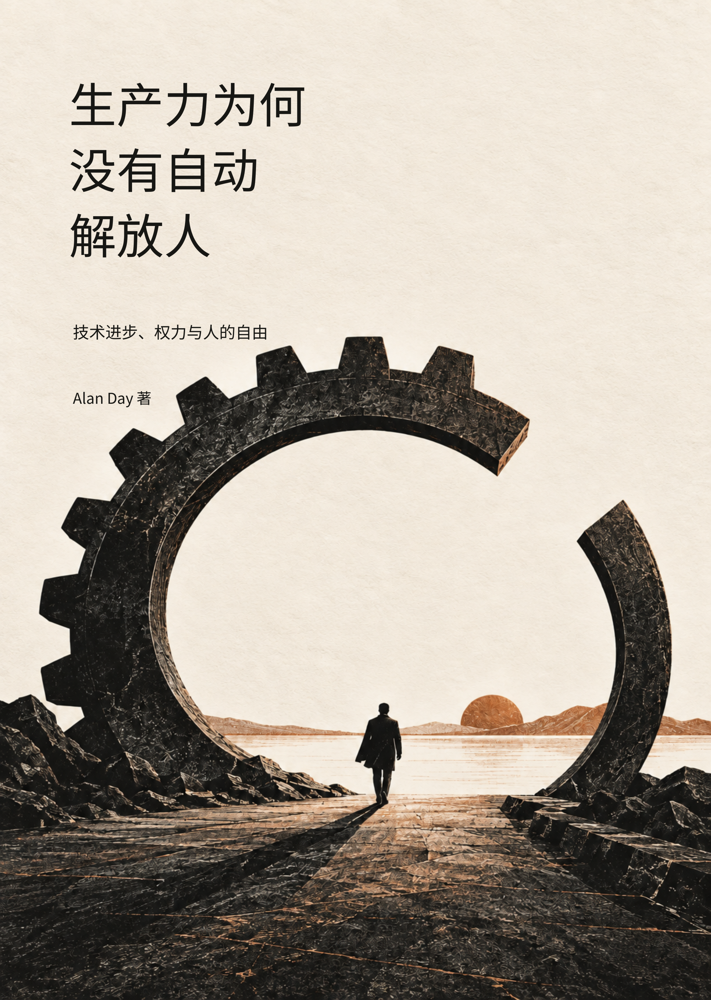

# 生产力为何没有自动解放人

技术进步、权力与人的自由

作者：Alan Day　｜　公开书稿：v1.11　｜　本版书稿日期：2026 年 10 月 3 日

工具越来越强大，节省下来的劳动为什么没有自动变成普通人的自由时间？本书从这个问题出发，讨论技术方向、控制权、风险与收益分配，以及人们参与决策和纠正错误的能力。

从机器、自动化和平台算法到人工智能，本书考察技术怎样进入人的工作与生活，并比较美国、欧洲、中国和苏联的制度经验。生产率能否改善生活，需要在收入、时间、安全、技能、自主和真实选择中得到检验。

本书向所有读者开放，欢迎阅读、下载与讨论。

## 开始阅读

- [下载完整 PDF](pdf/book-v1.11.pdf)：保留封面、目录、图表和分页，适合连续阅读。
- [按卷在线阅读](#五卷内容)：可以直接在 GitHub 浏览正文、图表和参考文献。
- [完整 Markdown 源稿](manuscript.md)：适合检索和离线阅读；如果 GitHub 不渲染全文，请使用分卷入口或下载源文件。
- [完整下载包说明](docs/DOWNLOAD.md)：一次下载整本及五卷 PDF、Markdown 源稿和配套图件。

## 五卷内容

| 卷次 | 主题 | Markdown | PDF |
|---|---|---|---|
| 第一卷 | 为什么更强大的工具没有自动带来更多自由 | [在线阅读](manuscript/volume-01.md) | [PDF](pdf/volume-01-v1.11.pdf) |
| 第二卷 | 谁在选择技术的方向 | [在线阅读](manuscript/volume-02.md) | [PDF](pdf/volume-02-v1.11.pdf) |
| 第三卷 | 不同制度如何组织技术 | [在线阅读](manuscript/volume-03.md) | [PDF](pdf/volume-03-v1.11.pdf) |
| 第四卷 | 怎样把生产率收益变成公共能力 | [在线阅读](manuscript/volume-04.md) | [PDF](pdf/volume-04-v1.11.pdf) |
| 第五卷 | 什么才算进步 | [在线阅读](manuscript/volume-05.md) | [PDF](pdf/volume-05-v1.11.pdf) |

第一卷提出工具效率与人的自由之间的问题。第二卷考察资本如何选择技术方向。第三卷比较制度如何发现信息、承担长期风险和应对危机。第四卷讨论怎样把生产率收益转化为公共能力。第五卷回到人的生活，追问什么才算进步。

## 版本与图像

v1.11 保留 v1.10 的封面设计和 v1.9 的正文润色成果，更新五幅卷图与五幅正文主题插画，并调整插画位置。公开版的封面、扉页、版权页和文件元数据统一署名 Alan Day。版本变化见 [CHANGELOG](CHANGELOG.md)。

本版封面与主题插画使用生成式图像工具制作。它们用于编辑与阅读呈现，不代表现场照片、历史复原或实证材料；数据与机制图的依据以书稿标注为准。具体说明见 [图像与素材说明](docs/ARTWORK.md)。

## 讨论与勘误

欢迎在本仓库的 Issues 中提出勘误和讨论。请注明卷次、章节、页码或原文，并尽可能提供可核验的来源。提交方式见 [CONTRIBUTING](CONTRIBUTING.md)。

## 使用说明

本次公开发布提供免费阅读和下载。尚未指定 Creative Commons 等开放内容许可；其他使用授权由作者另行说明。引文、数据和第三方资料的来源，以书稿中的标注为准。见 [CONTENT_USE](CONTENT_USE.md)。

