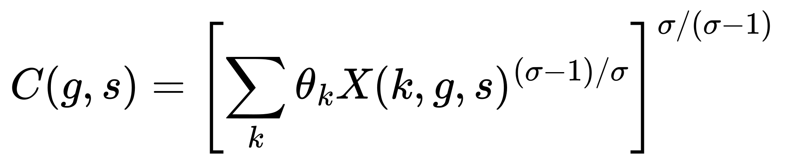
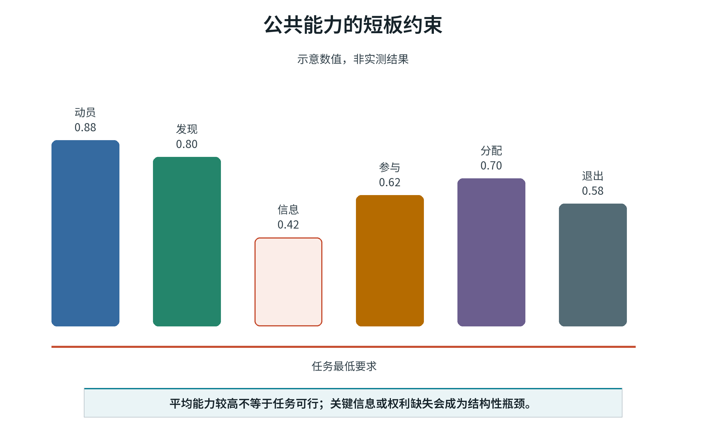
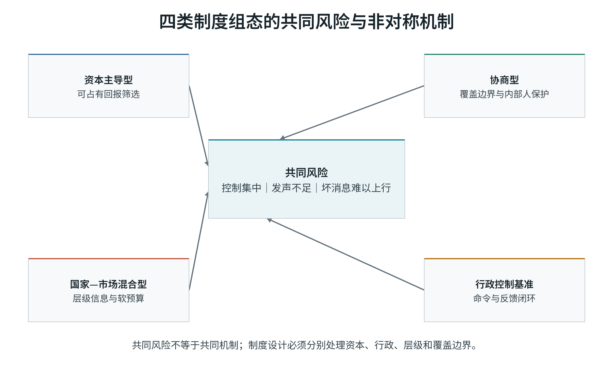
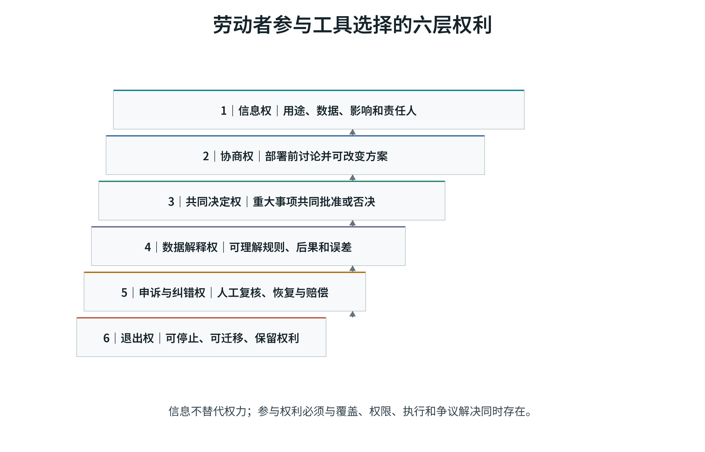
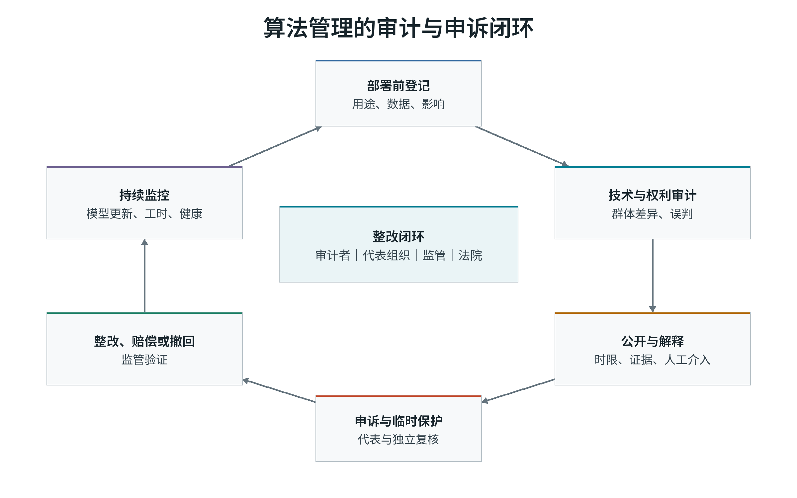
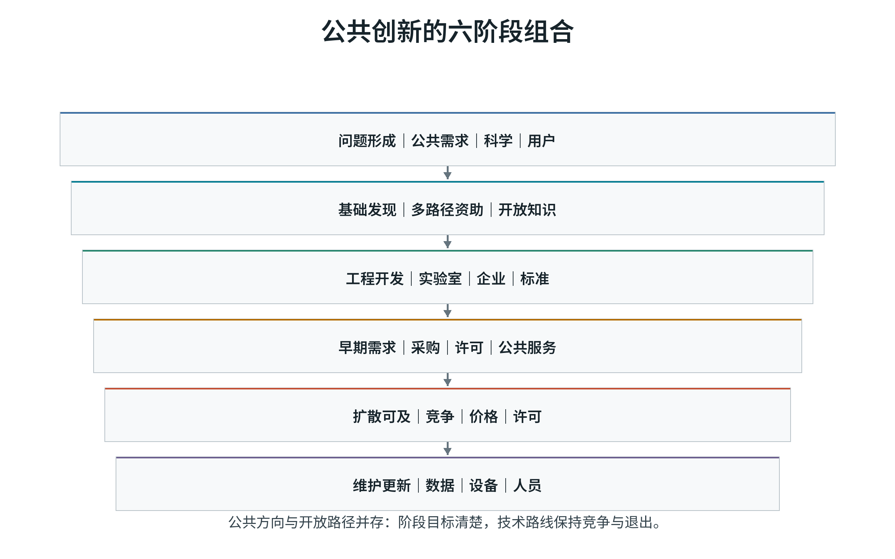
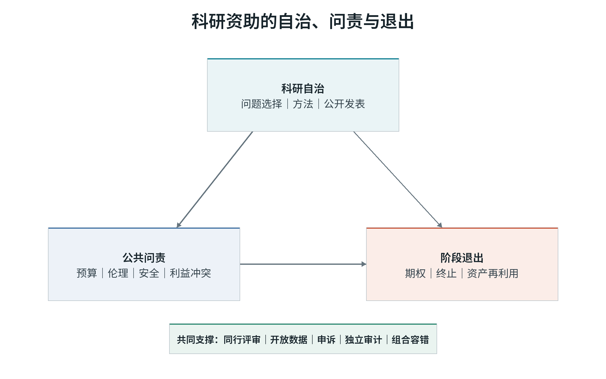
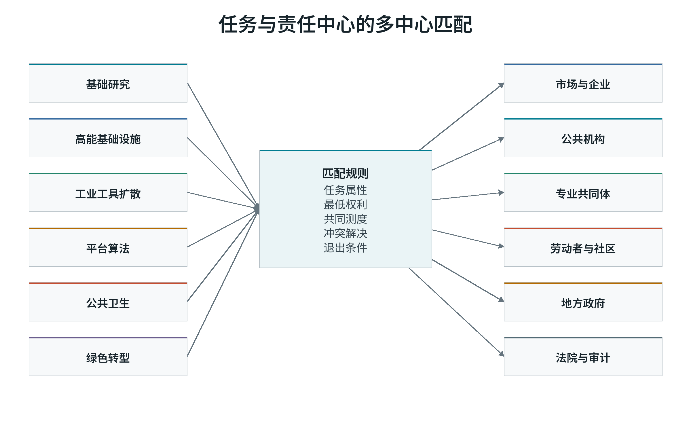
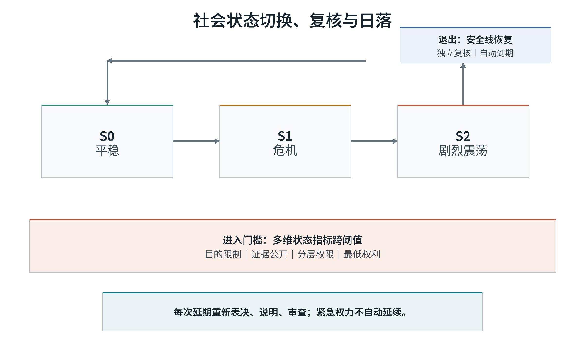

# 第一卷　为什么更强大的工具没有自动带来更多自由

## 本卷导读

工具节省了劳动，节省下来的时间为什么没有普遍成为自由时间？第一卷从机器破坏谈起，考察生产率、技术用途和控制权，为后面的制度比较建立共同的评价标准。

# 作者前言　为什么要追问效率收益去了哪里

我写这本书，源于一个持续很久的疑问：既然每一代工具都能节省一部分劳动，为什么节省下来的时间很少自动变成普通人的自由时间？

蒸汽机、电力、流水线、计算机、机器人、平台和生成式人工智能，各自解决了一批过去必须由人完成的任务。按最简单的想象，完成同样工作所需的人应当越来越少，工作时间应当越来越短，危险的岗位应当逐步消失，人们也应当拥有更多时间照顾家庭、学习、参与公共生活和安排自己的人生。这个方向在局部发生过，却没有成为稳定、普遍的结果。

有些企业用自动化改善了安全和质量，也让劳动者获得更高技能和更稳定的收入。另一些企业把同样的工具用于裁员、降薪、加强监控和压缩岗位。有人获得了新任务，有人失去了旧职业；有些地区形成新产业，有些地区只剩下更难就业的年长工人和被闲置的基础设施。工具的能力相近，结果却相差很大。

这些差异是本书要解释的问题：

> **技术提供可能，制度决定方向；生产率创造收益，控制与分配决定这些收益能否转化为人的自由。**

这个判断要求我们继续追问四件事。谁能够选择技术路线？谁承担采用新工具的风险？谁得到生产率提高形成的收益？受影响的人能否发声、申诉、转换岗位或在必要时退出？如果这些问题没有答案，所谓“技术进步会让大家受益”仍然只是一句未经兑现的承诺。

评价技术，我关心的不仅是产量、速度和成本，还有人们是否少受伤害，是否获得更多时间、技能和选择，以及他们能否约束使用技术的权力。收入、安全、自主和公共知识未必同步改善，评价时需要把这些冲突摆出来。

读者会看到资本、行政机构、专业共同体、劳动者和社区都在选择工具。市场能够发现分散需求、形成价格反馈和组织退出，却容易忽略没有支付能力的人、长期公共知识和不能收费的社会收益。国家和公共机构能够提供普遍权利、长期投资和危机协调，却可能压缩信息、扩大指标考核并让错误退出变慢。专业共同体维护知识标准，也可能形成封闭门槛。劳动者和社区掌握现场知识，却未必拥有决定权。

美国、欧洲、中国和苏联的经验，使我们能够考察不同制度如何发现信息、承担长期风险、分担调整成本和应对危机。比较的落脚点是这些具体安排，以及它们在失败后能否改变。

生产率上升扩大了社会能够支配的资源和时间。新增收益可以用来缩短工时、提高收入、改善安全、支持照护和开放知识；也可能被用于加密考核、扩大监控和集中财富。收益进入哪里，要看权利、风险和分配规则如何安排。

沿着这一问题，全书讨论五件事：

1. 什么条件决定同一种技术产生不同的社会后果？
2. 自动化在什么条件下替代劳动，在什么条件下创造新任务？
3. 市场、公共机构、专业共同体和劳动者各自擅长的发现，怎样进入同一套制度？
4. 集中协调和分散试错分别适合哪些任务和社会状态？
5. 当收入、时间、安全、自主和公共知识无法被压缩成一个数字时，社会怎样判断进步？

我希望这本书推动的，是对技术收益作出更具体的安排：让承担转型风险的人能够分享收益，让受影响者参与决策，也让失败的项目和制度能够被修改或终止。生产力能否改善人的生活，要在这些安排中得到检验。

# 全书导论　节省下来的劳动去了哪里

从蒸汽机、电力和流水线，到计算机、机器人和人工智能，工具不断接管人类的体力与信息处理任务。完成同样的工作所需的劳动减少了，社会也就有了缩短工时、减少危险作业的可能。

这种可能如何兑现，却很不一致。同一项技术可以让工人从危险工序转向设备维护，也可以取消岗位、削弱手艺的价值和议价能力。企业提高了生产率，劳动者可能得到更好的工作，也可能面对更密集的考核。

节省下来的劳动去了哪里？这个问题把技术的能力与人的处境联系起来。

工具改变可完成的任务，制度安排决定采用的目标、决策权、风险和收益归属。从生产率到自由时间，要经过控制与分配这一环。

全书围绕三个层次展开。第一层是技术问题。研发、采购、部署、接口和管理方式会筛选工具方向。工具可以替代劳动，可以增强劳动，可以扩大监控，也可以创造新的判断能力。第二层是制度问题。决定社会后果的，不只是“市场”或“国家”的标签，还包括控制权、信息、风险、分配、发声和退出如何组织。第三层是人的问题。生产率只有在转化为时间、收入、安全、技能、自主、公共知识和真实选择时，才具有解放的意义。

本书以减少不必要的劳动与伤害、扩大人的能力和选择作为评价方向。若一种效率改善要求人们承担无法申诉的风险，就需要重新审视它的代价。收入、时间、安全、健康、生态和公共知识之间的冲突，应当逐项说明。

前言提出的五个问题，将在各卷中逐步展开。第一卷建立评价标准，第二卷考察资本的技术选择，第三卷比较不同制度，第四卷讨论收益和风险的安排，第五卷检验这些安排是否改善了人的生活。

第一部从机器破坏、工厂自动化、平台算法和人工智能出发，解释生产率与人的自由之间的距离。工具完成任务的效率、资源配置、收益分配和纠错能力，需要分别考察。

第二部追问，企业有许多技术路线可选时，哪些路线更容易得到资本。可占有的收益、可计价的回报、投资期限、市场权力和劳动控制共同塑造方向。自动化首先改变任务，继而改变岗位、地区收入和个人职业。工具还会变成管理权，平台评分、设备节奏和绩效算法都会改变劳动者能否申诉和退出。

第三部比较美国、欧洲、中国和苏联如何发现需求、承担长期风险、传递坏消息、分担调整成本和组织危机应对。平稳时期与危机时期的任务不同，同一种制度安排的作用也会改变。

第四部转入制度设计。生产率收益要成为公共能力，需要在技术采用之前安排风险，在设计部署时引入现场知识，在长期创新中承担私人市场难以内部化的不确定性，并在多中心协调中保留边界、共同测度、最低权利和退出规则。这里的关键问题是从“是否采用技术”转向“怎样采用、谁参与、谁受益、失败如何纠正”。

第五部讨论承诺何时值得相信，技术进步是否增加了自由，以及谁能参与评价进步。前四部考察的控制、分配和纠错安排，最终要在人的生活中接受检验。

读者可以按部阅读，也可以把本书当作一套分析工具。每当有人说“技术提高了效率”，我们可以继续追问：效率提高了谁的能力？谁失去了选择？节省的时间去了哪里？风险由谁承担？失败以后谁能要求改变？

# 第一部　为什么更强大的工具没有自动带来更多自由

## 概念说明：为什么本书使用“工具”

机器只是工具史中的一个类别。人类生产力的持续发展依赖累积性的工具系统，而不必然依赖狭义的机器：文字、数字、度量衡、会计、地图、统计、电网、物流、软件、算法和人工智能，都可能在特定制度条件下扩展人类改造物质、处理信息和协调行动的能力。

| 层次 | 定义 | 研究问题 | 例子 |
|---|---|---|---|
| 工具 | 可重复使用并扩展行动能力的人工手段 | 人类能够做什么 | 机器、软件、算法、统计、电网 |
| 工具系统 | 由工具、能源、技能、数据、维护和标准组成的可复制能力 | 能力如何稳定组合 | 工厂体系、云平台、科研基础设施 |
| 组织 | 使用和协调工具系统的具体机构 | 谁在实际部署和维护 | 企业、大学、政府、平台 |
| 制度 | 稳定权利、权限、目标、责任和分配结果的规则与权力结构 | 谁控制、谁受益、如何纠错 | 产权、劳动法、计划、福利、参与制度 |

下文在讨论机器破坏、机器人和机床等历史对象或设备时使用“机器”，并保留“机器换人”“机器学习”等固定名称。涉及文字、统计、软件、算法和基础设施的共同机制时，则使用范围更广的“工具”或“工具系统”。

工具与制度承担不同功能。工具提供行动能力，制度规定谁能够开发、使用、控制工具，以及收益和风险如何分配。工具能力只有通过控制、信息和分配进入社会结果。

### 第一部导言　生产率与自由之间为何还有一道门

工具能够节省劳动、扩大能力，自由时间、安全和选择却未必随之增加。第一部考察两者之间的制度安排。

考察一项工具，需要先弄清它能完成哪些任务，再看谁决定用途、持有数据、承担风险和取得收益，最后追踪工时、收入、健康、技能与自主性的变化。

以下讨论围绕工具与工具系统、组织与制度、工具用途和控制结构展开。这些概念将用于后面的国家比较与制度设计。

## 第一章　工具本应扩展能力，人为何害怕它

机器破坏、工厂自动化、平台算法和生成式人工智能看起来相隔遥远，却反复引出同一组冲突：工具可以节省劳动，也可以改变技能、节奏、监督和谈判力量。如果效率提高本身足以让所有人受益，为什么采用同一种工具的人会得到截然不同的结果？

### 节省劳动需要制度兑现

“工具节省劳动”通常被当作一个技术事实。更准确地说，它是一个关系判断：工具在特定任务上减少了完成既定产出所需的人类劳动，但节省下来的劳动属于谁、以什么形式出现、是否补偿了被替代者，并不由工具单独决定。

同一套设备至少可能产生四种不同结果。

第一，产量不变，工时下降。企业减少劳动时间，或让同一批人承担更少任务。只有当工资、排班和岗位规则同步调整时，这才是真正的劳动节省。

第二，产量增加，总劳动不变。工具提高了单位时间产出，企业继续使用同样多的人，把新增产能转化为市场扩张。工人未必失去岗位，但也没有获得更多自由时间。

第三，产量增加，部分岗位消失。企业用资本接管某些任务，同时保留、扩大或创造其他岗位。岗位总数可能上升，被替代的具体职业仍可能遭受长期损失。

第四，产量增加，劳动强度提高。工具减少一个动作的体力消耗，却通过更少的人、更快的节奏、更严的考核或更高的生产目标，把节省的时间重新填满。

因此，“工具提高生产率”与“劳动者被解放”之间至少隔着三层制度安排：生产率收益如何形成，如何在工资、利润、价格、税收和公共供给之间分配，以及劳动能力如何被重新组织。

产出增加只是评价的起点。劳动者是否受益，还要看分配和工作组织怎样变化。

### 古典政治经济学中的机器悖论

“机器是否伤害劳动”早在古典政治经济学中已经出现。李嘉图最初把机器当作一般资本形式，后来在《政治经济学及赋税原理》第三版“论机器”中作出重要修正：机器可以提高净产出，却可能同时降低对劳动的需求。这一修正没有给出永久结论，却建立了此后争论的基本结构：总产出、净收益与就业分别变化。

马克思把这一问题推进到生产关系。机器的技术能力可以减少必要劳动，但在资本控制下，机器同时被用来延长剩余劳动、增强劳动强度、扩大相对过剩人口，并把技能和过程知识从生产者手中转移给管理者和资本。<super>[45]</super> 因此，机器本身的生产力与机器采用的阶级形式必须分开分析。这个区分直接预告了本书后面的三层生产力标准。

凯恩斯在 1930 年预见到，如果物质稀缺下降，社会的主要问题将转向如何分配自由时间、如何在不再以工作为中心的世界中维持意义和公平。<super>[46]</super> 他指出生产力与制度目标之间存在社会选择。

熊彼特则强调创新的两面性。创造性破坏提高长期能力，也会摧毁旧企业、旧技能和旧社区。<super>[47]</super> 这与当代机器人研究中的“总就业补偿与个人损失并存”并不矛盾。创新和破坏在同一过程中共同出现，只是在不同时间、空间和群体上的表现。

波兰尼提供了第三个维度。劳动、土地和货币若被当作纯粹商品，市场扩张就会触发社会保护的反向运动。<super>[48]</super> 在工具采用中，这意味着劳动者的技能、健康和社区并非可以无成本重新配置的投入品。若市场和行政系统只计算设备成本与产出，而不承担社会和生态成本，所谓效率就是局部核算。

这些经典讨论把问题引向工具的采用条件：谁支配新增收益，谁承担调整成本，劳动者的生活与再生产如何得到保障。

### 机器破坏反映权力与生计冲突

把反对机器的人称为“卢德分子”，已经成为一种常见的贬义表达。它暗示反对者目光短浅，看不到长期总收益，只保护即将消失的旧岗位。历史研究给出了更复杂的图景。

霍布斯鲍姆把英国机器破坏理解为一种集体谈判方式。工人攻击的并非一切机械知识，而是雇主利用机器压低工资、取消习惯权利、雇佣低技能替代者并改变谈判力量的具体做法。<super>[1]</super> 汤普森和兰德尔的研究进一步把机器破坏放回社区习惯、雇佣关系和政治压制之中，说明行动目标通常是恢复习惯权利和限制单方面权力，而不是拒绝所有技术。<super>[63-64]</super> 莫基尔则从有用知识和启蒙经济解释英国为何能够持续产生技术突破，同时提醒制度收益需要在不同社会群体之间重新分配。<super>[67]</super> 近期关于手工纺纱的研究记录了机械化造成的长期职业损失。<super>[2]</super>

这里的冲突有两个维度。

第一个维度是分配。技术带来的总收益可能为正，但损失集中在特定地区、技能和年龄群体。如果收益流向所有者、消费者和高技能岗位，损失却集中在被替代者身上，那么反对采用方式就是理性的风险反应，而不是把总产出误认为个人收入。

第二个维度是权力。工具改变的不只是任务，还改变谁掌握工艺知识、谁决定节奏、谁有资格监督、谁能够拒绝不合理要求。工人保卫的往往不是某个动作的旧做法，而是对工作过程的最低限度的控制。

当代调查得到相近结果。当受访者认为自动化风险高、社会保障弱、利益不能共享时，更可能支持限制或补偿政策；当风险与收益被视为共同承担时，工具接受度会上升。<super>[3]</super> 中国制造业研究还发现，“退出选项”很重要。认为自己离开现有岗位后没有更好选择的人，更容易对自动化感到不安全；部分工人同时承认自动化可以减轻体力负担、改善企业前景。<super>[26]</super>

所以，抵制通常针对一种特定的技术使用方式：风险由自己承担，收益由别人取得，决定过程没有自己的位置，承诺又没有可执行的保障。

### 同一技术在不同尺度上给出不同答案

自动化的就业效果随观察尺度而变化。企业、行业、地区和国家的就业数字，回答的是不同问题。

任务模型提供了一个基本框架。自动化把某些劳动任务转交给资本，产生替代效应；生产率提高可能降低价格、扩大需求；与此同时，新任务又会重新创造对劳动的需要。<super>[4]</super><super>[75]</super> 更早的任务研究还说明，技术变化会改变不同技能在常规、抽象和互动任务中的相对价值，净就业因此是这些力量共同作用的结果，而不是“工具必然抢走多少岗位”的固定常数。<super>[74]</super><super>[76-77]</super>

经验研究也呈现尺度差异。美国通勤区研究发现，机器人暴露较高的地区出现就业人口比和工资下降，冲击尤其落在常规任务群体。<super>[5-6]</super> 德国制造业就业也受到机器人负向影响，但服务业扩张在很大程度上形成补偿，原有制造业工人更多留在企业内部，调整压力转移到年轻进入者和工资结构上。<super>[7]</super> 中国研究则同时出现企业劳动需求下降、行业和城市层面的产业扩张补偿，以及不同所有制、融资约束和地区结构下的异质结果。<super>[16-22]</super> 生产率技术的扩散还可能存在延迟：无形资产、组织重构和技能互补需要时间，短期生产率统计无法立即显示全部收益或损失。<super>[78]</super>

这些发现并不互相否定。一家企业减少用工，可能伴随着上下游企业扩张；一个制造业岗位减少，可能由一个服务业岗位补上；宏观就业没有下降，也不代表被替代者获得了同等收入、保障和职业尊严。相反，城市净就业增加，也不能证明特定工人没有承担不可逆的技能和身份损失。

由此可以得到第一条方法论规则：

> 工具冲击必须分别记录任务、岗位、企业、行业、地区和个人结果。平均值的符号不能替代受损分布。

公式 2 把劳动需求变化拆成替代、恢复和生产率三部分。ΔNdisplace 是工具接管任务造成的替代，ΔNreinstate 是新任务重新带回劳动的效果，ΔNproductivity 是生产率和需求扩张对劳动需求的间接影响。三者符号可以不同，任一项都不能代表全部结果。

### 从机器人到生成式人工智能：先改变任务，后改变总体指标

人工智能与机器人冲击不会只表现为“某个岗位仍然存在或消失”。企业往往先改变职位描述、技能组合和招聘标准，再逐步改变实际人数。美国在线招聘岗位研究发现，在生成式人工智能扩散初期，企业已经调整了部分岗位的技能要求和任务构成，而宏观就业总量未必同步变化。<super>[8]</super> 宏观估计也提醒，AI 的生产率收益、任务替代和劳动份额效应在总量上可能远小于媒体叙事，但在具体职业和组织内部可能非常显著。<super>[90]</super>

这带来两个重要后果。

其一，技术风险可能在失业发生之前就已经出现。劳动者看到职位内部的任务被拆分、经验价值下降、晋升路径变窄，即使短期内仍保有工作，也会对技术产生防御性态度。

其二，用失业率判断技术影响会太迟，也会太窄。工作是否变得可控、可学习、可积累、可持续，属于生产力解放的问题，却在失业统计之外。自动化还可能改变资本与劳动的收益份额，并通过资产价格扩大财富不平等，即使总产出的净效应不明确。<super>[80-82]</super>

技术型工作不安全感研究进一步区分了岗位替代威胁与工作内容转型压力。中国证据还提示，机器人采用可能改善部分体力健康，同时加重心理压力和群体不平等，因此需要把健康拆成多个维度观察。<super>[23-25]</super>

劳动过程理论提醒我们，技术从来不只是投入替代。它还可能拆分技能、把判断编入流程、将监督权集中，并规定何种行为可以被记录和评价。<super>[9-10]</super> 三家中国“机器换人”工厂的社会学研究显示，在政策、资本和劳动力市场共同推动下，由企业单方面主导的工具升级可能减少执行性岗位、加强流程控制，而劳动者很少参与路线选择。<super>[10]</super>

自动化并不必然导致劳动降级；更重要的是，工具形式与组织方式共同决定结果。工业机器人可以完成危险、重复的工作，也可能把工人绑定到更快的生产节拍；生成式工具可以增强普通人的表达和编程能力，也可能被用于压低创作报酬、扩大审查或取代初级学习岗位。工具能力相同，制度用途不必相同。

任务是技术影响的第一层，岗位是第二层，企业和行业是第三层，地区和国家是第四层。短期的任务生产率提高不足以单独推出岗位福利改善，因为企业还可能改变招聘标准、晋升阶梯、工作强度和监督方式。生成式人工智能研究目前能较清楚地识别写作、编程和服务任务的生产率变化，却尚不足以确认长期岗位数量、技能形成和收入分配结果。<super>[79]</super>

### 为什么“以后会更好”需要实际保障

支持工具转型的常见论证是：短期会有损失，但增长最终会创造新岗位和新收益，因此应当接受调整。这个论证在长期总量层面可能成立，却不能自动解决当期政治经济问题。

未来补偿要能够改变今天的行动，需要同时满足几个条件。

1. 收益确实出现，不停留在预测中。
2. 受损者能够识别并实际取得其中一部分。
3. 补偿程序可执行，不依赖企业或政府临时改变承诺。
4. 受损者有能力等待，包括储蓄、社会保障、住房、医疗和家庭支持。
5. 新岗位与旧技能可衔接，或者存在可信的再训练和转岗路径。
6. 受影响者能够参与规则设计，并知道失败时会怎样处理。

缺一项，未来收益的可信度就会下降。缺得越多，“先增长、后分配”就越像要求当前受损者替别人承担转型风险。

劳动者对工具的信心，往往来自可核验的制度经验：收益规则是否兑现，就业保障能否取得，参与和申诉是否有效。积极的宣传很难代替这些经验。

### 为什么本书比较机制组合

工具恐惧把两种制度都推到了检验台上。

在资本控制下，工具选择主要由所有权、预期回报、竞争压力和管理权推动。这个体系可能迅速发现可变现需求、组织试错并扩张成功技术，却也可能忽略没有支付能力的社会需要，把转型损失外部化给劳动者和地区，并因金融期限和市场权力而扭曲研究方向。

在行政控制下，工具选择可以服务于工业化、国防、教育和基础设施等长期目标，并集中资本完成互补投资。这个体系却可能让数量指标替代真实目的，让上级目标压过基层信息，使企业隐藏产能、囤积投入、回避创新，并让失败项目因政治声誉而难以退出。

两种控制结构都能组织生产力，也都存在能力边界。全书不会问“市场好还是计划好”，因为这个问题把所有权、竞争、公共科研、福利制度、行政能力和劳动者参与压缩成两个标签。更可检验的问题是：

> 在具体任务和社会状态下，哪一种控制结构主导工具选择，它拥有什么信息和执行能力，谁承担成本，谁取得收益，失败能否被发现和纠正？

工具恐惧揭示了制度如何选择工具方向。

如果某项技术能够节省劳动，却让损失集中于缺少退出选项的人，让收益流向控制技术的人，让承诺无法执行，让受影响者不能发声，那么抵制就是分配冲突的表现。它没有证明技术有害，却证明了“技术潜力自动等于共同解放”这一判断不成立。

后续分析必须完成三次拆分：

1. 把“技术进步”拆成具体任务、具体用途和具体受益结构。
2. 把“就业影响”拆成企业、行业、地区和个人尺度。
3. 把“接受技术”拆成对未来收益、风险承担、发言权、退出选项和纠错能力的综合判断。

只有完成这三次拆分，才能进入下一章的评价问题：什么才叫生产力得到解放。

## 第二章　效率提高以后，谁得到更多时间？

生产率上升常被当作进步的同义词。但产量、单位工时、系统可用能力和人的自由时间分属不同层次；企业报表变好，不等于劳动者拥有更多可支配时间。

### 生产力至少有四种不同含义

“生产力提高”在日常讨论中经常被当作一个指标。实际上，至少存在四种彼此相关的概念。

第一是总产出。它回答一个经济生产了多少商品和服务。总产出可以因更多劳动、更多资本、更多资源投入、价格变化或借债消费而增加，因此不能单独证明效率提高。

第二是劳动生产率，通常以单位劳动投入的产出衡量。它回答每单位劳动时间生产了多少产出。劳动生产率上升可能来自技术进步，也可能来自资本加深、工人技能提高、企业规模扩大，或者把低生产率活动转移出去。

第三是全要素生产率。它试图衡量不能由已计量资本和劳动投入解释的产出增长，常被视为技术、组织和管理改善的近似指标。它比劳动生产率更接近工具效率，但仍会受到计量误差、产品质量、无形资本和需求波动影响。

第四是人的解放效果。它回答生产力收益是否转化为更少必要劳动、更高收入和保障、更好的健康与安全、更强的学习能力、更大的自主性，以及更多可由公众共同使用的知识。

这四层不是同义词。总产出增长可以伴随工时延长、劳动份额下降和环境退化；劳动生产率提高可以让股东和消费者受益，而工人失去岗位；全要素生产率提高也可能来自裁员和压低维护，而不是可持续创新。

因此，本书采用三层评价标准：

> 工具效率判断投入与产出的关系；系统配置效率判断资源是否到达真正需要它的用途；解放效果判断技术收益是否扩大人的能力与自由。

### 工具效率：产出规模与任务质量

工具效率关心给定投入能否生产更多、更好、更可靠的产品。它是必要信息，却有三个边界。

第一，产出的质量、耐久性、安全性和使用价值必须进入计量。若企业通过降低材料标准、缩短产品寿命或把维修成本转给消费者来提高当期产量，账面效率可能掩盖真实能力下降。

第二，投入必须完整。若生产率提高依赖无报酬加班、过度开采、污染外部化或基础设施补贴，就需要把这些成本重新纳入核算，而不能把成本转移称为效率。

第三，效率是任务和边界条件下的关系。一个系统在高负荷、单一品种和稳定需求下效率很高，可能在需求变化、设备故障或品种切换时极其脆弱。平稳期的局部最优未必等于危机中的系统能力。

工具效率因此不能被否定，也不能被神化。没有效率，社会就缺少扩大福利的物质基础；只有效率，社会却可能把更多产出集中给少数控制者，同时消耗掉劳动者和生态系统。

### 系统配置效率：生产表平衡与需求满足

系统配置效率关心资源是否从低价值用途转向高价值用途，投入端与需求端能否在数量、品种、质量、地点和时间上匹配。

这一层常被总量指标遮蔽。一个计划可以完成钢产量，却缺少所需规格的零部件；一个市场可以生产大量商品，却无法为低收入者提供住房和医疗；一个平台可以提高匹配速度，却可能通过垄断抽成把生产者剩余转化为平台租金。三者的共同点是：总量活动存在，端到端需求仍未满足。

系统配置效率还包含时间维度。投资今天的基础设施、教育和科研，可能减少未来瓶颈；企业今天削减维护和培训，则可能把成本推迟给明天。只看当期价格和利润，容易把未来能力当作免费资源。

因此，判断技术是否提高系统配置效率，需要追问四个问题：

1. 产出是否到达真正需要它的人和用途？
2. 品种、质量和时间是否匹配，而不只是数量平衡？
3. 今天的收益是否以透支未来能力为代价？
4. 资源获取由价格、计划、权力还是关系决定，谁能纠正错误配置？

### 解放效果：节省下来的时间去了哪里

如果工具减少了必要劳动，解放效果的第一项指标就是时间。但工时下降不会自动发生。企业可以用节省的时间扩大产量，管理者可以提高任务密度，消费者可以形成新的必要支出，劳动者也可能因住房、教育和医疗成本而维持长工时。

工业革命提供了一个重要历史提醒。长期生产率跃升与生活水平、工时和劳动条件的改善并不同步，部分群体经历了长期停滞甚至恶化。<super>[43-44]</super><super>[65]</super><super>[84-85]</super> 工业革命创造了前所未有的生产能力，同时说明生产力增长与劳动者福利之间存在制度和分配距离。

解放效果至少包括六个维度。

#### 收入与安全

技术收益是否转化为可支配收入，是否减少失业、疾病和老年风险，是否让转型损失可以被保险，而不是全部由个人承担。

#### 自由时间

节省的劳动是否变成更短工时、更稳定的排班、更充分的休息和照护时间，而不是更高的产出目标或随时待命。

#### 健康与安全

危险、重复和有害任务是否减少；心理压力、监控强度和工伤是否同步下降；技术是否把风险从正式工人转移给外包者、平台劳动者或供应链上的隐蔽劳动。

#### 技能与自主

劳动者是否获得更丰富的判断、学习和解决问题能力，还是只执行被系统分配的碎片任务。技能是否可迁移，经验是否仍被承认。

#### 参与和尊严

受影响者能否对工具采用、工作设计和收益规则表达意见；其异议是否会被记录、回应和申诉，而不是只在执行阶段被要求适应。

#### 公共知识与代际能力

技术收益是否扩大公共知识、公共卫生、教育和基础研究，是否为未来保留选择空间，而不是用短期收益锁定高成本、难退出和生态破坏的路径。

这六项不能被压缩成一个综合指数。它们之间可能存在真实冲突，例如某项技术提高收入却增加监控，或缩短工时却削弱技能积累。价值排序需要公开说明，不能由研究者用一个神秘的总分替社会决定。

### 能力、自由与社会再生产

把“解放效果”写成六项指标仍不够，还需要说明其理论根据。

森把发展理解为实质自由的扩大，而不只是收入和商品数量的增长。一个人是否能够获得教育、参与政治、选择职业、保持健康并参与社会，构成其可行能力。<super>[57]</super> 努斯鲍姆进一步强调身体完整、社会归属、实践理性和尊严等核心能力，并指出这些能力不能被一个收入指标完全替代。<super>[58]</super>

这对技术评价有三个直接含义。

第一，技术收益必须转化为实际能力，而不只是资源总量。若医疗、教育和照护成本上升，工资增长可能没有扩大真实自由。

第二，参与选择本身属于能力。工具采用如果只提供事后补偿，却禁止受影响者参与规则选择，解放效果就是不完整的。

第三，价值不可完全通约。更短工时、更高收入、更大自主性和更多公共知识之间存在冲突，不能假定一个隐藏的世界价格能够把它们自动换算。

赫希曼的“退出、发声与忠诚”补充了动态机制。劳动者若无法退出，又缺少有效的发声渠道，只能在忠诚被消耗后采取消极规避、集体抵制或政治反对。<super>[59]</super> 工具接受因此不是单纯偏好问题，而是受影响者是否拥有改变规则的手段。

还须加入社会再生产和生态边界。若工具减少工厂劳动，却把照护、清洁、平台待命和家庭管理费用留给女性、移民或低收入家庭，社会总工作量并未按同一比例下降。<super>[70-71]</super> 若生产率提高依赖不可再生资源、碳排放或生态修复成本的后移，工具效率也可能只是时间上的转移。

由此，第二章对“解放”的定义必须包含三层限制：

1. 个人实际能够选择什么；
2. 风险、照护和生态成本是否被重新分配或外部化；
3. 受影响者能否参与定义效率、收益和退出规则。

### “节省劳动”为什么可能变成“劳动强化”

技术节省的是一项任务，社会时间仍取决于制度安排。

设想一个岗位原来由十人完成，其中三项任务实现自动化后，企业只保留六人。若产量不变、工资和工时改善，这是一次劳动节省。若企业提高目标，让六人完成原来十二人的产出，并借助系统持续记录速度和错误，那么剩余劳动者承担了更高强度和更强监督。

劳动强化可能通过至少四种机制出现。

第一，**节奏由设备设定**。传送带、算法排班或实时绩效系统缩短了劳动者的自主调整空间。

第二，**目标随生产率上调**。节省下来的时间没有被保留，而是立即转化为更高指标。

第三，**监控范围扩大**。数字系统把原本难以计量的动作、情绪、位置和社交关系纳入考核。

第四，**风险向下转移**。平台化、外包和供应链分包让核心企业取得效率收益，却把需求波动、设备成本和法律责任推给更弱的参与者。

因此，判断工具是否解放劳动，不能只比较自动化前后的单位产出，还要比较同一批劳动者的工时、节奏、权限、技能、健康、收入和申诉能力。

### 收益分配取决于制度安排

生产率收益有若干可能去向：工资、利润、消费者价格下降、税收和公共服务、研发再投资、债务偿还，或者资产价格。收益分配由制度规则决定。

劳动收入份额下降可能意味着资本替代增强，也可能是统计口径、行业结构、全球化和垄断利润变化的结果。<super>[83]</super> 中国机器人研究在不同层级给出不同结论：企业层面可能观察到劳动份额下降，城市或产业结构转型研究则可能出现补偿甚至上升，但制造业、特定地区和弱服务业基础地区仍可能受损。<super>[16-22]</super>

这说明平均劳动份额也不够。必须拆成：

- 谁的收入变化，谁只是换了一份工作；
- 谁的工时和保障变化；
- 企业利润、消费者剩余和公共收入变化；
- 地区之间的转移和补偿；
- 未被纳入正规劳动的照护、平台和供应链工作。

市场并不自动保证技术收益流向最需要的人；行政分配也不自动保证资源到达基层。两者都需要具体规则。若收益分配完全依赖事后慈善、财政余量或政治承诺，被替代者面对的就不是收益，而是风险。

### 评价必须跨过“总产量幻觉”

一个社会可以同时出现以下现象：企业生产率上升，总产出增长，部分劳动者收入下降，区域差距扩大，公共科研获得更多数据却更依赖商业平台，消费者获得便宜服务但生产者失去议价能力。

若只用 GDP 或平均工资，这些变化会被压缩成一个方向。若只用失业率，技能降级、劳动强化和自主性丧失又会消失。若只用主观满意度，既可能受预期和身份影响，也可能忽略客观权利和长期能力。

合理做法是建立一个可审议的仪表盘：

| 评价层 | 理论基础 | 核心问题 | 最低指标组 | 典型误读 |
|---|---|---|---|---|
| 工具效率 | 生产率核算 | 给定投入是否生产更多、更好、更可靠 | 单位投入产出、质量、可靠性、能源与材料使用、维护成本 | 把产量增长当成工具效率 |
| 系统配置效率 | 资源配置与信息理论 | 资源是否到达匹配的用途和时间 | 供需匹配、品种与交付、瓶颈、库存、未来能力、公共需要 | 把生产表平衡当成需求满足 |
| 解放效果 | 能力方法与自由理论 | 技术收益是否扩大人的能力与自由 | 工时、收入、保障、健康安全、技能自主、参与、公共知识 | 把工资增长当成全部自由 |
| 韧性与纠错 | 系统与制度反馈 | 冲击发生时能否维持关键能力并修正错误 | 关键供给、组织冗余、信息上行、退出速度、恢复时间、长期疤痕 | 把平稳期效率当成危机能力 |

这四层不能互相替代。高产出不能抵消失去自由，高保障也不能抵消持续错配，平稳期的效率更不能替代危机中的生存能力。

#### 测量效度与公开规则

指标体系必须接受三项检验。

第一，**构念效度**。工时下降可能是因为经济停滞，劳动份额上升可能是因为统计口径变化，健康改善也可能来自职业转移而非技术。指标必须与理论机制对应。

第二，**尺度一致性**。企业、行业和国家的劳动份额需要分别核算。个体、家庭和工作岗位的时间也不能用同一平均工时替代。

第三，**价值透明**。若研究者最终必须做一个综合判断，应公开权重、替代方案和敏感性结果，而不是把规范性排序隐藏在技术指数中。

使用综合指标时，应说明权重、受影响群体和可能改变判断的证据。综合结果可以帮助比较，但各项指标之间的冲突仍需公开。

生产力既涉及物质生产能力，也涉及能力如何被组织、如何影响人的生活。分层评价，可以保留物质约束，同时追踪收益与代价。

判断一项技术是否解放生产力，至少要回答：

1. 它是否提高真实的工具效率和系统配置效率？
2. 节省的劳动和增加的收入由谁取得？
3. 工时、健康、安全、技能和自主性发生什么变化？
4. 受影响者能否参与规则选择？
5. 当工具路线错误时，社会如何发现、纠正和退出？

这些问题将贯穿对资本控制、行政控制和混合制度的所有分析。

## 第三章　技术有真实能力，但用途由制度选择

机器人、软件和算法都有真实能力，却没有固定用途。同一台设备可以承担危险工序，也可以加强监控和替代熟练判断，选择发生在设计、采购和组织规则之中。

### 技术能力与用途选择分属两层

机器、药物和算法各有能力与限制。工业机器人只能完成特定动作，统计方法依赖数据中的信息，电池化学也受成本和安全约束。讨论技术用途的制度选择，要从这些约束出发。

这里需要区分三种“中性”。

第一，**物理意义上的可替代性**。在给定任务和生产函数中，一种投入可以替代另一种投入，工具本身具有特定功能和精度。

第二，**设计意义上的开放性**。同一技术能力可以有不同接口、权限和用途。算法可以辅助工人判断，也可以单方面分配任务；自动化可以减轻重复劳动，也可以把个人经验编入仅供管理层使用的模型。

第三，**制度意义上的选择**。谁提出目标、谁资助研发、谁决定部署、谁取得收益、谁承担风险，这些不由技术物件自动决定。

技术提供一组真实的可能，也排除另一些可能。制度通过目标、资金、权限和收益规则，在可行范围内选择并固定用途。

### 从技术决定论到社会形塑与定向技术变革

工具方向为何会被制度筛选，需要理论解释。

技术决定论把技术变化视为近乎自主的力量，社会只能适应其结果。该观点捕捉了技术扩散的强制性：企业若不采用具有成本优势的系统，可能被竞争者淘汰。但它无法解释相同技术能力为何在不同组织中选择不同权限、任务组合和收益规则。

社会建构论强调相关群体的解释、争论和稳定化过程。平奇与比克尔说明，人工物的稳定形态来自社会群体对问题和解决方案的竞争性定义。<super>[54]</super> 温纳则提醒，社会建构视角不能把权力差异抹平，因为某些设计会排除特定政治安排。<super>[53]</super> 诺布尔对美国数控机床的经典研究显示，工具路线与技能控制、军方采购和管理目标相互作用，而不是只由最高效率决定。<super>[52]</super>

组织研究进一步说明，技术嵌入组织的规则和权力。奥利科夫斯基提出技术的二重性：行动者在使用中构成技术，技术规范又反过来构成行动。<super>[55]</super> 芬伯格把这种关系推进为技术代码与民主合理化，认为设计可以排除某些社会价值，也可以被受影响者重新打开。<super>[56]</super>

定向技术变革和诱导创新提供经济学补充。技术进步并非完全外生地只提高一种要素效率，而是会回应相对价格、市场规模、制度激励和可占有收益。<super>[72-73]</super> 例如，劳动力昂贵、能源便宜和军事采购可能共同推动不同工具路线。公共采购、标准和基础研究又会创造新的方向约束。

阿西莫格鲁与约翰逊进一步强调，工具方向不是自动共享繁荣的进程，而是不同社会群体围绕愿景、租金和权力持续争夺的结果。<super>[89]</super> 这与 STS 的组织研究互补：前者解释宏观激励，后者解释技术如何进入组织并稳定成规则。

技术能力与制度选择的关系，可以概括为：

> 技术能力设定可能边界，制度通过融资、价格、产权、组织权、标准和收益规则选择并稳定其中一条路线；采用后的反馈又改变下一轮选择。

### 四项不同的工具方向

为了比较制度，本书把工具路线区分为四类。这些功能方向可以同时存在。

#### 替代劳动

技术接管原本由人完成的一组任务，减少完成既定产出所需劳动。替代可以是完全取消岗位，也可以是停止招聘、自然减员、拆分任务或转而使用外包和零工。

替代并不天然有害。危险、单调和损害健康的工作应当被优先替代。但如果替代速度快于工人转岗、社会保障和新任务形成，损失会集中爆发；如果替代收益只归资本，工具效率提高也不会自动改善被替代者生活。

#### 增强劳动

技术提高劳动者处理复杂任务、学习和判断的能力。增强型路线通常让劳动者保留关键决策、获得更高信息质量、减少重复操作，并把新旧技能连接起来。

增强也可能被重新定义为更高负荷。若工具只是让一个人做原先两人的工作、取消学习阶段、要求随时在线，名义上的“辅助”就可能成为劳动压缩。

#### 监控与控制劳动

技术记录行为、评估绩效、分配任务、限制权限，或把基层知识转化为管理资产。算法管理常处于效率和控制的交界：它可以减少任意排班，也可能把不会申诉的评分变成新的纪律机制。<super>[68-69]</super><super>[93-94]</super>

控制型技术不一定降低总产量。相反，它在短期可能提高执行一致性、减少盗窃和管理成本，同时产生压力、规避、低信任和隐性知识流失。

#### 创造新任务与新能力

技术不仅替代旧任务，也创造以前不存在或过去不可行的任务。新任务可以来自互补设备、维护、设计、服务、照护、科研和新型公共需求。

但新任务不会自动匹配旧工人。企业若把新岗位设在其他地区、要求不同教育或使用更年轻的劳动力，宏观新增就业就无法补偿具体人的损失。

一项机器人项目可能同时替代搬运、辅助质检、监测流程并创造维护岗位。评价时需要逐项追踪任务和权力的变化。

| 工具方向 | 主要效率逻辑 | 主要控制效果 | 必须追问 |
|---|---|---|---|
| 替代劳动 | 降低单位劳动成本，提高一致性 | 资本接管任务，削弱特定技能议价 | 节省的工时和收益去了哪里 |
| 增强劳动 | 扩大判断、质量和处理范围 | 劳动者是否保留关键权限 | 是提高能力还是提高负荷 |
| 监控与控制 | 提高执行可见度和响应速度 | 信息、评价和惩罚权集中 | 申诉、隐私和错误纠正如何安排 |
| 创造新任务 | 形成互补岗位和新需求 | 新任务由谁定义、谁能够进入 | 旧劳动者能否实际转岗 |

### 工具方向的操作化

四类方向不能只靠研究者的解释性判断。为了避免事后叙事，应把它们拆成可观察指标。

| 方向 | 任务指标 | 权力指标 | 分配指标 | 反例风险 |
|---|---|---|---|---|
| 替代劳动 | 岗位任务被设备接管的比例 | 采用决策由谁作出，替代速度是否可协商 | 节省工时、工资、利润和就业如何变化 | 企业减员可能被新任务抵消 |
| 增强劳动 | 判断、学习和质量控制是否扩大 | 工人是否保留关键权限和修改能力 | 技能溢价、培训成本和负担如何分配 | 辅助工具也可能提高负荷 |
| 监控与控制 | 任务分配、评价和纪律的自动化程度 | 数据、参数、申诉和解释权归谁 | 监控收益与隐私、健康成本如何分摊 | 透明评价也可能改善公平 |
| 创造新任务 | 新任务数量、任务复杂度和互补性 | 新任务由谁定义，谁能进入 | 新旧岗位工资、技能和保障差异 | 宏观新岗位不一定匹配原工人 |

操作化需要至少四种数据：设备功能与软件权限、任务和岗位变化、劳动者权利与申诉记录、收益和风险分配。只有设备安装量，无法判断一项技术是增强还是控制。

这一定义还要求记录反事实。若没有采用该技术，企业可能通过重新设计任务、增加人员、提高安全标准或改变产品组合解决问题。把工具采用前后的结果全部归因于机器，会把组织、市场和管理变化误写成技术效应。

### 工具路线在哪些节点被选择

工具方向在研发、采购、部署和使用的一连串决定中逐渐形成。

1. **问题选择**：研发和采购试图解决谁的问题，是提高管理控制，减轻劳动，扩大公共能力，还是只是降低工资成本？
2. **融资期限**：项目可以等待多久，失败由谁承担，收益能否被项目发起者占有？
3. **设计和权限**：系统向谁提供信息，谁可以修改参数，工人是否有解释、申诉和拒绝的权限？
4. **采购和标准**：企业、政府或平台采用什么验收标准，是否把安全性、互操作、能耗和劳动影响写入合同？
5. **部署速度**：是一次性全面替换，还是分阶段试验、评估和修正？
6. **劳动组织**：谁接受培训，谁失去经验价值，新任务如何分配，绩效目标是否同步调整？
7. **收益规则**：生产率收益如何在工资、工时、价格、公共收入、再投资和所有者回报之间分配？
8. **退出和替代**：失败设备、失败算法和失败项目如何停用，受影响者如何迁移？

只要这些节点由单一控制者决定，工具选择就可能非常高效，也可能非常封闭。高效是因为命令链短、决策快；封闭是因为基层信息、受影响者风险和被忽略的替代路线难以进入决策。

### “能做什么”与“值得做什么”

技术可能性与社会价值分别判断。两者之间有四种典型偏差。

第一，**可占有偏差**。容易收费、容易专利化、容易转化为平台租金的方案，比开放知识、公共健康和生态修复更容易获得私人投资。

第二，**可计价偏差**。具有市场价格的活动容易被纳入回报计算，照护、社区知识、生态稳定和审慎避灾常被低估。

第三，**控制收益偏差**。若技术的主要收益是让管理者更容易监督和控制，即使它不一定减少社会总成本，也可能被企业采纳。

第四，**短期收益偏差**。若决策者只承担当期成本、未来损失可以外部化，训练数据、设备寿命、安全和维护就会被推迟。

这些偏差不意味着所有工具选择都应交给公共计划。公共机构也会被政治目标、部门利益和指标竞争扭曲。它们意味着不能把“有人愿意投资”直接等同于“社会应当优先发展”，也不能把“技术已经能够实现”直接等同于“现在值得全面部署”。

### 路径依赖：技术一旦被选择，选择空间会缩小

工具路线会形成反馈。

企业购买一套设备后，需要配套培训、维修、数据和流程；工人调整技能；供应商形成专用能力；法规和行业标准围绕既有系统建立。最初的选择因此逐渐变成下一次选择的条件。

路径依赖有正面和负面两面。正面是学习、规模经济和基础设施共享；负面是旧路线锁定、转换成本上升、替代方案被排除。一个国家若把大量研发、教育和基础设施投向单一技术体系，可能获得快速扩张能力，也可能在环境、需求或外部约束变化时难以转向。

评价工具路线，还要考察试验、互操作和退出空间。系统能否及时发现失败并以较低成本转向，决定了它的韧性。

### 从“用了多少设备”转向“工具被用来做什么”

现有机器人研究常以设备数量、进口量或行业渗透率作为工具暴露指标。这些指标适合研究就业和工资冲击，却不足以识别工具方向。

同样数量的机器人可以在不同工厂中用于不同目的：

- 替代危险搬运，还是替代整个质检岗位；
- 给工人提供辅助信息，还是把任务分配权交给算法；
- 缩短换线时间，还是减少工人自主调整；
- 将节省工时转为工时下降，还是转为更高目标；
- 让工人参与调试，还是把经验抽离为工程师和管理层资产。

识别工具方向，需要记录设备权限、任务重组、培训、绩效压力、工时、技能可迁移性和收益分享。设备数量可以衡量采用规模，这些记录才能说明它怎样改变劳动。

技术路线同时受物理能力、产权、融资、设计、采购和组织权影响。用途的选择因此包含制度选择。

控制者也未必能实现预定意图。意外后果、劳动者的规避与再解释，以及组织中的路径依赖，都可能改变结果。制度分析需要同时考察设计目标和实际使用。

这些选择由资本所有者、管理者、行政机构、专业共同体、劳动者和用户作出。第四章将考察他们如何分配决定权。

## 第四章　谁在决定工具怎么被使用？

资本、行政机构、专业共同体和劳动者都能提供能力与知识，也都能形成盲点和控制。真正的问题是，谁拥有决定权，谁承担风险，坏消息能否上行。

### 为什么需要控制结构

“市场配置资源”与“政府配置资源”都太抽象。市场中存在权力，政府也有多重目标。技术由谁选择、用什么信息判断、收益归谁，取决于更具体的控制结构。

本书区分四种机制：

1. 资本控制；
2. 行政控制；
3. 专业共同体控制；
4. 劳动者和受影响者参与。

资本控制和行政控制描述主导权力的来源；专业判断和受影响者参与，则常作为知识与制衡机制嵌入其中。同一国家、行业乃至组织内部，都可能同时存在这些机制。

### 制度比较要回到机制组合

比较制度研究长期提醒，资本主义并非一个类型。艾斯平-安德森的自由、保守和社会民主福利体制，霍尔与索斯凯斯的自由市场经济和协调市场经济，以及施特雷克对资本主义多样化和去民主化的讨论，都说明劳动、资本、国家和专业组织之间的关系会改变技术后果。<super>[60-62]</super> 西伦关于自由化路径的研究进一步指出，即使面对相似压力，不同制度也会通过不同联盟和政治过程形成分化，而不是收敛为一个模型。<super>[86]</super>

波兰尼的嵌入性提供更一般的起点。市场交换、价格和合同并非在真空中运行，它们依赖法律、社会信任、家庭照护、公共基础设施和政治合法性。劳动若被当作完全可替换的商品，企业会忽略技能形成、健康、家庭和社区的时间成本。<super>[48]</super> 工具采用的结果因此不能只从企业利润表推断。

由此，本书把制度比较分为四个问题层。

第一，**主导权层**：谁拥有资产、数据、组织和目标设定权。

第二，**协调层**：价格、计划、谈判、专业规范或社区惯例通过什么渠道协调行动。

第三，**风险层**：调整损失由企业、劳动者、家庭、地区、国家还是供应链分担。

第四，**纠错层**：反对意见、坏消息、失败项目和替代路线如何进入决策。

国家标签只是这些机制的粗略集合。美国内部存在公共科研、国防采购、州级福利和不同劳动制度；欧洲内部存在德国共同决定、北欧普遍福利、南欧分割劳动市场和中东欧依赖型市场经济；中国内部同时存在市场信号、地方竞争、国有资本、产业政策和行政动员。比较必须进入机制层，不能停留在国家类型。

### 资本控制：所有权、回报与退出

资本控制的核心是资产所有权和剩余索取权。企业、投资者、债权人和管理层围绕预期回报配置资源。价格、利润、竞争、融资、并购和破产构成主要反馈。

#### 主要能力

第一，**分散发现**。许多企业可以同时试验不同产品和工艺，不必等一个中央机构知道全部需求。

第二，**快速扩张**。一旦技术被市场验证，资本市场、供应链和企业组织可以迅速复制。

第三，**局部退出**。企业失败、项目关闭和资产重组可以把资源从低回报用途中移出。

第四，**需求反馈**。人们愿意支付的价格会传递部分偏好，尤其适合需求多样、变化迅速和难以集中识别的产品。

#### 主要风险

第一，**支付能力替代社会需要**。没有收入的人无法通过市场价格表达需求，公共服务和跨代利益可能长期不足。

第二，**公共知识投资不足**。知识外溢、不确定性和收益难占有使企业低于社会最优水平投资基础研究和高风险长期项目。<super>[27-30]</super>

第三，**市场权力扭曲选择**。垄断平台、专利壁垒和网络效应可以使优势来自排他能力，而不只是更高效率。

第四，**损失外部化**。企业取得收益，劳动者承担失业和技能损失，地区承担税基流失，生态承担污染和维护成本。

第五，**金融期限改变真实期限**。股东结构、债务压力和季度考核可能压缩研发周期，但这一结果并非所有企业、所有国家的普遍规律。<super>[31]</super>

资本的发现能力与公共目标缺口可以同时存在。需要考察的，是哪些收益能够被占有和计价，哪些回报符合投资期限，以及哪些活动因此被放弃。

### 行政控制：目标、层级与集中动员

行政控制通过政治和行政层级设定目标，以预算、指标、命令、物资平衡和人事体系配置资源。它可以是全国计划，也可以是部委项目、国有企业、产业政策和地方政府执行。

#### 主要能力

第一，**大系统动员**。铁路、电网、重工业、全民教育、公共卫生和国防需要大量互补投资，集中协调可以减少等待和碎片化。

第二，**长期目标承诺**。当收益高度外溢、私人资本不愿承担时，公共机构可以直接配置资源。

第三，**快速培训和部署**。行政系统可以在较大范围内统一标准、调动人员并压缩谈判成本。

第四，**危机中的关键品优先**。在战争、灾害和供应链断裂时，行政控制可以把有限资源集中到生存、医疗和基础设施。

#### 主要风险

第一，**指标替代目标**。数量容易考核，质量、品种、安全、真实需求和使用效果则难以被上级同步观察。

第二，**信息上行失真**。下级有动机高报需求、隐藏产能、低报困难，避免更高目标。坏消息越影响升迁，真实信息越难到达上层。

第三，**软预算和退出困难**。亏损组织可以继续获得资源，失败项目因政治声誉、就业和地方利益而难以终止。<super>[35-42]</super>

第四，**偏好表达不足**。集中目标可以动员能力，却难以知道不同地区、群体和个人的真实优先顺序。

第五，**行政化侵蚀专业判断**。科研、医疗和教育若以短期数量指标管理，专业判断会让位于可上报成果。

行政控制的能力取决于任务结构。目标越清晰、工具路线越成熟、互补投资越大，集中动员优势越明显；需求越多样、质量越复杂、创新越不确定，信息与激励成本越高。这是后续比较苏联和中国、产业政策和科研组织时必须检验的阶段条件。

行政控制的理论不能只依赖“计划失败”的道德判断。韦伯式官僚制说明，规则、层级和专业分工可以带来可预期性，也会产生目标位移和程序刚性；科尔瑙伊对短缺经济和软预算约束的分析则把企业行为连接到价格、补贴、产权和上级承诺。<super>[66]</super> 这些机制可能同时产生动员能力和系统成本。

### 专业共同体：知识标准与相对自治

科学、医学、工程和法律等专业共同体通过训练、同行评议、职业规范、复制验证和声誉机制维护知识质量。

专业控制的优势是把判断权交给拥有前沿知识和长期经验的人。它适合高度不确定、结果难以立即计量、错误会带来严重后果的活动。基础研究尤其需要容许长期探索和公开失败，不能完全由年度产量或短期回报评价。<super>[32-34]</super>

默顿式科学规范强调普遍主义、共享性、无私利性和有组织怀疑；迈克尔·波兰尼的“科学共和国”则强调同行协调不能由中央命令完全替代。<super>[87-88]</super> 专业控制因此具有公共性质：它保护的不只是专业利益，也是知识生产的可靠性。

专业控制也有风险。共同体可能封闭，外部利益和等级结构会影响课题选择；同行可能保护既有范式，创新者难以进入；专业自治若缺少公共问责，也可能忽略受影响者的经验。

因此，专业共同体独立于政府与市场，承担知识判断功能。可靠制度需要同时保护知识标准、透明纠错和跨专业监督。

### 劳动者与受影响者参与：把现场知识和风险带入决策

劳动者、用户和社区掌握控制者看不到的信息：设备在哪里出错，培训是否有效，排班是否可持续，算法评分是否与真实工作相符，服务对象真正需要什么。

参与要使承担风险、了解现场的人能够影响规则，提出异议并推动纠错。不同议题可以采用不同的决定权安排。

参与可能带来四项收益：

1. 降低信息损失，改善问题发现和流程设计；
2. 提高采用合法性，减少被动规避；
3. 把技能、健康、工时和自主性纳入效率判断；
4. 为分配和补偿承诺提供可执行机制。

参与也有真实代价。内部人可能保护既得岗位、抗拒外部进入或延缓必要重组；代表可能偏离普通成员；协商过程可能拖长，甚至把风险转给没有席位的临时工和供应链劳动者。

国际组织关于算法治理和集体协商的研究支持一个有限判断：劳动者参与可以改善信息和工作质量，现有证据没有显示它必然损害生产率。<super>[11-15]</super> 但这不足以推出“参与总是高效”。必须同时观察谁被代表、议题范围、退出选项和外部人保护。

参与权也不能被写成二元变量。至少有四种不同强度：

1. 信息权：及时知道工具采用、风险和工作变化。
2. 协商权：在采用前后表达意见并要求回应。
3. 共同决定权：对预算、权限、排班、岗位和收益规则拥有共同决策。
4. 申诉与退出权：能够质疑算法、拒绝不合理风险，并在必要时低成本退出。

赫希曼的框架说明，只有当发声可能改变结果时，它才会替代退出和抵制。<super>[59]</super> 若企业只提供事后沟通，却保留全部预算和权限决定权，这种参与可能提高接受度，却未必改变工具方向。

### 现实经济都是混合体

把国家标成“市场”或“计划”，会忽略同一制度内部的巨大差别。

美国不是纯市场。国防采购、大学、国家实验室、联邦科研和公共保险长期承担私人资本不愿或不能独自承担的风险，私人企业再进行商业化和扩张。

欧洲包含多个福利模式。德国共同决定和行业协商、北欧普遍福利、南欧劳动市场分割、中东欧跨国制造网络具有不同组织和分配结果。

中国与苏联式计划经济存在制度差异。价格、贸易、地方竞争、混合所有制、企业自主权和大量市场信号共同存在，同时又有产业政策、国有资本、行政目标和地方补贴。

苏联也需要分期。早期工业化中的集中动员、成熟经济中的数量指标和创新迟滞不是同一个阶段。

比较的单位应是具体机制。可以用下表作为后续章节的共同框架。

| 领域 | 常见主导机制 | 可能的主要优势 | 必须配置的制衡 |
|---|---|---|---|
| 基础科学 | 公共资助与专业共同体 | 分担长周期风险，保护开放知识 | 透明评审、组合容错、社会优先排序 |
| 大型基础设施 | 公共规划与资本市场组合 | 协调互补投资，形成规模网络 | 成本审计、地方信息、退出和替代方案 |
| 标准化制造 | 资本竞争与国家产业政策 | 快速扩散、成本下降、供应扩张 | 劳动转型、竞争政策、环境与安全标准 |
| 多样消费品 | 竞争性企业与市场需求 | 快速发现偏好、分散试错 | 反垄断、安全、外部性和支付能力修正 |
| 医疗与教育 | 专业判断与公共供给 | 保护质量、公平和长期能力 | 用户发声、资源透明、跨地区公平 |
| 数字平台 | 私人资本与网络基础设施 | 匹配和扩张速度快 | 数据权利、互操作、劳动保护、公共选择 |
| 危机关键供给 | 行政协调与市场能力混合 | 快速优先级和资源动员 | 信息核实、损失分担、恢复与退出 |

表格中的机制可随制度条件组合变化。现实制度会根据社会状态、技术成熟度和政治能力改变组合，因此第三部还要区分平稳发展、一般危机和剧烈震荡。

工具选择权分布在具体机构和规则中。资本控制影响融资，行政控制设定考核目标，专业共同体判断知识是否可靠，受影响者参与则使现场经验和风险进入决策。

一种制度能否解放生产力，取决于这些机制是否形成互补：

- 分散发现不能变成支付能力专制；
- 公共方向不能变成指标崇拜；
- 专业自治不能变成封闭权力；
- 劳动者参与不能只保护内部人。

有了评价标准、用途分类和控制结构，便可以进一步考察资本怎样选择工具。第二部讨论利润、自动化、管理权、抵制和长期研发。

## 第一部结论　工具只提供可能，制度决定结果

前面四章把工具能力、采用规则与人的处境联系起来：

第一，**工具潜力不会自动成为共同收益**。节省下来的劳动、岗位和收入不会自动流向承担转型风险的人。

第二，**生产力必须分层评价**。工具效率、系统配置效率、人的解放效果和韧性纠错不能互相替代。

第三，**工具方向是制度选择**。研发、融资、设计、采购、部署、劳动组织和退出规则共同决定工具被用来替代、增强、监控还是创造能力。

第四，**控制结构必须混合且可问责**。资本、公共机构、专业共同体和受影响者参与各有能力，也各有盲点。共同风险在于控制者能够过滤坏消息、外部化损失、压制申诉并拖延失败退出。

第五，**判断技术进步要看收益如何进入人的生活**。收入、时间、健康、安全、技能、自主、公共知识和纠错能力必须分别观察，任何单一生产率数字都不能代替公共判断。

# 第二卷　谁在选择技术的方向

## 本卷导读

企业面对多条技术路线时，资金更容易流向哪里？第二卷考察收益归属、计价方式和投资期限怎样影响选择，以及技术采用如何改变岗位与管理权。

# 第二部　谁在选择技术的方向

## 第二部导言　为什么有些技术更容易得到钱

第二部从一个现实问题开始：一项技术能够改善公共健康，却很难向使用者收费；另一项技术只带来有限社会收益，却能够形成稳定订阅、专利和数据资产。哪一种更容易获得资本？

融资取决于收益能否被占有和计价、回报是否符合投资期限，以及采用后能否扩大市场权力、降低劳动成本或转移风险。这些条件会使某些技术更容易得到资金，即使它们的社会回报并非最高。

长期机构资金、创始人企业、平台资本和承担公共任务的资金，面对不同的期限与责任。采购、资助、开放标准和劳动规则，也会改变私人投资的选择。以下分别考察这些机制。

## 第五章　为什么有些技术更容易得到钱？

一项公共卫生技术可能难以收费，一项订阅服务却能形成稳定现金流。两者获得资金的机会，往往随可占有收益而变化。

资本会优先配置给能够形成可占有现金流、可计价收益、可交易资产和期限匹配回报的方向。该机制能够解释资本为何同时具备强大创新能力和系统性方向偏差。

### 资本如何筛选工具路线

私人投资要求项目能够形成回报。技术路线因此需要经过几项筛选：

1. 问题能否转化为可出售的产品或服务；
2. 收益能否被投资者、企业或平台占有；
3. 成本与收益能否被计价；
4. 回报是否落在投资者可等待的期限内；
5. 竞争者能否迅速复制或绕过；
6. 资产能否融资、出售、上市或作为抵押；
7. 法规是否允许收益集中。

这组筛选形成资本工具选择漏斗。

### 可占有性

可占有性指投资者能否阻止他人免费使用收益。专利、版权、商业秘密、数据权限、网络效应、品牌、规模和政府特许都可以提高可占有性。

高可占有性的工具容易获得投资：

- 专有药物和医疗设备；
- 工业机器人和自动化软件；
- 企业级云服务；
- 平台算法和数字广告；
- 半导体设备；
- 消费软件和数字内容。

低可占有性的活动更难融资：

- 基础科学；
- 开放数据和开放标准；
- 公共卫生监测；
- 生态修复；
- 社区照护；
- 基础技能培训；
- 跨代基础设施。

可占有性描述融资筛选，与道德评价分开。专利在某些行业保护高风险研发，开放标准也可能扩大创新。问题在于，若制度只承认可占有收益，其他高社会价值活动就缺少稳定融资机制。

### 可计价性与期限

工具收益若没有价格、合同或可交易资产，就容易在投资模型中被忽略。

例如，减少空气污染、改善睡眠、避免疾病和维持社区稳定的收益真实存在，却不总是进入企业现金流。照护工作也常被家庭和公共预算吸收，而非由工具生产者的收入体现。

期限同样关键。长期研究需要持续资金、容许失败和组织记忆。若投资者必须在三到五年内退出，项目会被迫偏向短期可见成果、可拆分资产或可被收购的技术。

癌症临床试验研究提供了一个期限证据：验证和商业回报等待时间越长，私人研发越少；可以缩短验证时间的制度变化会改变研究组合。<super>[29]</super>

### 竞争、垄断和创新

竞争可以推动工具发现和扩散，也可能被专利、数据、网络效应和并购削弱。

De Loecker、Eeckhout 与 Unger 发现，美国企业加成率长期上升，市场势力可能改变劳动份额、投资和资源配置。<super>[101]</super> Autor 等提出的“明星企业”机制认为，拥有更高生产率和市场势力的少数企业取得更大市场份额，并可能压低总体劳动份额。<super>[102]</super>

两种解释并不互斥。高加成率可能来自更高质量、规模经济和无形资产，也可能来自进入壁垒、专利丛林、平台锁定和排他行为。

可检验问题在于：

> 收益来自更好满足社会需要，还是来自限制他人进入和选择？

#### 方向偏差如何形成

可占有性、期限和市场权力会产生不同偏离。基础研究主要受知识外溢影响；公共卫生监测同时受公共品和支付能力影响；气候变化受负外溢与代际利益影响；平台市场则更多涉及网络效应、数据积累和转换成本。政策若只增加总研发补贴，却保留相同的专利、采购和竞争结构，资金可能继续流向已经容易占有的方向。

#### 资本类别会改变方向

长期家族所有权、长期机构投资者、企业实验室、任务导向公共采购和风险资本的期限不同。风险资本擅长发现高增长企业，但其基金退出结构和资产流动性要求会偏向可上市、可出售、可快速扩张的技术。<super>[111]</super> 长期机构持股与创新可以正相关，但机制更接近降低管理者职业风险和提高竞争互补性，而非“长期资金必然选择社会最优方向”。<super>[100]</super>

公开上市的研究同样存在两面性。Bernstein 发现上市会改变企业创新数量和结构，既可能扩大融资，也可能提高披露、短期价格压力和收购风险。<super>[108]</super> 股票流动性和分析师覆盖对创新的影响也非单向，<super>[109-110]</super> 因此，所有权形式必须与竞争、技术阶段和管理激励共同分析。

### 资本类别与企业异质

金融化研究指出，股东价值最大化把利润分配、股价、回购、并购和管理层薪酬连接到企业决策，可能压缩长期组织能力。<super>[98]</super> 企业投资与利润的关系变化也不能简单归因于资本成本，市场集中和无形资产可能参与其中。<super>[99]</super>

不同资本的投资期限和治理约束差异很大。

机构持股与创新的关系取决于机构稳定性和竞争结构。<super>[100]</super> 公开上市可能增加融资和知名度，也可能增加披露、短期价格压力和收购风险。<super>[108]</super> 股票流动性和分析师覆盖对创新的影响同样存在正反两面。<super>[109-110]</super>

风险资本能发现新企业并提供网络支持，但基金退出期限也会塑造技术方向。<super>[111]</super>

因此，资本类型必须拆分，不能用“市场”或“私人资本”一个变量解释全部结果。

### 融资规则怎样改变技术选择

资本倾向可占有收益来自其融资和回报结构。它是投资制度在信息、风险和期限约束下的行为规律。

公共制度可以改变这种规律：

- 专利期限和强制许可；
- 公共采购和预商业采购；
- 长期基础研究资助；
- 公共数据与开放标准；
- 竞争政策和互操作；
- 长期机构投资者制度；
- 收益分享和公共股权；
- 失败项目退出。

评价标准在于资本逐利会形成什么方向：

1. 私人收益与社会收益差距有多大；
2. 差距来自知识外溢、期限、市场权力还是政策；
3. 何种制度能够缩小差距；
4. 公共替代是否会制造新的行政和信息失灵。

#### 制度如何改变方向

专利制度可以同时提供研发激励和阻挡后续创新。过强、过宽或过长的保护可能提高许可和诉讼成本，尤其伤害累积性创新。<super>[97]</super> 较优设计通常依赖“范围、期限、公开、强制许可、竞争和公共替代”的组合，而不是单一工具。

公共采购可以把尚未存在的需求转化为可预期市场。任务导向创新能够协调跨部门资源，分担早期风险，并建立标准和原型；其风险是目标政治化、供应商俘获、重复投资和退出困难。<super>[33-34]</super><super>[114-115]</super>

长期机构资金、员工持股、合作社、公共股权和收益分享可以改变期限与分配，但每一种安排都会产生代理、治理或流动性成本。制度评价应比较可观察的期限、外溢覆盖、失败退出和公共收益回收，而不是只比较名义所有制。

资本控制具有真实的发现和扩散能力，也会系统性偏向可占有、可计价、期限匹配和可扩张的工具。

资本是否支持长期创新，需要结合所有权、竞争、融资和公共制度判断。

私人投资缺口更可能出现在以下领域：

> 私人投资不足最可能出现在收益难占有、外溢大、期限长、风险难定价和公共需要无法转化为支付能力的领域。是否出现普遍短期主义，取决于所有权、竞争、融资和公共制度。

## 第六章　当机器开始接管任务，岗位会发生什么？

自动化首先接管具体任务。一个企业可能减少用工，同一地区却出现扩张；被替代的劳动者也未必能进入新岗位。就业问题的关键落在尺度、转换路径和时间窗口上。

自动化首先替代任务，但劳动市场结果是替代、恢复、生产率扩张、市场结构和制度反馈的合成。因而，“机器人是否减少就业”不是单一问题，必须同时指定技术、任务、尺度、群体和时间窗口。

### 任务框架

自动化意味着资本接管一组任务。劳动需求由替代、恢复和生产率效应共同决定。<super>[4]</super><super>[75]</super>

公式 4 中，ΔNdisplace 是替代效应，ΔNreinstate 是新任务恢复效应，ΔNproductivity 是需求扩张和生产率改善的间接效应。三项可以方向相同，也可以相互抵消。

自动化同时改变三类结果：

1. 任务由谁完成；
2. 谁的技能仍有价值；
3. 收益和风险如何分配。

任务替代并不一定意味着岗位消失。岗位由多个任务组成；若被自动化任务可被剩余任务、新任务、质量要求或需求扩张吸收，企业就业可能稳定甚至增加。即使企业就业增加，劳动份额、技能结构和工资仍可能改变。Acemoglu 与 Restrepo 的框架进一步说明，自动化降低劳动比较优势，新任务恢复劳动比较优势，二者的相对速度决定过渡期不平等。<super>[4]</super><super>[6]</super><super>[75]</super>

Autor、Chin、Salomons 与 Seegmiller 把 1940-2018 年美国新职业名称连接到人口普查和专利数据，发现当前多数就业位于 1940 年后出现的新工作中，但新工作创造从 1940-1980 年间的中等工资生产与文职岗位，转向 1980 年后的高工资专业岗位和部分低工资服务岗位；自动化创新抑制职业劳动需求，增强型创新提高劳动需求。<super>[124]</super> 因而，“新任务会出现”不能回答新任务的工资、技能门槛、地区位置和进入机会。

### 跨国产业证据

Graetz 与 Michaels 使用 17 个国家 1993-2007 年的产业机器人面板，发现机器人使用使年度劳动生产率增长约提高 0.36 个百分点，并伴随全要素生产率提高和产出价格下降；总体上未发现显著就业下降，但低技能劳动者就业份额下降。<super>[103]</super> 该研究说明“生产率提高”与“分配改善”是两个结果。

跨国产业研究还显示，自动化对生产率和劳动份额的影响显著异质，行业、技术类型、资本结构和测量方法不能混同。<super>[105]</super> 因而，将不同国家的自动化系数简单平均，会掩盖制度与产业结构差异。

### 美国、德国、法国和日本

美国通勤区研究使用行业机器人推进速度与当地行业就业结构构造暴露指标。结果显示，每千名工人增加一台机器人会使就业人口比下降约 0.2 个百分点、工资下降约 0.42%；常规任务群体受损更大，机器人效应也可与海外贸易和一般资本深化区分。<super>[5-6]</super> 通勤区是地区均衡单位，个人损失需要另行分析；当工人迁出或退出劳动市场时，地区回归可能低估个体福利下降。

德国行政数据提供不同图景。机器人暴露造成制造业岗位减少，但服务业新增岗位完全抵消总量就业变化；主要损失落在进入劳动市场的年轻人，原有企业内部工人更多转向新任务并保持稳定就业，部分新任务质量更高。<super>[7]</super> 这说明制度、企业内部调整和进入者队列决定损失分布。

法国企业层面研究包括 55,390 家制造业企业，其中 598 家在 2010-2015 年间采用机器人，却覆盖制造业就业的约 20%。采用企业的增加值、生产率、总体就业和劳动份额变化显著，生产工人比例下降；企业扩张部分以竞争对手收缩为代价，因此总体就业关联为负。<super>[104]</super> 这一设计清楚展示了“采用企业收益”与“行业总效应”并不相同。

日本 1978-2017 年的长期产业证据又提供了相反方向。Adachi、Kawaguchi 与 Saito 利用机器人不同用途的价格下降差异识别采用冲击，发现机器人价格下降同时提高机器人数量与就业，主要机制是生产率和生产规模扩张。<super>[123]</super> 这一结果没有推翻美国地区替代效应，而是说明需求弹性、产业结构、机器人价格和采用阶段会改变净效应。任何跨国比较都必须报告结果单位和反事实，不能把某国的系数当作技术常数。

### 中国证据

中国制造业上市公司研究发现，机器人渗透提高可能减少企业劳动需求，并降低劳动收入份额。<super>[16-17]</super> 这一结果与法国企业层面方向相近：采用者获得效率或成本优势，但企业内部的劳动分配和技能构成会变化。

行业、城市和地区的产业扩张可能创造补偿性岗位。<super>[18-22]</super> 最低工资、所有制、融资约束、地区产业结构和技术用途会改变估计结果。<super>[21-22]</super> Wu 与 Sun 对南方制造业的调查进一步显示，约 2,400 名工人和 600 家企业的证据不支持“暴露越高就一定越反对自动化”；内部迁移者因拥有可接受的退出选择，反而比本地工人焦虑更低。<super>[26]</super> 这说明制度岗位替代风险与主观抵制之间不存在机械对应。

刘东升与王永中使用中国家庭追踪调查和城市机器人渗透度，发现本地机器人应用与跨省就业回流显著相关，省内跨市回流效应较弱，中低技能劳动者的反应更明显；土地等稀缺资源会削弱本地就业创造并加强挤出。<super>[122]</super> 该研究把劳动力流动纳入机器人效应，却主要采用有序 Logit 和机制回归，仍可能受到地方发展趋势、产业政策和迁移选择的共同影响。它适合说明“地区补偿通过迁移发生”，不宜单独证明机器人提高了个体长期福利。

机器人供给扩张的速度也需要单独记录。国家统计局口径下，中国工业机器人产量从 2020 年的 21.8 万套增加到 2025 年的 77.3 万套，2025 年同比增长 28.0%。<super>[125]</super> IFR 则报告 2024 年中国安装约 29.5 万台工业机器人，占全球新安装量的 54%。<super>[126]</super> 两组数字分别测量国内产量与市场安装量，需要分开核算，企业自动化强度和就业替代率另需证据。

但补偿并不保证被替代者获得同等收入、技能和保障。企业减员、城市净就业和个体职业轨迹是三种不同结果。

**表 4B　中国机器人研究的尺度与解释边界**

| 尺度 | 可能结果 | 不能推出的结论 |
|---|---|---|
| 任务 | 工具接管常规动作 | 整个岗位必然消失 |
| 企业 | 用工减少、劳动份额下降 | 全国就业必然下降 |
| 行业 | 上下游和服务业补偿 | 原工人获得同样岗位 |
| 地区 | 产业扩张和迁移 | 个人损失被完全补偿 |
| 国家 | 总就业可能稳定 | 工资、技能和地区差距不恶化 |

### 软件和生成式 AI

生成式 AI 可以提高写作、编程、客服和管理任务的速度与质量。<super>[79]</super><super>[106]</super>

Noy 与 Zhang 的预注册在线实验包含 453 名受过大学教育的专业人士。获得 ChatGPT 的组平均完成时间下降约 40%，输出质量提高约 18%，组内差距缩小。<super>[79]</super> Brynjolfsson、Li 与 Raymond 研究 5,172 名客服人员，发现 AI 辅助使每小时解决问题数平均提高 15%，收益主要集中于低经验和低技能员工。<super>[106]</super> 两者都支持任务增强和技能差距压缩，但不足以单独推出岗位、工资和劳动份额变化。

快速采用调查的 2025 年修订版显示，截至 2024 年末，接近 40% 的 18-64 岁美国人使用过生成式 AI；23% 的就业者在此前一周用于工作，9% 每个工作日使用。受访者报告约 1%-5% 的总工时得到生成式 AI 辅助，时间节省相当于总工时的 1.4%。<super>[107]</super> 这组自报数据说明采用速度快，但不能替代企业日志、工资或岗位数据。

ILO 2025 年全球指数把职业拆为任务后估计，全球约四分之一劳动者处于某种生成式 AI 暴露之下，最高暴露组占 3.3%，且女性最高暴露比例高于男性。<super>[120]</super> 暴露指数描述“技术可能介入多少任务”，没有估计企业是否采用、采用后选择替代还是增强，也没有纳入工资、谈判权和需求扩张。把暴露比例直接当作失业预测，会同时混淆技术可行性、投资决策和组织重构。

企业采用还受到组织能力约束。OECD、BCG 与 INSEAD 的 2025 年调查覆盖七国 1,007 家采用 AI 的企业，其中 G7 国家 840 家、巴西 167 家；报告指出，管理者经常既难以把 AI 对应到具体工作问题，也低估其对流程和组织文化的系统影响。<super>[127]</super> 该样本以采用者为主，不能估计全国普及率，却支持“互补投资与流程重构决定实际收益”的机制。

任务生产率提高可能带来四种组织选择：

1. 提高质量或扩大需求；
2. 减少重复岗位；
3. 提高剩余劳动者的目标；
4. 把节省时间转化为更多监控、审核和待命。

因此，AI 生产率实验只能支持“任务可以被增强或替代”，不足以单独推出工资、就业和劳动份额。

### 劳动份额、明星企业与买方垄断

自动化只是劳动份额下降的一种可能机制。全球化、行业集中、市场势力、专利、数据和平台网络也会改变分配。

资本替代可能降低劳动份额，但总体劳动份额还取决于：

- 行业结构和企业规模；
- 投入品价格；
- 企业加成率；
- 劳动市场议价能力；
- 最低工资和集体谈判；
- 无形资本和统计口径。

买方垄断研究说明，在少数雇主主导的地方劳动市场中，工资可能低于边际产品价值。<super>[112]</super> 自动化若减少替代雇主或提高工人技能专用性，可能进一步降低谈判力量。

如果自动化同时提高进入壁垒或扩大规模优势，它会与市场集中互相强化。技术替代、市场势力、买方垄断和劳动制度因此不能被写成四个相互排斥的回归。

自动化既可以提高生产率，也可能降低劳动需求、劳动份额和工资增长。其方向和强度取决于任务替代、新任务、需求扩张、市场结构、技能和劳动制度。

技术政策的评价不能只看企业是否采用工具，还要看：

1. 节省的时间去了哪里；
2. 谁获得生产率收益；
3. 被替代者是否拥有转岗和保障；
4. 新任务是否具有同等工资和技能；
5. 企业市场势力是否因自动化进一步集中。

本章的规范含义是把“谁获得生产率收益、谁承担调整成本、被替代者能否重新进入”写进技术评价。若生产率提高伴随利润和工资共同增长，同时劳动者拥有训练、转岗和参与，技术采用可以形成正和结果；若收益集中在企业、损失集中在特定群体、退出和保障不足，自动化的接受危机就是制度结果。

## 第七章　工具也是管理权

流水线把生产节奏写进设备，平台把派单、评分和处罚写进软件，生成式工具进一步介入绩效评价。工具提高生产能力的同时，也会改变管理者与劳动者之间的权力。

工具采用同时改变生产能力与组织权力。设备节奏、软件权限、数据评分和模型决策可以降低协调成本，也可能集中信息、评价与纪律权；当申诉、解释和参与不足时，效率提高不一定转化为劳动改善。

### 劳动过程与控制

工具不仅替代劳动，也改变谁拥有知识、判断和监督权。布雷弗曼指出，管理可以通过把概念与执行分离、标准化流程和机器节奏降低技能。<super>[49]</super> 布洛维强调稳定生产还依赖规则、内部劳动力市场和同意。<super>[50]</super>

爱德华兹把控制区分为简单控制、技术控制和官僚控制，说明管理策略会随组织规模和劳动抵抗调整。<super>[51]</super> 诺布尔关于数控机床的历史研究则表明，技术路线不是效率单变量竞赛：管理者可能选择限制熟练工人判断的自动化路径，即使存在其他技术上可行的组织方案。<super>[52]</super> 温纳提出的问题同样适用于算法系统：人工物是否具有政治？<super>[53]</super>

现代控制不再只发生在工厂。数据、软件、权限、评分和模型把控制嵌入日常工作。控制并不必然表现为命令和惩罚，也可以表现为界面默认值、信息不对称、任务排序和指标可见性。劳动者也可能通过规避、互助、重新解释和谈判改变工具效果。<super>[54-55]</super><super>[94]</super>

### 四种控制机制

**表 5　工具控制机制、权力变化与可观察结果**

| 控制机制 | 工具形式 | 主要权力变化 | 效率可能收益 | 需同时测量的风险 |
|---|---|---|---|---|
| 设备节奏 | 传送带、机器人、工业控制 | 管理者控制速度与动作顺序 | 一致性、产出、安全替代 | 工伤、疲劳、节拍压力 |
| 软件权限 | 工单、账号、访问控制 | 控制任务与信息可得性 | 协调、留痕、标准流程 | 自主性、隐性知识、依赖 |
| 数据评分 | 平台评分、绩效看板 | 持续评价与排序 | 反馈速度、目标可视化 | 压力、规避、低信任 |
| 模型决策 | 招聘、排班、绩效模型 | 自动分类与资源分配 | 降低成本、规模处理 | 不透明、偏差、难申诉 |

控制强度可以抽象为：

### 算法管理

Kellogg、Valentine 与 Christin 把算法管理分为指导、评价和纪律三个控制过程。<super>[93]</super>

Rahman 基于三年多的访谈、档案和平台观察发现，不透明算法评价会让工人持续调整和竞争，却难以确认成功标准，形成“看不见的笼子”。反应并非一致：成功率、对平台的依赖和评分挫折共同影响工人是实验、限制使用还是继续投入。<super>[94]</super>

平台研究显示，工人同时获得部分排班自由和更不透明的规则、收入波动与风险转移。<super>[91-92]</super><super>[95]</super>

平台案例之外，OECD 2025 年雇主调查显示算法管理已经进入普通企业。该调查在 2024 年 6-8 月访问法国、德国、意大利、日本、西班牙和美国 6,047 名中层管理者，覆盖指导、排班、监测、评价和纪律等十五类用途。<super>[121]</super> 60% 的使用者认为软件提高了管理决策质量；美国样本中 76% 的管理者报告企业使用十种以上工具，显示强度而非单纯“是否采用”值得测量。与此同时，近三分之二至少报告一项可信性担忧，其中责任不清、逻辑难解释和劳动者健康保护不足分别达到 28%、27% 和 27%。

这些结果来自管理者的感知，尚需客观生产率和健康数据验证。它们提供了一组可继续追踪的指标：采用范围与强度、决策质量、责任归属、解释、健康和劳动者协商。

因此，算法管理不能用“自主或控制”二分法理解。它可能同时增加：

- 进入机会和地理自由；
- 收入不稳定和规则不透明；
- 工作量选择和平台限制；
- 反馈速度和申诉困难。

算法系统的透明度也不能只用“是否公开代码”衡量。对劳动者更重要的是：哪些数据被采集；评分如何进入任务、收入和停用决定；规则变更是否通知；能否解释、质疑和补救；系统错误的责任由谁承担。有效解释不要求披露商业秘密，但必须让受影响者获得足以采取行动的信息。

### 生产率与控制属于不同评价层次

控制工具可能提高执行一致性，也可能产生：

- 压力和健康成本；
- 规避、游戏和低信任；
- 隐性知识流失；
- 错误不敢上报；
- 合作和培训减少。

因此，管理效率与控制强度必须分别测量。

#### 生产率收益与控制成本

控制技术可能降低任意管理、减少等待、规避危险任务，也可能提高执行一致性。然而管理层的短期产出指标往往遗漏压力、伤病、离职、培训减少、群体合作和错误上报。若这些问题延迟出现，采用期评估会高估净收益。

合理评价至少需要同时报告：单位产出和成本；任务完整性、技能与自主性；工伤、压力和离职；申诉、规则解释和参与；生产率收益在工资、价格、利润和工时之间的分配。没有这些结果的“生产率提高”只能证明某些目标改善，不能证明工作改善。

**表 5B　算法管理证据的测量层级**

| 证据层级 | 典型指标 | 能支持的判断 | 主要局限 |
|---|---|---|---|
| 管理者感知 | 决策速度、信息、满意度、担忧 | 采用经验与治理缺口 | 共同方法偏差、无法识别因果 |
| 劳动者调查 | 自主、压力、公平、申诉 | 主观工作质量与异质性 | 选择进入、态度与行为差距 |
| 企业日志 | 分配、评分、停用、产出、离职 | 规则与行为的时间关联 | 数据由平台控制、指标可能被策略性调整 |
| 政策或规则冲击 | 采用前后、地区或门槛差异 | 局部因果效应 | 外部效度和政策同时变化 |
| 算法审计 | 相同输入的评分和待遇差异 | 偏差、稳定性与可解释性 | 不能单独衡量长期组织结果 |

### 劳动者参与

德国共同决定研究没有发现参与必然损害企业绩效，多数估计为零到小幅正向。<super>[14-15]</super> OECD 的算法协商研究也没有发现协商必然增加成本，并报告了工作质量改善的初步证据。<super>[13]</super>

但参与可能只确认已决定的方案，也可能保护内部人。需要区分信息、协商、共同决定、解释和退出。

共同决定研究还显示制度效果依赖权限与配套。Jäger、Schoefer 与 Heining 利用德国改革发现，三分之一董事会席位安排对工资、工资结构、租金分享和劳动份额没有显著影响，却未发现投资下降。<super>[14]</super> Jäger、Noy 与 Schoefer 的综述和跨国事件研究认为，现有共同决定制度通常只赋予有限权力，并且高基线非正式发声会压缩边际效应；多数微观结果为零或小幅正向，长期证据仍有限。<super>[15]</super>

这意味着参与形式需要与真实权力配套。算法协商若发生在采用之后，只允许对参数作边缘调整，也不能改变方向选择。有效参与至少应覆盖采用前评估、数据与模型用途、绩效和纪律规则、健康与安全、申诉和退出。

工具是管理权的一部分。它既能扩大人的能力，也能扩大管理者的信息、评价和纪律能力。

判断工具是否增强劳动而非控制劳动，需要同时观察：

1. 任务是否更完整；
2. 工人是否保留判断和修改权；
3. 数据与评分是否透明；
4. 是否有申诉通道；
5. 生产率收益是否分享；
6. 技能是否可迁移。

管理工具可以减少危险作业、改善排班，也可能增加控制与健康成本。评价时应追问谁设定目标、谁看到数据、谁能提出异议，以及谁承担错误。收益是否分享、权力是否受到约束，要与效率一并考察。

## 第八章　为什么人会拒绝一项“更高效”的技术？

当收益属于企业、调整成本留给个人，且社会保险和退出选择很弱时，劳动者拒绝一项“更高效”的技术可能是对风险的理性回应。

工具抵制通常是损失集中、退出困难、补偿不可信和发声不足条件下的风险反应。可信风险分担、收益分享和参与可以降低抵制，但不能保证所有抵制都代表公共利益。

### 抵制的分配基础

总生产率提高会产生不同分配结果。损失集中、收益远期、退出困难、补偿不可信时，反对采用方式是理性风险反应。

英国机器破坏是工人围绕工资、习惯权利和谈判力量的集体行动，不是对工具知识的无知。<super>[1]</super><super>[63-64]</super>

当代调查还发现，社会保障弱和收益不共享会提高限制性政策偏好；中国制造业中缺少更好退出选项的劳动者更容易产生工具焦虑。<super>[3]</super><super>[26]</super>

历史证据需要避免两个简化。第一，机器破坏并非同质运动：不同地区、行业、技能和政治联盟针对的对象不同。<super>[63-64]</super> 第二，集体行动通常针对风险和收益分配。工人往往要求工资、工作时长、就业规则、传统权利和谈判程序，其目标是把采用速度和控制权纳入议价。<super>[1]</super><super>[63]</super>

### 退出、发声和忠诚

赫希曼的框架说明，组织衰退时成员可以退出、发声或忠诚。<super>[59]</super>

技术采用中的三种反应对应：

- 退出：转岗、离职、迁移或创业；
- 发声：谈判、申诉、政治参与和集体行动；
- 忠诚：接受短期损失，期待未来补偿。

当退出成本高、发声无效、收益承诺不可信时，忠诚无法长期维持。

### 国际制度比较

**表 6　风险分担、参与和补偿可信度的制度比较**

| 制度机制 | 可能提高接受 | 可能副作用 |
|---|---|---|
| 失业保险 | 降低等待成本 | 岗位匹配可能变慢 |
| 岗位保留 | 保存技能和企业关系 | 固化低效率、内部人保护 |
| 共同决定 | 提供信息和参与 | 决策变慢、代表偏离 |
| 收益分享 | 把增长与工资连接 | 分配规则可能不公平 |
| 终身学习 | 提高转岗能力 | 训练与岗位需求脱节 |
| 工资保险 | 分担转型损失 | 财政成本与逆向激励 |

制度比较不能只列政策名称。失业保险的接受效应取决于替代率、领取条件、再就业服务和区域岗位机会；岗位保留取决于企业是否同时重组任务；共同决定取决于权限范围；收益分享取决于规则是否透明并覆盖非正式劳动者。<super>[13-15]</super><super>[59-60]</super>

### 为什么“先增长、后分配”常失败

未来收益要改变今天行为，必须满足：

1. 收益确实出现；
2. 受损者能取得；
3. 承诺可执行；
4. 受损者能等待；
5. 新任务匹配旧技能；
6. 受影响者能参与规则；
7. 失败时有退出。

缺一项，接受度就会下降。

现实中，补偿可信度往往低于总收益规模。企业可能无法承诺多年不裁员，政府可能换届，技术收益可能由其他地区、职业或资本持有者取得。可信承诺因此需要制度化：法定保障、集体协议、可携带福利、转岗权利、区域基金、收益分享和独立申诉共同作用，而非单次宣传。

### 抵制也有适用边界

内部人可能保护租金，反对有利于外部人的工具；信息不足也可能导致错误风险评估。因此，抵制研究需要同时观察：

- 损失是否真实；
- 替代收益是否可能；
- 外部人是否被代表；
- 工具是否被用于控制；
- 补偿是否实际执行。

因此，抵制研究不能只询问“是否支持技术”，还要区分态度、投票、谈判、规避、退出和集体行动。调查态度适合识别风险感知，集体协议和罢工记录更适合识别组织能力，行政数据适合观察实际流动。不同结果回答不同问题。

还需防止内部人偏误。受保护的在职者可能反对会扩大外部人就业的自动化；社区可能反对有总体收益但集中于其他地区的设施；企业也可能以创新为名规避劳动保护。政策评价需要同时观察受损者身份、替代方案、工具用途、补偿执行和外部人进入。

工具接受取决于可验证的制度经验。

当风险被分担、收益可分享、退出可行、发声有效、补偿可执行时，劳动者更可能支持工具创新。若全部风险由个人承担，抵制就是理性制度反应。

## 第九章　资本的时间尺度与无人愿坐的冷板凳

基础研究、公共卫生、气候治理和通用知识往往回报周期长、外溢广，却难以被单个投资者完全占有。若所有人都等待别人承担早期风险，社会的长期学习能力会不断变薄。

知识外溢、固定专利期限、融资冲击、研发生产率下降和管理考核，都可能压缩长期研究。公共资助、耐心资本和任务采购能够补足部分缺口；竞争、专业自治和退出规则则有助于约束新的失灵。

### 知识公共品与私人回报

基础研究、开放知识、公共卫生和跨代基础设施具有非排他性、外溢性和不确定性，私人回报低于社会回报。<super>[27-28]</super>

罗默的内生增长理论说明，知识积累能够产生规模报酬递增，同时知识外溢使私人收益无法覆盖全部社会收益。<super>[96]</super>

Scotchmer 指出，创新依赖前人知识，过强的专利边界可能提高后续创新的交易成本。<super>[97]</super>

### 期限证据

癌症临床试验表明，验证和商业回报等待时间越长，私人研发越少。<super>[29]</super>

融资冲击研究显示，长期研究比常规开发更容易被削减。<super>[30]</super>

研发生产率下降研究提醒，增加研发投入并不自动产生同等创新，知识前沿变难和组合复杂性也会降低收益率。<super>[113]</super>

这些机制支持“结构性期限和知识缺口”，不证明所有企业都短视。

### 资本类型与长期投入

长期研发的概率取决于：

- 所有者期限；
- 股票流动性和分析师压力；
- 企业内部实验室和组织记忆；
- 公共采购和基础研究；
- 竞争结构和市场进入；
- 可占有性；
- 研究组合与失败容忍。

企业并非普遍短期化。<super>[31]</super> 机构持股对创新的影响也依赖机构稳定性和竞争。<super>[100]</super>

公开上市可能提供资金，也可能增加披露和收购压力。<super>[108]</super> 股票流动性和分析师覆盖的正反效应并存。<super>[109-110]</super>

Kaplan 对“美国企业过度短期化”的系统质疑说明，回购、估值和风险资本回报的长期证据并不一致。<super>[31]</super> 这要求研究将“平均企业是否短视”与“特定公共品方向是否投资不足”区分开。即使大多数企业期限合理，只要社会高度需要的部分方向存在系统性缺口，公共政策仍有必要。

### 公共创新国家

美国、欧洲和其他地区的基础研究、大学、国防采购、公共卫生和国家实验室承担了大量长周期不确定性。

公共采购可以创造新市场、提供需求信号并分担早期风险。<super>[114-115]</super> 任务导向创新能够协调跨部门资源，但存在目标选择、部门协同和退出难题。<super>[33-34]</super>

公共创新并非天然高效。它也可能：

- 被政治目标绑架；
- 被年度指标压缩；
- 形成软预算；
- 重复投资；
- 被少数企业和地区俘获。

### 资金制度比较

**表 7　长期研究资助机制的时间尺度、优势与治理风险**

| 资助机制 | 时间尺度 | 优势 | 风险 |
|---|---|---|---|
| 年度项目制 | 短中期 | 竞争、透明度 | 指标替代、短周期 |
| 长期机构资助 | 长期 | 组织记忆、探索 | 封闭、证明压力低 |
| 任务导向采购 | 中期 | 需求明确、跨部门 | 目标政治化、供应商俘获 |
| 风险资本 | 5-10 年 | 早期发现、网络 | 退出压力、估值泡沫 |
| 企业实验室 | 可变 | 知识与生产连接 | 受利润和重组冲击 |
| 开放科学 | 长期 | 累积、复用、验证 | 资金和职业激励不足 |

资金机制应与研究阶段匹配。早期探索需要小额、组合、容错和同行判断；中试和规模化需要任务采购、工程能力和标准；商业化可以使用风险资本、企业投资和竞争。把同一考核制度应用于所有阶段，会造成短期项目挤出或公共资金包办商业化。

#### 公共创新的失败模式

公共投入不会自动解决方向问题。政治目标可能压倒科学判断；年度预算和短期指标可能挤出高风险研究；部门与地方可能重复投资；软预算可能让失败项目难以退出；大型供应商可能俘获采购标准。<super>[32-34]</super>

公共创新治理需要稳定的长期预算、阶段评估、专业判断、失败公开、跨部门协调和退出规则。研究者应当能够依据证据修正目标，同时说明资金用途与结果。考核若惩罚所有失败，会把研究不确定性变成隐瞒压力。

长期研究缺口往往来自知识收益难以占有、回报期限长、失败概率高，以及社会收益无法进入私人账目。

公共投入、耐心资本、专业自治和公共采购可以缓解缺口，但必须配置阶段评估、竞争性组合、公开失败和退出机制。

## 第十章　哪些问题价格能够发现，哪些不能？

价格能够快速传递分散偏好、稀缺和退出信号，却难以充分表达无支付能力需求、公共品、长期知识和不可逆损害。

市场的相对优势是分散利用信息、允许局部试错、反映部分偏好并通过退出重新配置资源；其边界来自公共品、外部性、无支付能力需求、市场权力、长周期不确定性和代际利益。公共行动具有潜在补足作用，也面临信息、激励、俘获和退出风险。

### 市场擅长什么

市场在以下任务中有独特能力：

1. 分散发现不同需求；
2. 允许局部试验；
3. 通过价格反映部分偏好；
4. 通过竞争降低成本；
5. 通过破产和退出重新配置资源；
6. 快速扩散可占有产品。

这些能力不能被中央计划轻易替代。

这一判断与哈耶克关于分散知识的问题相通：价格体系能够汇总大量局部信息，任何中央机构都难以完整复制。<super>[116]</super> 科斯则指出，市场交易本身需要搜寻、谈判、合同和执行成本，企业边界取决于不同治理方式的相对成本。<super>[117]</super> 西蒙的有限理性说明，组织无法在采用前计算所有结果，因此需要规则、反馈和局部适应。<super>[118]</super>

市场的关键能力来自分散试错、价格反馈和退出：多主体独立试错、利润和亏损提供反馈、进入退出更新资源配置、价格传播局部信息。问题在于，这些能力只在特定条件下充分运作。

### 市场难以处理什么

公共品、支付能力、长期知识和不可逆损害，构成几类主要的市场边界：

**表 8　市场能力边界与可能的制度回应**

| 问题 | 机制 | 典型工具缺口 | 可能回应 |
|---|---|---|---|
| 公共品 | 非排他、非竞争 | 基础科学、公共卫生 | 公共资助、开放科学 |
| 正外溢 | 投资者收益不足 | 教育、疫苗、基础软件 | 补贴、采购、开放许可 |
| 负外溢 | 成本由社会承担 | 污染、监控、健康损害 | 税、监管、责任 |
| 市场权力 | 数据、专利、网络效应 | 平台租金、进入壁垒 | 反垄断、互操作 |
| 支付能力 | 穷人的需求无法付费 | 住房、医疗、照护 | 公共供给、转移支付 |
| 长周期不确定性 | 风险难定价 | 基础研究、跨代设施 | 组合资助、耐心资本 |
| 代际利益 | 未来没有市场代表 | 气候、生态、债务 | 公共受托、长期预算 |

奥斯特罗姆对公共池塘资源的研究表明，公共品治理并非只有国家或市场两极。使用者可以在边界、规则、监督、冲突解决和惩戒方面形成多层次自治制度。<super>[119]</super> 该传统扩大了“制度回应”的范围：公共供给、公共采购、共同治理、合作社、平台规则和受监管竞争都可能适用。

市场失灵也不自动证明政府或共同治理有效。后者同样面对信息不完整、目标冲突、预算软约束、政治俘获和执行能力不足。第二部的比较原则是对称的：不同治理机制都可能成功或失败，关键是比较任务特征与制度能力。

### 公共能力如何补足市场的支付边界

判断应使用何种机制，需要看：

1. 排他性；
2. 外部性；
3. 不确定性和期限；
4. 规模报酬；
5. 分配与支付能力；
6. 信息分散程度；
7. 失败和退出成本。

下图汇总不同任务中市场机制的适用条件及相应的制度安排。

### 平台、数据与网络效应

平台可以降低搜索和匹配成本，也可能通过数据、网络效应和转换成本形成进入壁垒。

平台能力具有双边或多边结构。降低匹配成本可以提高利用率和进入机会，网络效应也可能形成赢家通吃。平台价格为零或低于边际成本时，竞争重点会转向数据、排序、抽成、默认设置和互操作，而非消费者可见价格。传统以价格为中心的福利指标会低估锁定、隐私、劳动者身份和上游创新限制。

平台治理需要同时考虑：

- 消费者价格和便利；
- 生产者与劳动者的抽成；
- 数据权利和隐私；
- 互操作和可携带；
- 劳动身份和保障；
- 内容与算法责任；
- 创新进入和竞争。

### 公共能力与市场能力的组合

市场发现局部机会，公共机构承担长期和公共目标，专业共同体维护知识标准，劳动者参与工作场所决策。

组合机制按任务选择：

- 竞争性消费：市场主导；
- 公共科研：公共资助 + 专业自治；
- 大型基础设施：公共规划 + 竞争采购；
- 平台网络：竞争 + 互操作 + 数据治理；
- 照护和健康：公共供给 + 专业判断 + 用户参与；
- 危机关键品：行政协调 + 市场能力。

**表 9　不同任务特征下的机制组合**

| 任务特征 | 主要协调机制 | 需要防止的失败 | 可观察指标 |
|---|---|---|---|
| 偏好分散、可排他、可竞争 | 竞争性市场、进入退出 | 集中、欺诈、负外溢 | 价格、质量、进入率 |
| 强知识外溢、长期不确定 | 公共资助、大学、耐心资本 | 短期指标、政治选择 | 知识扩散、研究组合、失败退出 |
| 需求明确但市场未形成 | 公共采购、标准、原型 | 供应商俘获、目标漂移 | 成本、竞争、扩散、公共收益 |
| 网络效应强、转换成本高 | 竞争政策、互操作、数据规则 | 锁定、抽成、创新壁垒 | 多归属、进入、抽成、质量 |
| 公共品和资源共同体 | 公共供给、共同治理 | 搭便车、俘获、供给不足 | 使用、维护、参与、监督 |
| 无支付能力但高社会需要 | 转移支付、公共供给 | 财政不可持续、排斥 | 覆盖率、可及性、健康结果 |

组合治理需要规定各方怎样协作：谁发现需求，谁承担长期目标，谁判断知识质量，谁代表受影响者，以及谁有权要求修改或终止项目。公共品和长期不确定性越重要，这些责任越需要明确。

市场的作用取决于任务和制度条件。

它的核心优势是分散发现、试错和退出；核心边界是公共品、外部性、支付能力、市场权力、长周期和代际利益。

因此，关键问题是：

> 在具体任务、信息和权力结构下，哪种机制能够发现需求、承担期限、分担风险、保护能力并允许失败退出？

## 第二部结论　资本善于发现，也需要公共方向和退出

资本控制下的工具创新具有强大的发现、试错、扩散和成本下降能力。它的主要方向偏差来自收益难以占有、回报期限过长、市场权力维持租金、劳动控制能够增加利润，以及风险和损失能够转嫁给劳动者、社区、公共财政或未来世代。

由此得到四项政策原则。第一，政策不能只补贴设备采用，还要评价工具解决什么社会问题、收益能否覆盖外溢。第二，转型损失集中时，补偿必须可取得、可执行和可携带。第三，工具改变信息和纪律权时，数据用途、评分规则、申诉和参与必须同步建设。第四，市场发现、公共方向、专业判断和劳动者现场知识需要组合，并保留公开失败和退出机制。

资本的重要能力是发现分散机会和组织退出；资本的重要边界是公共品、无支付能力需求、长期知识、市场势力和劳动权利。第三部将把这些能力与边界放进不同国家制度和社会状态中比较。

# 第三卷　不同制度如何组织技术

## 本卷导读

第三卷比较美国、欧洲、中国和苏联如何组织技术。共同的尺度是需求发现、长期投资、信息反馈、成本分担、危机协调与失败退出；历史时期和社会状态则决定这些能力何时更重要。

# 第三部　不同制度如何组织技术：美国、欧洲、中国与苏联

## 第三部导言　比较制度完成不同任务的能力

国家名称帮助组织历史材料，具体的制度安排才是比较的对象。

这组任务包括六个问题：谁能快速发现分散需求；谁能承担长期和公共风险；坏消息能否上行；调整成本如何分配；危机状态下能否集中协调；错误项目和失败制度能否退出。

平稳发展、一般危机和剧烈震荡，对制度提出不同要求。大规模动员需要集中协调，复杂需求和前沿创新需要分散探索；地方试验能发现新办法，却可能在危机中协调迟缓。以下把四组历史经验放在各自的任务和状态中考察。

## 第十一章　平稳、危机与剧烈震荡有什么不同？

同一套制度在平稳时期可能显得迟缓，在危机中却能快速动员；在危机中有效的集中权力，也可能在常态中压制试错。

### 状态分类需要可检验标准

NBER 将衰退识别建立在经济活动下降的深度、扩散与持续时间上，而不是连续两个季度负增长的机械规则<super>[128]</super>。Laeven 与 Valencia 识别 1970—2017 年 151 次系统性银行危机，强调显著金融困境与重大政策干预的共同出现<super>[129]</super>。IPC 的 Phase 5 饥荒标准同时要求极端食物缺口、急性营养不良和死亡率阈值<super>[130]</super>。这些标准来自不同知识共同体，却共享一个原则：社会状态必须由多维、可观察后果界定。

本书从五个维度观察社会状态：产出与就业、基本生活供给、金融与支付、国家执行能力，以及暴力与流离失所。各维度可标准化为 0—1 的压力值，综合判断时还须记录关键维度发生断裂的数量。

按本书的分类规则，升级到 S2 不仅要求综合压力超过阈值，还要求至少两个关键维度同时断裂。这可以避免把短而深的金融波动自动等同于战争，也避免用尚存的工业产出掩盖大规模饥饿。指标权重应公开，并用于敏感性分析，不能借此制造虚假精确。

| 状态 | 产出就业 | 基本供给 | 金融支付 | 国家执行 | 暴力与流离失所 | 首要政策目标 |
|---|---|---|---|---|---|---|
| S0 平稳 | 波动可被常规制度吸收 | 供应连续 | 清算和信用正常 | 程序性执行 | 低水平 | 创新、分配、长期能力 |
| S1 危机 | 广泛显著下滑 | 局部紧张 | 系统压力或非常支持 | 仍能实施非常政策 | 可控 | 阻断反馈、保就业和支付 |
| S2 震荡 | 统计本身可能失真 | 生存品断裂 | 货币或支付失序 | 多层级失灵或强制化 | 战争、饥荒、大规模迁移 | 生存、关键供给、秩序重建 |

### 状态转换取决于缓冲能力

相同外生冲击不会产生相同社会状态。粮食减产在有库存、运输、可信信息和普遍购买力时可能停留在 S0/S1；在刚性征购、迁移限制和坏消息受罚的制度中则可能进入 S2。

状态转换与冲击强度和社会缓冲能力有关，但具体关系仍需经验检验，不能据此自动裁判历史事件。财政空间、福利、库存、冗余产能、支付网络、基层信息和政策纠错，都是需要分别观察的缓冲条件。

### 边界案例与编码纪律

恶性通胀可能在没有战争时摧毁支付；疫情可造成巨大死亡却保留国家执行；战争中的某些后方工业部门甚至扩张。因此编码必须记录“总体状态”和“群体状态”。2025 年全球被迫流离失所人数约 1.178 亿，提示宏观国界并不能覆盖个人处境<super>[131]</super>。本研究采用三条纪律：第一，不以现行 IPC 标准追溯性“认证”1930年代事件；第二，不把国家平均覆盖当作农村、少数群体或占领区状态；第三，报告所有可能改变分类的证据，而不是只选择支持既定制度判断的指标。

### 案例 11.1：大萧条中不同地区的状态差异

1929 年开始的大萧条是区分社会状态的边界案例。它证明金融和就业可以遭受极深冲击，却不能因此把“经济极差”与“社会生存系统全面断裂”混为一谈。美国在大萧条中经历银行恐慌、信用收缩、价格下降、投资崩塌和长期高失业；银行困境并不是事后装饰，而是通过信贷和支付网络把初始衰退放大为真实经济收缩。Calomiris 与 Mason 的银行—地区研究显示，银行困境更严重的地区出现了更大的实体经济损失<super>[171]</super>。但同一时期，美国并未普遍出现区域性食物配给体系崩溃、人口大规模饿死和全国支付系统完全消失，国家执行与基本供给虽承受巨大压力，仍保有恢复和纠错能力。因此，就总体状态编码而言，大萧条更接近持续而深的 S1，而不是 S2。局部群体仍可能进入 S2 式困境，但这必须由群体指标单独记录。

大萧条的制度教训不在于“危机一定来自错误货币政策”这一单因解释，而在于多个放大器彼此强化。固定汇率或金本位约束限制货币和汇率调整；通缩提高实际债务负担；银行倒闭破坏信用中介；失业保护不足将企业资产负债表压力转移给家庭；政策若坚持预算平衡，又会把私人需求下降转化为更长的公共收缩。Romer 与 Romer 对 24 个 OECD 国家战后金融危机的半年度研究发现，金融危机的平均后续产出损失存在，但对模型和样本敏感，不同危机之间差异很大；金融困境自身越严重、越持久，后续损失通常越大<super>[172]</super>。这说明国家能否及早处理金融中介、支付连续和债务重组，是状态是否长期固化的关键，而不是危机名称本身决定结果。

可以从暴露、脆弱性、放大机制和持续时间分析这个案例：暴露集中在银行、债务人和依赖信用投资的行业；脆弱性来自高杠杆、失业保护和存款保险薄弱；放大器包括银行挤兑、通缩、固定汇率与财政紧缩；持续时间取决于支付体系修复和政策退出时点。反事实比较不是假设“没有大萧条”，而是比较更早稳定银行、允许汇率调整、保护基本支付和需求的政策组合。这类反事实可提高机制可信度，但不能把不同国家的历史路径压缩为一个精确政策乘数。

**表 3-2　大萧条的 S1 编码与可能的 S2 局部边界**

| 维度 | 总体判断 | 主要事实 | 不能推出 |
|---|---|---|---|
| 产出与就业 | 严重断裂 | 长期高失业、投资和信用收缩 | 经济极差就等于战争或饥荒状态 |
| 基本生活供给 | 承压但未全国断裂 | 贫困和营养不良增加，基本市场与救济仍有运行 | 平均供给存在就等于所有家庭安全 |
| 金融与支付 | 严重压力 | 银行恐慌和信用中介破坏 | 银行危机自动解释全部实体后果 |
| 国家执行 | 受挑战但持续 | 税收、救济、监管和政策调整继续实施 | 国家执行存在就等于政策及时正确 |
| 暴力与流离失所 | 未达到 S2 主阈值 | 政治冲突与社会动荡上升，但非普遍战争、饥荒和流离失所 | 无需处理政治后果和群体极端损失 |

这一编码的意义是迫使分析者承认两种同时成立的事实：大萧条的损失足以推翻“市场自动恢复”的乐观判断；但社会并未在所有维度同时失效，因此也不能把非常时期的紧急权力无限外推到常态。

### 案例 11.2：2008 年危机与 2020 年疫情的状态差异

2008 年金融危机首先击中批发融资、银行资产负债表、抵押品价格和跨境信用，随后通过需求、就业和财政传导到社会。它通常表现为金融—就业型 S1：部分国家出现主权债务和长期失业，但国家执行、人口安全和基本供给没有普遍崩溃。Romer 与 Romer 的研究表明，危机后的产出路径跨国家差异显著，金融困境持续期比“是否发生过危机”更能解释后续损失<super>[172]</super>。因此，同样的金融冲击是否固化为长期停滞，取决于去杠杆速度、银行重组、财政支持和货币空间，而不是危机标签。

2020 年疫情冲击更清楚地暴露状态编码的群体性。公共卫生限制同时造成需求下降和供给中断，美国非农就业在 2020 年 4 月急剧减少，而欧洲多个国家通过短时工作、工资补贴或其他岗位保留机制减少雇佣关系断裂<super>[135-137]</super>。两类政策都可能是 S1 应对：前者保留劳动市场重新配置速度和失业保险连接，后者保留企业专用技能与雇佣关系。真正的比较指标不是“失业数字谁更小”，而是收入损失、债务、企业存活、重新匹配、健康、性别照护负担和长期职业轨迹。

这两个案例共同支持一个有限判断：状态分类必须记录主要断裂维度和群体分布。2008 年金融断裂可能对青年、移民和债务家庭造成长期伤痕；2020 年健康冲击可能对老年人、基础劳动者和照护承担者造成不对称风险。若只用 GDP 或总失业率，制度能力评价会遗漏风险承担者。

## 第十二章　平稳发展时，制度如何选择工具方向？

平稳发展中的关键困难是方向：技术路线可以增加产出，也可能锁定技能、能源和组织路径。

### S0 的难题是方向，不只是速度

在平稳期，各制度都能增加资本和技术，但选择函数不同。美国更依赖预期可占有收益、证券估值和企业战略；欧洲把行业谈判、职业技能与监管约束部分纳入选择；中国由中央方向、地方竞争、银行信贷和企业市场判断共同决定；苏联则主要通过计划指标和部门行政分配。问题不是哪一种“有投资”，而是哪一类工具更容易获得资金：能否专利化、能否计价、是否符合计划数量指标、是否支持就业质量，都会改变技术方向。

### 效率、冗余与劳动能力的三角关系

竞争会淘汰低效率组织，并通过价格发现局部知识；但极致库存压缩、单一供应商和短期回报约束可能减少社会冗余。行政体系可以保留战略产能，却可能因软预算使低效项目无法退出。协商体系可使企业选择增强技能的工具，但若发声权只覆盖稳定雇员，外包者与青年会承担调整。因而 S0 的评价至少包括生产率、韧性和劳动能力三维。

| 制度组合 | 主要选择机制 | 平稳期优势 | 内生风险 | 关键校正装置 |
|---|---|---|---|---|
| 美国资本市场主导 | 企业、投资者、采购、大学网络 | 分散试错、快速规模化 | 垄断、短期化、地区锁定 | 竞争政策、公共回报、可携带保障 |
| 欧洲社会协商 | 企业、行业组织、工会、公共规则 | 技能积累、关系投资、风险共担 | 内部人保护、碎片化、退出迟缓 | 扩大覆盖、青年入口、跨境协调 |
| 中国国家—市场混合 | 规划方向、地方竞争、银行和企业 | 基础设施、追赶、快速扩散 | 指标替代、重复投资、软预算 | 竞争中性、财税纪律、劳动可携带性 |
| 苏联行政计划 | 计划机关、部委、国企 | 已知路线集中复制 | 信息扭曲、品种错配、创新停滞 | 真实反馈、企业边界、失败终止 |

### 生产率是否转化为解放

工具提高单位劳动产出，劳动者能否获得时间、工资和自主仍取决于分配制度。转化链条依赖议价、税收、社会保障和所有权。若生产率收益主要进入地租、垄断租金或资产估值，技术进步可与时间贫困并存；若谈判和社会政策把部分收益转为休息、教育与健康，生产力才成为能力扩展。平稳期最重要的制度测试，是能否在没有灾难压力时投资于低可占有、高社会回报的基础科学、公共卫生、照护与生态韧性。

### 案例 12.1：德国的“病夫—明星”转换说明什么

德国在 1998—2005 年间常被称为“欧洲病夫”：年均增长约 1.2%，2003 年出现衰退，失业率由 1998 年的 9.2% 升至 2005 年的 11.1%。随后，德国在大衰退中经历 GDP 急剧下降，却没有出现与美国、西班牙等国相当的失业上升<super>[173]</super>。这一对照常被简化为“灵活劳动市场改革成功”，但证据不足以支持这种单因叙事。德国的调整能力同时来自行业谈判、工作委员会、职业教育、企业内部技能、短时工作以及出口制造结构。劳动市场制度不是简单地“保护”或“放开”，而是把外部冲击转化为工时、利润分享和内部重新配置。

该案例支持 S0 中的制度互补判断：工具采用、技能形成和劳动关系可以互为条件。若企业预计能够保留核心技能，就更有动力投资培训和长期工艺；若劳动者拥有信息和协商权，组织调整也更容易把现场知识用于工艺优化。反过来，若制度只降低解雇成本而不提供收入、培训和区域调整能力，企业可能获得更快裁量，劳动者却承担全部转型风险。德国经验因此不能被压缩为“裁员自由”或“保障充分”，而应被理解为调整成本在时间、群体和企业内部如何分摊。

### 案例 12.2：中国新能源汽车与机器人扩散的方向协调

中国新能源汽车和机器人产业提供另一个 S0 观察窗口。政策体系并非单一行政命令，而是中央目标、地方试点、目录和标准、公共采购、信贷与资本市场、企业竞争和全球供应链共同形成方向。新能源汽车早期依赖试点城市、购置补贴和充电基础设施；随后逐步引入双积分、技术标准和市场竞争，企业必须在成本、续航、质量和供应链上竞争，而非只完成口号。国际能源署的统计显示，2024 年全球电动汽车销量超过 1700 万辆，中国占全球销量的一半以上，说明方向协调可以在一个尚未成熟的市场中形成规模、学习和技术扩散<super>[182]</super>。

机器人扩散则显示“国家—市场混合”并非一层逻辑。中国工业机器人产量由 2020 年 21.8 万套增至 2025 年 77.3 万套，2024 年安装量约 29.5 万台，占全球 54%<super>[160-161]</super>。产业扩张可能通过设备、零部件、系统集成和出口创造新任务，也可能在企业内替代某些岗位、压低常规劳动者的议价权。现有中国企业、行业和城市研究之所以结论不同，往往是分析尺度不同：企业可能减少用工，地区可能通过上下游扩张吸收就业，个体则可能经历工资、技能和保障断裂。因此，国家方向、市场竞争、地方补贴和劳动者可携带保障必须分别检验。

### 案例 12.3：苏联集中复制路线的适用边界

苏联在钢、电、铁路、机床和军工等目标明确、产品相对标准化的领域，能够集中投资、协调上下游并快速形成生产能力。Allen 的反事实研究认为，重工业投资和计划体系对快速工业化有显著贡献，而集体化对增长的额外贡献较小<super>[35]</super>。这表明 S0 不能简单等同于“市场最擅长一切”：在外部威胁、技术路线已知和互补投资必须同步时，集中协调确有真实能力。

需求变得多样以后，单一数量目标的局限更明显。按吨数、件数或总产值考核，企业容易选择体积大、重量重、便于完成指标的产品，忽略质量、品种、服务和维修。若报告困难会招致惩罚，基层还可能隐藏产能、夸大需求或掩盖不合格品。资源配置便从解决实际问题转向满足指标。判断这种安排的适用范围，要看任务是否明确、用户能否反馈、预算是否受到约束，以及失败项目能否终止。

### 平稳期的能力转化

平稳期的净生产率收益，要经过议价与参与、公共供给、所有权和公共回报安排，才能转化为更广泛的实质能力。评估时还须扣除技能、地区、健康和照护方面的调整成本。任何关键环节缺失，都可能阻断这种转化。分析的目的在于辨明收益的去向，而非用单一分数代替制度判断，或把产出提高直接等同于社会改善。

三个 S0 案例共同表明：美国的分散发现可以快速形成新产业，但收益可能向平台、专利和地区集中；欧洲协商可以保存技能和组织关系，但可能保护内部人并削弱外部人的进入；中国的国家—市场混合可以快速扩大方向明确的市场，同时面临地方重复投资、软预算和劳动保障分割；苏联集中动员可以复制已知路线，却在品种、质量、反馈和创新退出上付出代价。制度比较的目标不是寻找一个在所有维度上都占优的模式，而是识别收益在哪一环节被创造、在哪一环节被截留、成本由谁承担。

## 第十三章　危机中哪些能力决定损失与恢复？

金融冲击、需求下降和公共卫生限制会通过不同链条进入企业、家庭和地方财政。危机中的快速救助也可能把损失推迟到未来。

### 危机损失需要多维衡量

危机损失需要同时衡量产出缺口、失业、健康损失、金融破坏与分配恶化。

失业损失包括劳动者与岗位匹配关系的破坏，健康损失包括疾病与死亡，金融损失包括中介功能受损。若对不同损失加权，权重必须公开，并在不同伦理权重下检验结论是否稳健。大萧条研究显示，银行恐慌和金本位约束与更深萧条相关，较早脱离金本位的国家通常较早复苏<super>[132-134]</super>。这些结果涉及固定汇率约束、通缩、银行资产负债表和政策可信度的联动，不能归结为货币单因解释。

### 三种危机传导

2020 年 4 月美国非农就业减少 2050 万，失业率升至 14.7%<super>[135]</super>。同期 OECD 岗位保留计划覆盖约 6000 万份工作，约占成员经济体就业的 20%；5月实际支持约 5000 万份<super>[136]</super>。欧盟 SURE 在 2020 年支持约 3150 万名劳动者和 250 万家企业<super>[137]</super>。这些数字不是同口径绩效排名，却清楚显示危机策略分岔：美国更常通过失业保险和现金支持个人，欧洲更常通过工时补贴保存雇佣关系，中国则更多通过信贷、地方政府融资与投资维持需求和生产网络<super>[138]</super>。

就业变化可分解为：

Loff 是离岗，Rkeep 是岗位保留，Mrealloc 是跨企业重新匹配，Ncreate 是新岗位。岗位保留减少短期匹配损失，但可能把资源锁在无前景企业；裁员促进重新配置，却在住房、医保、教育和地域不可携带时制造长期伤痕。优良危机制度应“保存可恢复的关系、退出不可恢复的组织”，而不是无差别保企业或无差别放任失业。

### 危机中的集中与道德风险

危机会扩大政府和大企业资产负债表。救助若没有条件，可能保护股东和管理层而把财政成本社会化；信贷扩张若主要依赖地方抵押和基建，短期乘数可能与地方债、土地依赖和重复工程并存；过早财政紧缩则会把暂时冲击转化为人力资本永久损失。危机治理的可检验原则包括：支持与就业、投资或公共服务挂钩；股东和高管先承担可识别损失；公布受益者；设置复审和日落条款；把劳动者与地方社会纳入退出方案。

### 案例 13.1：美国大萧条中的银行—就业传导

大萧条最重要的机制教训，是金融中断会改变实体经济的恢复函数。银行危机不仅反映先前衰退，还可能通过销毁信息资本、压缩信贷、迫使企业低价处置资产和提高预防性储蓄，继续制造失业和破产。Calomiris 与 Mason 的地区研究显示，银行困境程度与实体经济损失同向变化<super>[171]</super>。因此，政策只恢复总需求而不同时修复支付、存款和信用中介，恢复会更慢；政策只救助银行而不处理家庭债务和失业，也会把资产负债表压力重新输送回金融体系。

这一案例同时需要反例约束。银行困境不能解释大萧条的全部深度，因为金本位约束、工资和价格调整、农业冲击、保护主义、预期和政策制度都在共同作用。将危机归结为某一项政策错误，可能产生事后归因偏差。较可靠的表述是：金融脆弱性提高了冲击的放大倍数，而政策纠错速度决定放大器持续多久。

### 案例 13.2：2008 年后为什么相同的金融冲击产生不同恢复

2008 年金融危机后，不同发达国家的产出和就业恢复差异很大。Romer 与 Romer 发现，战后金融危机的平均产出损失存在但并非固定不变，估计对样本和模型敏感；金融困境的严重性和持续时间是后续差异的重要来源<super>[172]</super>。这支持一个制度结论：危机政策不应以“救或不救”二分，而应区分支付连续性、损失确认、债务重组、需求支持与生产能力重建。

若政府无条件保护所有负债和股东，道德风险与僵尸企业会上升；若政府迅速抽离支持或同步紧缩，银行和家庭修复尚未完成，需求下降又会造成第二波违约。有效政策需要一个有条件的时间序列：先稳定支付和基本信用，随后强制确认损失、重组可持续债务、保护失业者基本收入，再逐步将资源转向新企业和公共能力。政策退出本身也必须可验证，否则“暂时”支持会固化为长期租金。

### 案例 13.3：新冠冲击中的就业与供给双重断裂

2020 年疫情同时包含供给与需求冲击。限制接触同时减少生产、服务需求、交通和照护供给，家庭又因健康风险降低消费。美国失业急剧增加，欧洲岗位保留机制覆盖大量劳动者，而中国较多使用信贷、投资和地方协调维持供给网络<super>[135-138]</super>。三种选择的即时目标不同：美国保障被裁者收入和重新配置；欧洲保存雇佣关系和企业专用技能；中国保持项目、产业链和地方财政的连续性。

这些策略的长期成本也不同。美国若失业保险和医保不可携带，重新配置可能变成长期贫困和地区退出失败；欧洲若补贴无前景企业，可能延迟生产率重组；中国若信贷与基建缺少收益和退出纪律，可能把短期稳定转化为债务和重复投资。由此，危机评价不能只看救助规模，还应看损失确认、受益公开、企业退出、劳动者再进入和财政复盘。

衡量危机政策的净社会价值，需要比较支付和信用连续、收入与岗位关系保护、公共投资和生产能力恢复带来的收益，与财政成本、未受约束的私人风险转嫁，以及无前景企业和项目长期占用资源造成的损失。各项应分别测量，救助总额不能代替净效果。

**表 3-3　三次危机的传导、承受者与退出条件**

| 案例 | 初始断裂 | 主要放大器 | 短期承受者 | 主要退出条件 | 其他解释 |
|---|---|---|---|---|---|
| 大萧条 | 银行、信用、需求 | 金本位、通缩、银行恐慌、政策紧缩 | 失业者、债务人、农民、小企业 | 支付恢复、债务重组、需求支持、政策纠错 | 技术性失业、结构错配、国际体系冲击 |
| 2008 年危机 | 批发融资、抵押品、跨境银行 | 杠杆、影子银行、主权—银行反馈 | 青年、债务人、边缘地区、临时工 | 银行重组、需求支持、债务减记、再培训 | 全球储蓄过剩、监管失败、需求不足 |
| 新冠疫情 | 健康、接触型服务、供给 | 封锁、需求骤降、照护缺口、政策覆盖差异 | 服务业、女性、非标准劳动者、移民 | 收入支持、岗位保留、公共卫生、重新匹配 | 财政过度支持、技术替代、消费偏好变化 |

危机政策需要保存可恢复的生产与雇佣关系，也要及时保障安全、收入、支付和健康。支持措施应确认损失、公开受益者，并允许没有恢复前景的主体退出。第四部将进一步讨论如何把这些要求写进规则。

## 第十四章　剧烈震荡为什么会击穿生产能力？

饥荒、战争和全国性断裂会压缩常规反馈；生产统计、强制征购、运输网络和权利缺失共同决定生命后果。

### 从粮食总量到获得权与强制权

苏联 1932—1933 年饥荒的死亡估计与意图判断存在持续争议。Davies 与 Wheatcroft 根据档案研究强调低收成、集体化破坏、严厉征购和政策失误的复合过程，并给出约 550万—650万饥荒死亡的最佳估计区间<super>[139]</super>。Naumenko 等人的区域研究则发现，乌克兰总体存在避免饥荒的粮食条件，死亡率与乌克兰人口占比、征购和留粮负相关，迁移限制进一步加重死亡<super>[140]</super>。这两类研究并非在所有判断上互斥：自然与农艺冲击可降低可用粮，政治征购、留粮和迁移制度决定谁死亡；但“是否存在针对特定民族的灭绝意图”需要独立历史证据，不能由一个回归系数直接替代。

中国 1959—1961 年大饥荒死亡估计范围约 1650万至4500万。Meng、Qian 与 Yared 发现，饥荒年份农村死亡率反而与人均粮食产量正相关；一种解释是征购按预期产量渐进且不能随当期减产灵活调整，使高产地区保留粮下降<super>[141]</super>。该发现支持“刚性征购 × 信息滞后 × 地区不平等”的机制，并不排除自然灾害、公共食堂、激励破坏和政治运动的作用。

| 机制 | 对总量的影响 | 对死亡分布的影响 | 可观察证据 | 反事实缓冲 |
|---|---|---|---|---|
| 收成/农艺冲击 | 降低可用粮 | 随生态暴露变化 | 收成、天气、病虫害 | 储备、进口、替代作物 |
| 刚性征购 | 农村留粮下降 | 高征购地区更重 | 计划与实际征购 | 随当期产量调整、最低留粮 |
| 迁移限制 | 不改变总量 | 阻断家庭自救 | 通行与返乡政策 | 开放迁移、救济通道 |
| 信息压制 | 延误政策纠偏 | 无发声地区更重 | 报告偏差、惩罚记录 | 独立统计、保护坏消息 |
| 权利不平等 | 决定配给优先序 | 农村与边缘群体承压 | 口粮、身份、死亡差异 | 普遍最低保障与申诉 |

### 战争动员的能力与边界

美国在第一次世界大战后期可把约五分之一资源投入战争，显示采购、价格管理、征税与金融动员的组合能力<super>[142]</super>；二战时期对航运、铝、橡胶等稀缺资源的配额与替代也展示集中协调的有效性<super>[143]</super>。但战争共识、强制权和外部威胁不可直接移植到气候或常态产业政策。战时动员的成功指标是关键产量，而社会评价还必须计入征兵、配给不平等、通胀、债务、民用消费压缩和战争死亡。

### 退出 S2 的最低序列

退出 S2 需要按相互依赖的次序重建：先恢复安全、人道通道、水粮能源和医疗，再修复支付、身份、交通和学校，随后重建企业信用、产权争议处理与政治问责。过早私有化或紧缩可能在秩序尚未恢复时助长掠夺，长期配给则可能固化紧急权力。日落条款、独立统计、最低供给保障、地方反馈和国际核验，需要与重建同时推进。

### 案例 14.1：苏联 1932—1933 年饥荒的制度放大器

苏联饥荒不能被写成单一天灾。Davies 与 Wheatcroft 的档案研究强调低收成、集体化破坏、征购压力和政策失误共同作用，并给出约 550 万至 650 万饥荒死亡的最佳估计区间<super>[139]</super>。Naumenko 的区域研究进一步发现，乌克兰在总体粮食条件下并非必然发生如此规模的死亡，死亡率与乌克兰人口占比、征购和农村留粮呈负相关，迁移限制又切断了家庭自救通道<super>[140]</super>。这些证据并不要求把所有死亡都归因于一个单一意图，却足以识别一组可检验的放大器：征购缺乏随收成调整的弹性，地方执行者面对政治压力，离乡寻找食物受限，救济与信息反馈迟缓。

该案例的分析关键是分开三个问题。第一，粮食可供量与农艺冲击是否恶化？第二，政治决策和征购制度如何决定谁能保留粮食？第三，意图、歧视性选择与制度性后果之间是什么关系？第三个问题尤其不能用一个回归直接替代。若不同群体在征购、配给、迁移和救济上面对不同规则，且这些差异与死亡分布一致，可以支持制度性权利不平等机制；是否存在特定灭绝意图仍需独立历史证据。把“制度导致不对称死亡”与“特定意图已被证明”分开，是保证案例分析严谨性的必要条件。

### 案例 14.2：中国 1959—1961 年大饥荒的“产量—征购—留粮”机制

中国大饥荒死亡估计仍有较宽区间。Meng、Qian 与 Yared 发现，在饥荒年份，农村死亡率在部分设定下与人均粮食产量呈正相关；其解释是征购按预期产量、历史产量或政治目标渐进执行，不能随当期减产迅速下调，导致高产地区反而可能因被征购更多而减少农村留粮<super>[141]</super>。Lin 与 Yang 进一步强调“可获得性—权利”分离：总产量下降重要，但公共食堂、征购、城乡配给和农村退出权变化决定个体能否真正获得食物<super>[181]</super>。

因此，中国案例不支持“自然灾害一切”或“制度一切”的简单答案。自然与农业冲击降低可用粮；公社化改变激励、自留地和家庭储备；公共食堂削弱家庭调节；高征购把区域余粮抽走；信息上报与政治压力延误纠错；迁移限制降低寻找食物和救济的机会。死亡在各地区、年龄和身份群体间分布不均，说明总量下降必须通过权利和分配机制才能转化为个体死亡。

**表 3-4　两次大饥荒的比较与不可直接外推之处**

| 维度 | 苏联 1932—1933 | 中国 1959—1961 | 可比较机制 | 不可混同 |
|---|---|---|---|---|
| 初始冲击 | 低收成、集体化、征购 | 农业减产、激励破坏、公共食堂 | 总量不是唯一变量 | 气候与制度组合不同 |
| 权利分配 | 地区、身份、迁移与征购差异 | 城乡、地区、公社和身份差异 | 权利不平等决定死亡分布 | 具体政策工具与政治背景不同 |
| 信息反馈 | 报告与地方执行受政治压力 | 高指标、瞒报与纠错滞后 | 坏消息上行受阻会放大灾难 | 不能用同一行政体制标签解释 |
| 自救与迁移 | 外出和返乡限制 | 人口流动与家庭储备受限制 | 迁移权具有生存价值 | 时间、范围和执行机制不同 |
| 责任判断 | 意图问题存在历史争议 | 政策错误与政治机制存在不同解释 | 机制证据与意图证明分层 | 死亡相关与单一意图证明分层 |

两案例最重要的方法教训，是 S2 识别不能等待完整死亡统计。粮食库存、农村留粮、征购计划、迁移和救济许可、报告偏差与地方申诉，往往在最终死亡统计公开之前就已发生变化。保护坏消息和允许即时救济，是降低不可逆死亡的基础制度。

### 案例 14.3：美国二战动员的任务适用边界

二战时期美国通过采购、价格和物资管理、税收、债券和金融监管动员大量资源，航运、铝、橡胶等关键品实施配额与替代，军品产出迅速上升<super>[142-143]</super>。这个案例证明，在目标单一、外部威胁明确、需求可集中汇总且生产技术相对成熟时，民主国家也能使用接近行政配置的工具完成任务。动员能力是真实的，不能被“市场不会计划”一句话抹去。

但战争经济的经验需要限定在特定任务与授权期限。目标由军事必要性压缩，消费者选择被暂停，工资和价格受控制，税收和配给把成本转移给家庭，部分少数群体和女性承担劳动与迁移成本，死亡不可逆。战争期间的有效产出指标主要是武器、舰船和物资，不代表医疗、照护、生态、消费品多样性和个人自由同样最优。制度比较必须区分“动员已知关键品”的能力和“发现未知偏好与创新”的能力。

### S2 案例的统一结论

四个 S2 案例显示，集中权力并非天然有效或天然灾难。它的价值取决于任务是否清晰、信息是否真实、必需供给是否能普遍到达、受影响者是否有救济和迁移权、错误是否能被承认。其风险则来自同样的集中：当征购、配给、迁移、报告和救济权限同时被政治目标锁定，地方和家庭失去自我调节空间，坏消息无法上行，局部失误会被系统放大。

家庭能否获得食物、药品、住所和安全，是判断 S2 是否结束的起点。还要看支付和交通是否恢复，学校、医疗和市场能否运行，迁移者是否取得身份和返回选择，以及死亡是否得到记录、承认和救济。紧急权力的期限与审查程序，也应纳入恢复标准。

## 第二编 美国 公共创新与分配断裂

## 美国部分导论 联邦体系中的公共和私人组合

美国创新体系由联邦科研、国防与健康采购、大学、国家实验室、风险资本、大企业和地方产业集群共同构成。公共部门承担大量基础研究和早期不确定性，私人主体在专利、产品、渠道和平台上组织商业化。<super>[144-149]</super><super>[174-175]</super> “纯市场美国”会遗漏公共风险承担；“国家创造一切”又会遗漏企业工程、竞争、用户和资本选择。

美国的分配断裂具有空间性。新工具的收益集中在拥有大学、资本、供应商和高技能劳动的城市，传统制造地区可能因贸易、自动化和需求变化同时受损。全国就业恢复并不保证受冲击工人恢复原工资，地区房价下降也会削弱迁移能力。Autor、Dorn和Hanson关于进口竞争的研究说明，地方劳动市场调整可以持续很久。<super>[147]</super>

## 美国专题 公共科研的风险链

公共科研的价值不只体现在直接专利。NIH、NSF、国防机构、大学和国家实验室生产论文、人才、数据、仪器、标准和可继续开发的技术选项。Galkina Cleary等追踪2010至2016年获批新药，发现相关基础知识与NIH资助联系广泛。<super>[174]</super> 该结果证明公共研究参与了知识链，不能解释为政府创造了药物全部价值。

公共知识进入产品，还需要临床试验、工程、制造、监管、融资、营销和医疗支付。私营企业承担部分失败风险，也可能利用专利、市场排他和定价权取得超出其边际贡献的回报。公共回报需要分别考察知识开放、产品可及性、制造能力、竞争和财政回收。

Bayh-Dole法案推动受联邦资助发明由大学和承包方许可商业化，同时保留政府权利和报告要求。GAO对报告与监督的审查说明，权利是否有效取决于数据完整和执行能力。<super>[149]</super> 如果政府不知道哪些发明进入产品，就难以评估可及性、制造和介入权。

## 美国专题 DARPA与任务型采购

DARPA式组织的优势来自明确任务、专业项目经理、有限任期、多路线竞争和停止失败项目的权力。它不同于给既有企业提供永久补贴，也不同于用短期论文指标管理基础科学。任务机构可以跨越实验室和原型之间的融资缺口，但仍依赖大学、企业与公共采购共同形成技术生态。

任务型采购的风险包括军事目标挤压民用需求、供应商集中、保密限制和项目经理判断错误。评估不应只数成功项目，因为高风险组合必然包含失败；也不能忽略失败成本。适当指标包括技术选项价值、后续私人投入、开放标准、供应商进入和任务完成率。

## 美国专题 平台集中与人工智能

人工智能基础模型需要算力、数据、人才和分发渠道，规模经济与网络效应可能提高进入门槛。公共科研和开放论文为模型发展提供知识底座，云平台和大型企业控制训练基础设施与用户入口。工具创新由此可能同时扩大能力和集中控制。

劳动结果不能由职业暴露预测。生成式人工智能可提高部分客服、编程和写作任务效率，收益大小随经验、任务和组织流程变化。企业可能用它增强低经验劳动者，也可能缩减入口岗位、加强监控或把质量风险转给承包者。美国部分沿用第二部“暴露—使用—采用—产量—安装—劳动结果”链条，不把模型能力演示当作就业结果。

## 美国专题 地区调整和地方财政

技术集群产生知识溢出和高工资，也推高住房成本。受冲击地区的工人理论上可以迁往增长地区，实际上住房、家庭、医疗保险和技能认证限制移动。地方税基下降又削弱教育、交通和公共服务，形成累积衰退。企业退出是市场纠错机制，但若没有地方缓冲，退出成本由无法迁移的居民承担。

地点导向政策需要区分公共品与企业补贴。交通、宽带、社区学院、住房和清洁环境可以提高多类企业与居民能力；为单一企业提供长期税收优惠可能转移选址租金。评价应比较新增活动、替代活动、财政机会成本和十年以上的地方工资，而不是只报告宣布投资。

## 美国专题 危机救助的所有权与条件

金融和疫情危机中，政府可以用贷款、担保、资产购买和财政转移迅速稳定系统。救助条件决定社会回报。对支付系统和小企业流动性的支持可以避免连锁破产；无条件保护股东、回购和高管报酬可能把下行风险社会化。救助设计应包括损失承担顺序、分红限制、就业或能力条件、透明披露和退出日期。

“救助是否有效”不能只用受助企业存活回答。若本来可融资的企业占据资源，额外性有限；若支持维持了短期可行企业的匹配关系，收益可能很高。需要利用资格阈值、政策时点和地区差异建立反事实。

## 第十五章　美国式创新为何同时产生突破和分配断裂？

美国公共科研、军工采购、大学、风险资本和平台企业共同形成创新优势，地区调整和地方财政却承担了高度不均的成本。

### 美国的公共与私人机制如何结合

美国 2023 年研发支出约 9370 亿美元，其中基础研究约 1380 亿、应用研究约 1740 亿、试验发展约 6250 亿；2024 年总额估计约 9930 亿美元<super>[144]</super>。企业 2023 年执行研发约 7220 亿美元<super>[145]</super>，占全国研发执行约 78%、资助约 75%；但联邦政府仍资助约 41% 的基础研究<super>[146]</super>。这些事实描述的是一种分工：公共部门承担知识、人才和任务采购的上游不确定性，企业以产品、专利、平台和规模化组织下游。

### 地区、教育与种族的非对称调整

自动化冲击通过地方产业集中、住房成本、社区财政与教育机会放大。劳动力流动受房产负资产、照护责任、医保和资格认证约束。Autor、Dorn 与 Hanson 对中国进口竞争的研究显示，地方劳动力市场调整缓慢，工资、就业和转移支付影响可持续多年<super>[147]</super>；这一证据不能直接等同自动化效应，却说明地区锁定会使全国净收益与地方持久损失并存。

### 创新价值链与社会回报

公共创新的价值包括知识积累、知识溢出和未来选择空间，也可能因垄断、定价或数据控制而流失。政策应使公共投入保留开放知识、合理许可、竞争入口与可审计回报，同时允许私人商业化。对药品、AI 和国防衍生技术，还需把安全、可及性和劳动影响写入采购合同。

### 案例 15.1：美国“隐藏的发展型国家”

美国创新系统并非政府缺位下的纯市场奇迹。Block 与 Keller 对 1970—2006 年美国经济中重大创新来源的研究发现，公共资助、大学、国家实验室、国防采购和政府培育的企业在网络、计算、生命科学等关键领域持续发挥中心作用；随着企业实验室和传统工业研发结构变化，这一公共—私人网络的重要性反而更突出<super>[175]</super>。美国优势来自多中心发现：联邦机构、州政府、大学、企业、风险资本、用户市场和专业共同体可以并行试验，失败项目能够相对容易地被竞争者替代。

公共底座需要回报契约和可及条件。公共机构创造知识、人才、初始需求和标准，企业则可能通过专利、平台、渠道、数据或供应链锁定把后续租金集中起来。DARPA 式的任务机构之所以有效，通常不是因为官僚命令比市场更聪明，而是因为其项目经理拥有较高专业自治，采取小规模组合资助，允许失败，并在竞争者之间保持入口。若采购被单一承包商锁定，或公共资助只考核论文和短期指标，同样的制度形式也会失灵。

### 案例 15.2：地区调整为什么能把全国净收益转化为地方损失

Autor、Dorn 与 Hanson 的“中国综合症”研究显示，中国进口竞争对美国地方劳动力市场造成持续冲击，制造业就业和工资承压，转移支付增加且调整缓慢<super>[147]</super>。该案例不直接测量机器人，却揭示了一个更一般的机制：全国消费者获得更低价格、进口企业和物流获得利润，局部制造社区却同时失去工资、税基、住房价值和公共投资。贸易或自动化的全国净收益与地方损失因此可以并存。

地区锁定来自多重成本。工人可能拥有只适用于本地产业的技能；住房负资产使迁移无法变现；医保、养老金、配偶工作和子女学校增加流动成本；新岗位可能要求不同职业资格；社区税基下降又削弱教育和公共服务。把“劳动可以流动”写成个体选择，会遗漏这些制度性退出成本。政策若只提供一次性补贴或泛化培训，通常不足以恢复地区能力；需要产业转移、工资保险、可携带福利、住房和公共服务的组合。

### 案例 15.3：创新系统中的分配结果必须进入生产率评价

美国研发体系的高总量说明资源和人才集中，却不说明收益分配。公共基础研究可能带来新药、算法、互联网和国防衍生技术；企业商业化也可能带来速度、质量和规模化。只有当公共合同保留开放标准、可负担定价、竞争入口、国内制造和劳动者转型条件时，公共风险才与公共权利对称。否则，公共部门承担早期失败，私人控制取得后续租金，地区和社会承担调整成本。

该案例支持本书第三部的一个核心判断：评价创新系统必须同时记录知识产出、产品扩散、价格与可及性、产业能力、劳动结果和地区分布。单一专利数量、企业估值或总研发金额，都不足以代表创新是否扩大社会能力。

## 第十六章　公共突破为什么会变成私人控制？

公共资金承担早期不确定性，私人企业随后把成果转成专利、价格、平台和数据资产。

### NIH、大学与长期不确定性

NIH 年预算约 480 亿美元，其中约 82% 通过竞争性方式支持外部研究组织<super>[148]</super>。这类组合资助允许失败、同行评议和知识积累，适合私人资本难以独占的上游领域。但进入商业化以后，专利组合、临床试验、制造能力、渠道和支付体系会重新集中控制。公共知识与私人产品之间经历多次权利重组。

### Bayh-Dole 的成就与治理缺口

Bayh-Dole 允许受联邦资助机构保留发明产权，意在提高技术转移；GAO 的最新审计同时指出发明披露和商业化报告仍存在数据完整性问题<super>[149]</super>。因此争论不能停在“专利促进或阻碍创新”。应分别评估：许可是否排他、公共资助是否披露、产品是否可负担、未商业化专利是否阻断后续研究、政府保留权是否可执行。

| 环节 | 公共贡献 | 私人贡献 | 可能的控制瓶颈 | 制度接口 |
|---|---|---|---|---|
| 基础研究 | 长期资助、开放知识 | 企业实验室、问题反馈 | 议题偏向可商业化领域 | 多元同行评议、开放数据 |
| 原型与任务采购 | 首批需求、标准、风险承担 | 工程整合、制造 | 采购锁定单一承包商 | 模块化标准、多源采购 |
| 商业化 | 人才、基础设施、公共数据 | 产品、营销、规模资本 | 专利丛林、平台网络效应 | 许可条件、互操作、竞争政策 |
| 扩散 | 医保、教育、公共采购 | 服务网络、持续改进 | 高价、地域和群体排除 | 可及性条款、公共收益回收 |

### 从“纳税人出资”到可执行权利

公共回报可以是财政收益，也可以是更低价格、开放标准、国内制造能力、培训、数据访问和知识共享。与其事后争论谁“应当感恩”，更可执行的办法是在资助与采购时写入里程碑、透明度、许可边界、回购或收益分享、劳动转型和终止条款。美国体系最需要补足的不是创新冲动，而是把公共风险与公共权利对称化。

### 案例 16.1：NIH 基础研究如何进入新药

Galkina Cleary 等追踪 2010—2016 年 FDA 批准的 210 个新分子实体，发现每一个获批新药的已发表研究都同 NIH 资助存在关联；相关研究累计超过 20 万个资助年，涉及超过 1000 亿美元投入，其中 90% 以上投向药物靶点和疾病机制的基础研究，而不是药物本身的后期开发<super>[174]</super>。这一事实支持公共基础研究与私人应用开发之间的互补关系：政府承担知识发现和靶点验证的长期不确定性，企业承担临床开发、制造、监管和商业化。

但“所有新药都受益于 NIH”不能被解释成“公共部门应当拥有全部药品”。公共研究产生大量不可排他的知识，私人企业需要组织试验、生产、风险管理并面对监管责任。更精确的结论是：公共风险贡献与私人收益控制之间缺少对称的权利接口。若公共资助只换来论文，而没有知识开放、可负担定价、竞争性许可、生产能力和失败披露，社会回报可能被下游专利、渠道和支付权力截留。

### 案例 16.2：Bayh-Dole 的成就与反事实

Bayh-Dole 允许受联邦资助的大学和小企业保留发明权，意在促进技术转移。它的支持者强调商业化激励、大学专利和技术创业；批评者则担心排他许可、专利丛林和高价阻断后续研究。GAO 的审计显示，发明披露和商业化报告仍存在数据完整性问题<super>[149]</super>。因此，政策评价必须区分“大学是否更容易申请专利”与“社会是否更快获得可负担、可扩散的产品”。

可行的反事实不是简单取消专利，而是比较不同权利组合：非排他许可与独家许可；里程碑付款与统一低价；公共专利池与专利垄断；开放数据与商业秘密；公共制造与外包。对每一种组合，至少需要测量研发方向、后续引用、产品价格、可及性、企业进入和公共财政回收。只有当权利设计同时保留研发激励与后续竞争，公共投入才更可能变成公共能力。

**表 3-5　公共突破到私人控制的五道接口**

| 接口 | 公共贡献 | 私人能力 | 主要风险 | 可执行条件 |
|---|---|---|---|---|
| 基础科学 | 长期资助、人才、数据 | 问题反馈、工程化 | 目标被短期可商业化方向扭曲 | 开放出版、长期拨款、复现要求 |
| 早期原型 | 采购、试验、标准 | 快速迭代、制造 | 公共试验成功被私人锁定 | 里程碑、分阶段资金、竞争入口 |
| 知识产权 | 发现、风险承担 | 许可、投资、商业化 | 排他许可阻断后续创新 | 许可边界、政府介入权、专利池 |
| 市场扩散 | 医保、采购、基础设施 | 生产、渠道、服务 | 高价和地域排除 | 可及性、价格、数据与制造条件 |
| 收益分配 | 税收、公共风险 | 股东回报、再投资 | 公共收益被私人租金截留 | 收益分享、回购、终止和转授权 |

### 公共回报的可执行形式

公共回报可以从开放知识和数据、价格与覆盖、制造技能和基础设施、后续创新入口，以及税收或收益回收五个方面观察。这些回报可部分替代，却不能由企业估值代替。政策工具应随产品特征变化：公共卫生更强调普遍可及，国防技术更强调安全和供应链，软件和 AI 更强调互操作、数据权和模型责任。

美国案例提出了一个持续的制度难题：怎样保留商业化激励，同时让公共投入带来知识扩散、竞争机会和可执行的社会回报。第四部的公共采购、专利治理和长期创新安排，将围绕这一问题展开。

## 第三编 欧洲 社会市场 劳动协商与制度多样性

## 欧洲部分导论 制度家族而非欧洲模式

欧洲至少包含北欧高覆盖协调、德语区共同决定与职业教育、南欧劳动市场分割、中东欧生产网络追赶，以及各国内部显著地区差异。<super>[150-159]</super> 欧盟层面制定竞争、贸易、数据、平台劳动和绿色产业规则，工资形成、福利和执行仍主要由成员国制度决定。将欧洲写成高福利单一模式，会同时高估统一性和低估制度互补。

协商制度的效应不能从工会密度单独判断。行业谈判覆盖、工作委员会权限、企业信息、执行与申诉共同决定参与是否真实。Jager、Noy和Schoefer的综合研究发现德国共同决定对工资、生产率和投资的平均效应多为零或小幅正值，但制度可能改变信息、程序正义、长期资本和冲突方式，而未在短期平均值中表现。<super>[150]</super>

## 欧洲专题 德国岗位保留的条件

德国短时工作通过减少工时而非立即解除劳动关系吸收暂时冲击。它保存企业专用技能，降低重新招聘成本，并让社会保险分担收入损失。疫情期间德国和其他欧洲国家大幅扩大相关计划，德国部分行业协议进一步提高替代率。<super>[136]</super><super>[136]</super>

岗位保留需要同时评估工资、技能与安全。若企业需求永久消失，补贴会锁定劳动和资本；边缘工、微型就业者和自雇者可能被排除；企业也可能获得本来会保留岗位的补贴。有效制度需要企业共付、定期复审、培训支持和逐步退出，并为不可持续岗位提供转岗服务。

德国经验还依赖职业教育、行业组织、社会保险管理和企业信息，不能把短时工作政策单独移植。没有可信工资记录和执行机构时，同一补贴可能变成企业现金支持而未保护工人。

## 欧洲专题 北欧协调与数字化

北欧制度常把较灵活的企业调整与普遍福利、培训和高谈判覆盖结合。企业可以重组，劳动者因收入保障和公共服务拥有更强退出能力。技术接受因此不只来自文化信任，而来自对失业、医疗和再就业规则的可预期性。

高税收和高保障也有边界。培训项目可能与实际岗位脱节，技术密集企业仍会集中在大城市，移民和平台劳动者可能覆盖不足。评价应比较失业后收入轨迹、培训完成后的岗位质量和地区迁移，而不是只观察福利支出。

## 欧洲专题 南欧内部人与外部人

南欧部分国家的长期合同保护与临时合同、高青年失业并存。企业采用自动化时，受保护内部人可能通过协商获得培训，青年和临时工则难以进入稳定岗位。总就业保护指数无法显示这种分割。

危机中，岗位保留若主要覆盖正式合同，会加剧代际和合同差异。制度改进需要让保险随劳动者而非合同类型移动，并减少企业通过连续临时合同规避责任。技术政策还要把青年入口岗位作为独立指标，防止自动化先消除学习任务。

## 欧洲专题 中东欧生产网络

中东欧通过汽车、电子和机械供应链进入欧洲制造体系，外资带来设备、标准和出口需求。追赶收益取决于本地供应商、工程人才和研发是否升级。若关键设计和采购由总部控制，地区可能长期停留在装配和成本竞争。

机器人采用可能提高工厂效率并保住出口，也可能减少低技能入口。欧盟凝聚政策和国家教育投资可以建设本地能力，但补贴竞赛可能把公共资源转给跨国企业。评价应记录本地采购、研发人员、工资、利润留存和企业退出后的资产可再利用性。

## 欧洲专题 平台工作指令和算法管理

欧盟2024年平台工作指令处理就业身份推定、算法透明、人类监督和数据限制等问题。<super>[156]</super> 它的重要贡献是把算法管理视为劳动治理，而不只是数据保护。就业身份决定最低工资、工时、社会保险和集体权利；算法规则决定派单、评分和停用。

法律文本与实际保护之间仍有执行距离。平台跨境经营、承包链和自雇形式会增加责任识别难度；监管机构需要访问系统日志和决策依据；劳动者需要低成本申诉和代表支持。成员国转置差异将形成新的比较材料。

## 欧洲专题 绿色任务与产业能力

Horizon Europe和净零工业法试图把科研、示范、制造和市场规则连接到长期公共目标。<super>[157-159]</super> 绿色任务面临技术路线、许可、电网、原料、技能和地区分配的多重协调。单纯补贴工厂无法解决电网接入和需求不足，单纯设定排放目标也不能形成制造能力。

欧盟产业政策还受到成员国财政能力差异约束。财力强的国家可以提供更多支持，可能把产业进一步集中。共同融资、竞争审查和地区能力投资是避免内部补贴竞赛的必要条件。成功指标应包括实际减排、成本、供应链韧性、就业质量和地区收敛。

## 欧美比较 科研资助与劳动保障的不同安排

美国的公共性更多集中在科研、采购和危机融资，劳动调整依赖企业和地方市场；欧洲在科研之外拥有更广的社会保险、岗位保留和协商制度。美国可能更快重配资本和劳动，也更容易形成地区与个人持久损失；欧洲可以保存技能和收入，却面临内部人保护、财政差异和重组延迟。

这种比较不产生固定优胜者。对于高不确定前沿研究，美国多元资金和快速商业化具有优势；对于暂时需求冲击，欧洲岗位保留可能减少匹配损失；对于平台与算法劳动，欧盟权利框架提供更明确程序，但执行效果仍待观察。制度选择应匹配任务和状态。

## 第十七章　欧洲为什么需要按制度家族解释？

德国共同决定、北欧普遍福利、南欧劳动分割和中东欧生产网络都属于欧洲，却产生不同风险分布。

### 四种欧洲制度组合

德国行业谈判与共同决定形成企业合作能力，但工会密度与覆盖下降使双元体系的代表性受到挑战<super>[150]</super>。OECD/AIAS ICTWSS 数据覆盖 56 个国家、60年和百余变量；在欧盟，只有 10 个国家达到 80% 集体谈判覆盖门槛<super>[151]</super>。因此“欧洲劳动模式”只是一组制度家族。

北欧以高覆盖谈判、普遍福利和积极劳动力政策组合“安全与流动”；德语区以行业工资、工作委员会、职业教育和共同决定积累企业专用技能；南欧更常出现稳定内部人、临时青年和小企业并存；中东欧依靠较低单位劳动成本、邻近核心市场和单一市场准入进入全球价值链，并在部分地区向高附加值活动升级<super>[152]</super>。

全球价值链并未在 2023—2024 年出现普遍、急剧的“回流”：OECD 的实验性估计显示，整合程度变化有限且国家异质性显著<super>[170]</super>。这意味着中东欧的制度问题不是简单等待制造业回迁，而是如何把外资生产节点转化为本地研发、供应商能力、职业上升和议价权。

### 内部人—外部人与青年入口

2025 年欧盟就业率达 76.1%，但成员国从意大利 67.6% 到马耳他 83.6% 差异显著<super>[153]</super>；同年欧盟失业率为 6.0%，西班牙 10.5%、希腊 8.9%，捷克仅 2.8%<super>[154]</super>。欧盟 15—29 岁 NEET 比例为 11.0%<super>[155]</super>。这些统计不证明就业保护导致青年失业，却表明平均值无法代表转型风险。若协商权集中在大企业正式工，算法管理、外包、平台劳动和青年临时合同仍可能在制度外部。

### 协商权是乘法结构

覆盖率高但没有决策权，或有咨询权却没有算法信息，Voice 都接近零。欧洲优势只有在四者同时存在时才成立：覆盖非标准劳动者；工作委员会有实质权限；企业披露模型目标、数据和错误率；申诉决定可执行。

### 案例 17.1：德国共同决定的效率效应为什么“接近零”却仍重要

Jäger、Schoefer 与 Heining 利用德国 1994 年改革造成的公司董事会三分之一工人代表制度变化，比较改革前后成立的企业以及受影响的公司类型。研究发现，董事会共同决定对工资水平和工资结构没有显著影响，租金分享和劳动份额也没有明显改变；研究还拒绝了共同决定通过减少投资压低工资的机制，因为共同决定若产生作用，反而提高了资本形成<super>[150]</super>。Jäger、Noy 与 Schoefer 的比较研究也表明，现有证据不足以支持“工人进入董事会必然损害企业绩效”这一强判断<super>[150]</super>。

平均工资或利润的变化，只反映共同决定的部分作用。它还可能影响信息流、事故、技能投资、危机中的工时调整和申诉渠道；同时也可能保护内部人，使外包工、青年和临时劳动者承担更多调整成本。评价时需要把企业绩效、工作质量、进入机会和未被覆盖者的成本放在一起。

### 案例 17.2：德国大衰退中的岗位保留

德国在 2008—2009 年 GDP 显著下降，却没有出现与产出下降等比例的失业上升<super>[173]</super>。这一结果来自制度互补：行业谈判、工作委员会、短时工作、技能投资和企业内部调整共同分担需求下降。企业保留熟练工人，劳动者接受工时和收入下降，公共社保部分承担成本，待需求恢复后生产能力较快恢复。对高技能、企业专用能力强和培训成本高的行业，这种做法具有清晰经济逻辑。

其风险是选择性保护。短时工作若长期补贴无前景企业，会延迟资源重新配置；企业若借短时工作压缩工资和培训，而利润不分享，则劳动者承担过多。另一个风险是外部人：临时合同、平台劳动者和进入市场者可能不在制度覆盖内。案例支持的不是无条件岗位保留，而是“对可恢复关系进行有期限、分阶段的共同调整”。企业必须证明恢复路径，政府必须设置时限和复审，劳动者要有培训、收入和申诉保障。

### 案例 17.3：南欧青年与中东欧升级的两种外部性

2025 年欧盟就业率平均为 76.1%，但成员国从意大利 67.6% 到马耳他 83.6% 差异显著；失业率从捷克 2.8% 到西班牙 10.5%、希腊 8.9% 不等；15—29 岁 NEET 比例为 11.0%<super>[153-155]</super>。这些差异说明欧洲包含多个制度家族。南欧部分国家同时面对稳定内部人、青年临时合同、小企业低生产率和家庭照护负担；中东欧则更多处于外资生产网络、成本追赶和向高附加值升级的张力中。

OECD 对全球价值链的实验性估计显示，2023—2024 年并未出现普遍、急剧的制造业回流，制度差异和行业位置仍高度重要<super>[170]</super>。中东欧若只承接低附加值组装，外部需求冲击会直接转化为就业和地方财政风险；若能形成本地供应商、研发、技能和议价组织，外资生产节点才可能转为长期能力。两种路径都说明，区域政策不能只看投资流入，还要看技术溢出、收入分配、工会覆盖和退出成本。

**表 3-6　欧洲案例的能力与边界**

| 案例 | 主要能力 | 支持机制 | 反例或风险 | 需要的校正 |
|---|---|---|---|---|
| 德国共同决定 | 信息共享、重组合法性、资本形成 | 董事会代表、工作委员会、行业谈判 | 平均工资效果小、内部人可能受保护 | 扩大代表覆盖、保护外部人和青年 |
| 德国短时工作 | 保存技能、降低失业、共同承担冲击 | 工时调整、社保补贴、企业协商 | 补贴无前景企业、工资和培训被压缩 | 时限、复审、利润分享、培训和退出 |
| 南欧青年市场 | 正式员工稳定、企业内部技能 | 雇佣保护、家庭支持、职业网络 | 临时合同、青年入口难、区域差距 | 可携带福利、学徒、公共服务和竞争 |
| 中东欧生产升级 | 外资、出口和供应链学习 | 单一市场、成本优势、产业基础 | 低附加值锁定、外部需求波动 | 本地研发、技能、供应商和议价权 |

## 第十八章　协商式转型能保存岗位与能力吗？

当劳动者参与、短时工作和技能形成同时存在时，技术转型可以保存匹配并改善安全；覆盖不足时，调整成本会转给外部人。

### 劳动者知识进入技术选择

车间劳动者了解设备异常、维护问题、客户反馈和隐性安全风险。采购和部署前引入这些知识，可能减少实施失败、改善培训并提高接受度。协商也可能保护既有岗位、延迟重组，或把成本转给外包者。判断其效果，需要比较生产率、事故、离职、工资、任务自主和外部就业。

### 平台工作和算法管理

欧盟平台工作指令 2024/2831 对自动化管理的信息、咨询、数据处理和人工复核提出要求，成员国应在 2026 年 12 月前转化为国内法<super>[156]</super>。其制度创新是把算法从“企业内部工具”转为可被解释、申诉和协商的劳动规则。但执行效果取决于雇佣身份推定、监管资源、跨境平台数据访问与集体代表覆盖。

### 公共任务与绿色产业

Horizon Europe 2021—2027 年指示性预算为 935 亿欧元<super>[157]</super>。净零工业法提出到 2030 年欧盟战略净零技术制造能力接近或达到年度部署需求的 40%<super>[158]</super>。这些任务可以解决长期外部性和协调失灵，也可能演变成国家补贴竞赛。欧洲创新计分板持续显示成员国和地区创新能力显著异质<super>[159]</super>；共同目标若没有财政能力、技能和电网许可的配套，可能把产业集中到原有强区。

### 案例 18.1：欧盟平台工作指令的权利结构

欧盟 2024/2831 号平台工作指令为自动化管理建立了信息、咨询、人工复核和数据保护要求，成员国原则上须在 2026 年 12 月前转化为国内法<super>[156]</super>。它的制度意义不在于简单禁止算法，而在于把算法系统拆成可治理的对象：系统是否使用自动决策；规则如何分配任务和收入；数据如何被使用和保存；劳动者能否获得解释和人工复核；代表机构何时获得信息和协商。

执行风险同样清楚。平台可能通过雇佣身份分类规避劳动保护；跨境平台的数据和运营主体分散，监管机构难以取证；集体代表若只覆盖正式雇员，算法评分、众包和自雇劳动者仍可能落在制度外；人工复核若没有时限、权限和结果公开，就只是形式。该指令的真正检验是申诉能否改变决定、数据能否被劳动者和代表访问、算法错误是否降低收入或造成处罚，以及跨境执法是否有统一最低标准。

### 案例 18.2：公共任务是否形成产业能力

Horizon Europe 和净零工业法的目标具有长期性和跨部门外部性，适合公共方向、组合资助和标准建设。任务导向创新需要公共方向与分散试验并存。一个有效任务需要明确问题、多个技术路线并行、阶段性评估、专业同行评议、采购需求、供应链标准和失败退出。若资金按政治关系或地方指标分配，任务就容易变成补贴竞赛；若只资助实验室而不建设电网、许可、技能和制造能力，产品无法扩散。

欧洲创新能力强的地区拥有大学、企业、资本和基础设施，任务资金可能继续向核心区集中。因此，绿色产业的分配结果应进入评价：新增制造和研发是否进入落后地区；劳动者是否得到再培训、工资保险和区域公共服务；能源和交通基础设施的许可是否与产业目标同步；失败项目能否退出并把资源转向其他路线。公共任务的成功标准不是补贴金额，而是问题解决、产业能力、可负担性和区域包容性的组合。

**表 3-7　欧洲公共任务的四类治理风险**

| 风险 | 表现 | 可能后果 | 治理装置 |
|---|---|---|---|
| 目标替代 | 以投资额和项目数代替减排与可及性 | 补贴膨胀、效果不清 | 结果指标、独立评估、公开里程碑 |
| 单一技术锁定 | 过早押注一种路线 | 沉没成本、失败难退出 | 技术组合、阶段门、日落条款 |
| 区域集中 | 资金流向原有强区 | 区域差距扩大 | 地方能力、基础设施和技能配套 |
| 劳动外部化 | 转型成本由工人和社区承担 | 抵制、技能断裂、政治反弹 | 协商、工资保险、培训和可携带福利 |

## 第四编 中国 国家市场混合体系与多层国情

## 中国部分导论 国家能力的多重结构

中国部分不能从“国家推动机器换人”这一句话出发。中国的技术转型发生在一个人口规模巨大、地区发展阶段不同、城乡制度仍有分割、所有制并存、地方政府承担发展职责、企业深度嵌入全球供应链的经济体中。中央部门确定方向、标准和部分资金条件，省市县政府配置园区、土地、信贷协调和公共采购，国有企业承担基础设施与战略任务，民营企业承担大量就业和产品竞争，外资企业及出口市场传递工艺、订单和质量约束，劳动者则通过迁移、换岗、离职、平台就业与家庭分工吸收调整成本。把这些主体压缩为“国家”，会遗漏政策在执行层的变形；把它们压缩为“市场”，又会遗漏融资、土地、标准和基础设施中的公共权力。<super>[164]</super><super>[176]</super><super>[183-184]</super>

“机器换人”更适合描述特定时期、特定地方和特定企业的政策语言。它不能概括工业软件、质量检测、数控设备、物流系统、人工智能、能源网络和组织流程的全部变化，也不能预先假定净就业必然减少。企业采用机器人可能替代装配、搬运、焊接或喷涂任务，也可能提高产量和质量，增加研发、维护、系统集成与销售岗位；采用企业扩张还可能挤压未采用企业及其供应商。工厂就业、城市就业、劳动参与、工资、劳动份额、健康和家庭照护因此必须分别测量。<super>[188-192]</super>

本编把中国国情拆成八个不能互换的层次：人口与家庭、城乡与户籍、区域产业结构、企业所有制与规模、中央和地方治理、国内需求与全球贸易、劳动制度与社会保障、数据生产与反馈机制。只有说明冲击穿过哪些层次，才有资格讨论技术的社会后果。

**表 3-C1 中国国情的八层分析框架**

| 层次 | 关键事实 | 对工具选择的影响 | 常见误判 | 最低证据要求 |
|---|---|---|---|---|
| 人口与家庭 | 劳动年龄人口、老龄化、照护负担并存 | 招工难和质量要求可推动自动化，家庭风险影响换岗 | 把人口下降直接等同于全国缺工 | 年龄、地区、职业和家庭结构 |
| 城乡与户籍 | 迁移规模大，公共服务可携带性仍不完全 | 企业获得跨地区劳动力，劳动者退出成本较高 | 把迁移视为无成本重新配置 | 户籍、居住地、参保地和子女教育 |
| 区域产业 | 沿海集群、内陆承接、资源地区和老工业基地差异显著 | 同一设备在不同供应链中回报不同 | 用全国机器人密度解释所有城市 | 城市行业结构、基期暴露和产业链位置 |
| 企业结构 | 国企、民企、外企及大中小企业并存 | 融资、目标、采购和退出约束不同 | 把企业平均值解释为所有制效应 | 企业级采用、融资、生产率和退出 |
| 多级治理 | 中央定向、地方执行和横向竞争同时存在 | 可加快试点与集群，也会重复投资 | 把地方行为等同中央意图 | 政策层级、资金来源和执行差异 |
| 国内外市场 | 超大国内市场与出口网络共同作用 | 需求、标准、学习和规模经济相互强化 | 把出口成功全部归因补贴 | 市场份额、价格、质量、进口投入和出口目的地 |
| 劳动制度 | 合同、工会、平台规则、社保和技能制度覆盖不一 | 决定收益分享和调整成本 | 以岗位总量替代工作质量 | 工资、工时、社保、健康、发声和家庭后果 |
| 数据与反馈 | 普查、抽样、行政记录、企业报表和地方统计并存 | 决定政策能否发现损失并及时纠错 | 把一个统计口径当作完整国情 | 多源交叉验证、修订记录和不确定区间 |

## 中国国情章一 人口转折如何改变有效劳动供给

2025年末，中国16至59岁人口为8.5136亿，占总人口60.6%；60岁及以上人口为3.2338亿，占23.0%。全国就业人员7.2504亿，城镇就业人员4.7535亿。劳动力总量仍然庞大，但年龄结构、技能结构和空间分布都在变化。<super>[185]</super> 企业所说的“招工难”可能是某一城市生活成本过高、某一工序劳动强度过大、某一技能供给不足或订单季节性过强，并不能推出全国劳动力绝对短缺。

机器人采用对老龄化的回应也具有任务差异。搬运、焊接、喷涂和高温高危工序的自动化可以减少职业伤害和体力负担；柔性装配、维修、异常处置和小批量生产仍高度依赖经验劳动。若企业只用设备替代一线岗位而不改变工时、培训和晋升，年龄较大的工人可能从正式制造业流向低保障服务业。若设备改造与工位工程、辅助装置和在职培训结合，技术反而可以延长部分劳动者的职业寿命。人口老龄化为工具创新提出的是“怎样重组任务”，不是“怎样用机器清空岗位”。

家庭是中国劳动调整中经常被遗漏的单位。迁移工人的就业选择同时受到住房、子女教育、老人照护和配偶工作的约束。自动化造成的失业若由返乡、家庭农业或平台零工吸收，城镇登记数据可能没有完整记录收入和福利损失；企业扩张带来的加班和夜班也可能把照护成本转移给女性和祖辈。因而劳动结果应使用家庭可支配收入、照护时间、参保连续性与儿童教育稳定性补充个人工资。<super>[186]</super><super>[193]</super>

人口约束应结合地区和技能条件，用有效劳动供给来衡量。

有效劳动供给不是劳动年龄人口的简单总和，而要扣除迁移、住房、照护、健康和技能不匹配造成的不可达部分。一个城市即使拥有大量潜在劳动力，也可能因公共服务门槛和住房成本形成企业层面的紧缺；另一个人口减少地区则可能同时存在青年外流与中年失业。

## 中国国情章二 三亿农民工与半城市化的调整成本

2024年全国农民工总量为2.9973亿，其中外出农民工1.7871亿；外出农民工中跨省流动6840万人。2025年农民工总量进一步达到3.0115亿。<super>[186]</super><super>[185]</super> 这组规模说明中国制造业和城市服务业长期依赖跨地域劳动供给。它也说明“劳动从低生产率部门转向高生产率部门”并不是一次完成的转换，而是一条涉及居住、参保、教育和家庭分离的制度路径。

户籍制度的迁移限制功能已经显著减弱，但权利与服务的可携带性仍不完全。世界银行对经济流动的分析指出，取得当地户籍或拥有城市户籍的迁移者上升机会通常优于农村户籍的城市迁移者；后者虽然可能比留在农村获得更高收入，却更容易停留在不稳定和低保障位置。<super>[193]</super> ILO对中国内部迁移社会保障的研究也把统筹层级、跨省转移、参保资格和信息系统分割列为关键障碍。<super>[205]</super>

这改变了自动化冲击的含义。对拥有本地住房和完整社保的技术工人，岗位消失可能意味着经过培训进入相邻企业；对居住在宿舍、子女留在户籍地、社保缴费断续的农民工，同一冲击可能意味着离开城市、放弃累计权益或进入平台零工。企业名册中的“自然流失”可能是家庭层面的强制退出。研究若只观察城市就业总量，就可能把劳动者承担的迁移成本误判为顺利再配置。

**表 3-C2 自动化冲击下四类迁移路径**

| 路径 | 表面统计 | 真实调整 | 潜在损失 | 应记录指标 |
|---|---|---|---|---|
| 原厂转岗 | 就业未变 | 工序、班次、技能改变 | 强度上升、晋升受限 | 任务、工时、培训和工资 |
| 同城换厂 | 城市就业未变 | 搜寻和试用期成本 | 社保断缴、工资折损 | 换岗时长、合同和参保 |
| 跨城返乡 | 城镇就业下降有限 | 家庭重新配置劳动 | 收入下降、技能折旧 | 户籍地、居住地和家庭收入 |
| 转入平台 | 灵活就业增加 | 风险由企业转给个人 | 算法控制、职业伤害和无薪等待 | 在线时间、净收入、保险和申诉 |

## 中国国情章三 地区差异决定自动化的含义

珠三角和长三角拥有密集供应链、港口、工程师、系统集成商和大规模客户，机器人可以嵌入快速迭代的产品网络。中西部承接产业转移的城市可能同时面对较低工资、地方招商补贴和技能供给不足；东北老工业基地拥有重工业设备和技术传统，却可能受到人口外流、需求不足与企业治理约束。资源型城市的自动化更多围绕矿山安全、能源和运输，县域小微企业则可能首先采用数字支付、数控机床或共享工业互联网，而不是成套机器人。

最低工资上升对机器人采用的影响在2008至2012年更明显，而且集中于生产率较高、沿海、民营和技能密集企业。<super>[188]</super> 这一结果否定“工资一涨，所有企业都会机器换人”的机械推论。自动化需要融资、工程能力、稳定订单和组织改造；低生产率企业可能退出、转移、外包或延长工时，未必有能力购买设备。由此产生选择偏差：观察到的机器人企业通常本来就更大、更高效、更有出口联系。

地区研究还面临暴露指标问题。将某行业在全国的机器人增长按城市基期行业份额加权，可以估计潜在暴露，却不能确认当地企业真正安装、使用或维护了设备。沿海城市的总部与内陆工厂、海关进口主体与实际使用地点、集团内部调拨都会造成错配。因此每项地区结论至少应同时报告行业暴露、企业采用、设备安装地和劳动者居住地。

构造地区机器人暴露指标时，行业机器人变化必须与城市基期就业结构相乘，并以基期行业规模归一化。它衡量潜在冲击，实际处理还需另行评估。若把它直接解释为“每增加一台机器人导致多少人失业”，就跨越了采用地点、任务替代和需求扩张三道识别缺口。

### 珠三角案例 从招工压力到柔性制造

珠三角早期自动化常与工资上升、订单波动和招工压力并存。地方“机器换人”项目通过设备补贴、技术改造备案、融资和示范工厂降低了采用成本，但企业目的并不一致。大型电子和汽车供应商重视质量一致性、交付周期和客户认证；小型加工企业更关心少人化、夜间连续生产和减少熟练工依赖。前者可能建立工程团队并增加技术岗位，后者可能只购买孤立设备，因换线、维护和订单不足而利用率偏低。

珠三角案例应同时检查四个反事实。没有补贴时企业是否仍会因工资、客户标准和设备降价而采用；获得补贴但缺少订单的企业是否形成闲置资产；劳动者离厂后是进入更高生产率企业还是低保障服务业；地方是否公开项目退出、设备利用率和就业质量。补贴项目数和设备投资额只能证明政策投入，不能证明社会回报。

### 长三角案例 产业链密度与知识扩散

长三角的汽车、电子、机械和软件网络使自动化收益不仅来自单厂节省人工，还来自供应商共同标准、工业软件接口、质量追溯和客户协同。产业链密度降低了维修、零部件和工程人才的搜寻成本，也使采用企业更容易通过订单扩张吸收劳动。这里更适合研究“工具系统扩散”。

密集网络也会放大支配关系。核心企业的数字质量系统、交付评分和价格要求可能迫使供应商投资，但供应商无法取得相应利润；客户机器人采用还可能通过议价和财务压力减少供应商就业，同时通过信息扩散增加高技能岗位。<super>[191]</super> 链主企业生产率提高可能改变供应链分配。

### 中西部案例 产业承接如何转化为能力升级

中西部城市承接沿海制造时，土地、厂房、税收优惠和劳动力供给能够迅速形成产能。若研发、供应商、维修和职业教育仍集中在沿海，承接地可能只获得装配与低利润环节。设备更新会减少低技能入口，却未必在当地创造足够工程岗位。地方统计中的工业增加值上升，需要与本地工资、税收留存、供应商采购和技能积累共同评价。

对产业承接的高标准检验是能力是否在本地沉淀：设备停机能否由本地团队处理，关键软件和数据是否可访问，职业院校课程是否与真实工序连接，中小供应商能否进入采购网络，补贴退出后企业是否仍有订单。若这些条件不成立，地区得到的可能是可移动产能，而不是可持续工具能力。

### 东北案例 存量工业能力与需求约束

东北拥有重工业、装备制造和技术教育积累，不能被写成等待新机器拯救的落后地区。问题可能在于需求、人口、企业治理、资本更新周期和产业链断裂。向存量工厂投入先进设备，如果没有产品更新、市场订单和组织权限，可能只增加折旧负担。相反，围绕轨道交通、能源装备、航空、农业机械和工业服务重建需求，可以使既有技能与数字工具结合。

东北案例提示，地区技术政策应从“买了多少设备”转向“解决了什么生产问题”。设备稼动率、产品合格率、交付周期、维修能力、工资和青年留存比项目投资额更接近真实结果。

## 中国国情章四 所有制与企业规模改变目标函数

截至2025年5月，市场监管总局报告私营企业超过5800万户；民营经营主体占经营主体总量的比例很高。<super>[202]</super> 这一口径包括大量小微企业和个体工商户，不能与规模以上工业产出或研发占比直接比较。国资监管系统披露的中央企业则资产规模大、承担基础设施和战略性新兴产业投资，2024年中央企业战略性新兴产业投资为2.7万亿元。<super>[203]</super> 两组数字说明主体结构多样。

国有企业可能获得长期资金、承担电网、通信、轨道交通和重大装备等系统任务，也可能受到多重目标、软预算和行政考核影响。大型民营企业面对产品市场和资本约束，能够快速迭代，也可能凭平台、数据和供应链权力把风险转给劳动者及供应商。外资企业带来设备、订单和标准，同时会根据全球成本和地缘风险重新配置。中小企业最接近细分需求，却常受融资、人才和系统集成能力约束。

“国家推动、企业执行”的二分法无法描述这些差异。中央企业内部也有上市公司、研究院、子公司和地方合资平台；民营企业也可能获得政府基金、政策性担保、国有客户和园区支持。更有效的分类应记录控制权、现金流约束、采购来源、竞争强度、公共任务和退出方式。

**表 3-C3 企业类型与自动化机制**

| 企业类型 | 主要融资与需求 | 采用优势 | 主要风险 | 适宜评价 |
|---|---|---|---|---|
| 中央国企及基础设施企业 | 国有资本、公共任务、长期合同 | 系统工程、标准和长期投资 | 多重目标、软预算、内部扩散慢 | 任务完成、全寿命成本、开放接口和公共回报 |
| 地方国企与平台 | 地方资本、土地和区域项目 | 协调园区与基础设施 | 债务、项目重复、地方保护 | 现金流、财政风险、退出与跨地竞争 |
| 大型民营制造商 | 销售收入、资本市场、供应链金融 | 产品迭代、成本和出口响应 | 链主压价、劳动强度、市场集中 | 生产率、质量、工资、劳动份额和供应商结果 |
| 外商投资企业 | 全球订单、母公司技术和内部资本 | 标准、设备和管理扩散 | 利润转移、产能重配、技术边界 | 本地采购、知识扩散、工资和稳定性 |
| 中小微企业 | 自有资金、银行贷款、应收账款 | 细分需求与灵活试错 | 融资约束、设备闲置、数字依附 | 利用率、现金流、人员培训和平台费用 |

## 中国国情章五 从机器换人转向工具系统转型

机器换人叙事有三个分析偏差。第一，它把技术方向预设为替代，忽略增强劳动、改善质量、减少危险、节能减排和创造新任务。第二，它把设备视为独立投入，忽略数据、软件、标准、维护和组织权限。第三，它把企业成本下降视为社会收益，忽略工资、劳动份额、供应链与家庭后果。

中国工业升级应按任务重新分类。危险岗位替代关注安全和暴露；重复工序自动化关注成本、质量与工时；数字质量工具关注可追溯和缺陷发现；工业软件关注设计、排程和协同；平台算法关注交易匹配与劳动控制；人工智能辅助工具关注知识工作和决策。每一类工具有不同的受益者、风险和数据口径。

### 汽车产业 机器人只是系统中的一个环节

汽车工厂机器人密度较高，但新能源汽车竞争优势还来自电池化学、功率电子、软件、供应链组织、充电网络和大规模用户反馈。<super>[182]</super> 焊接机器人减少某些工位，并不能解释整车价格、续航和迭代速度。反过来，销量增长也不能证明每项地方补贴有效。需要把中央标准、地方基础设施、企业竞争、消费者需求和出口规则放入同一时间线。

新能源汽车政策经历了试点、购买补贴、目录管理、充电设施、双积分、补贴退坡和市场竞争加剧。这个序列更接近政策学习，而非一次性国家命令。成功部分来自早期需求和协调，代价包括地方保护、企业进入过多、价格战和部分产能退出困难。评价应比较每一阶段的额外性：公共资源是否解决当时存在的电池成本、充电网络和用户信心问题；问题消失后工具是否退出或转型。

### 电子产业 高速迭代与工人可替代性并存

电子制造订单周期短、产品更新快、用工规模大。柔性自动化可以提高一致性并缓解旺季招工，但频繁换线和小批量订单限制固定设备回报。企业可能采用自动测试、机器视觉和数字排程，而不是完全无人化。劳动者的经验在异常处理、返修和工艺爬坡中仍重要，却常未被正式技能认证。

若技术知识沉淀在工程师和软件供应商，生产工人的经验只被数据系统抽取而没有转化为晋升，企业会获得组织学习，劳动者却提高不了市场能力。评价电子产业自动化必须跟踪生产工人是否进入调机、维护、质量和班组协调岗位，以及培训是否发生在带薪时间。

### 纺织服装 小批量需求限制完全自动化

纺织和服装包含纺纱、织造、染整、裁剪、缝制与物流，技术条件差异极大。纺纱、织造和裁剪较易设备化，柔软材料缝制、款式变化和小单快反仍依赖劳动。将整个行业写成“机器替代低技能工人”会掩盖工序差异，也会忽略订单平台、设计软件和物流系统的控制作用。

技术升级可能把部分岗位从沿海转移到内陆或海外，也可能通过快速反应和小批量保留国内生产。需要同时观察订单交付、单件工时、工资、淡旺季波动、女工就业与宿舍制度。行业产出增长若依赖更强劳动强度和不稳定订单，则不足以视为解放效果。

### 矿山化工和高危工序 安全收益优先

在矿山、化工、高温、粉尘和有毒环境中，机器人替代首先应按死亡和职业病风险评价。即使岗位数量下降，只要劳动者获得安全转岗、收入保障和培训，社会收益可能显著。问题在于企业可能把高危核心工序自动化，同时把清洁、检修和承包环节外包给保障更弱的工人。安全统计必须覆盖承包商和维修停机期，不能只观察正式员工。

## 中国国情章六 企业采用与劳动者暴露产生相反结论

中国机器人研究已经出现看似矛盾的结果。使用企业进口机器人数据的研究发现，采用企业可能提高生产率、就业和高技能劳动需求。<super>[189]</super> 使用地区行业暴露与家庭调查的研究则发现，机器人暴露与劳动参与、就业和小时工资下降相关。<super>[190]</super> 供应链研究发现，下游客户采用机器人可能压低供应商就业，却提高供应商高技能劳动比例。<super>[191]</super> 性别研究发现企业内部性别工资差距可能缩小，但部分原因是重复任务中的女性更容易被挤出，因而整个劳动力市场的性别不平等可能加剧。<super>[192]</super>

这些结论不应通过选择其中一个来“统一”。采用企业的增长可以与地区受暴露劳动者受损同时成立，因为市场份额从未采用企业流向采用企业；企业平均工资上升也可以与低技能劳动者退出同时成立，因为员工构成发生变化；制造业城市总就业稳定也可以与原制造工人收入下降同时成立，因为服务业吸收了部分劳动力。

应将总效应分解为：

其中，企业内部替代、采用企业规模效应、同行企业重配、供应链溢出、新任务和劳动者退出必须分别估计。任何只观察一个分量的研究只能回答局部效应。

**表 3-C4 中国机器人研究的尺度对照**

| 研究尺度 | 典型处理变量 | 可回答问题 | 边界外的问题 | 主要偏误 |
|---|---|---|---|---|
| 采用企业 | 进口或购买机器人 | 企业采用后的就业、质量和生产率 | 全国净就业 | 采用选择、幸存者和集团调拨 |
| 供应链 | 客户采用与供应商关系 | 议价、信息和订单溢出 | 非供应链地区结果 | 客户披露和关系稳定性 |
| 行业城市 | 基期就业权重乘行业机器人增长 | 地区潜在暴露 | 实际安装与个人使用 | 暴露错配、产业趋势 |
| 劳动者家庭 | 地区暴露连接调查 | 工资、参与、迁移和家庭调整 | 具体企业生产率 | 迁移选择、样本流失 |
| 全国统计 | 产量、安装、就业总量 | 宏观趋势和结构 | 个体因果效应 | 口径变化、聚合抵消 |

## 中国国情章七 平台算法是另一种工具政治

制造业机器人只覆盖中国技术转型的一部分。配送、网约车、电商、直播、家政和众包劳动由平台规则、评分、派单、计价和封禁机制组织。平台劳动者形式上可以决定上线时间，实际收入却受需求预测、动态价格和接单率约束。算法既降低交易成本，也可能把等待、设备、保险和职业伤害风险转给劳动者。<super>[194-196]</super>

2023年发布、2024年施行的相关指引要求平台合理确定工作量和劳动强度，将企业要求的在线时间及线下管理时间计入工作时间，并对直接涉及劳动者权益的规则公开征求意见。<super>[195]</super> 这些规则的重要性不在于是否出现“算法”一词，而在于把工作时间、规则知情和反馈程序变成可执行权利。执行效果仍需观察平台是否披露关键参数、劳动者能否获得个案解释、申诉期间是否暂停不利决定，以及合作用工企业是否承担责任。

平台案例纠正了机器换人的设备偏见。软件不一定替代整个岗位，却可以把管理权嵌入计价和排序，使劳动者承担更密集的时间压力。生产率评价因此必须加入无薪等待、交通风险、设备折旧、平台抽成和申诉成本。

## 中国国情章八 数据能否准确描述国情

“国家无法准确描述国情”需要被改写为可检验判断。任何大型国家都面临聚合损失；中国还存在地区层级多、流动人口规模大、平台和非正规就业难记录、地方绩效激励以及统计口径调整等问题。由此不能推出所有官方数据无效，也不能因为存在全国公报就认为国情已经被完整捕捉。严谨结论是：不同指标具有不同测量误差，必须建立多源校验和修订制度。

地区GDP曾由地方分级核算，2019年数据起实施国家统一核算，以解决地区汇总与全国核算差距并提高一致性。<super>[198]</super> 这说明统计制度能够识别并修正自身问题。学术研究利用市长晋升年龄规则和夜间灯光、电力等较难操纵指标，发现2013年前强调GDP绩效时，晋升激励显著提高统计GDP增速而未同步提高外部指标；2013年后该模式明显减弱。<super>[197]</super> 另一项夜间灯光研究却发现部分时期官方增长可能被低估。<super>[199]</super> 两类结果共同反对简单的“全部高估”或“全部可信”。

机器人统计也有类似问题。国家统计局工业机器人产量、IFR市场安装量、海关进口机器人、企业问卷采用和城市行业暴露分别描述供给、销售、购买、使用与潜在冲击。<super>[160-161]</super><super>[187-190]</super> 国产机器人在集团内部调拨、进口机器人由总部报关、系统集成后跨地安装，都可能使地点错位。调查中的“采用人工智能”还取决于问卷定义，不能与模型算力或岗位替代相互替换。

国情测量应建立五源交叉：官方普查和抽样调查提供总体边界；行政记录提供参保、税收和企业存续；企业与劳动者调查提供任务和工作质量；遥感、电力、运输和互联网等外部数据校验活动；定性访谈和档案解释机制。各源之间不一致时，应公开差异并说明取舍。

测量国情时，真实状态往往无法直接观察，各数据源又同时包含系统偏差和随机误差。权重不能只按样本量确定，还应依据覆盖、独立性、修订记录和被操纵激励。全国平均值与县级、职业和群体估计需要分别评估。

**表 3-C5 中国国情数据的适用范围**

| 数据源 | 优势 | 盲点 | 交叉校验 | 适合结论 |
|---|---|---|---|---|
| 人口与经济普查 | 覆盖广、结构完整 | 周期长、无法追踪短期任务 | 抽样调查、行政记录 | 存量和结构边界 |
| 月季年度统计 | 时间及时、可比较 | 聚合抵消、口径修订 | 普查基准、行业数据 | 宏观趋势 |
| 社保税收行政数据 | 连续、接近实际交易 | 非正规就业和跨地匹配不足 | 家庭调查、平台数据 | 正式就业和缴费 |
| 企业调查与财报 | 可见采用、产出和融资 | 大企业偏重、幸存者偏差 | 海关、工商和用电 | 企业机制 |
| 家庭和劳动者调查 | 可见工资、健康和迁移 | 回忆误差、样本流失 | 行政参保、地区暴露 | 个体与家庭结果 |
| 夜间灯光和用电 | 相对独立、空间细 | 服务业、节能和亮度饱和 | GDP、税收、货运 | 活动交叉校验 |
| 平台日志 | 高频、任务细 | 企业控制、定义不透明 | 劳动者日记、监管抽样 | 算法劳动过程 |

## 中国国情章九 国家能力的上限来自反馈而非规模

中国的公共部门能够建设电网、高铁、通信、充电设施和产业园区，这类网络工具需要统一标准、大规模融资和跨地区协调。能力不能由投资规模单独证明。基础设施是否连接真实需求、维护是否有稳定现金流、数据能否跨部门互操作、失败项目能否退出，决定投资能否形成长期生产力。

地方试验提供了发现机制。政策可以先在城市或园区实施，通过比较结果再推广；Heilmann把这种从地方试验到国家政策的过程视为中国政策形成的重要特征。<super>[184]</super> 试验的有效性依赖真实差异、可观察结果和停止失败方案。如果试点被预先要求成功，地区只报告投资和示范数量，试验会退化为政策表演。

国家能力的另一边界是坏消息传递。地方担心招商失败、企业担心失去补贴、部门担心目标未完成时，闲置设备、工资拖欠和安全风险可能延迟上报。更高层级的集中监督能减少部分地方偏差，却无法替代劳动者、供应商、消费者、审计机构和独立研究的多点反馈。准确国情来自可纠错的信息制度，不来自一个无所不知的主体。

## 中国国情章十 工业政策的收益和成本必须同表核算

工业政策可以解决知识外溢、协调失败、融资期限和初始需求不足。它也可能产生寻租、地方保护、重复产能、债务和贸易摩擦。Juhasz、Lane和Rodrik的综述强调，现代证据对产业政策给出条件化而非无条件的支持；政策工具、市场结构和治理能力决定结果。<super>[177]</super> 中国企业研究表明，促进竞争的行业政策与更高生产率更一致。<super>[164]</super>

工业政策审计应设置财政、竞争、劳动和生态四本账。财政账记录补贴、税收优惠、土地、担保和损失；竞争账记录进入、退出、价格、质量和市场集中；劳动账记录工资、工时、技能、社保与地区迁移；生态账记录能源、材料、污染和全生命周期减排。出口和低价可以是规模效率，也可能包含未计入的财政与环境成本，需要证据区分。

大规模设备更新政策明确提出市场化推进、标准引领和软硬件一体化。<super>[200-201]</super> 对这一政策的评价不应停在投资拉动。应抽样追踪旧设备淘汰、新设备利用率、软件兼容、能耗、质量、劳动任务和企业现金流；并比较获得支持与未获得支持企业的趋势。若政策只加快本来就会发生的购买，额外性有限；若它解决了中小企业融资、标准或协调瓶颈，社会回报可能更高。

## 中国国情章十一 技能形成需要看实际能力积累

机器人、工业软件和人工智能需要工程、维修、数据和复合工艺能力。职业院校与企业合作可以缩短技能形成，但“培训人次”无法说明劳动者是否真正掌握可迁移能力。企业专用操作证可能提高当前岗位效率，却不一定被其他企业承认；短期课程也可能把设备厂商的产品介绍包装为技能提升。

技能政策应记录训练时长、是否带薪、考核方式、资格可携带性、培训后任务和工资变化。对于被替代风险较高的劳动者，培训要在失业前发生，并与岗位空缺和地区产业需求连接。若培训要求劳动者自费停工，最需要培训的人反而最难参加。

中国教育和技能差异具有城乡与地区维度。世界银行指出，经济转向知识和高价值服务后，教育差距可能限制低教育群体的上升流动。<super>[193]</super> 第五次全国经济普查进一步提供了分行业从业人员、数字化和研发活动的结构基线，可用于识别设备采用与人力资本差异是否同步扩大。<super>[204]</super> 这意味着工具政策若只补贴设备，可能扩大企业和劳动者之间的能力差距。

## 中国国情章十二 劳动参与和社会回报

劳动者参与不能只理解为事后安置。工人在选型、工位设计、节拍、质量、维护和安全方面拥有现场知识。参与机制可以减少设备与工序不匹配，也能发现企业没有计入的疲劳和风险。参与的最低层次是提前告知，其上依次是数据访问、方案咨询、协商、共同决定和申诉。不同企业可采用不同形式，但不能把宣传会算作参与。

工具收益的社会回报可以分为工资、工时、安全、技能、发声、公共知识和财政回收。企业生产率提高而劳动份额下降时，工资总额可能仍增加，但收益集中于高技能和管理岗位；平均工资上升也可能来自低工资员工退出。必须报告同一劳动者的变化和员工构成变化。

其中每个分量都要保持可见，不能由单一总分掩盖。安全和基本权利应设最低约束，不允许用产出收益抵消严重职业伤害或无保障失业。

## 中国部分结论 多层国情取代单一机器换人叙事

中国案例支持的结论不是“国家比市场更能推动机器人”，也不是“机器必然替代劳动”。更准确的结论有五点。第一，中央方向、地方试验、企业竞争、全球学习和超大市场共同形成高速扩散。第二，地区、所有制、企业规模和任务差异使平均效应缺乏代表性。第三，采用企业扩张与受暴露劳动者受损可以同时发生，劳动结果必须跨尺度追踪。第四，户籍、住房、照护、社保和平台就业决定退出成本，是中国国情的核心而非附属变量。第五，国家能力取决于数据交叉验证、坏消息上行、竞争纪律和失败退出，不能由投资规模或政策数量替代。

“机器换人”是部分地方政策与企业策略使用的语言，不能概括中国技术转型的全部路径。公共方向、市场和用户反馈、地方试验、劳动参与与社会保障，各自在工具扩散中发挥作用。它们能否互相配合，影响规模扩张最终带来能力增长，还是错配、过剩与不平等。

## 第十九章　机器换人与中国国家—市场混合体系如何共同作用？

中国同时存在国家方向、地方竞争、企业扩散、平台系统和多层劳动力市场。机器换人的含义会随地区、产业、所有制和劳动身份改变。

### 国家与市场的机制组合

国家方向、市场竞争、地方政府与全球供应链共同决定工具组合，权重随行业和时期变化。新能源汽车、工业机器人、平台算法和医疗研发不能用同一权重解释。国家可提供标准、基础设施和耐心资本；企业进行产品和流程试错；地方提供园区、融资与审批；出口和外资带来需求、竞争与学习。

### 机器人扩散与口径纪律

中国工业机器人产量由 2020 年 21.8 万套增至 2025 年 77.3 万套<super>[160]</super>。IFR 记录 2024 年中国安装工业机器人 295,045 台，占全球安装量 54%<super>[161]</super>。产量、安装量、保有量和企业采用强度需要分开核算。自动化可在企业内减少某些任务，同时通过价格下降、质量改善、上游零部件和地区产业扩张创造岗位；净效应取决于需求弹性、贸易、进入和培训。

### 劳动者的退出选择

工具焦虑不仅由替代概率决定，还由替代后的医保、社保、住房、子女教育、培训和地域迁移成本决定。户籍和福利可携带性不足会使“换城市、换行业”成为高成本选择；平台评分和算法排班又可能把形式自由转为事实依赖。因此技术政策不能只给企业设备补贴，还需给劳动者可携带账户、在职培训时间、工资保险、算法申诉和跨地区公共服务。

### 案例 19.1：新能源汽车为什么既是产业政策，也是市场学习

中国新能源汽车的扩张不能只用补贴解释。早期试点提供初始需求，地方建设充电设施和公共采购，目录、标准和安全监管降低不确定性；随后双积分、补贴退坡和市场竞争把企业推向成本、续航、质量和供应链竞争；电池、材料、零部件、软件和充电网络又形成上下游学习。IEA 报告显示，2024 年全球电动汽车销量超过 1700 万辆，中国占全球销量的一半以上<super>[182]</super>。这个结果同时依赖公共方向、巨大国内市场、企业进入、全球供应链和持续试错。

产业政策的其他解释也必须保留。中国市场规模使单位成本快速下降，加入全球贸易体系带来设备、材料、知识和需求，地方政府竞争加快基础设施与产能形成，这些因素并非单纯的中央计划能力。持续补贴还可能造成产能过剩、价格战、地方债和弱势企业难以退出。Aghion 等发现，产业政策投向竞争更强行业或促进竞争时，生产率效果更好<super>[164]</super>；Juhász、Lane 与 Rodrik 对近期产业政策研究的综述也强调，结果高度依赖政策工具、测量、市场结构和治理能力，不能把“有政策”直接等同于“政策有效”<super>[177]</super>。

新能源汽车案例因而支持一个条件化判断：公共方向可以缩短协调时间和建立基础市场，但只有当企业面对真实用户、竞争、技术标准和退出纪律时，方向协调才会转化为生产率。若政策只保护身份或产能，补贴会变成租金，规模会变成过剩。

### 案例 19.2：机器人扩散与劳动结果的多尺度分离

中国工业机器人产量由 2020 年 21.8 万套升至 2025 年 77.3 万套；IFR 记录 2024 年中国安装约 29.5 万台，占全球安装量 54%<super>[160-161]</super>。这组数字证明供给和采用规模，却不足以单独推出失业规模。机器人可以在企业内替代某些任务，企业也可能扩大产量并增加维护、系统集成、销售和研发岗位；地区层面还可能通过零部件、上下游和服务业产生补偿。不同研究使用企业、行业、城市或个体样本，结论自然不会完全一致。

更精确的分析需要六层链条：技术暴露、劳动者实际使用、企业采用、产量或服务扩张、市场安装、劳动结果。中国制造业上市公司研究可能发现企业劳动需求和劳动份额下降；地区研究可能发现结构性补偿；个体研究则可能发现跨省回流、岗位转换或收入波动。六层不能互相替代，也不能把产量当作替代率。政策评价应同时报告岗位数量、工资、劳动份额、技能、健康、职业安全和地区分布。

### 案例 19.3：地方竞争为什么能加速也会重复

地方竞争是中国国家—市场混合的重要机制。地方政府通过园区、土地、信贷、补贴、审批和公共采购吸引企业，能够快速形成产业集群和基础设施。但这种竞争也可能导致同质项目重复、土地和债务依赖、统计指标美化、企业跨地套利和地方保护。结果是同一政策在不同地区产生截然不同的生产率效果。

解决重复投资不能只依靠更集中的审批，因为中央机关同样面临信息不足和地方差异。更可行的组合是：全国统一竞争、环境、安全和会计规则；地方公开补贴、土地、信贷和绩效数据；企业承担真实资本和退出责任；跨地区比较生产率、就业质量和财政回报；对失败园区和地方融资设置重组和问责。地方试验的价值在于发现和纠错。

**表 3-8　中国案例的机制、证据与反向风险**

| 机制 | 支持事实 | 可能结果 | 反向风险 | 需要的证据 |
|---|---|---|---|---|
| 中央方向与标准 | 研发增长、产业目录、技术标准 | 降低协调成本和不确定性 | 目标过宽、指标替代 | 项目选择、退出率和结果指标 |
| 地方试点与竞争 | 园区、基础设施、采购、信贷 | 加速集群形成 | 重复投资、地方债、保护主义 | 财政成本、产能利用率、跨地进入 |
| 企业市场竞争 | 新能源车和机器人快速迭代 | 成本下降、质量提升、扩散 | 价格战、弱势企业难退出 | 企业进入退出、利润、生产率、劳动份额 |
| 全球供应链 | 出口、外资、设备和材料学习 | 技术扩散与规模经济 | 外部冲击、地缘政治风险 | 进口依赖、出口市场、知识流向 |
| 劳动调整 | 行业和地区可能补偿企业损失 | 新任务和服务业吸收 | 个体长期失业、技能与保障断裂 | 个体追踪、工资、社保、健康和迁移 |

## 第二十章　公共目标如何避免变成行政化激励？

公共目标能够集中资源并加速能力形成，也可能通过指标压力产生重复投资、统计高估和软预算。

### 研发规模与结构

中国 2024 年研发经费为 3.63268 万亿元，占 GDP 2.69%；基础研究 2500.9 亿元，占研发 6.88%；企业执行占 77.7%<super>[162]</super>。2025 年研发经费升至 3.9262 万亿元，占 GDP 2.80%，基础研究 2778 亿元、占 7.08%<super>[163]</super>。规模增长显示国家战略、企业研发与产业扩散共同作用；但基础研究占比、原创质量、开放知识和中小企业扩散仍需分开评价。

### 竞争纪律为何重要

Aghion 等利用 1998—2007 年中国企业数据发现，投向竞争更强行业或促进竞争的产业政策与更高生产率相关<super>[164]</super>。这说明产业政策与竞争不是对立项：方向性支持若奖励进入、性能和真实用户，可能加速学习；若绑定行政身份、维持低效主体或追逐同质指标，则会压低退出和创新。对国企分权的研究也表明，地方信息能够改善决策，但地方目标和软预算同时可能扭曲资源<super>[165]</super>。

| 治理装置 | 要解决的市场失灵 | 可能产生的政府失灵 | 可审计约束 |
|---|---|---|---|
| 产业基金 | 长期限、外部性、协调 | 追逐热点、关联配置 | 专业治理、分阶段拨付、损失披露 |
| 地方补贴 | 集群和基础设施 | 重复投资、跨地保护 | 全国竞争中性、退出率审计 |
| 国有资本 | 战略能力、逆周期投资 | 软预算、目标多重 | 商业与公共任务分账 |
| 数据与平台治理 | 网络效应、信息不对称 | 行政不透明、创新准入 | 程序规则、申诉、互操作标准 |
| 科研计划 | 知识外溢、高不确定性 | 指标化、短周期项目制 | 同行评议、长期资助、开放复现 |

### 中国与苏联的制度差异

中国与苏联都存在国家定向，但中国的价格、贸易、民营和外资企业、地方竞争及混合所有制，形成了不同的发现与学习渠道；土地、金融、产业标准和基础设施又使国家作用持续存在。比较时需要逐项考察预算、价格、信息反馈、企业退出和劳动参与。

### 案例 20.1：产业政策的比较证据为什么比口号更复杂

Juhász、Lane 与 Rodrik 对近期产业政策研究的综述指出，较新的研究在测量、因果识别和经济结构上明显改进，整体上对产业政策给出了比早期相关性研究更积极但条件化的评价。成功并不来自财政补贴本身，而来自补贴是否纠正外部性、能否形成学习、是否面对竞争、是否有出口或用户验证、是否能退出失败项目，以及政府机构是否具有专业能力和反俘获约束<super>[177]</super>。这一结论与 Aghion 等关于竞争和生产率的研究相互支持<super>[164]</super>。

中国的经验必须放入这一框架。新能源汽车、机器人和部分数字基础设施说明国家方向可以形成快速规模；Hsieh 与 Song 对国有部门转型的研究则表明，提高竞争、硬化预算、改善资本配置和允许低效企业退出，能够显著提高总体生产率<super>[176]</super>。另一方面，地方补贴、政策性信贷和土地融资若把风险和损失社会化，就会形成软预算和重复投资。公共目标与资本纪律不是矛盾修辞，而是成功政策的两个必要条件。

### 案例 20.2：研发规模、基础研究和原创能力

中国 2024 年研发经费为 3.63268 万亿元，占 GDP 2.69%，基础研究占 6.88%，企业执行占 77.7%；2025 年研发经费升至 3.9262 万亿元，占 GDP 2.80%，基础研究占 7.08%<super>[162-163]</super>。这些数据表明中国已从技术追赶进入大规模研发阶段，企业是执行主力，公共方向、大学、科研机构和产业基金共同提供长期资源。规模并不自动等于原创质量，还需观察基础研究占比、开放知识、国际合作、科研评价、失败容忍和中小企业扩散。

中国与苏联的关键差异之一，是市场主体和价格机制更广。企业必须在消费市场、出口市场和资本竞争中获得收入，地方也要通过就业、税收和产业升级证明政策效果。但差异不只来自“有没有市场”，还来自竞争是否公平、预算是否硬、数据是否真实、坏消息能否上报、企业能否退出。若这些机制削弱，国家—市场混合可能逐渐向行政化偏移；若竞争与问责增强，公共方向反而可以为长期能力提供稳定预期。

**表 3-9　公共目标与资本纪律的制度组合**

| 组合 | 目标方向 | 竞争纪律 | 信息反馈 | 退出能力 | 预期结果 |
|---|---|---|---|---|---|
| 方向强、竞争强 | 高 | 高 | 中高 | 中高 | 可能形成学习和规模，需防止政策俘获 |
| 方向强、竞争弱 | 高 | 低 | 低 | 低 | 项目重复、软预算、创新选择失真 |
| 方向弱、竞争强 | 低 | 高 | 高 | 高 | 分散发现较强，公共品与长周期投入不足 |
| 方向弱、竞争弱 | 低 | 低 | 低 | 低 | 租金、垄断和低投资可能并存 |

该矩阵比较制度能力，不形成国家排名。现实制度在不同行业和时期会移动。重要的是把方向、竞争、信息和退出分别审计，而不是用“政府多一点”或“市场多一点”解释全部结果。

## 中国案例群增补 省域 行业 劳动与政策

## 中国案例群 同一政策在不同地区的结果

中国的技术转型同时发生在超大城市、县域产业集群、资源型地区、农业人口输出地和全球供应链节点。中央规划和行业标准提供方向，地方财政、土地、园区和国有资本影响实施，企业订单与现金流决定工具能否投入使用，劳动者家庭承担迁移、培训、照护和失业风险。以下沿地区、行业、企业和劳动者四个层次，考察同一政策在不同约束下的结果。<super>[183-186]</super>

中国2024年工业机器人安装规模居全球首位，但这一事实只是流量和市场规模，不是自动化深度、有效利用率或净就业结果。<super>[187]</super> 企业研究发现，最低工资、企业生产率、所有制、沿海区位和技能结构影响采用；采用企业的就业可能增加，地区和个人暴露却可能出现负面劳动结果，供应链上下游又有不同方向。<super>[188-192]</super> 这种表面矛盾来自尺度不同。案例群的任务正是追踪收益与成本如何跨尺度移动。

**表 3-C6 中国案例群的嵌套结构**

| 层级 | 研究对象 | 关键约束 | 主要结果 | 典型误判 |
|---|---|---|---|---|
| 国家 | 人口、标准、宏观需求、技术与贸易 | 人口老龄化、外部市场、研发结构 | 总就业、生产率、劳动份额、韧性 | 以机器人安装推断全国就业 |
| 地区 | 产业集群、财政、土地、教育和社保 | 财政空间、迁移、产业链密度 | 工资、税基、青年留存、能力沉淀 | 以投资额推断地方升级 |
| 企业与供应链 | 订单、融资、所有制、软件和设备 | 现金流、客户标准、维护和议价 | 产量、质量、利润、用工和账期 | 以链主绩效代替全链绩效 |
| 劳动者与家庭 | 任务、技能、工时、健康和照护 | 户籍、住房、社保、家庭分离 | 净收入、参与、职业伤害、儿童教育 | 以在岗工资代替家庭福利 |

## 地区案例一 珠三角 外向型制造的柔性压力

珠三角的电子、电器、家具、玩具和汽车零部件企业长期面对出口周期、短交期、多品种和劳动力流动。企业采用自动化往往同时回应工资、招工、客户审核、产品一致性和夜间生产，不宜归结为单一“替代人”。最低工资推动采用的研究结果在后期、沿海、高生产率、民营和技能密集企业更突出，说明采用发生在特定能力基础上。<super>[188]</super>

大型供应商能把机器人、视觉检测、数控、仓储和制造执行系统连接起来。系统集成改变质量反馈、排程和工程职责，节省的一线工时可能被更高产量吸收。小企业即使购入相同设备，也可能因订单波动、换型成本和维修等待而无法稳定运行。地方政策若按购置额兑付，容易奖励买设备而非解决生产问题；若按验收产量，又可能鼓励短期冲量而忽略人员培训和安全。

珠三角劳动市场的高流动性具有双重含义。企业可以通过自然离职减少显性裁员，统计上看不到一次集中冲击；劳动者却可能反复换厂、降低工资、进入配送或返乡。外来劳动者的宿舍、社保、子女教育和配偶就业约束，使“去另一家工厂”不是无成本重新配置。<super>[186]</super><super>[193]</super><super>[205]</super> 因而评估至少要追踪离职后十二至三十六个月，而不能只比较采用企业在册人数。

一项可执行的研究可利用地方技改项目的分批资格，匹配行业、规模、出口和采用前趋势。处理变量同时记录申报、拨款、设备到厂、投产和利用率；结果同时记录单位成本、缺陷率、交期、就业、工资、工时和离职去向。若只有购买增加而利用率、质量和现金流不变，政策解决的可能是融资或申报激励，而非工具能力。

## 地区案例二 长三角 产业链密度与软件接口

长三角的整车、零部件、电子、机械、化工和软件企业形成跨城市生产网络。工具转型的主要单位常是产品平台和供应链。统一质量标准、数字追溯和订单接口可以减少协调成本；本地工程服务、院校和设备供应商缩短停机。网络越密，孤立设备越可能成为可迭代系统。

网络密度也产生权力。核心客户可以要求供应商购买指定设备、接入平台、实时上传质量和交付数据，却通过降价或延长账期收回收益。客户采用机器人对供应商就业和技能结构的研究说明，上游或下游外溢不能由采用企业结果代替。<super>[191]</super> 如果链主通过数字透明掌握供应商成本，供应商可能失去议价空间；如果接口开放、订单稳定且共同培训，数字协同则可能促进能力扩散。

长三角新能源汽车案例说明机器人只是子系统。电池、功率电子、热管理、软件、充电网络、标准、供应链和消费者反馈共同决定产品竞争。<super>[182]</super> 地方政府建设基础设施和形成初始需求，企业竞争推动成本与迭代，市场淘汰又可能留下厂房、债务和供应商损失。政策评价应把销量、质量、安全、研发、工资、供应商账期、地方财政和退出资产共同列账。

研究设计可构建买方—供应商网络面板，利用客户采用时点估计供应商结果，并加入供应商对多个客户的暴露权重。必须检验客户是否在采用前选择高能力供应商，也要观察被替换供应商和新进入者。若仅保留持续披露关系的企业，会低估退出与断链。

## 地区案例三 中西部承接 产能迁移与能力沉淀

中西部承接沿海制造通常依靠交通、园区、土地、劳动力和地方协调。大企业进入可迅速增加投资和就业，带动住宿、物流和服务；也可能以总部采购、外部维修和内部结算把高价值环节留在原地。设备先进与本地掌握设备、产量增长与供应商升级需要分别评估。

能力沉淀需回答五个问题：本地团队能否处理常见故障；关键软件参数是否可访问；职业院校是否基于真实工序训练；本地企业能否通过认证进入采购；补贴退出后订单是否稳定。每个问题都需要行为证据。培训人数不能替代岗位使用，注册供应商不能替代采购份额，园区产值不能替代税收留存。

承接地常同时是农业人口就近转移地区。就近就业可以减少家庭分离和住房成本，但工资、社保和职业发展可能低于沿海。若自动化消除初级装配岗位，当地青年进入制造业的阶梯会缩窄。技术政策因此应把学徒和初级岗位的任务重组作为指标，而不是要求企业简单维持岗位总数。

比较研究可使用新建交通节点、园区分期或大企业选址形成合成对照，但企业选址具有强内生性。应记录选址前产业基础、领导任期、土地和债务，防止把原有增长趋势归于承接政策。至少观察五至十年，才能区分一次建设投资与持续能力。

## 地区案例四 东北 存量工业体系的需求约束

东北拥有钢铁、石化、装备、轨道交通、汽车、航空和农业机械等存量能力，也面临人口流动、需求变化、企业治理和老旧资产兼容问题。将其描述为因自动化不足而落后，会把产品、市场和组织问题误诊为设备问题。新机器如果没有订单、软件接口和维修预算，只会增加折旧与债务。

存量工厂更新需要全寿命核算。购置价格之外还有厂房改造、停产、软件许可、备件、能源、培训和报废；收益包括质量、可靠性、安全、交期和新产品能力。东北的优势可能在重型系统工程和工业服务，而不是复制沿海消费电子装配。公共采购和重大任务可以形成需求，但需要竞争性里程碑、跨地区供应商和退出规则，避免把存量企业永久保护。

人口维度尤其重要。青年迁移既减少本地劳动供给，也削弱新工具团队和消费需求。企业用自动化应对招工并不意味着社会劳动力短缺已经解决，因为技能、地点和年龄不匹配仍在。政策应比较“设备补贴”“工程人才与住房”“产品示范采购”“供应链重建”的边际效果。

东北案例的反事实比较不同更新组合。可以在相似工厂中比较只购置硬件、同时改造流程与培训、以及围绕新产品重组的路径。若硬件组利用率低而系统组改善，证据支持工具系统判断；若所有组都被需求约束，订单和产品方向比设备更关键。

## 地区案例五 资源型地区 安全替代与公正转型

煤炭、矿山、冶金和化工的自动化具有直接安全价值。远程控制、无人巡检、视觉识别和机器人可减少高温、高粉尘、有毒和塌方暴露。这里用减少危险岗位衡量成功比用维持原岗位更合理，但劳动者收入、地区税基和替代就业仍需安排。

安全替代的反事实必须包括已有安全监管。企业可能用技术投资替代维护和人员配置，也可能以无人化名义减少现场责任。应观察事故、险情、暴露时长、设备失效和应急响应，不只看“少下井人数”。传感器产生更多数据并不保证风险被处理，若上报停产会受惩罚，坏消息仍可能被压制。

能源转型使资源型地区同时面对需求下降。自动化提高剩余矿井效率可能延长生产，也可能加快就业减少。公正转型不能只提供一次培训，需处理养老金、住房、地方公共服务、土地修复和新产业需求。培训成功应以完成后稳定就业和收入轨迹衡量。

## 行业案例一 汽车与新能源汽车 系统创新和退出纪律

汽车生产包含冲压、焊装、涂装、总装、检测、物流和软件。机器人在焊装和涂装中成熟，但总装的柔性、人机协作和质量追踪仍依赖劳动。新能源汽车又加入电池、电控、软件和充电生态。把行业成功归于机器人密度，会遗漏产品架构和市场学习。<super>[182]</super>

国家标准、地方基础设施、采购和企业竞争共同作用。地方支持可解决充电和初始市场的协调问题，也会诱发重复投资和地方保护。企业价格竞争提高消费者可及，却可能压缩供应商利润、延长工时或降低测试冗余。社会回报必须在价格、安全、质量、研发、劳动与财政之间平衡。

企业退出是行业学习的一部分，但退出成本不能由供应商和劳动者无限承担。应建立电池与数据责任、售后服务、供应商应收账款、工人欠薪和地方担保的处置规则。政策如果只奖励进入而不设计退出，会把试验成本推向未来。

## 行业案例二 电子制造 多品种小批量与入口岗位

电子制造在消费周期、型号变化和全球客户标准下运行。自动化对稳定、大批量工序更易产生收益；多品种小批量需要快速换线、视觉识别、工装和熟练操作。企业可能采用柔性工具增强工人，也可能把标准化任务外包给更弱势供应商。

电子厂是大量年轻迁移劳动者进入城市制造的入口。自动化消除重复岗位可以减少职业伤害，却也可能消除获得正式工资、宿舍和社保的第一步。评估应观察初级岗位是否转化为设备操作、质量或物流岗位，培训是否在工作时间内并可跨企业认证。

性别分工需单列。若女性集中于重复装配和检验，任务替代可能改变在岗性别结构。企业内工资差距缩小可能来自低薪女性退出。<super>[192]</super> 高标准研究应同时跟踪离职者与留下者。

## 行业案例三 纺织服装 柔性自动化与地区再配置

纺织服装横跨纺纱、织造、染整、裁剪、缝制和物流。标准连续工序较易自动化，柔软材料处理和快速款式变化仍需要人。数字打版、排料和订单系统可能提高设计与库存效率，其效果与缝纫机器人不同。

行业利润率、品牌议价和快速交付决定企业是否把生产率收益分享给劳动者。品牌和平台压缩交期时，数字系统可能强化节奏和加班；订单稳定、培训和协商则可能改善技能。评价要沿品牌—工厂—家庭作坊追踪，防止风险转移到统计之外。

产业向中西部或海外转移与自动化同时发生，地区就业变化不能全归因于技术。需要结合贸易、订单、工资和运输成本，识别企业是升级、迁移还是退出。对县域集群而言，污水治理、能源和设计公共服务可能比单厂设备补贴更具外部性。

## 行业案例四 装备制造 单件小批与工匠知识

装备制造常具有单件、小批、长周期和高可靠性特征。数控、仿真、数字孪生和智能检测能够提高精度，但现场装配、调试和故障诊断依赖经验。若数字化只把纸面流程搬到系统，反而增加重复录入。

工匠知识应成为系统设计的输入。项目应记录操作员参与、异常处理、参数权限和知识传承。退休潮使知识外流风险上升，工具可以把经验结构化，也可能把判断权交给封闭供应商。开放接口和内部工程能力决定长期自主。

大型国企在重大装备上拥有长期任务和系统能力，也可能因多重考核而避免失败试验。创新组合需要小规模原型、里程碑采购和停止权，使失败不立即变成政治问责，同时防止无限续期。

## 行业案例五 钢铁化工 过程控制、能源和环境账

钢铁化工的核心工具包括过程控制、传感、优化、预测维护和安全系统。评价重点还包括能源、原料、质量、排放和事故。单项节能率可能因产量变化产生误导，应按产品和质量调整单位能耗。

老旧产线更新具有系统性：局部设备效率提高可能把瓶颈转移到上游或公用工程。停产改造、废料、兼容和人员响应需要全线建模。绿色政策还要避免“数据漂绿”，排放监测由独立校验和异常记录支持。

地区层面，关闭落后产能改善环境却影响税基和就业。替代产业需要真实需求，不能只以注册项目计算。健康收益、土地修复和家庭迁移应进入成本收益分析。

## 行业案例六 物流与仓储 速度收益和工作强度

自动分拣、仓储机器人、路径优化和数字追踪降低错误并提高速度。电商高峰期的需求波动使自动化和临时劳动并存：机器处理标准流，工人承担异常、装卸和最后一公里。总就业可能增加而单位任务更碎片化。

算法排班可减少闲置，也可能使工人等待无薪、节奏过快和休息不足。安全指标需要按工时和任务强度标准化，不能因在册人数下降而看似改善。仓库与配送承包层级还会模糊责任。

消费者低价和快速交付是收益，但其社会成本包括道路、包装、事故和劳动风险。公共规则可以要求工时记录、事故数据、可解释排班和承包商连带责任，使效率不依赖隐性转嫁。

## 劳动案例一 农民工 社保可携带性与返乡缓冲

近三亿农民工构成中国制造与城市服务的重要劳动供给。<super>[186]</super> 外出和跨省规模说明劳动力可移动，也说明家庭分离和制度转换规模巨大。返乡可以在失业时提供住房、家庭和土地缓冲，却可能使收入下降和职业退出不出现在城镇失业数据。

技术冲击研究应记录户籍地、工作地、参保地和家庭地。个人离开样本可能是转岗、返乡、照护或失访；只有追踪调查与行政转移数据结合才能区分。社会保障统筹和可携带性影响劳动者是否敢于拒绝低质量岗位。<super>[205]</super>

企业培训如果只在单一设备上有效，工人离职后价值有限。可携带资格、基础数字技能和公共职业服务能把企业专用技能转化为劳动者能力。评价应以再就业工资和稳定性，而非培训人次。

## 劳动案例二 女性劳动者 自动化、照护与选择退出

女性在电子装配、纺织、服务和平台劳动中的任务分布不同。自动化可能减少重复和有害岗位，也可能先替代女性集中任务。企业内部性别工资差距下降必须分解为工资变化、岗位升级和样本构成。<super>[192]</super>

家庭照护影响培训和夜班。若新技术岗位要求不规则工时、长期在厂或跨地培训，拥有照护责任的劳动者可能无法进入。企业提供培训但不提供时间与照护支持，形式机会并不平等。

研究应跟踪离职女性的收入、工时、社保和照护，不把退出劳动市场当作偏好。托育、可预测排班和反歧视招聘可能比单次技能券更能改变参与。

## 劳动案例三 青年入口 自动化是否切断学习阶梯

许多初级岗位同时承担生产和学习功能。重复任务效率低，却让青年了解流程、积累信誉并进入更复杂岗位。自动化首先替代入口任务时，企业可能要求新员工直接具备经验，形成经验悖论。

政策不应要求保留所有低效任务，而应设计新的学习阶梯：带薪学徒、仿真训练、辅助工具和导师评价。培训完成率不是结果，进入稳定岗位、工资增长和跨企业认可才是。

地区差异明显。产业密集地区有更多企业吸收培训者，单一大厂地区一旦退出，技能难转移。公共职业教育应与多家企业和通用标准连接，减少对单一雇主依赖。

## 劳动案例四 年长劳动者 设备更新与知识转换

人口老龄化使年长劳动者的任务适配成为核心问题。<super>[185]</super> 新工具可以减少体力负担并延长工作能力，也可能因界面、节奏和培训方式将其排除。年龄无法代理技能，经验判断与数字操作可以互补。

企业可能选择提前退出年长工人以快速重组，成本转给养老金、家庭和地方。应比较岗位改造、渐进培训、团队搭配和退出补偿。健康、安全和退休收入需与生产率同表报告。

## 政策案例一 设备更新 从购买补贴到全寿命绩效

工业设备更新方案强调市场化、标准引领和软硬件一体化。<super>[200]</super> 执行中最容易量化的是投资额和项目数，最重要却难测的是利用率、兼容、质量、能耗和任务变化。政策应要求基线、里程碑和改后追踪，并允许未达到目标的项目停止。

额外性是评价核心。大型企业可能本来就会购买，补贴只是转移；中小企业可能真正受融资和协调约束，但也更易买后闲置。资格阈值和分期实施可用于识别，财政评价要扣除提前购买和企业间替代。

旧设备处置也有环境和安全外部性。翻新、再制造、回收和报废需纳入政策，不应把淘汰设备转移给监管更弱地区。全寿命指标比年度投资更符合公共回报。

## 政策案例二 机器人产业规划 供给能力与真实需求

“十四五”机器人产业规划涉及创新、基础能力、应用和生态。<super>[201]</super> 供给政策可解决核心部件、标准、试验和人才的共同瓶颈；也可能在地方竞赛中形成同质园区和低利用率产能。

产业成功不能只看机器人产量或企业数量。应观察可靠性、平均无故障时间、软件生态、系统集成成本、出口、利润和真实工厂使用。国内安装规模大可形成学习市场，但客户压价和重复补贴可能削弱长期研发。

政策组合需要供给和需求双向纪律：公共试验平台降低验证成本，用户采购提供真实问题，竞争允许新进入，失败项目及时退出。对公共资金形成的标准、数据和测试能力，应设置开放使用规则。

## 政策案例三 地方试验 可扩散学习与不可见失败

地方试验使中国政策能够在差异环境中探索，再由中央总结扩展。<super>[184]</super> 竞争可加快行动，也会诱发重复、数据美化和把成本转给地方财政。成功试点更易上报，失败和未实施地区构成选择偏差。

可学习试验需要预先记录目标、基线、比较组、退出条件和失败原因。扩散前要判断效果来自政策本身还是特殊领导、产业集群和财政条件。把一个沿海园区经验复制到人口输出县，可能失去关键互补。

地方官员激励与统计研究表明，考核结构会影响报告和行为，统一核算能改善部分口径但不能消除所有策略。<super>[197-198]</super> 试验治理应保护诚实坏消息，把失败视为组合学习而非个人污点，同时对滥用资金保持问责。

## 政策案例四 国有资本与公共任务 长期性和软预算

中央企业在基础设施和战略性新兴产业投入规模大，能够承担电网、通信、交通和重大装备的长期系统任务。<super>[203]</super> 国有资本的优势是融资期限和协调，风险是多重目标、关联交易、软预算与退出困难。

公共任务需要把目标变成可审计合同：技术里程碑、服务覆盖、开放接口、全寿命成本、劳动和环境底线。企业规模和政治重要性不应成为无限续期理由。竞争可以在方案、供应商和阶段里程碑上发生，即使资产最终保持公共控制。

与民企合作时，应区分采购、股权、贷款和担保的风险。公共资金承担下行而私人保留全部上行会削弱社会回报；过度控制又可能压制企业试错。收益分享、开放标准、价格条件和退出权需按项目设计。

## 政策案例五 民营与中小企业 融资约束、灵活性和数字依附

私营企业数量庞大且异质，从个体经营到全球制造平台不能使用一个平均目标函数。<super>[202]</super> 中小企业了解细分需求、调整快，却常受抵押、账期、人才和系统集成约束。简单设备补贴可能不如公共测试、融资担保、共享工程师和开放接口。

数字化服务降低进入成本，也可能形成平台依附。软件订阅、数据锁定和迁移成本使企业失去议价权。政策支持应要求数据可导出、接口互操作、合同透明和供应商退出方案，防止公共补贴加深封闭生态。

中小企业的失败退出需要保护诚实创业者、劳动者和供应商。若地方为维持企业数而滚动担保，低效资产占用资源；若银行一次冲击即抽贷，可行企业又会被迫退出。财务重组、信用和社会保障是同一创新生态的组成。

## 政策案例六 对外开放 全球供应链学习与风险

外资和出口订单带来设备、标准、客户审核和管理学习，也可能把利润和关键研发留在集团内部。评价应观察本地采购、工程人员、专利合作、工资、数据权限和供应稳定，而不只看注册资本。

地缘与贸易风险促使企业调整供应链。韧性来自多来源、库存、替代设计和可修复能力。过度本地化会失去竞争和知识流，过度依赖又产生单点风险。

企业为满足海外标准进行自动化，可能改善质量与环境，也可能把合规成本压给供应商。公共服务可提供测试和规则信息，减少中小企业重复投入。

## 数据案例一 机器人统计 从海关和安装到真实任务

机器人进口、国内产量、安装量、企业资产和车间使用分别属于不同口径。设备可由集团总部购买、跨地区安装或闲置，产量也可能包含出口。研究需要设备序列号、安装地址、投产时间、维护和任务日志，才能从流量走到处理变量。

行业暴露指标把全国机器人增长按地区基期就业结构加权，适合估计潜在冲击，但不能确认当地安装。<super>[190]</super> 企业采用调查更接近处理，却存在高能力企业自选择。两类指标应互相验证，不可用其中一个消除另一个的局限。

## 数据案例二 就业统计 在册岗位、工时和劳动参与

企业在册人数无法显示外包、劳务派遣、平台化和自然离职；城镇就业不能完整显示返乡、照护和非正规工作。就业分析至少分解人数、总工时、时薪、年收入、社保和劳动参与。<super>[185-186]</super>

采用企业就业增加可能来自产量和市场份额扩张，地区总就业仍下降；地区就业稳定可能由服务和平台吸收，工资与保障却下降。企业、地区和个人数据必须并列，结果不一致本身就是外溢证据。

## 数据案例三 国家统计的可信边界与修订制度

统计是治理基础，也受分类、覆盖和激励约束。GDP统一核算减少地区加总和口径差异，经济普查提供结构基准，住户和劳动力调查补充企业与行政数据。<super>[198]</super><super>[204]</super> 夜间灯光、用电和货运用于交叉校验。<super>[199]</super>

可信度来自可追溯过程：样本框、定义、修订、缺失处理和不确定性公开；原始微观数据在隐私保护下供独立研究；异常由抽样复核而非仅行政追责。若坏消息报告必然带来处罚，任何数字系统都可能放大失真。

## 历史分期一 改革初期 组织松绑与劳动力重新配置

1978年以后中国改革不是一次从计划到市场的瞬时转换，而是农业激励、乡镇企业、价格双轨、地方财政和企业权限逐步变化。Xu对中国改革基本制度的概括强调地区分权治理结构，Heilmann则突出地方试验向国家政策扩散。<super>[183-184]</super> 这段历史说明，分散信息和地方动员可以并存；也说明地方试验并非天然民主或有效，其边界由干部激励、财政和上级授权决定。

农业生产率与非农机会释放劳动力，乡镇企业让部分农民在较低迁移成本下进入工业。此时工具升级的核心不只是机器，更是组织权限、价格、订单和劳动从农业向工业服务的配置。若用今天的机器人指标回看，会遗漏最重要的制度工具。

反事实比较不同改革顺序。农业激励、地方企业、价格和国企改革何者先行会改变就业与通胀风险。历史证据支持渐进试验在高度不确定转型中的发现价值，同时留下地区保护、预算软化和统计激励问题。

## 历史分期二 沿海开放与农民工体系 全球需求如何进入地方工厂

沿海开放、开发区、外资和出口订单把全球需求、设备和质量标准带入地方。农村劳动力跨省进入珠三角和长三角，企业获得可扩张劳动供给，家庭承担居住、教育和照护分离。今天近三亿农民工规模是这一长期结构的结果，而不是短期劳动力市场变量。<super>[186]</super>

外向型制造的学习依赖客户、供应商、工程人员与基础设施。外资带来标准和订单，也可能把研发和利润留在集团内部；本土企业从加工、零部件到品牌的路径存在巨大差异。评价开放不能只看出口总额，需要观察本地采购、工资、技能和企业进入。

这一时期的低工资并非唯一竞争来源，港口、电力、园区、供应链和组织速度同样重要。把后来的工资上升写成“机器换人”的单一原因，会忽略出口波动、客户标准和产业链升级。劳动密集增长形成了城市化机会，也累积了社保可携带性和家庭分离的制度债务。<super>[193]</super><super>[205]</super>

## 历史分期三 加入世界贸易组织后 规模扩张与地区不均

加入世界贸易组织后，贸易、投资和制造规模快速扩大。沿海集群产生知识和供应网络，内陆人口继续输出，地区差异既由市场可达性也由政策与历史基础决定。大规模吸收就业使技术采用的规模效应更可能抵消部分任务替代，但企业和地区结果仍不同。

出口企业面对国际质量、交付和认证，推动数控、自动检测和管理系统。技术采用在机器人数量上升前已经发生。信息系统、模具、流程和物流改造改变了生产组织，却常被固定资产统计分散记录。工具系统视角因此比单一设备更适合解释长期升级。

全球需求也使冲击外部化。订单下降首先影响加班、派遣和返乡，企业正式人数变化可能滞后。2008年危机后中国以投资和信贷托底，保住总需求，却把部分调整推向地方债务和房地产。危机缓冲与长期风险必须同表核算。

## 历史分期四 2009至2015年 投资托底 地方竞争与产能问题

金融危机后基础设施、房地产和工业投资扩张稳定就业与需求。地方政府通过融资平台、土地和园区推动项目，国企承担大量建设。国家协调显示强大动员能力，但投资收益、债务和重复产能在地区间差异显著。

这一时期的产业政策为新能源汽车、设备与新兴产业创造市场和基础设施，也可能让地方追逐相似项目。竞争能发现企业与路线，软预算会延迟失败退出。Aghion等关于产业政策与竞争的研究支持“支持与竞争互补”的条件判断，不支持补贴本身必然有效。<super>[164]</super>

地方GDP与官员激励研究提示，考核会影响报告和投资行为；后续考核变化与统一核算减弱了部分模式。<super>[197-198]</super> 历史评价不应把某一时期的激励恒定外推到今天，也不能因制度修订就假设所有数据问题消失。

## 历史分期五 2015年以来 数字平台 工业升级与治理追赶

移动支付、电商、网约车、配送和数字服务快速扩展，平台把交易、信用、派单和计价连接起来。消费者便利、市场进入和物流能力扩大，同时劳动关系、数据控制和市场集中成为新问题。<super>[194-196]</super> 工具转型从工厂设备扩展到组织规则。

制造业升级中，机器人、工业软件、视觉检测和新能源产业共同发展。IFR安装数据显示中国成为全球最大机器人市场，但企业研究的劳动结果依赖规模、地区、所有制和任务。<super>[187-192]</super> 这一阶段最不应使用“机器换人”概括，因为软件、平台、能源系统和产品创新的作用已经超过单一替代逻辑。

治理往往在创新后追赶：平台劳动指引、数据规则、竞争执法和行业标准逐步形成。制度滞后说明新工具改变了权力接口，旧分类需要更新。评价应观察规则是否转化为数据访问、申诉、人工复核和真实补救。

## 历史分期六 人口转折与设备更新 劳动节约目标需要重写

劳动年龄人口占比下降、老龄人口增加和家庭照护上升构成长期转折。<super>[185]</super> 这提高了安全替代、辅助工具和公共服务自动化的潜在价值，但各地区、行业和技能的短缺程度不同。高青年就业压力与企业技能短缺可以同时存在，说明匹配、需求和入口岗位比总量更关键。

设备更新与机器人规划提供系统升级机会。<super>[200-201]</super> 若政策只追求少人化，可能加剧青年入口和地区调整；若围绕安全、质量、节能、维修和劳动增强，能够在老龄化背景下提高有效劳动供给。政策目标需要从“替代多少人”转向“减少何种风险、解决何种瓶颈、创造何种能力”。

人口政策、住房、社保、教育和照护与技术政策相互依赖。一个城市即使设备先进，若生活成本使工程师和工人无法长期居住，工具能力仍不稳定。家庭并非生产体系之外的私人领域，而是劳动再生产的基础设施。

## 历史分期七 外部不确定性与韧性 从效率极大化到可恢复性

贸易摩擦、疫情、地缘风险和气候约束使供应链韧性成为目标。韧性来自多来源、替代设计和可修复能力。多来源、替代设计、可维修、数据可见、关键库存和快速协调需要组合，成本应与中断损失比较。

国有基础设施企业、民营制造商、外资供应链和地方政府在韧性中的角色不同。公共部门适合建设标准、测试与关键网络，企业通过竞争发现具体路线，供应商和劳动者提供现场坏消息。过度集中产生单点错误，过度分散又无法承担系统冗余。

韧性评价必须进行压力测试：关键部件中断多久会停产，替代需要何种认证，软件服务终止能否迁移，劳动者无法到岗时如何保障关键任务。平稳期最低成本不是唯一基准，极端情境下的恢复时间和分配损失同样重要。

## 历史分期八 从追赶到前沿创新 失败、开放和公共回报

追赶阶段可以引进、模仿和规模化相对已知路线；前沿创新面对未知需求和技术，需要更高失败容忍、专业自治与多路线试验。行政指标擅长推动数量，可能诱发论文、专利和投资的策略性完成。市场竞争提供退出，也可能因平台、资本和标准形成集中。

中国研发经费规模和占GDP比重持续提高，2025年R&D约3.9262万亿元、占GDP约2.80%。<super>[185]</super> 规模是必要投入，不说明原创性、扩散和公共回报。应追踪基础研究、人才流动、开放数据、标准、产品可及、制造能力和失败项目。

公共资金与私人商业化可以形成有条件的分工。政府基金、国企采购、大学科研、民企工程和用户市场共同形成创新链。公共回报可以通过开放知识、竞争性许可、服务覆盖、价格、收益分享和能力条件实现，具体形式需随任务变化。

**表 3-C7 中国技术—劳动—治理的历史分期**

| 时期 | 主要组织变化 | 工具与需求 | 劳动和家庭 | 核心遗产 |
|---|---|---|---|---|
| 改革初期 | 农业激励、地方试验、企业权限 | 基础工业与轻工需求 | 就地非农转移 | 分散发现与地方激励并存 |
| 沿海开放 | 开发区、外资、出口和基础设施 | 客户标准、设备和供应链 | 跨省迁移与家庭分离 | 制造集群和权利可携带性缺口 |
| WTO后扩张 | 全球市场与规模生产 | 数控、质量、物流和管理系统 | 大规模就业吸收 | 工具系统学习和地区差异 |
| 危机后投资 | 信贷、基建、地方平台和产业支持 | 需求托底与新兴产业 | 就业缓冲 | 债务、产能和退出问题 |
| 数字化阶段 | 平台、数据、移动支付和算法规则 | 软件、机器人、新能源与服务 | 平台劳动和任务重组 | 治理追赶与市场集中 |
| 人口转折 | 老龄化、设备更新与韧性政策 | 安全、辅助、节能和前沿创新 | 照护、青年入口和技能匹配 | 从少人化转向有效劳动与公共回报 |

## 中国案例群综合 十项条件性结论

1. 人口老龄化提高部分节省体力和补充劳动工具的价值，但不自动证明全国劳动力短缺。
2. 农民工流动提高产业适应性，也把住房、社保、教育和照护成本交给家庭。
3. 机器人安装规模证明市场和供给能力，不能决定净就业、工资或劳动份额方向。
4. 采用企业扩张与地区劳动者受损可以同时发生，因为市场份额和供应链外溢跨越统计边界。
5. 产业链密度使设备转为系统能力，也使链主能借数字透明加强议价。
6. 中西部承接的核心检验是维修、供应商、技能和订单是否在地沉淀。
7. 东北更新的首要问题可能是产品需求和组织权限，而非设备年龄本身。
8. 平台算法既匹配交易也分配等待、事故和申诉风险，灵活性必须用全工时与真实退出检验。
9. 地方试验的社会价值取决于失败是否可见、经验是否可迁移、债务和退出是否受约束。
10. 国家统计的能力应按变量与流程评价，统一汇总、独立校验和坏消息保护缺一不可。

## 第五编 苏联 行政控制的历史比较基准

## 苏联部分导论 用历史分期理解制度能力

苏联案例不能用“计划成功”或“计划失败”一次概括。1917年后的战争与重建、1920年代新经济政策、1928年后的强制工业化、第二次世界大战动员、战后重建、1960年代改革尝试、1970至1980年代增速放缓以及改革解体具有不同任务和约束。制度在追赶、战争和成熟创新阶段的表现不同，正是比较价值所在。<super>[35,37,166-169]</super><super>[179-180]</super>

集中体系在目标可量化、技术路线相对已知、投入可以成套复制时更容易动员资源。钢、电、铁路、基础教育和军工符合部分条件。消费品品种、服务质量、维护、跨部门匹配和未知技术路线需要大量局部信息与失败退出，集中指标更容易产生错配。能力与代价必须同时核算：工业和教育扩张不能抵消饥荒与强制，生命代价也不能作为否认全部物质能力增长的理由。

## 苏联专题 工业化的反事实

苏联工业化从农业社会中抽取资源，快速扩张重工业和城市就业。Allen等研究讨论计划和资本积累对追赶的贡献，并指出集体化对增长的额外贡献可能低于传统叙述。<super>[35]</super> 反事实不能简单设为保持1913年结构，也不能假定存在无冲突、同速度的市场转型。更合理的比较包括延续新经济政策、较缓农业征收、不同贸易融资和较低军事优先。

工业产量指标倾向吨数、件数和总值，能够推动规模却弱化质量、品种和用户价值。企业完成计划可能通过生产更重产品、减少型号和推迟维修实现。宏观增长与微观浪费可以并存。档案研究显示，中央配置也包含讨价还价、特批和非正式关系，而不是一个掌握全部信息的单一计划者。<super>[179-180]</super>

工业化的社会核算需要把城市工资、住房、教育、农村消费、迁移强制、营养和死亡放入同一时期。把重工业增长作为唯一目标，会把农村和家庭再生产当作免费投入。

## 苏联专题 电气化和网络工具

电气化具有高固定成本、统一标准、网络外部性和长期回收，适合公共协调。发电、输电、工业负荷和城市服务必须同步建设，单个企业难以独立完成。苏联在大型系统上形成的工程能力说明公共组织可以创造跨地区工具基础。

网络工具的成功仍依赖末端匹配。总发电量增长不说明停电、损耗、设备可靠性和居民可及；电力优先供给重工业可能挤压家庭和轻工业。评价应从装机转向可靠供电、维护、区域覆盖和用途分配。

这一经验可与当代数字基础设施比较。统一计算和数据网络同样需要标准与投资，但数据含义、权限和反馈比电力更复杂。物理网络调度与经济决策优化的条件不同。

## 苏联专题 教育与战略科学的双重结构

苏联扩大基础教育、工程训练和科学机构，为航天、核技术、数学和军工提供人才。战略项目目标清楚、资源优先、组织边界相对明确，能够形成“能力岛屿”。这些成就反驳行政体系完全不能创新的说法。

能力岛屿难以自动扩散到消费和民用生产。保密、部门壁垒、缺少用户反馈、企业没有采用激励以及设备供应不足，会阻断科研成果。科学发现、工程原型、批量制造、维护和用户学习是不同环节。战略成功只证明链条中某些环节有效。

专业共同体在政治命令与科学标准之间存在张力。长期基础研究需要同行评价和失败容忍，政治目标可以提供资源，也可能压制不符合路线的研究。评价公共科学必须同时观察投入、研究自治、国际交流、成果扩散和纠错。

## 苏联专题 企业经理的局部理性

在计划指标、投入不确定和短缺环境中，经理倾向低报能力、高报需求、囤积材料、增加库存并维持冗余劳动。这些行为从系统角度造成浪费，从企业生存角度却是理性的。Berliner对企业经理的研究和Kornai的短缺理论揭示了这种组织均衡。<super>[168]</super><super>[180]</super>

如果完成指标决定奖金和安全，而创新会打断生产、需要新投入并可能失败，经理会偏好熟悉工艺。中心要求提高指标并不能消除这一激励，反而增加隐瞒。非正式供应网络可以修补计划缺口，却也奖励关系和信息不透明。

因此官僚化不只来自个人道德。它是目标、信息、预算和惩罚结构共同产生的均衡。改革需要改变企业边界、价格、预算和退出，而不是只增加监督层级。

## 苏联专题 物资平衡的维度问题

物资平衡把部门投入和产出按数量连接，适合少数标准化关键品。复杂经济需要同时匹配品种、规格、质量、地点、时点、维修和替代关系。吨数相等不保证钢材牌号适合，年度交付不保证设备在停工前到达。

端到端匹配率由上述六维的最弱环节限制。中心即使获得更快计算，也可能缺少真实需求、质量和现场约束。企业若因报告坏消息受罚，数据网络会更快传播失真信息。

库存与短缺可以同时存在。企业为防止未来断供囤积不适用材料，另一个企业却缺少关键规格；未完工程占用设备和资金，又不产生可用产出。总投资率高并不保证资本服务增长。

## 苏联专题 OGAS的制度条件

OGAS试图建立全国计算网络以改善计划和管理。Gerovitch和相关研究说明，项目受部门权力、资源竞争和制度目标冲突阻碍。<super>[166][292][167]</super><super>[178]</super> 失败不能解释为计算机性能不足，也不能证明数字计划在逻辑上不可能。它说明技术网络会重新分配信息和决策权，既有组织可能抵制。

即使网络建成，仍需回答谁定义目标、企业为何真实报告、软预算如何处理、质量如何记录、消费者和劳动者如何表达偏好、错误由谁承担。算法优化只能在目标和约束既定后求解，不能替代目标形成和政治责任。

OGAS对当代治理的启示是把技术可行性与制度可行性分开。统一数据标准和实时库存可以改善协调；集中所有决策可能放大单点错误。多中心系统需要公共标准、地方数据权、审计、申诉和退出。

## 苏联专题 增长放缓的其他解释

苏联战后增速放缓可能来自资本边际回报下降、劳动储备耗尽、创新扩散不足、军费、能源结构、农业效率、计划错配和统计问题。<super>[37,169]</super> 单一解释难以覆盖全部时期。增长核算可以分解资本、劳动和全要素生产率，却不能独立识别制度机制。

Kukic的长期研究强调技术变化与资本效率在放缓中的作用。<super>[37]</super> 世界银行对改革期苏联经济的评估记录价格、财政、企业和供应链问题。<super>[169]</super> 两类材料应与企业档案结合：宏观放缓何时出现，哪些部门首先受影响，投资为何转化为未完工程，创新为何难扩散。

石油出口收入可能暂时缓冲结构问题，也可能延迟改革。军工和航天继续取得成果，不等于民用生产没有停滞；居民消费改善也不等于短缺消失。分期和部门差异是避免意识形态判词的基本要求。

## 苏联专题 改革和退出困境

1960年代及其后的改革试图增加利润、企业自主和价格的作用，但这些变化与计划指标、供应体制和软预算同时存在。企业扩大了支配权，却未承担相应损失，可能继续寻租和囤积资源。局部改革的作用，会受到其他规则的牵制。

1980年代改革面对更深的财政、货币和政治约束。放松数量控制而价格和供应未同步调整，会把隐性短缺转化为显性通胀与抢购；地方和企业权力变化又削弱中心执行。制度退出比危机动员更复杂，因为权利、资产、债务和支付需要重新定义。

苏联解体不能被用作任何公共计划都会失败的证据。它更具体地显示，长期压低价格信号、缺少企业退出、坏消息受罚和政治控制，会使局部改革难以保持一致。公共协调若要避免这一结果，必须允许独立信息、预算约束、多路线试验和可逆调整。

## 苏联部分结论 集中能力的任务边界

苏联在追赶、战争和战略项目中能够集中资源，代价包括消费压缩、强制和分配不平等。经济转向多样化需求、服务和未知创新后，数量指标、企业激励与信息结构逐渐不适应新任务。目标能否修订、报告是否可信、用户是否有权反馈、失败项目能否退出，成为更突出的约束。

苏联案例为第四部提供两项正面遗产和四项警告。正面遗产是大型公共系统和长期科学需要协调，危机时期关键供给需要动员。警告是公共目标必须接受生命和分配核算，专业自治不能被行政命令替代，企业与项目需要失败退出，数字网络不能代替真实反馈。

## 第二十一章　为什么集中动员在追赶阶段曾经有效？

苏联的集中动员曾把资源快速投入重工业、基础设施和教育，在追赶已知路线时形成真实能力。

### 追赶目标为何适合集中配置

当目标是钢、电、铁路、机床和军工等可量化、技术路线相对已知的系统，集中体制可以压缩协调时间，集中储蓄和进口设备。Allen 的反事实研究认为重工业投资和计划体系对苏联快速工业化贡献显著，而集体化对增长的额外贡献较小<super>[35]</super>。这挑战“所有增长都是虚假”的说法，也不能替集体化的强制与生命代价开脱。

### 能力—代价双重核算

工业产量增长、识字率提升和战略能力必须与农村留粮、消费压缩、迁移限制、政治压制和饥荒死亡同表核算。若只用后来工业产能证明政策正确，是以幸存产出抵销不可逆死亡；若只用灾难否认所有基础设施能力，则无法解释战争动员和技术追赶。严谨结论是：集中配置在一组目标上产生真实能力，同时通过权利不对称把巨大风险转移给无发声者；两者是同一制度过程的不同结果。

### 战争动员的任务边界

战争奖励集中、标准化和服从，却降低消费多样性、开放争论和失败试验的价值。一个能在战争中保住军工供给的制度，未必能在和平期发现更好的消费品、软件或组织。把战时生存当作常态福利最大化，会系统性高估动员并低估信息与退出。

### 案例 21.1：从农业国到工业国的“任务适配”

苏联早期工业化的目标具有集中体制偏好的典型特征：钢铁、煤炭、电力、铁路、机床、化工和军工是可以定义、可以计数、需要跨部门同步投资的关键系统。Allen 认为重工业投资和计划协调对快速工业化有显著贡献，而集体化并未带来相称的额外增长贡献<super>[35]</super>。这一发现意味着，低起点、明确蓝图和外部威胁可以暂时提高集中配置的相对优势，尤其当国家能够压缩消费、动员农村剩余和集中进口设备时。

能集中仍需核算成本和风险。Gregory 与 Harrison 对斯大林档案的研究显示，国家目标、部门利益、信息不对称、管理者激励和行政分配共同塑造结果；中央命令并非一个全知计划者按社会福利函数精确配置资源<super>[179]</super>。Berliner 对企业管理的研究也表明，管理者的奖金、指标、材料保障和政治风险会改变报告与生产行为<super>[180]</super>。因此，工业化能力是真实的，代价也是真实的：消费压缩、强制集体化、政治压制、迁移限制和饥荒不能被后来的钢铁产量抵销。

### 案例 21.2：工业化能力的“能力—代价”双重核算

对集中动员的正确评价应同时列两组账户。能力账户包括重工业基础、铁路与电力、城市和工程教育、战略科学、战时生产能力；代价账户包括农村剩余被过度抽取、消费与住房长期短缺、强制劳动和政治惩罚、环境破坏、机会成本与不可逆死亡。两组账户来自同一制度的不同侧面。

反事实也必须精细。若苏联没有集中重工业投资，它可能在外部威胁下工业更慢，也可能把资源更多用于农业和消费；若集体化更温和、征购更灵活、迁移和贸易更开放，工业化的部分能力可能保留而灾难性代价下降。历史数据无法给出精确权衡，但可以检验关键制度环节：投资是否依赖强制剩余、信息是否允许调整、农民能否退出、地方能否报告坏消息、紧迫目标结束后消费是否恢复。

**表 3-10　苏联集中动员的能力与代价账户**

| 维度 | 能力 | 代价或边界 | 可检验证据 |
|---|---|---|---|
| 投资动员 | 高储蓄、集中投资、互补项目 | 消费压缩、投资效率下降 | 投资率、资本产出比、未完工程 |
| 工业与基础设施 | 钢铁、电力、铁路、机床体系 | 质量、品种、维修和服务不足 | 产品合格率、用户反馈、维护成本 |
| 人才与教育 | 识字、工程教育和科研扩张 | 专业判断受政治约束 | 教育、科研产出、人员流动 |
| 战争动员 | 关键军品和后勤能力 | 民用消费、伤亡与强制 | 军工产量、配给、死亡和债务 |
| 战略科学 | 核、航天和部分高技术突破 | 保密和部门壁垒阻断扩散 | 专利、民用转化、进口依赖 |

## 第二十二章　电气化、教育与战略科学为什么能够形成能力？

电气化、识字教育和战略科学需要大规模互补投资和长期协调，公共体系在其中可以发挥私人资本难以替代的作用。

### 大型工具系统的组织条件

电网、重工业、普及教育、核与航天要求跨部门标准、长期预算和大量专业人才。苏联能够把国家目标、科学院、设计局和军工采购连接起来，尤其适合少数清晰任务。这里的优势来自任务可定义、资源可集中、用户单一和失败保密，并非行政命令本身创造知识。

### 战略岛屿与民用扩散

战略部门的成功可能与民用部门落后并存。保密、部门壁垒和军工优先会形成“创新岛屿”：尖端技术不能顺利转化为机床质量、企业软件、医疗设备和消费服务。专业共同体需要一定自治以筛选真问题；政治命令若预先规定科学结论，就会把同行评议变成忠诚测试。

### OGAS：技术方案需要制度改革

OGAS 设想通过全国计算机网络收集和处理计划信息，被视为对 1965 年经济改革的技术替代或继承<super>[292]</super>。相关研究显示，项目在部委利益、客户需求、算法成熟度和政治决策之间受阻<super>[167]</super>。网络能提高传输速度，却不能自动让企业诚实报告，也不能决定谁有权修改目标。若激励仍奖励夸大需求和隐藏产能，更快的计算只是更快处理失真的输入。

### 案例 22.1：电气化、教育和战略科学的“小目标优势”

苏联能够把电网、重工业、普及教育、核与航天等大型系统连接起来，因为任务具有一些共同特征：目标可由国家定义，技术路线相对明确，用户数量有限，关键专家和资源可以集中，评估标准可以工程化。电气化和识字率提高扩大了工业劳动力与现代组织能力，核和航天则说明专业共同体在清晰任务中具有强大能力。

这个成就应被准确归因。它来自国家目标、科学院和设计局、工程教育、资源集中和专业知识的组合，而不是行政命令本身产生知识。若没有技术专家、科学共同体的筛选和项目组织，即使有预算也无法完成复杂系统。集中体制的优势更多在于“压缩协调时间”，而不是替代知识发现。

### 案例 22.2：OGAS 全国网络为何未能形成

Gerovitch 对苏联全国计算机网络的研究表明，OGAS 及类似方案未能落地，不是因为当时完全没有计算机或网络思想，而是多个行政、军事、经济和技术主体对系统控制权、数据访问、资金来源和改革方向存在冲突。部门拒绝交出信息，地方和军工系统担心权力损失，统一标准和接口难以形成，系统设计又同价格改革、企业自主和计划目标争论绑定<super>[178]</super>。技术网络可以传输数据，但不能自动建立信息可信、激励兼容和组织授权。

这个案例与今天的“数字计划”“全国数据平台”直接相关。现代计算能大幅降低数据存储和算法成本，传感器和软件可以提高实时性，但计算机同样无法决定：企业是否有权隐藏商业信息；地方政府是否如实报告项目收益；平台数据是否属于劳动者和消费者；模型优化目标由谁设定；错误建议如何被推翻；数据垄断如何被竞争和隐私规则约束。

### OGAS 对现代数字治理的六项检验

第一，数据来源能否独立验证，而非只由被考核者上报。第二，目标是否允许多个价值维度，而不是把教育、健康、质量、生态和自由压缩成产量。第三，企业是否有硬预算和真实用户反馈。第四，专业共同体能否公开质疑模型、数据和目标。第五，受影响的劳动者、地方和用户是否有信息、协商和申诉权。第六，项目是否有阶段评估、停止、替换和继承机制。

缺少上述条件，数字化可能让错误指标得到更精细的执行。具备这些条件，公共数据和算法才更有助于协调、采购、预警和公共服务。数据处理能力提高以后，信息的可信度和使用权仍需由制度保障。

## 第二十三章　计划为什么逐渐变成官僚化？

在层级组织中，坏消息常威胁报告者的考核和安全，管理者会围绕指标调整行为。

### 官僚化是可预测的组织均衡

当企业以完成数量指标获得奖金、投入与政治安全时，管理者会选择易完成的品种、争取宽松目标、夸大投入需求、隐藏产能并囤积关键材料。这不是“某些官员品德差”的充分解释，而是目标、信息和惩罚结构共同生成的行为。Kornai 的软预算约束说明，预期上级会救助使企业需求失去价格纪律，短缺从偶发冲击变为系统特征<super>[168]</super>。

### 坏消息的价值与惩罚

在复杂工具系统中，坏消息具有公共品性质：报告者承担职业风险，整个系统获得纠错收益。若计划失败被解释为忠诚问题，基层会把故障、低产和不合格品重新编码为可接受数字。上级随后依据被美化的数据追加错误目标，形成信息—压力正反馈。

| 层级行为 | 局部理性 | 系统后果 | 纠偏机制 |
|---|---|---|---|
| 夸大投入需求 | 降低断供风险 | 总需求虚高、挤压他企 | 独立库存数据、价格与配额复核 |
| 隐藏产能 | 防止目标上调 | 计划低估能力 | 多年激励、免罚试报 |
| 选择易产品 | 完成吨数/件数 | 品种质量恶化 | 用户指标、质量和全周期成本 |
| 囤积材料与劳动 | 自保 | 全局短缺与低流动 | 硬预算、可靠交付、可交易余量 |
| 延期坏项目 | 避免承认失败 | 未完工程累积 | 独立里程碑、终止权 |

### 案例 23.1：管理者的局部理性如何变成系统低效

Berliner 对苏联企业的研究说明，管理者的行为必须放在奖金指标、材料保障和政治风险中理解。若上级以总产出或总产值为主要考核，管理者倾向生产重量大、工艺简单、容易计量或原料成本高的产品，即便用户真正需要的是不同规格、质量和服务；若目标完成不确定，经理会夸大投入需求、隐藏实际产能、拖延技术升级并囤积紧缺材料<super>[180]</super>。这些行为在单个企业内部是自保，但加总后会使需求虚高、供给短缺、库存增加和质量下降。

Gregory 与 Harrison 的档案研究进一步显示，斯大林时代的行政分配同时存在中央目标、部门利益、地方执行、非正式交换和黑市行为；中央并非不知企业操纵，但依赖同一批干部执行，使惩罚和激励陷入矛盾<super>[179]</super>。World Bank 对改革前苏联经济的分析也记录了软预算、投入品短缺、信息不足、配送失灵和零部件不匹配如何共同降低生产率<super>[169]</super>。因此，计划失误不能只用“官僚愚蠢”解释，而是一个信息、激励与权力结构重复生成的组织均衡。

### 案例 23.2：坏消息为什么是公共品

在一个高度不确定的系统中，坏消息具有正外部性：一个人报告设备故障、产品缺陷或目标不可行，所有下游单位都能避免损失；但报告者个人可能面临降职、扣奖金、政治调查或同事压力。若上层把忠诚等同于报喜，普通员工的最优策略就是沉默、推诿或修改数字。上级收到的数据越漂亮，重新分配的任务就越重，基层又更倾向隐藏能力，形成正反馈。

让坏消息进入决策，需要改变报告者的风险和收益。免罚试报、独立审计、用户投诉、质量抽检、维护记录、项目终止权以及专业和媒体监督，都是可能的渠道。它们的作用，是尽早发现错误并降低纠正成本。

**表 3-11　计划官僚化的行为链条**

| 观察行为 | 局部理由 | 系统后果 | 可能的纠偏 |
|---|---|---|---|
| 选择易完成产品 | 提高奖金和避免惩罚 | 品种与质量偏离需求 | 用户评价、质量退货、全周期成本 |
| 夸大投入需求 | 防止材料断供 | 总需求虚高、挤占他企 | 独立库存、价格与配额复核 |
| 隐藏真实产能 | 防止目标上调 | 计划低估生产可能 | 多年期规则、试报免罚、审计 |
| 囤积材料和劳动 | 降低不确定性 | 全局短缺、流动性下降 | 硬预算、可靠交付、可交易余量 |
| 延期失败项目 | 避免承认错误 | 未完工程与债务累积 | 里程碑、终止权、公开复盘 |

## 第二十四章　端到端资源为什么总是对不上？

吨数、账面产出和计划指标并不等于可用产品；库存短缺、维修不足和未完工程可以同时出现。

### 物资平衡的维度缺失

物资计划必须同时满足总量资源约束和关键投入要求，最短缺的必要投入会限制实际生产。除此之外，品种、规格、质量、地点和时点也要匹配。钢的吨数相等不意味着钢号、板厚和交付期可用；一台缺轴承的机器在总量统计中仍可能计为高完成率。

衡量短缺时还应纳入品种不符和交付延误造成的损失。世界银行对苏联经济的研究记录了软预算、投入品短缺、企业缺少市场信息、零部件不足和配送失灵<super>[169]</super>。

### 库存与短缺为何共存

企业囤积自己可能需要的材料，却缺少当期真正需要的零件；部门完成总量计划，却未在正确地点交付正确规格。于是库存高并不否定短缺，而是对不可靠供给的理性自保。催货员、企业间关系交换和替代材料修补正式计划，既提高局部韧性，也把资源分配变成关系和权力网络。

### 数字化计划的条件

现代传感器、云计算和优化算法能降低数据和计算成本，但仍不能消除偏好变化、创新未知、战略报告和政治目标冲突。数字计划有效的必要条件是可验证数据、分散试验、用户反馈、硬预算、开放接口与终止权。否则“更多数据”可能强化中心对错误指标的精细控制。

### 案例 24.1：吨数平衡如何遗漏可用钢材

假设计划要求钢铁总供给等于建筑、机械和军工总需求。即使吨数满足，若钢板厚度、钢号、强度、表面质量和交付地点不匹配，机器仍无法组装，建筑仍会停工。企业可能把易生产的普通钢完成在报表上，把困难规格延期；用户可以收到数量相同但无法替代的投入品。库存与短缺因此可以同时存在：企业囤积“以后可能用得上”的材料，却缺少“今天必须使用”的零件。

这个例子说明物资平衡的制度边界。计划中心需要知道的不只是总量，还包括替代弹性、工艺配方、运输时点、质量检验和用户偏好。信息越分散，中央统一计算的误差越大；如果企业隐藏能力或夸大需求，计算精度还会下降。计算机可以提高处理速度，却无法自动创造真实报告和硬预算。

### 案例 24.2：未完工程、维修与资本效率

投资计划若奖励开工和投资额，而不惩罚延期和低回报，企业就会争取更多项目，形成同时在建的工程群。项目延期占用土地、设备、劳动和材料，新增产能尚未形成却已计入投资；已建成设备若缺少维修和备件，又会提高停产频率。由此，投资率上升可以与资本效率下降并存。

Kukic 的研究将苏联后期增长放缓更多地联系到资本效率，尤其是建筑物和未完工程效率的下降；维修占投资比重由 1930 年代约 10% 升至 1980 年代约 20%<super>[37]</super>。投资构成、工程周期、维护负担和资产质量，因此需要与劳动效率分别考察。

### 案例 24.3：非正式协调为何既修补又扭曲

当正式供给不可靠时，企业会派出催货员、建立关系网络、交换稀缺材料、接受替代品或私下交易。这些活动能够挽救短期生产，证明社会网络在行政系统中具有真实协调功能；但它们也把资源配置从计划规则转向关系、权力和回报。拥有关系、政治资源或关键材料的企业得到优先供给，缺少关系的企业和消费者承担短缺。

因此，对非正式协调不能只做道德评价。它既是对正式计划失败的适应，也是新的不平等来源。若制度引入价格、可靠合同、硬预算和开放供应商，非正式网络可能转为正常商业关系；若继续压制价格和退出，只会把稀缺转移到关系和腐败中。

**表 3-12　端到端错配的四个层级**

| 层级 | 总量可能平衡 | 实际失败点 | 纠偏工具 |
|---|---|---|---|
| 企业申报 | 总额可能满足 | 夸大需求、隐藏产能 | 独立审计、多年规则、硬预算 |
| 部门分配 | 配额可执行 | 部门自保、优先关系 | 竞争性供应、公开规则、跨部门标准 |
| 运输交付 | 数量已发运 | 时点、地点和损耗 | 物流信息、合同责任、基础设施 |
| 车间使用 | 入库数量足够 | 品种、规格、质量不匹配 | 用户反馈、质量抽检、替代设计 |

## 第二十五章　旧优势为什么会在创新阶段变成约束？

复制成熟路线的能力很强，不等于发现未知路线。资本效率下降、维护不足和创新退出困难会逐渐累积。

### 增长核算与资本效率

增长可分解为技术效率、资本和劳动贡献：

第二项进一步扣除折旧和未完工程。Kukic 的新研究认为，苏联增长放缓主要与资本效率、尤其建筑物和未完工程效率下降有关，不能简单归因于劳动效率崩塌；资本维修占投资比重由 1930 年代约 10% 升至 1980 年代约 20%<super>[37]</super>。这一修正把问题从“工人不努力”转向投资构成、工程周期和资产维护。

### 复制已知路线与发现未知路线

钢厂、电站和标准化教育可以按既有蓝图复制；复杂消费品、软件、生物技术和持续工艺改进需要多样试验、用户反馈、质量竞争与快速退出。数量指标奖励规模而非可用性，部委边界阻断跨领域组合，失败项目因政治与预算承诺而延续。于是制度从“集中解决明确问题”进入“无法发现问题是什么”的阶段。

### 反例、边界与最终比较

四组经验中都存在例外：苏联有科学突破，美国有长期获得支持的失败企业，欧洲协商可能遗漏外部人，中国行政协调也可能避免重复投资。公共、市场、专业和非正式网络如何组合，决定了具体结果。以下归纳其适用条件：

| 能力维度 | 美国 | 欧洲 | 中国 | 苏联历史基准 |
|---|---|---|---|---|
| 分散发现 | 强，但受平台集中限制 | 中强，受碎片化限制 | 中强，行业差异大 | 弱，战略部门例外 |
| 集中动员 | 危机时较强 | 欧盟与成员国分层 | 强 | 极强 |
| 劳动发声 | 覆盖较弱、退出主导 | 正式制度较强但异质 | 企业和地区差异大 | 独立发声弱 |
| 长期公共目标 | 科研与采购强 | 任务与规则强、财政分散 | 方向与基础设施强 | 既定战略目标强 |
| 错误发现 | 市场退出与公共审查并存 | 协商和监管、多层迟缓 | 试点与竞争并存、坏消息风险 | 纵向信息扭曲显著 |
| 失败退出 | 破产快但“大而不倒” | 较慢、重协商 | 硬软预算并存 | 项目与企业退出困难 |
| 主要分配风险 | 地区、教育、种族、资产 | 内外部人、南北与代际 | 户籍、地区、平台与财产 | 农村、消费与无发声群体 |

平稳时期需要需求发现、参与和长期投资；一般危机需要缓冲、支付连续和有选择地保存生产关系；剧烈震荡则首先要求关键供给与秩序重建，同时限制紧急权力的期限。各类任务都离不开可信信息、受影响者参与、损失保障和停止失败的能力。

### 案例 25.1：苏联增长放缓的“资本—维护—创新”链条

苏联后期增长放缓不能用“劳动力变懒”解释。Kukic 发现资本效率，尤其建筑和未完工程的效率下降，比劳动效率崩塌更能解释增长回落；维修投资占比显著上升，说明大量资源被用于维持旧资产而不是形成新能力<super>[37]</super>。这一结果与前文的物资错配、软预算、项目延期和质量问题彼此印证：投资越多，不代表净资本存量越有效；设备越多，不代表可靠产能越强。

增长核算必须扣除维修、折旧、未完工程和质量贬值。其制度版本是：如果企业以投资额和开工项目争取资源，却不必承担延期、低回报和维护成本，资本积累会从能力形成转向指标完成。反过来，硬预算、用户付款、竞争性供应商、设备维护和项目终止能够提高资本效率，即使投资总量较低。

### 案例 25.2：战略科学为什么会与民用创新脱节

苏联在核、航天、军工和部分计算技术中取得突破，但这些突破并未普遍转化为消费品、机床质量、医疗设备和企业软件。原因不止是“技术落后”，还包括保密、部门封闭、军事优先、价格不传递质量、企业缺少用户反馈、创新失败不能退出和战略项目的特殊资源保障。少数创新岛屿可以证明科学能力，却不能证明整个经济具有扩散能力。

Gerovitch 对全国计算机网络的研究显示，即使全国信息协调在技术上具有设想，部门权力、数据控制、经济改革方向和组织标准仍可能阻断系统实现<super>[178]</super>。这提供了一个重要反例：先进工具不会自动改革组织，反而会被原有权力结构重新解释。要形成扩散，公共研究必须有开放知识、标准、竞争供应商、用户反馈和民用需求；否则科研能力会被锁在少数受保护领域。

### 案例 25.3：美国、欧洲、中国与苏联的最终比较

四个案例是不同历史任务中的制度组合。美国内部有公共科研、国防采购、平台垄断和地区衰落；欧洲内部有北欧、德语区、南欧和中东欧；中国内部有中央方向、地方竞争、国有、民营、外资和平台；苏联内部也有战略科学、非正式网络、地方差异和后期改革争论。比较的价值在于识别能力组合。

美国的长处在分散发现、资本市场规模化和公共科研嵌入，风险在平台权力、短期回报、地区与群体分配和公共回报截留。欧洲的长处在协商、技能和社会保护，风险在内部人、碎片化和创新扩散速度。中国的长处在方向协调、基础设施和快速规模扩散，风险在地方激励、软预算、重复投资和劳动保障分割。苏联的长处在明确任务的集中动员，风险在信息失真、品类错配、资本效率、创新扩散和失败退出。

这些差异可以压缩为五个制度问题：谁设定目标；谁承担失败；谁拥有数据、专利和平台；谁在损失发生时获得保障；谁能停止错误并重新配置资源。回答这五个问题，比争论“市场还是计划”更能解释同一技术在不同社会状态下为何产生不同结果。

### 第三部结论　比较制度完成不同任务的能力

美国、欧洲、中国和苏联都由多种制度机制组成。它们在发现分散需求、承担长期风险、传递坏消息、分配调整成本、组织危机协调和退出失败项目上各有能力与盲点。

美国展示了公共科研、风险资本、平台集中和地区调整断裂的组合。欧洲展示了社会协商、岗位保留、技能形成与外部人风险并存的组合。中国展示了国家方向、地方竞争、企业扩散、多层国情和反馈能力之间的张力。苏联展示了集中动员在追赶任务中的真实能力，也展示了信息压缩、指标替代、软预算和创新退出困难如何把旧优势变成新约束。

这些经验提示，坏消息长期被过滤、成本不断被转嫁、申诉不能改变决定、失败项目难以终止，都会削弱技术收益向人的生活改善转化的可能。

## 第六编 跨国综合 案例档案与制度判断

## 综合章一 六种能力的跨国矩阵

下表逐项比较动员、发现、信息、参与、分配和退出。动员涉及关键资源集中，发现涉及需求与技术路线，信息涉及稀缺和坏消息的传递，参与涉及劳动者与用户的决策权，分配涉及收益与损失，退出则涉及失败项目和非常权力的终止。

**表 3-X1 四个地区的能力来源与典型缺口**

| 地区 | 动员来源 | 发现来源 | 参与来源 | 主要缺口 |
|---|---|---|---|---|
| 美国 | 联邦采购、金融和科研 | 企业竞争、资本和用户 | 企业内部与地方制度差异大 | 地区损失、平台集中、公共回报弱 |
| 欧洲 | 欧盟与国家财政、社会保险 | 企业网络、专业机构和市场 | 行业谈判、工作委员会和法律 | 内部人外部人、财政碎片和重组慢 |
| 中国 | 中央方向、地方执行、国企基础设施 | 企业竞争、地方试验、全球供应链 | 劳动制度和地方执行覆盖不均 | 数据聚合、户籍成本、重复投资和退出 |
| 苏联 | 行政计划、国有资本和战略组织 | 专业共同体与非正式修补 | 正式参与受政治和指标限制 | 坏消息、品种质量、软预算和持续创新 |

矩阵描述能力的来源及其条件。美国公共采购可以高度集中，中国消费品市场可以高度竞争，欧洲成员国的紧急权力安排各不相同，苏联企业也曾借助非正式网络寻找资源。每一项能力都需要回到具体规则。

## 综合章二 机器换人判断的跨国检验

同一台机器人在美国汽车集群、德国共同决定企业、中国出口工厂和苏联式计划企业中产生不同结果。技术性能相同，融资期限、需求弹性、工人参与、供应链和退出不同。机器换人因此不是技术规律，而是任务和制度共同产生的可能路径。

美国研究常强调地区制造就业和工资损失，德国研究发现制造岗位减少可由服务业吸收且企业内部调整更平滑，中国研究同时观察到采用企业扩张和地区劳动者受损，苏联历史则显示自动化在设备供给、维护和指标激励下可能难以扩散。跨国差异要求统一口径而非统一结论。

**表 3-X2 自动化结果的必要分解**

| 环节 | 问题 | 数据 | 错误替代 |
|---|---|---|---|
| 技术供给 | 能否生产或进口设备 | 产量、贸易、价格 | 以产量代替采用 |
| 企业采用 | 谁真正安装使用 | 企业采购、设备地点 | 以行业暴露代替使用 |
| 任务变化 | 哪些任务被替代或增强 | 工序、职业和时间使用 | 以岗位名称代替任务 |
| 企业结果 | 产量、质量和就业怎样变 | 财报、生产与员工数据 | 以采用企业代替行业 |
| 重配结果 | 竞争者和供应商怎样变 | 企业网络、进入退出 | 忽略市场份额转移 |
| 劳动者结果 | 工资、工时、健康和迁移 | 链接调查、社保和家庭 | 以总就业代替福利 |

## 综合章三 公共方向和竞争纪律

美国公共科研、中国产业方向、欧洲绿色任务和苏联计划都说明公共目标可以集中长期资源。差异在于公共方向如何与竞争、专业自治、用户反馈和退出连接。方向越强，越需要公开目标、阶段里程碑、多路线和损失披露；否则错误也会按规模扩散。

竞争纪律同时要求质量、成本与退出。公共任务可以用性能采购、开放标准、用户结果和成本下降形成竞争；基础科学可以依靠同行评议和多机构组合；基础设施可以比较全寿命成本和服务可靠性。关键是失败能被识别并停止，成功者不能永久封闭入口。

## 综合章四 劳动参与是信息制度

美国弱谈判、欧洲共同决定、中国企业和平台规则、苏联企业指标显示，劳动参与既是权利也是信息来源。工人了解异常、维护、节拍和安全，排除他们会使管理者高估设备能力、低估调整成本。参与不能保证每个技术项目正确，却能增加坏消息渠道。

参与可能被内部人利用以阻止有社会价值的重组，因此需要与新进入者、消费者和公共目标平衡。有效制度保护信息、咨询、协商和申诉权，不赋予任何单一群体无条件否决权；同时给受损劳动者收入和转岗保障，避免把同意建立在失业威胁上。

## 综合章五 数据国家与可纠错治理

数字化使政府和企业能够实时观察交易、物流和劳动过程，也提高监控、目标替代和单点错误风险。苏联OGAS、中国平台和行政数据、美国大型平台与欧洲算法监管都显示，更多数据不自动产生更好决策。数据需要定义、权限、审计和争议程序。

可纠错治理至少包含来源独立、指标多维、原始记录可追溯、模型可审计、受影响者可申诉和政策可退出。国家统计、企业平台和专业研究应相互校验。集中数据标准可以提高互操作，分散分析和公开复核可以减少一个指标支配全部行为。

## 综合章六 第三部可检验判断

判断 13 状态放大器判断：相同外部冲击在缓冲、支付、基本供给和反馈较弱的制度中更容易从S1转为S2。若跨国事件研究显示控制冲击后这些能力与状态恶化无关，判断被削弱。

判断 14 公共创新回报判断：公共科研对产品链贡献越大而可及、竞争和财政接口越弱，私人控制与社会出资之间的张力越高。若公共贡献与控制、价格和分配长期无关，判断不成立。

判断 15 协商式调整判断：在暂时冲击和企业专用技能较高时，可信岗位保留与劳动参与可减少匹配损失；在永久需求变化时，缺少退出的保护会拖延重配。若岗位保留在各种冲击下都不影响匹配或锁定，判断被推翻。

判断 16 中国混合协调判断：中央方向、地方试验、企业竞争和全球学习互补时，成熟工具扩散更快；缺少竞争、数据或退出时，规模转化为重复与过剩。若单一中央投入能在没有这些接口时持续产生质量和生产率，互补判断需修正。

判断 17 复杂计划匹配判断：经济复杂度提高时，品种、质量、地点、时点和维护匹配比总量计算更约束绩效。若集中系统在不增加真实反馈和退出的条件下长期解决这些维度，判断被推翻。

判断 18 多尺度劳动判断：采用企业就业增长可以与受暴露劳动者工资或参与下降同时出现。若链接企业劳动者数据表明各尺度结果总是同向，尺度分离判断需收缩。

判断 19 国情可测量判断：多源独立校验和公开修订提高政策对地区与群体损失的发现能力。若增加独立数据不改善预测、纠错或资源配置，数据多元的制度价值被削弱。

## 综合结论 各项制度能力如何配合

第三部的最终结论强调任务与制度组合。美国说明公共科学可以与私人商业化共存，也会产生公共风险与私人控制断裂；欧洲说明劳动协商和社会保险可以保存匹配，也会形成内部人保护；中国说明国家方向、地方试验和企业竞争能够加速规模扩散，也会在信息、退出和分配不足时产生重复与不平等；苏联说明集中体系可以完成清楚的追赶和战略任务，却难以在复杂需求中持续匹配与发现。

第一部建立评价标准，第二部解释资本的技术选择，第三部进一步展示这些机制怎样受到具体制度与社会状态的影响。第四部由此讨论几项配套安排：公共方向中的竞争和审计，市场调整中的社会保障和反垄断，劳动参与中的信息与执行，以及紧急动员中的期限和退出。

# 第四卷　怎样把生产率收益变成公共能力

## 本卷导读

第四卷讨论怎样安排技术采用的收益与风险：在采用前确定责任，在部署时引入劳动者的知识，为长期创新约定公共回报，并使不同机构之间的协调有明确边界和退出规则。

# 第四部　怎样把生产率收益变成公共能力

## 第四部导言　制度应当在哪里介入

前三部解释了技术收益为什么未必成为公共收益。接下来需要确定，制度应在哪些环节介入，以及谁负责执行。

首先是在技术采用之前。可携带保障、工资保险、培训权和收益分享，需要预先明确适用对象、资金来源与责任人。

在设计和部署阶段，劳动者的现场知识和健康风险应进入方案。参与、数据访问、算法申诉和安全否决，要能在上线前影响决定。

长期创新需要公共资助、开放知识、耐心资本和任务采购，弥合私人回报与社会回报之间的差距。专业自治、竞争、失败公开和阶段退出，则约束资金的使用。

跨机构协调需要明确权限、共享指标、最低权利、冲突解决和退出规则。地方政府、企业、研究机构、专业团体、劳动者与社区，应各有职责，也各受约束。

下面将说明各项制度安排中的依赖关系和权衡，具体效果仍须结合实施条件判断。

## 第二十六章　为什么同一种制度在危机和平时表现不同？

曾经快速完成动员的制度，可能在复杂需求中反应迟缓；善于分散发现的制度，也可能在危机中行动过慢。

### 制度比较为什么需要任务维度

第三部比较了美国、欧洲、中国和苏联在不同社会状态下的工具选择、融资、劳动参与、公共目标、冲击承担和失败退出。若直接把比较结果读成“哪一种制度更优越”，就会丢掉最重要的信息：同一制度组合在 S0、S1 和 S2 中的优势与失灵并不相同，而且国家名称内部包含多种机制。第四部因此不从“美国模式、欧洲模式、中国模式、苏联模式”出发，而从一组可拆分的能力出发，再把制度组态写成这些能力的组合。

制度与社会状态的能力矩阵包含制度组态 g、社会状态 s 和能力 k。每个格子记录五项内容：能力的形成机制、证据等级、适用条件、分配后果，以及可能改变判断的证据。这样可以把宏观制度评价落实到可检查的安排。

制度组态可以有不同的抽象层次。第一层是**资本主导型**，企业、资本市场、平台和风险资本在工具方向与收益分配中权重较高，公共机构主要通过产权、采购、基础科研和监管进入。第二层是**协商型**，集体谈判、共同决定、福利国家和多层级监管共同约束资本选择，但覆盖差异会形成内部人与外部人。第三层是**国家—市场混合型**，中央方向、地方竞争、公共资本、民营企业、价格和全球市场同时运行，能力取决于层级间反馈、竞争纪律和地方差异。第四层是**行政控制基准**，层级命令、数量目标、国有预算和干部考核在资源配置中占据主导，能在标准化追赶任务中集中资源，也会因信息、激励和退出不足产生累积成本。

四类机制可以同时存在。美国的研究体系包含大量公共资助和军工采购，欧洲内部既有协调市场也有自由市场部门，中国同时存在价格、地方实验、民营竞争、国有长期投资和行政指标，苏联后期也有企业间非正式交换和局部市场。矩阵的用途是分析某一任务的**主导接口**，不是给国家贴上永久标签。

### 能力转换函数与瓶颈

本部把六项能力记为：

Xs,g=(M,D,I,P,R,X),

其中 M 为动员，D 为发现，I 为信息，P 为参与，R 为分配，X 为退出。能力不是产出。动员可能把资源集中到错误路线，参与可能保护已经失去竞争力的岗位，退出也可能在能力尚未替代时造成断层。制度质量取决于这些能力与任务、权利约束和价值目标的匹配。

公式 1 表示不同能力在有限替代条件下的聚合：

任务还受到最低能力要求的约束。

若任何关键能力未达到任务的最低要求，即使其他能力很高，任务仍可能在短板处失效。一个高速工业项目有强动员和弱环境信息，可能建成高排放产能；一个算法治理制度有透明代码和弱申诉权，仍可能把数据错误转化为工资或解雇；一个参与制度有高工会覆盖和弱退出程序，可能长期保护内部人。

制度能力会随学习而增长，也会因人员流失、组织知识衰减和利益俘获而减弱。一次成功动员不会永久保留组织记忆，一次立法不会自动形成执行能力。制度必须持续投入维护、训练、审计和继任，否则表面规则虽仍存在，实际能力却可能被关键人物、单一系统或政治关系锁定。

### 制度组态在三种社会状态中的能力画像

表26.1把第三部案例压缩成可检查的矩阵。表中不写“高、中、低”这种单一分数，而记录主要机制、证据等级和反事实风险。信心等级为本部综合分级：A表示有多项独立因果研究或法律执行证据；B表示跨国比较、较强过程追踪或单国高质量研究；C表示主要用于构造假设的历史或理论证据。

| 制度组态 | 社会状态 | 动员 | 发现 | 信息 | 参与 | 分配 | 退出 | 证据与反例 |
|---|---|---|---|---|---|---|---|---|
| 资本主导型 | S0 | 中，政府采购和金融市场可快速扩大成熟路线 | 高，市场竞争、风险资本和大学形成多路径搜索 | 中，价格和分散反馈强，统计与劳动信息可能碎片化 | 中低，企业层级和产权决定参与，工会覆盖不均 | 中低，收益主要经工资、价格、税收和资本市场分配 | 中高，破产和资产市场支持退出，公共项目退出较难 | A/B；美国创新和地区调整证明发现能力，也证明地方损失可长期存在 <super>[175]</super><super>[206]</super><super>[211]</super> |
| 资本主导型 | S1 | 高，央行、财政和紧急融资能力较强 | 中，危机中试验倾向集中到既有大型组织 | 中，市场价格和行政数据并行，坏消息可能被金融机构隐藏 | 低到中，危机增加了紧急协商但覆盖不平等 | 中，失业保险和救助可缓冲损失，救助条件与覆盖差异大 | 中，金融重组可退出，企业太大不能倒会造成锁定 | A；大萧条、2008 与疫情显示金融和就业支持差异 <super>[132]</super><super>[136]</super><super>[172]</super> |
| 资本主导型 | S2 | 高，在战争和全国紧急状态下可迅速转为行政动员 | 不确定，常态分散发现会被紧急目标压缩 | 低到中，保密、混乱和目标冲突削弱反馈 | 低，紧急权力通常减少异议空间 | 取决于政治联盟，配给与救助可能高度不均 | 低，紧急机构与政治承诺难以自动退出 | B/C；战时动员有效不等于常态计划普遍有效 <super>[142]</super><super>[143]</super> |
| 协商型 | S0 | 中，协调行动速度取决于组织和财政谈判 | 中高，福利、职业教育、生产网络和公共研究支持渐进创新 | 高，雇主、工会和公共机构形成多源信息，但未覆盖者声音可能缺失 | 高，谈判覆盖和共同决定能够进入工作场所与技术议题 | 高，工资、短时工作、培训和社会服务把风险部分社会化 | 中，协商可能延缓重组并保护内部人 | A/B；德国共同决定、短时工作和欧洲多样性显示协商收益及分割成本 <super>[150]</super><super>[151]</super><super>[173]</super><super>[226]</super> |
| 协商型 | S1 | 中高，已有三方机制可迅速扩展短时工作与岗位保留 | 中，危机中倾向保存现有组织关系 | 高，社保和就业行政能识别缺口，但地区财政能力不均 | 高，工会与政府协商能够快速调整规则 | 高，失业保险、休假和岗位保留降低收入断裂 | 中低，若冲击是永久结构调整，保留可能演变为僵尸岗位 | A；欧洲就业支持降低失业，长期退出效果依赖冲击性质 <super>[136]</super><super>[137]</super><super>[218]</super> |
| 协商型 | S2 | 中，若社会伙伴和行政系统尚存，可组织关键供给 | 低到中，共识程序面对基础生存冲击可能过慢 | 中，组织网络可传递信息，排除群体仍不可见 | 中，已有组织参与，边缘劳动者和移民常被遗漏 | 中高，福利网络可配给和救助 | 中，若政府仍拥有执行能力可退出，否则制度承诺难以维持 | C；历史证据不足，不能假设福利国家自动处理国家崩溃 |
| 国家—市场混合型 | S0 | 高，公共投资、地方执行和产业政策能快速形成规模 | 中高，地方试验、民营竞争和全球供应链同时存在 | 中，多源数据丰富，指标竞争和报送偏差构成风险 | 中低，企业协商和基层参与因地区、所有制和身份差异显著 | 中，公共基础设施、产业收益和劳动保障并存，分配不均 | 中高，市场竞争支持企业退出，公共项目和地方平台退出较慢 | A/B；新能源、机器人和地方试验证明学习能力，也显示重复投资和统计激励 <super>[160]</super><super>[164]</super><super>[177]</super><super>[184]</super><super>[185]</super><super>[200]</super> |
| 国家—市场混合型 | S1 | 高，信贷、投资和行政协调可快速托底 | 中，危机投资可能偏向已选路线，替代方案受限 | 中，行政、企业和数字平台数据多，基层申诉覆盖不均 | 中低，紧急政策和员工协商并行，平台与非正规劳动较弱 | 中，转移、公共投资和就业支持能快速覆盖部分群体 | 中低，信贷托底可延缓坏账和产能退出 | B；2008 与疫情投资证明速度，也留下地方债务和错配风险 <super>[138]</super><super>[164]</super><super>[176]</super> |
| 国家—市场混合型 | S2 | 很高，能动员供应、运输、医疗和基础设施 | 中低，生存任务压缩探索空间 | 取决于地方和基层组织，中央可能接收不到失真信息 | 低到中，紧急目标优先，边缘声音风险高 | 可高，关键供给和救助可以快速配置，地区差异明显 | 低，紧急动员机构与投资承诺难以退出 | B；国家执行能力提高生存配置，但历史危机证明信息与权利不对称可放大死亡 <super>[141]</super><super>[181]</super> |
| 行政控制基准 | S0 | 高，可在明确目标下集中投资和人员 | 低到中，成熟路线复制强，未知路线和质量改进弱 | 低，数量指标、隐瞒产能和坏消息惩罚削弱上行信息 | 低，参与多由层级动员，独立异议和退出受限 | 中低，基本教育、工业和部分社会服务可普遍化，消费与选择受限 | 低，软预算和计划完成率保护低效单位 | A/B；苏联工业化、电气化和教育形成能力，短缺与创新迟滞呈现约束 <super>[35]</super><super>[168]</super><super>[37]</super><super>[178]</super><super>[180]</super> |
| 行政控制基准 | S1 | 高，危机中可快速调动库存、运输和生产 | 低，集中诊断可能错过地方异质性 | 低，坏消息和失败报告压力大 | 低，危机提高服从但不提高信息质量 | 中，配给关键品但容易产生特权与短缺 | 低，救助者与计划指标绑定 | B；计划体系能维持部分关键产出，也常把短缺转移到非优先部门 <super>[168]</super><super>[179]</super> |
| 行政控制基准 | S2 | 很高但代价高，战争和灾变动员能力强 | 低，路径依赖和目标压缩严重 | 很低，信息失真可用压制维持表面对齐 | 很低，强制和迁移限制替代协商 | 可维持关键集团和军工，边缘群体承担死亡与流离失所 | 很低，除非政治和预算结构发生根本变化，否则不会主动退出 | A/B；动员能力与强制成本必须同表核算 <super>[139]</super><super>[140]</super><super>[179]</super> |

矩阵显示三个稳定结果。

第一，动员能力与社会状态强相关。资本金融市场、协商型社会伙伴、国家—市场体系和行政控制都能在危机中形成动员，但资金来源、覆盖和退出方式不同。动员速度取决于任务与授权条件。

第二，信息与参与是跨状态的关键瓶颈。资本主导系统拥有分散价格，但企业可能隐藏风险和劳动成本；协商系统能整合组织信息，却可能排除未覆盖者；国家—市场系统拥有更多行政数据，却面对地方指标竞争；行政控制可能收集大量数据，却惩罚坏消息。一个系统越集中，越需要独立审计、举报保护和开放统计来校正信息。

第三，退出能力最容易在成功后被制度化遗忘。战争机构、危机救助、产业园区、平台规则和公共项目都可能在原始冲击结束后继续存在。能否设置日落、复审、资产再利用和人员转换，构成制度长期适应力的核心。

### 证据置信度比矩阵格子更重要

矩阵若写得整齐，容易制造一种错误印象：每个格子都能用同等强度的证据证明。事实上不同格子的证据质量差异很大。表26.2给出本部采用的置信规则。

置信表要求两项纪律。第一，法律赋予权利只支持“权利存在”，不支持“权利有效”。例如，GDPR第22条限制完全自动化决定，但个人能否得到可理解的解释、能否承担申诉成本，需要执行数据。第二，跨国比较不能把制度变量当作随机处理。国家同时改变税制、教育、产业、劳动和福利，任何单系数都不足以隔离某一种机制。

### 共同风险与非对称

四个制度组态存在一项共同风险：工具控制权过度集中、受影响者缺少发声、坏消息无法上行。共同风险需要不同机制分别处理。

资本主导型的主要风险是**可占有回报筛选**。可以计价和抵押的工具容易获得融资，广泛外溢的基础知识、生态修复和低支付能力人群的需求容易被忽略。企业之间竞争也能形成发现优势，因此公共政策不应把资本控制简单写成必然低效，而应补足市场无法内部化的回报，并约束市场权力。

协商型的主要风险是**覆盖边界和内部人保护**。有组织的正式劳动者可以交换工资、工时和技能，平台工人、临时工、移民、照护者和青年可能被排除。共同决定若只保护现有岗位，也会把调整成本推给未覆盖者。制度需要可携带权利、外部代表、时限复审和入口规则，而不是取消协商。

国家—市场混合型的主要风险是**层级信息与软预算**。中央方向能够集中资源，地方政府和企业会围绕考核指标调整行为，可能出现重复投资、产量竞赛、统计高估和风险后移。民营竞争与外贸反馈可以纠错，但它们只有在准入、破产、价格和司法可预期时才发挥作用。

行政控制的主要风险是**命令压过反馈**。报告坏消息若会受罚，数量指标便可能成为组织的生存条件。管理者会隐瞒产能、囤积投入，或牺牲质量以完成吨数。动员能力与这些长期成本，都需要从信息、激励和退出规则中解释。

### 任务匹配：先定义问题，再选择协调机制

能力矩阵若不落到任务，便会变成宏大分类。制度设计需要先判断任务属性，再匹配能力组合。表26.3给出六组判断。

| 任务属性 | 最适合的协调机制 | 需要的公共能力 | 主要失败 | 反事实检验 |
|---|---|---|---|---|
| 目标清晰、技术成熟、互补投资大 | 公共融资与集中动员为主，市场执行 | 动员、信息、分配、退出 | 错误路线被高速放大 | 不干预 vs 公共投资延迟 |
| 需求多样、变化快、局部知识强 | 市场与企业分散发现，公共规则保底 | 发现、信息、参与、退出 | 外部性和垄断，公共品短缺 | 单一行政分配 vs 竞争试错 |
| 基本权利和普遍服务 | 公共权利与财政保障为主 | 分配、信息、参与、退出 | 覆盖漏洞、地方能力差异、行政排斥 | 自愿供给 vs 普遍权利 |
| 长周期、高不确定、知识与健康外溢 | 公共科研、开放科学、耐心资本组合 | 发现、信息、分配、退出 | 资助偏保守、政治俘获、成功集中 | 单一市场融资 vs 公共组合 |
| 工作场所工具采用和算法管理 | 共同决定与法定最低权利组合 | 信息、参与、分配、退出 | 内部人保护、程序空转 | 单向管理 vs 协商 |
| 跨区域基础设施和生态风险 | 多级公共协调、标准与市场执行 | 动员、信息、参与、分配 | 重复建设、地方保护、成本转嫁 | 地方各自供给 vs 区域协调 |

任务匹配要求能力、责任和边界同时明确。政府在竞争市场和技术成熟的领域仍要维护竞争、安全和劳动权利；市场在公共卫生和基础科学中仍承担设备、服务和产品创新；专业共同体在科研中负责方法标准，但预算和开放义务仍受公共问责；劳动者参与工具选择，但企业仍需保留经营和快速调整空间。表26.3给出主导机制，不排除其他机制作为制衡。

### 案例 26.1：疫情就业支持为什么显示状态依赖

2020年冲击具有显著外生性、行业集中性和潜在可逆性。欧洲通过短时工作、工资补贴和社会伙伴协定，在部分国家把失业上升转化为工时和收入下降；美国则主要通过失业保险、直接转移和远程工作调整，失业冲击更大，但劳动市场重启也更快。OECD对岗位保留政策的研究、欧洲SURE工具和跨国短时工作研究共同表明，当冲击主要是暂时需求下降、企业仍有恢复可能时，保留匹配关系可以避免重复招聘和技能损失<super>[136]</super><super>[137]</super><super>[217]</super><super>[218]</super>。

如果把同一制度直接用于永久技术替代或需求萎缩，保留就会阻止劳动力重新配置并延长低效组织寿命。正确的结论取决于任务和覆盖条件：

保留净收益=匹配与技能保存+收入稳定-财政成本-重新配置延迟-内部人保护.

制度应设定复核周期，把暂时需求冲击与结构性下降分开；对重复申请的单位要求披露生产率、需求、培训和岗位转换计划；当岗位不能恢复时，将资金从保留转向工资保险、培训和区域就业。

### 案例 26.2：产业政策为什么既可能形成能力也可能创造租金

新能源、半导体、机器人和绿色制造具有规模经济、学习外部性、供应链互补和国家安全属性。公共融资、采购和标准能够把分散企业拉入共同方向，Juhász、Lane与Rodrik对产业政策研究的综述、中国新能源汽车和机器人案例均显示，公共需求、地方竞争和企业学习可以共同形成能力<super>[160]</super><super>[164]</super><super>[177]</super><super>[182]</super>。但同一政策也会产生重复投资、关联企业优先、补贴依赖和地方保护。

Aghion等关于竞争与产业政策的研究表明，支持竞争性企业并保留淘汰压力的政策更可能提高生产率<super>[164]</super>。因此，产业政策的矩阵格子不能只写“政府支持”。至少还要写：进入是否开放，采购是否竞争，补贴是否阶段化，绩效信息披露到什么层级，失败企业是否退出，地方政府是否承担隐性债务。

### 案例 26.3：公共科研为什么需要自治与问责同时存在

美国NIH、DARPA、大学和国家实验室承担了大量长周期、高不确定性研究，企业则在可占有的产品开发和商业化上发挥优势。Block与Keller的研究、NIH资助与药物创新的证据说明，重大创新经常经过公共资助、开放知识、企业开发和市场扩散的多阶段链条<super>[174]</super><super>[175]</super>。因此，公共科研不是市场的替代品，而是创新体系若干阶段的制度基础。

公共科研的失灵也同样明确。若资助完全由短期产量指标控制，研究者会转向低风险、可计量项目；若长期由少数网络分配，新的问题和方法难以进入；若公共成果没有开放和回报条件，纳税人承担风险而私人独占下游收益。第29章据此设计多路径资助、同行评审、阶段退出、开放义务和公共回报。

制度—状态—能力矩阵得出四项结论。

第一，任何制度组态都有状态依赖。资本市场擅长分散发现和退出，却在公共品、外部性和长期风险上需要公共补足；协商制度擅长风险分担和信息整合，却需要处理覆盖边界；国家—市场混合体系擅长动员和地方学习，却需要竞争、统计和司法约束；行政控制擅长明确追赶任务，却需要独立信息和退出。

第二，能力必须组合使用。没有信息，动员会放大错误；没有分配，创新会制造抵制；没有退出，参与会保护僵化；没有参与，退出会把成本转给无发声者。

第三，制度评价要对证据分级。失业保险、短时工作和基础研究已有较强因果证据，算法审计和合作组织治理仍主要依赖法律、机制和案例研究。不能把证据较弱的制度写成确定答案。

第四，下一章必须把分配从事后补偿转为事前契约。因为矩阵已经说明，劳动者是否接受工具不仅取决于平均生产率，更取决于收益是否有规则、培训是否有资金、数据是否可申诉、坏消息是否被处理、失败后是否有退出和再进入机会。第27章将逐项设计这些规则。

## 第二十七章　在机器进入工厂之前，谁先承担风险？

新设备进入工厂前，收益归属、用工调整、培训、收入损失和退出责任通常已经由投资和合同决定。

### 事前分配意味着提前写明责任

工具采用通常以企业投资决定开始、以劳动调整结束。企业先购买设备或部署模型，再观察岗位、工资、技能和工作强度怎样变化；公共政策则常在损失出现后提供失业救济、培训或补贴。事后反应并非没有价值，但存在四个结构性缺陷。

第一，承诺不可信。工具部署前，企业、政府和劳动者可能都表示收益会被分享，但部署后产权和现金流控制权发生变化，原来的承诺缺少执行工具。第二，损失难归因。自动化、需求下降、供应链转移和管理改革同时发生，单个劳动者很难证明自己的损失来自哪一项工具。第三，政治组织不对称。获得收益的企业和股东高度集中，承担风险的劳动者和社区分散，后者的补偿容易被延迟或降低。第四，政策周期短。四年或五年后的公共财政可能与当前不同，政府更替也会改变承诺内容。

事前分配是在采用决定中预先约定权利、资金、信息、分配和退出规则，让各方知道变化会怎样发生。提前通知、技能评估、过渡收入、工时调整、数据访问、员工代表参与、收益分享和再进入权，都可以使单方面的采用决定转为可预期的调整。

### 分配问题的完整账本

评价分配不能只看工资。第三部提出的有效劳动和六本分配账需要在工具层面重新展开。

1. **收入账**：基础工资、加班、奖金、平台计价、失业或工资保险、家庭转移。
2. **时间账**：标准工时、隐性待命、通勤、培训、照护和无薪劳动。
3. **健康安全账**：噪声、化学品、重复动作、夜班、事故、心理压力和算法强度。
4. **技能与职业账**：任务留存、学习阶梯、证书可携带性、晋升和职业转换。
5. **数据与权力账**：谁访问行为数据、谁解释模型、谁设定速度、谁能够申诉和退出。
6. **公共财政账**：转移支出、税收、培训投资、基础设施、债务以及未来维护成本。

六本账之间存在冲突。缩短工时会提高单位劳动成本，但可能改善健康与照护；工资保险降低收入损失，却可能减少立即再就业；收益分享提高合作，却可能让劳动者承担企业风险；数据权保护隐私，却可能限制模型改进和公共服务。制度不能用一个工资变化概括结果，也不能通过把不可货币化的健康、尊严和自由时间压缩进单一指数来隐藏价值冲突。

### 劳动者采用工具的收益与成本

评估劳动者在工具采用后的收益，需要记录实际工时、小时工资、企业或社会的生产率增量，以及劳动者获得的收益份额。

工资保险和过渡给付、可携带福利和普遍服务、带薪培训与技能认可、利润分享、股权或公共红利，都可能增加劳动者的收益；转换、通勤、照护成本和承担的税费则会减少净收益。评估应分别记录这些项目，不能把它们当作精确福利函数。只提高收益份额或只增加培训，效果都可能被转换成本和税费抵消。

工具接受不能由净收益单独决定。可信承诺、参与权和公平感会影响劳动者对同一收益的判断。

参与权、承诺可信度、损失集中程度、信息不确定性和退出选项，也会影响劳动者是否接受工具。经验上，当损失集中、退出选项不足、收益承诺无法执行时，即使平均生产率提高，也可能出现抵制、规避或离职；当规则可验证、培训和再就业真实可用、劳动者能够改变部署方式时，接受更可能转向合作<super>[115]</super><super>[150]</super><super>[219]</super>。

抵制可能来自错误信息，也可能来自真实的分配和权力冲突。制度应当同时降低不确定性、建立申诉并保护选择权，而不是用宣传替换可信承诺。

### 七类事前分配工具

#### 短时工作与工时缩短

短时工作是在需求冲击或采用过渡期降低工时，并由社会保险或公共财政补足部分收入。其适用条件是：需求下降或调整具有可逆性，企业保留技能和客户关系有价值，员工同意或经集体代表批准，培训和岗位转换计划明确。欧洲短时工作在2008年和2020年冲击中减少了失业，但长期使用会延缓退出并增加财政成本<super>[136]</super><super>[137]</super><super>[217]</super><super>[218]</super>。

工时缩短则是把生产率收益转为自由时间。Bosch与Lehndorff总结欧洲经验，认为工时下降可以改善部分劳动者福利，但就业效果取决于需求、生产组织、工资调整和技能互补<super>[216]</super>。Hunt对德国工时分享、Kapteyn等对“工时分享自动创造等量岗位”的怀疑，都说明工时政策不能脱离产品需求。更稳妥的设计是把工时缩短、岗位创造和公共投资组合使用，并给予照护者、健康风险者和临近退休者更高的选择权重。

工时缩短的审计指标包括实际工时而非合同工时、隐性加班、收入变化、岗位净变化、企业交付、照护时间和健康安全。若生产任务不可分割，可先采用团队轮换、班次重构和跨企业共享技能，而不是强制所有岗位等比例减少工时。

#### 工资保险

工资保险向因工具或贸易调整而接受较低工资的劳动者补足部分差额，通常覆盖数年和一定比例。它针对的是职业转换后的长期收入损失，比一次性补偿更接近实际风险。Autor等对美国贸易调整劳动者的研究显示，损失高度持久，且集中于特定地区和群体<super>[219]</super>。OECD对非标准劳动者社会保护的研究则强调资格、缴费和覆盖设计<super>[214]</super>。

工资保险的风险是逆向选择、道德风险和资格认定成本。若劳动者知道更换低薪工作后可获长期补贴，可能减少技能投资；若企业知道公共保险会承担降薪成本，可能把调整外部化。制度应将给付与培训、岗位质量、工时和收入申报绑定，设置递减替代率、最长领取期和雇主共同缴费。它适合有可识别损失、能够重新就业但工资下降的中期调整，不适合把无就业者长期留在低薪岗位。

#### 可携带福利

传统社会保险和企业福利依附于长期雇佣关系。平台工作、项目制、劳务派遣和多雇主职业路径使劳动者在转换时失去养老、医疗、工伤、休假和培训权益。可携带福利把权利记在个人账户或社会权利记录上，随劳动者跨雇主、地区和平台转移。OECD和ILO均把非标准劳动的社会保护列为制度缺口<super>[214]</super><super>[215]</super>；欧盟理事会关于自雇者和非标准劳动者社会保护准入的建议进一步把覆盖、缴费累积、待遇连续和跨境可携带列为共同政策目标<super>[234]</super>。

可携带福利要求跨雇主和跨地区连续。养老和长期照护可以部分预筹，工伤、失业和健康风险仍需风险共担。制度要规定最低缴费、雇主与平台责任、公共托底、隐私和账户可审计。中国农民工社保跨地区转移和平台劳动者职业伤害保障改革提供了现实案例：可携带权利若缺少地方财政协调、缴费基数和待遇统一，账户仍在而保障不可用<super>[186]</super><super>[195]</super><super>[205]</super>。

#### 培训权与学习账户

培训政策的常见失败是把“培训人次”当作能力形成。有效培训需要需求信息、带薪时间、基础技能、照护支持、企业承认和岗位入口。个人学习账户可以解决部分资金和选择问题，但若把风险完全个人化，低薪、照护负担重和数字能力弱的劳动者最容易不参与。

培训权应与工具影响评估联动。企业部署新系统前，识别会改变的任务和技能；公共就业服务、职业学校和大学提供模块化课程；行业组织建立可携带证书；工资保险或短时工作为培训期提供收入。劳动者的参与权确保培训内容反映真实工作变化，而不是由管理层单方面定义“未来技能”。

审计不能只看报名和结业，还要看带薪培训时长、完成率、技能使用、工资和就业路径、不同性别年龄身份群体的差距，以及培训后工作岗位是否真实存在。

#### 收益分享

收益分享包括利润分享、绩效奖金、员工持股、合作社分红和与生产率绑定的集体协议。Kruse等对共享资本主义的研究、FitzRoy与Kraft对利润分享的分析、Blasi等对企业样本的研究表明，广泛、稳定、可理解且与信息分享结合的收益机制，可能改善留任、合作和生产率<super>[220]</super>—<super>[221]</super>。Pencavel对工人合作社的分析也说明，成员所有权在特定条件下能够维持承诺和地方知识<super>[224]</super>。

收益分享要求企业与劳动者共同承担和分享结果。若工资被压低、股权集中在管理层、企业亏损风险全部由员工承担，共享安排会变成风险外部化。稳定设计应包含：覆盖范围广，不只覆盖高管；基础工资不低于行业底线；收益计算透明；员工了解财务信息；治理权与股权匹配；离职后的权益可携带；不能以持股替代法定社会保险和集体谈判。

收益分享适合收益可计量、员工能够影响结果、企业现金流波动的组织，不适合简单把公共收益私有化。

#### 数据权和算法收益

数据是工具系统中的生产资料，也是劳动过程的记录。个人数据保护、劳动者数据访问、集体数据谈判和公共数据信托回答不同问题。GDPR第22条限制完全自动化决定，欧盟平台工作指令推动算法管理透明、人类复核和集体代表，NIST人工智能风险管理框架提供风险识别流程，但它们不能自动解决平台与工人之间的权力不对称<super>[156]</super><super>[228]</super>—<super>[230]</super>。

数据权至少包含五层：知道哪些数据被收集；获得可理解的目的和后果；访问、更正和迁移个人数据；对自动决策进行人工复核和申诉；由集体代表就数据使用和模型指标进行协商。公共机构使用数据时，还应增加目的限制、最小必要性、独立审计和错误的公共赔偿。

数据收益可以通过公共数据基础设施、数据信托、开放许可和平台缴费分享，但不应把个人数据作为可自由交易的私有商品。涉及健康、位置、生物识别和劳动关系的数据尤其需要更高保护。

#### 公共股权和公共回报

当公共资金承担了研发、基础设施、采购或危机救助的早期风险，社会可以通过公共股权、收益回收、许可条件、价格和可及性义务取得回报。美国NIH和DARPA等公共投入进入药物、软件和平台产品，但公共回报的法律执行长期不足<super>[149]</super><super>[174]</super><super>[175]</super>。第29章将展开公共创新回报，本章只对分配工具作一般规定。

公共股权适合具有明确现金流、可估值且政府有治理能力的项目。治理风险包括政治干预、管理能力不足、资产估值失真和公共机构被企业俘获。若公共股权缺少透明治理，它可能变成对特定企业的补贴。更稳妥的组合是：组合投资而非单项目押注，独立估值，公开持股和退出规则，限制关联交易，收益进入公共基金，并设置知识开放、价格可及和本地能力条件。

### 财政成本必须和分配结果同表

估算制度的净财政成本，需要记录覆盖人数、持续时间、工资替代率和基准工资，加上培训与行政成本，再扣除税收、企业缴费和资产回收获得的资金。

工资保险设计需要注意两点。第一，替代率应以可验证工资和工时为基础，不能把加班、平台计价和小费排除在基准之外。第二，行政成本需要与公共能力比较。识别资格、防止欺诈、提供申诉和数据审计都需要行政资源；过度削减行政会造成漏保和错误，掩盖真实成本。

分配工具的资金来源需要多元。失业保险和工伤可由工资缴费、企业风险费和一般税共同承担；可携带福利应由雇主、平台和劳动者按经济控制力分摊；培训由公共、企业和个人共同投入；收益分享来自企业利润；公共股权和回收来自公共投资合同。对自动化、资本所得、数据租金和环境外部性征税可以改变资金来源，但税基必须透明并避免把“机器人”定义成任意设备。

Guerreiro等关于机器人税的理论和阿西莫格鲁等对美国税制偏向自动化的分析表明，关键不是给某种设备贴税标签，而是减少资本替代劳动相对于劳动收入的系统性税收优惠<super>[222]</super><super>[223]</super>。更广泛、稳定和难以规避的资本所得、利润和数据租金税，通常比按机器数量征税更可行。

| 工具 | 最适用的状态与风险 | 资金方式 | 主要收益 | 主要风险 | 审计指标 | 日落或退出条件 |
|---|---|---|---|---|---|---|
| 短时工作 | S1 可逆需求冲击；S0 过渡期 | 社保、企业缴费、公共临时资金 | 保留匹配、收入和技能 | 延长僵化、财政依赖 | 工时、收入、复职、培训、净财政成本 | 需求不恢复、重复申请、无培训计划 |
| 工时缩短 | S0 生产率收益与照护需求 | 企业成本、集体协定、公共照护投资 | 时间福利、健康、部分岗位 | 工资下降、岗位不等比、生产不可分 | 实际工时、收入、岗位、健康、交付 | 工时缩短未转成收益或加剧收入不平等 |
| 工资保险 | 职业转换后持续低收入 | 一般税、企业共同缴费 | 稳定消费、支持再就业 | 道德风险、逆向选择、长期依赖 | 再就业质量、工资恢复、领取时长 | 工资恢复或低薪锁定达到上限 |
| 可携带福利 | 多雇主、平台、跨地区流动 | 雇主和平台缴费、个人账户、公共托底 | 权利连续、减少身份分割 | 缴费规避、账户碎片、风险个人化 | 覆盖、实际领取、转移时间、兜底率 | 统一制度建立后自动并入 |
| 培训权 | 工具改变任务和技能 | 公共、企业、个人、行业基金 | 能力转换、岗位进入、生产率 | 培训与岗位脱节、个人负担 | 带薪时长、完成、使用、工资路径 | 课程与真实岗位无关联时停止资助 |
| 收益分享 | 收益可测、员工有影响 | 企业利润、股权、分红 | 合作、留任、分配共享 | 风险转嫁、治理缺失、选择偏差 | 覆盖、份额、波动、治理权、工资底线 | 基础工资受损或收益长期不兑现 |
| 数据权 | S0—S1 平台和模型部署 | 企业合规成本、公共数据基础设施 | 自主、纠错、信任、议价 | 合规仪式、隐私泄露、进入壁垒 | 访问、解释、申诉、纠错、代表性 | 权利无法执行或被用于排斥 |
| 公共股权 | 公共投入产生可占有现金流 | 公共基金、采购条件、回收权 | 公共回报、价格可及、能力建设 | 俘获、估值、政治干预 | 净回报、治理、开放、可及性 | 组合收益低于成本或治理失控 |

### 状态化工具箱

同一工具在不同状态中的规则不同。表27.2给出状态化设计。

| 状态 | 分配重点 | 主要规则 | 禁止事项 | 退出标准 |
|---|---|---|---|---|
| S0 平稳 | 方向、技能、收益和公共回报 | 采用前评估、集体协商、学习账户、收益分享、公共股权、数据审计 | 以“未来收益”为名取消现有权利；把培训风险完全个人化 | 定期复审；工具采用收益和分配达到约定或转为常规制度 |
| S1 危机 | 收入、就业、流动性和关键劳动 | 短时工作、工资保险、失业支持、可携带福利、快速培训、危机采购 | 无期限补贴；救助无劳动和信息条件；削弱申诉 | 冲击结束后自动降阶；复核需求、企业生存和岗位恢复 |
| S2 剧烈震荡 | 生存、基本供给、安全和恢复 | 配给、公共供给、紧急转移、必要征用、最低劳动保障 | 用紧急状态取消身份平等和申诉；把临时权力用于政治惩罚 | 多源指标回到安全线；独立复核；紧急预算和机构到期 |

状态化设计的关键是规则转换可预测。劳动者和企业在 S0 中知道 S1 触发条件、给付水平和责任；在 S1 中知道哪些权利继续存在、哪些程序可以简化；在 S2 中知道紧急权力如何被记录、多久复审、怎样退出。缺少状态转换规则的制度，会在危机时临时出台政策，在日常时又难以收回。

### 案例 27.1：德国短时工作的条件性成功

德国短时工作在2008年和2020年冲击中降低了失业，但制度并非无条件有效。其成立条件包括较高集体谈判覆盖、企业培训传统、失业保险资金、社会伙伴参与和工作委员会的信息能力。短期需求冲击下，企业保留技能和客户关系；永久结构下降中，企业持续依赖补贴则会形成僵尸岗位。

因此，德国案例支持的是“有条件保留”，不是“所有危机都扩大短时工作”。政策需要每季度复核需求、订单、生产率和培训，企业在再次申请时必须说明为何岗位能够在期限内恢复。若不能恢复，资金应转向工资保险、职业培训、区域投资和提前退休等不同路径，不能让劳动者在低工时补贴中长期停滞。

### 案例 27.2：中国可携带保障的制度难点

中国农民工和平台劳动者的保障受就业地点、户籍、缴费、平台身份和劳动关系影响。国家统计局农民工监测调查显示，跨地区流动和就业形式变化使社保连续性和家庭支出风险显著<super>[186]</super>。人社部平台劳动者权益指引要求平台企业承担休息、报酬和劳动规则透明责任，但平台与劳动者之间的法律身份、数据控制和实际执行仍不统一<super>[195]</super>。

可携带福利的难点不是缺少账户，而是地方财政、缴费基数、待遇标准、数据互认和争议处理。若账户只能转移资金而不能立即使用，劳动者仍面临医疗、工伤和养老空档。更可行的设计是以全国最低待遇和电子权益记录为基础，由就业地、居住地和平台共同缴费，中央财政对高流动和低财力地区提供转移；工会和社会组织获得代表平台工人的实际渠道。

### 案例 27.3：员工持股与工资和参与的不同作用

企业样本和共享资本主义研究表明，广泛员工持股与信息分享、培训和组织稳定结合时更可能改善绩效<super>[220]</super>—<super>[221]</super>。但员工持股也可能是管理层集中控制、压低工资或让员工承担股价风险的工具。若员工不能了解财务、不能参与治理、离职后权益难以兑现，股权就更像延迟工资而不是共享所有权。

政策应把收益分享和法定劳动权利分开：员工持股可以补充收入，但不能替代养老、工伤、失业和集体谈判；公共税收优惠应要求广泛覆盖、透明治理、风险分散和离职可携带。收益分享的效果可通过员工持股比例、管理层与普通员工权益差、投票权、基础工资、离职兑现和财务披露来审计，而不能只看企业是否设立计划。

事前分配的制度逻辑可以压缩为一句话：不阻止工具采用，但不允许收益和风险由单方面决定。

由此提出三项判断。

第28章将处理这些规则的权力条件。即使分配方案计算无误，若劳动者不能获得信息、不能解释数据、不能对模型提出申诉、不能在部署前改变规则，分配承诺仍可能只是企业或政府单方面发布的条件。

## 第二十八章　使用工具的人能否参与决定工具？

使用者知道设备在哪里出错、哪项风险被低估、哪种流程无法执行，却不一定拥有改变选型的权力。

### 参与是信息制度，也是权力制度

工具采用常常被描述为管理层识别技术机会、劳动者接受培训的过程。真实组织并非如此。设备能否稳定运行、软件是否适配订单、算法指标是否会诱发违规、维修知识是否保留、工人是否会通过绕过程序完成工作，都决定工具能否形成生产能力。劳动者掌握的是分散、具体和不断变化的知识；管理层掌握的是资本、数据和正式决策权。参与制度的作用，是把这两类信息接入同一决策过程。

参与同时是权力制度。若劳动者只能收到通知，即使提供了意见，也不改变工具方向、速度和收益分配；若劳动者拥有共同决定或否决权，就会影响资本回报、管理权威和资源配置。把参与只写成“沟通”“培训反馈”或“满意度调查”，会把权力问题伪装成沟通问题。

算法管理通过设备、软件、评分和模型改变劳动过程；各地的共同决定与平台治理，则赋予受影响者不同权利。信息、协商、共同决定、解释、申诉和退出，分别处理知情、参与决策、理解后果、纠正错误和拒绝承担风险的问题。这些权利需要配合使用。

### 为什么参与能够提高工具质量

参与至少有四条机制。

第一，**信息互补**。劳动者知道任务实际怎样完成，管理层知道投资、市场和系统架构。共同设计能够发现流程冲突、数据错误、隐性风险和培训缺口。Freeman与Medoff对工会退出—发声机制的分析把集体发声视为降低离职和传递集体偏好的制度；Rogers与Streeck对工作委员会的研究强调信息、协商和共同决定可以嵌入日常管理<super>[225]</super><super>[226]</super>。

第二，**承诺与执行**。采用新工具需要员工改变习惯、分享经验和维护系统。单方面制定规则可能招致规避；让员工参与设计和调整，则有机会根据现场信息修正方案，使规则更容易执行。

第三，**风险识别**。算法会放大已有偏差，也会创造新的偏差。若模型被用于排班、绩效、解雇、计价或安全监控，受影响的劳动者比远程审计者更早知道什么信号被扭曲。数据访问和集体申诉可以把个体异常转成制度反馈。

第四，**约束内部人保护**。如果参与只覆盖现有成员，平台工人、临时工、青年和新进入者可能承担更多调整成本。代表范围、任期、进入机会与退出保障，需要同时设计。

### 六层权利的正式定义

#### 信息权

信息权包括在工具部署前获得用途、范围、数据、决策逻辑、可能影响、时间表、责任人和申诉渠道的说明。说明必须与实际工作相关，不能只提供代码、通用隐私声明或空洞的“系统可能用于管理”。企业可以保护商业秘密，但商业秘密不能成为隐瞒工作后果的理由。

信息权还应覆盖数据来源、保存期限、第三方共享、绩效指标、模型更新和异常处理。对平台和算法系统，定期发布影响评估比一次性告知更有效，因为模型和规则会持续变化。

#### 协商权

协商权要求雇主在部署前与代表性组织交换信息、讨论替代方案并说明采纳或不采纳的理由。协商要求劳动者能够改变实施速度、培训安排、监控范围、试点范围和过渡制度。

协商代表应覆盖正式员工、派遣工、平台工人和其他实际受系统影响者。仅由企业指定“员工代表”或只让高技能员工参与，不能称为代表性协商。代表需要时间、培训、专家资源和免受报复的保护。

#### 共同决定权

共同决定使劳动者代表对特定议题拥有共同批准、否决或延迟权。工作节奏、监控、绩效评分、自动解雇、健康安全、数据访问和重大岗位重组，都可以纳入议题范围。范围需要明确，使影响劳动权利与风险的事项受到共同约束。

德国共同决定的经验显示，制度可以影响资本劳动结构、信息流动和组织承诺，但效果取决于覆盖、公司治理和产品市场；研究也提醒它可能保护内部人、强化既有联盟，不能假定所有劳动者都同等受益<super>[150]</super><super>[226]</super>。因此，共同决定需要与可携带权利、外部代表和青年入口配套。

#### 数据解释权

解释权要求公开足以申诉的关键规则和数据。劳动者需要知道哪些数据、哪些目标、哪些规则会导致什么后果，并能够理解、质疑和验证。可解释信息应包括特征类别、阈值作用、误差来源、人工干预点、历史偏差和不同群体的结果。若解释只能由企业聘请的技术专家提供，实际可获得性很低。

解释权应由工会、工作委员会或独立审计机构协助，允许委托专家。对国家安全、商业秘密和个人隐私的例外要有范围和期限，不能把整个系统一律封闭。

#### 申诉与纠错权

申诉权要求存在独立于直接管理者的渠道、合理时限、证据访问、临时保护、书面决定和复核层级。对可能影响工资、岗位或职业资格的自动决定，应暂停执行或提供等效保护，直到完成人类复核。若错误已经造成损失，应有恢复工资、职位、积分和记录的机制。

算法申诉必须处理集体问题。个体可能无法证明模型歧视，且申诉会暴露身份。代表组织应能对规则、指标和群体差异提出集体争议。独立审计、监管检查和司法审查彼此补充，不能相互替代。

#### 退出权

退出权包括拒绝不合理的生物识别、持续定位或超出合同目的的监控；在健康安全风险下停止工作；从平台或算法控制系统退出并保留工资、社保和培训权益；从失败工具转回人工流程。退出权不能只是“自愿辞职”，因为辞职会把全部转换成本转给劳动者。

退出权还应保护公共服务的非数字替代渠道。若公共服务、银行、医疗或交通完全依赖数字系统，用户和劳动者没有实际退出选项，算法治理就必须采用更强的事前许可、公开审计和司法救济。

### 集体发声的有效条件

集体发声是否有效，取决于实际覆盖、议题权限、信息质量、执行约束和争议解决。任何关键环节缺失，都可能使参与权难以发挥作用。

法律承认工会但企业可以不谈判，实际覆盖便可能落空；工人代表可以谈判却看不到数据，信息权就难以落实；出现算法歧视但缺少仲裁和法院救济，执行与争议解决便不足；所有权利都存在但只适用于正式员工，平台和非标准劳动者仍被排除。制度评估不能只看法律列表，还要检查每项权利的覆盖、权限、信息、执行和争议解决。

### 案例 28.1：德国共同决定的边界

德国工作委员会和共同决定把员工代表嵌入信息、协商与部分共同批准程序。Jäger等对德国产业关系的研究和欧洲制度数据库显示，该体系与职业教育、行业谈判和短时工作相互补充，能够降低一部分采用冲击并传递基层信息<super>[150]</super><super>[151]</super>。它也有两项边界。第一，覆盖集中于较大企业、正式员工和特定行业，非标准劳动者和小企业员工难以获得同等权利。第二，共同决定可能保护现有成员，延迟技术调整，或将成本转给未覆盖者。

德国经验支持“参与产生信息价值”，但不支持“参与自动解决分配”。政策需要把共同决定与可携带福利、行业培训、竞争政策和青年入口组合，并对代表范围和异议程序进行定期审计。

### 案例 28.2：欧盟平台工作指令的权利结构

欧盟2024年平台工作指令把算法管理、就业身份、数据访问、人工复核和集体代表联系起来。其核心不是简单规定“算法必须透明”，而是要求平台在自动决策前后提供人力监督、争议程序和代表权利<super>[156]</super>。这比单纯信息公开更进一步，因为平台上的工人通常缺少稳定的企业工作委员会和传统雇主责任。

但指令的执行取决于成员国转换立法、平台身份认定、跨境执法和工人组织能力。若平台通过合同外包、账户关闭或分类调整规避责任，权利仍可能停留在纸面。评估指标应包括：被认定为雇员的平台工人比例、算法决定复核率及结果、账户停用恢复时间、数据访问请求成功率和集体协议覆盖。

### 案例 28.3：中国平台劳动与企业民主管理

中国人社部2023年关于新就业形态劳动者休息和劳动报酬权益的文件，要求平台企业优化算法规则、保障休息和报酬，并建立协商、申诉和公示渠道<super>[195]</super>。中国的企业职工代表大会、集体协商和工会制度在国有企业、大型企业和部分民营企业中提供正式参与渠道，但平台用工、劳务派遣、地区差异和劳动争议成本使实际效果不均衡。

可供检验的制度路径是：把算法规则纳入集体协商事项；由政府、平台、工会和劳动者代表建立行业最低标准；对派单、计价、超时、健康安全和服务评分进行联合审计；允许劳动者通过电子记录和申诉获得可验证证据；将社保和职业伤害保障与平台经济控制力绑定。此路径不把平台自设“申诉入口”当作业力，也不把集体协商简化为签署协议。

### 案例 28.4 算法审计怎样推动纠正

GDPR第22条、欧盟人工智能法、NIST人工智能风险管理框架和欧盟平台工作指令共同构成“告知—评估—人工复核—解释—申诉—监管”的制度链<super>[228]</super>—<super>[230]</super>。中国《互联网信息服务算法推荐管理规定》把算法机制机理、用户选择、人工干预、申诉反馈和监管记录纳入平台义务，说明算法治理已从单纯技术披露扩展到组织程序与可追责接口<super>[232]</super>。算法审计研究进一步指出，审计不只是技术测试，还包括谁能进入系统、谁能定义问题、怎样接触受影响者、发现后谁来整改，以及整改如何被验证<super>[253]</super>—<super>[255]</super>。

要让审计结果产生实际作用，需要完成以下环节：

1. 部署前登记用途、数据、决策边界、受影响者和替代方案。
2. 由内部、代表组织和独立机构分别进行技术、权利和结果审计。
3. 公开群体结果、误判、申诉、停用和人工干预数据。
4. 对高风险用途设置暂停、整改和禁用条件。
5. 由监管、司法或独立机构验证整改。
6. 将模型更新、数据源变化和新的工作强度纳入持续审计。

如果没有整改和追责，透明度会变成合规表演。Kroll等关于可问责算法的研究强调，算法问责需要制度程序，而非仅靠技术解释；Raji等则强调审计的独立性和组织嵌入<super>[253]</super><super>[254]</super>。这两点与劳动者参与结合，才能把抽象解释转变为可执行纠错。

### 参与制度的反例

#### 内部人保护

代表制度可能优先保护有工龄、正式合同或高技能的成员，拒绝会带来岗位重组的新工具。解决方式不是取消参与，而是扩大覆盖、设置代表轮换、允许未覆盖者组织、规定调整时限，并将培训、外部就业和公共保障与协商绑定。

#### 创新封锁

若共同决定被用于全面否决所有技术变化，企业可能转向非工会地区、外包或用平台规避。制度需要区分对劳动权利有重大影响的决定和一般经营决策：前者需要强参与，后者保留管理空间；同时通过行业标准、供应链责任和公共采购覆盖外包。

#### 程序空转

企业可能召开会议、收集意见而不改变决定，或者只在系统上线后提供“反馈”。因此要审查通知时点、方案修改比例、被采纳的问题类型、培训数据、试点调整和争议结果。

#### 专业门槛和报复

数据解释需要技术和法律能力。代表组织若没有专家资源，就难以判断模型风险；若劳动者担心报复，申诉数字会低估问题。应建立匿名和集体申诉渠道、举报保护、代表培训基金和对报复的惩罚。

#### 公共部门特殊性

公共服务算法的对象包括居民、病人、学生和申请人，不能只由雇主和员工协商。制度需要加入用户、服务对象、隐私监管、平等机构和法院。公共部门在采购模型时应在合同中保留数据、解释、审计、终止和源代码托管权。

### 部署前工具影响评估

参与制度若只在冲突发生后启动，就无法选择工具方向。部署前评估应成为共享程序。

| 阶段 | 参与主体 | 必须回答的问题 | 证据与输出 | 不通过条件 |
|---|---|---|---|---|
| 需求界定 | 管理层、劳动者代表、用户代表 | 要解决的问题是什么，是否有非自动替代方案 | 任务图、劳动强度、服务指标 | 目标不明确或主要为规避权利 |
| 设计与采购 | 技术、法律、工会、独立专家 | 数据从何而来，谁被影响，风险和收益如何分配 | 数据清单、影响矩阵、采购条件 | 不能解释、审计或退出 |
| 小规模试点 | 直接劳动者、代表、监管者 | 是否改变工时、工资、安全、技能和申诉 | 试点协议、基线、异常记录 | 结果不能公开或无法复现 |
| 部署与监控 | 工作委员会、审计机构、监管部门 | 模型更新后结果如何变化 | 监控仪表板、投诉和纠正数据 | 高风险偏差持续或申诉无效 |
| 复审与退出 | 独立评估者、预算和监管机构 | 净收益、分配和替代方案如何 | 公开评估、继续/整改/终止 | 净成本超过收益、权利受损或无法纠错 |

### 审计指标与制度约束

参与质量的审计指标分为权利、过程、结果和纠错四类。

| 维度 | 指标 | 不应作为主指标 |
|---|---|---|
| 覆盖 | 被代表劳动者比例、小企业/平台/派遣覆盖、青年和新进入者 | 企业是否设立形式代表机构 |
| 权限 | 可协商事项、共同决定事项、延迟或否决次数 | 会议次数、培训人次 |
| 信息 | 部署前通知比例、数据访问成功、专家支持、解释期限 | 是否发布技术白皮书 |
| 结果 | 工资工时、健康安全、技能、申诉纠正、离职、生产率 | 员工满意度单一评分 |
| 纠错 | 申诉时限、人工复核、群体纠错、模型撤回 | 投诉数量越少越好 |

### 本章判断

下一章讨论基础科学和长期创新。科研共同体同样需要信息、自治、公开评估和退出；公共资金则为私人融资难以承担的期限与风险提供支持。

## 第二十九章　谁为长期未知买单？

基础科学和长期公共任务无法依靠短期现金流定价，失败又不可避免。

### 长期创新的公共性问题

基础科学、公共卫生、气候适应、开放数据和关键基础设施的收益往往具有三个特征。第一，结果高度不确定，单个项目失败概率高，成功时间无法预先确定；第二，知识可以被广泛使用，单个投资者难以占有全部社会回报；第三，研究需要长期设备、数据、人员、标准和机构记忆，不能按季度现金流决定存废。市场可以在产品开发、工艺改进和需求发现中发挥强大作用，却难以单独为这些公共品提供足够而稳定的投入。

公共投入需要专业自治和独立评审。公共资助会面临四种失灵：资助者偏好保守项目，创新方向围绕评审网络自我复制；政治周期要求短期成果，基础研究被包装成可实现的产品；公共机构被企业或地方利益俘获，补贴变成租金；缺少失败退出，低质量项目长期占用资金。第四部因此不把“增加科研投入”当作结论，而把问题改写为：什么资金组合、评审机制、开放义务、阶段退出和公共回报，能够同时容纳科学自治和公共问责？

### 从线性创新模型转向组合模型

早期科技政策常用线性模型：基础研究产生知识，应用研究开发产品，企业完成商业化。该模型能够描述部分药物和通信技术，却遗漏需求反馈、工程知识、组织能力和制度约束。Stokes的“巴斯德象限”指出，追求基础理解与解决具体问题可以同时发生；Mazzucato的任务导向创新研究强调，公共机构可以通过采购、融资和标准创造新市场，而不只是修补市场失灵<super>[237]</super><super>[238]</super><super>[239]</super>。

更合适的图景是多阶段组合。

1. 问题形成：科学家、公共服务、产业、劳动者和用户共同识别长期问题。
2. 基础发现：通过多路径资助形成可公开验证的知识。
3. 工程开发：科研机构、企业和公共平台解决可靠性、成本、安全与规模问题。
4. 早期需求：公共采购、标准、试验许可和公共服务创造初始市场。
5. 扩散与可及：竞争、许可、价格和技术转移决定收益分配。
6. 维护与更新：数据、设备、标准和人员需要长期投入，不能只资助新项目。

长周期创新涉及市场、大学、公共实验室、医院、企业、地方政府和专业共同体。公共政策需要明确各阶段的责任和回报，使不同机构能够合作，并对资金、结果和失败负责。

### 公共创新的选择问题

评估公共创新投资组合，需要估计不同条件下各项目成功的可能性、成功后的社会收益和投入成本，同时考察项目间重复投资、政治或商业俘获造成的损失，以及保留未来选择的价值。

评估中有三点需要明确。第一，社会收益应包含知识开放、健康、安全、环境和能力，不能只看企业收入。第二，早期失败未必全部是浪费；若失败提高了对问题空间的认识，其信息价值应被记录，并在条件允许时公开。第三，俘获损失要落实到关联交易、排他许可、价格上升、地区偏置和审计缺失等具体问题。

组合不能简单选择预期收益最高的单个项目。若项目收益高度相关，同时失败会使公共能力断裂；若项目彼此互补，一项成功可以提高另一项的回报。制度需要设定风险预算、领域多样性、团队进入规则、阶段门和最低公共能力条件。

项目进入下一阶段前，应根据已经获得的信息重新评估继续投资的价值。

阶段评审需要比较继续投资的预期收益、保留未来选择的价值和继续投入的成本，并检查组合能否满足最低公共能力要求。对高风险基础项目，选择价值和信息价值可能高于短期产出。评审须独立开展、公开理由；项目终止后，还应妥善安排数据、设备与人员。

### 六类公共创新工具

#### 研究者发起的基础资助

研究者发起的同行评审资助适合问题边界尚未明确、研究者最了解方向、成功标准难以提前量化的领域。其优势是保护学术自治和长期积累，风险是评审保守、关系网络、重复资助和成果封闭。

制度设计应包含：稳定的多年预算，不以每篇论文数量决定续期；双盲或分阶段评审；青年和跨学科入口；独立专家和申诉程序；开放发表、数据和材料义务；对高风险项目提供小额探索资金；对科研服务、数据维护和阴性结果给予承认。Myers关于科学资助弹性的研究提示，增加资助并不自动等比例增加新知识，科学劳动供给、项目管理和团队结构会限制边际回报<super>[241]</super>。

#### 开放科学与公共数据基础设施

开放科学把论文、数据、代码、材料和部分模型作为公共知识基础设施。它降低重复实验和验证成本，也能让中低收入国家和小机构参与。开放同时带来隐私、安全、数据质量和商业竞争问题。制度应是“分类开放”：公共资助成果默认开放，敏感数据和双重用途研究通过受控访问、分层许可和监管审计开放；开放标准不应要求公开个人数据或安全密钥。

公共数据基础设施的财政不能只覆盖建设，还要覆盖长期维护、元数据、版本、接口、用户支持和独立审计。数据集的访问规则应由研究者、数据主体、公共机构和监管者共同制定，不能由单一平台的报价决定。

#### 任务导向采购

公共采购可通过明确需求、性能标准和市场规模推动企业投资，Edler与Georghiou以及Uyarra等的研究都把需求侧政策视为创新政策的重要组成<super>[242]</super><super>[243]</super>。采购适合公共卫生、国防、能源、交通、教育和公共安全等领域，但风险包括规格锁定、地方保护、企业垄断、过度指定技术路线和采购者俘获。

有效采购应规定功能而非专利方案，采用竞争性原型、阶段付款、独立测试、知识产权条件、开放接口和退出条款；不得以本地关系替代技术评估。对可形成平台的采购，应保留数据、接口、源代码托管和迁移权，避免供应商锁定。采购结果不仅要看合同是否完成，还要看单位服务成本、可及性、供应商进入、技术扩散和维护成本。

#### 耐心资本和公共投资银行

耐心资本要求投资期限与企业技术成熟和社会收益周期匹配。公共开发银行、公共养老基金、主权投资工具和混合基金可以为基础设施、能源、生物技术、半导体和早期创新提供长期资本。Mazzucato与Semieniuk的研究强调，公共融资不是只承担风险而不取得回报，而应形成方向、条件和公共收益<super>[244]</super>。

耐心资本的风险是国家俘获、软预算、错误估值、政治干预和隐性债务。治理结构需要：独立投资委员会、透明项目标准、组合而非单项目决策、商业和公共利益双轨评估、关联交易限制、公开损失和退出、绩效薪酬上限，以及公共收益回流基金。公共投资银行不得以国家安全或产业政策为名免除竞争和审计。

#### 任务型组合与挑战奖

任务型组合围绕明确社会目标组织跨部门研究，如低碳能源、公共卫生、抗微生物耐药和关键公共数字基础设施。它不同于传统计划，因为目标规定问题、方法和团队竞赛保持开放，失败项目可退出，阶段成果进入公共知识池。Mazzucato的欧盟任务报告、OECD高风险研究政策和公共采购经验都支持“方向明确但路径开放”的组合<super>[239]</super><super>[32]</super>。

挑战奖适合技术目标可验证、参与者多样且公共资金不希望预先选择团队的场景；不适合目标不可测、需要长期数据维护或成果无法独立验证的任务。奖金应与开放许可、成本和可及性条件结合，避免赢家拿走公共成果后限制使用。

#### 公共研究机构、大学与国家实验室

大学和公共实验室承担训练、公共知识、长期实验和标准维护，其价值不能只用专利和创业收入衡量。美国NIH、国家实验室、DARPA和大学体系形成公共—私人分工，但Bayh-Dole等制度也显示公共成果转移可能带来专利和可及性问题<super>[149]</super><super>[174]</super><super>[175]</super>。公共研究机构应获得长期基础经费，同时接受开放、研究伦理、利益冲突和安全审计。

### 公共回报契约

公共资金进入创新后，需要在契约中明确社会保留的回报。

公共回报包括开放知识、可及性和价格收益、国家或地区获得的技术和人力能力、市场竞争改善，以及财政回收。评价时还应扣除持续公共成本，并考察俘获和排他造成的损失。

公共回报可以通过持股、采购、许可或价格条件实现。不同工具有不同合同：基础资助以开放发表和数据为主；早期研发可通过回收、许可、公共股权或价格条件取得回报；任务采购以性能、价格、接口和竞争为主；公共基础设施以普遍服务和维护条件为主。公共回报条款必须在项目开始时写明，不能等产品成功后再追加。

表29.1比较公共创新工具的适用条件和主要风险。

| 工具 | 最适合的任务 | 资金与期限 | 责任主体 | 公共回报 | 主要风险 | 阶段退出 |
|---|---|---|---|---|---|---|
| 研究者资助 | 未知问题、基础发现 | 多年稳定拨款 | 资助机构、同行评审、大学 | 开放论文、数据和材料 | 保守评审、关系网络、低风险化 | 项目结束、阶段评审、申诉 |
| 开放基础设施 | 数据、标准、验证、公共模型 | 建设与长期维护预算 | 公共机构、研究共同体、用户 | 默认可验证和再利用 | 隐私、安全、维护不足、数据质量 | 使用和价值评估，替代或合并 |
| 任务采购 | 可定义性能的公共需求 | 合同、里程碑付款 | 采购部门、企业、测试机构 | 价格、开放接口、竞争和可及性 | 锁定、垄断、政治俘获 | 未达里程碑取消，供应商更换 |
| 耐心资本 | 长周期、高固定成本、可占有现金流 | 股权、贷款、担保、组合基金 | 独立投资委员会、公共银行 | 股权、回收、价格和能力条件 | 软预算、估值失真、隐性债务 | 组合绩效、到期退出、资产处置 |
| 挑战奖 | 目标可验证、路径多样 | 奖金、原型和测试资金 | 捐赠方、测评机构、监管者 | 开放许可、成本上限、可及性 | 指标游戏、赢家通吃、后续无人维护 | 评奖结束后成果公开和转移 |
| 公共研究机构 | 长期知识、训练、安全标准 | 基础预算、设施和人员 | 大学、实验室、专业共同体 | 公共知识、人才和服务 | 行政指标、政治干预、封闭网络 | 定期独立评估、使命调整 |

### 案例 29.1：NIH知识链的制度与缺口

美国NIH、大学、国家实验室和企业形成长链条：公共资助支持基础发现、工具和临床前研究，企业承担后期开发并利用专利和市场融资。Li等对NIH资助与专利的研究、Galkina Cleary等对2010—2016年新药批准的分析，说明公共投入在药物创新中具有广泛作用<super>[174]</super><super>[240]</super>。这支持公共基础研究对私人产品创新的重要性。

公共投入还需配合价格、采购和许可制度。药品定价、专利期限、排他许可、临床试验和信息披露决定社会能否取得回报。GAO对Bayh-Dole报告和监督的研究表明，公共成果转移同时存在商业化收益与监督缺口<super>[149]</super>。制度应将开放发表、合理定价、数据透明、可及性和公共回收写入资助或采购条件，并要求对公共贡献进行可核验披露。

### 案例 29.2：DARPA的成功与幸存者偏差

DARPA、ARPA-H等任务机构通过短期项目、项目经理自主、跨学科团队和阶段性任务形成高风险创新。案例能够说明任务型组织如何连接科学、工程和应用需求，也会产生幸存者偏差：成功项目被记忆，失败项目、普通资助和既有产业能力被忽略。公共组合的价值不能由少数明星项目证明。

可以比较的是制度流程：问题是否具体，项目经理是否有权终止和重配资源，团队是否轮换，失败是否公开，成果是否进入公共标准或采购体系，成果扩散是否受许可限制。若只模仿“高投入、强命令”，而不模仿失败授权、竞争进入和成果开放，任务型政策会退化成行政项目。

### 案例 29.3：欧洲、美国与中国的任务型政策差异

欧洲Horizon Europe、绿色任务和净零产业政策把公共研究、采购、标准、区域基金和监管组合起来，但成员国财政、工业和劳动制度差异使执行不一致<super>[157]</super><super>[158]</super>。美国CHIPS与科学法和通胀削减法通过补贴、税收抵免、采购和供应链条件推动半导体、清洁能源和制造能力，争议集中在项目选择、地方分配、财政成本和对既有企业的偏向<super>[245]</super><super>[246]</super>。

中国的国家科技计划、重大专项、产业基金、地方设备和设备更新政策形成从基础到应用的组合，能够快速扩大成熟工具和基础设施，但地方指标竞争、项目重复、企业套利和统计偏差需要单独审计<super>[162]</super><super>[177]</super><super>[200]</super>。比较不是判断“谁更成功”，而是看公共投入是否形成公开知识、竞争性企业、长期能力、可及服务和可核验退出。

### 公共创新的治理规则

公共创新组合应遵守七项规则。

1. **方向与路径分离**：公共机构设定问题和性能边界，具体技术路线保持竞争。
2. **自治与问责分离**：研究者拥有方法和发表自治，资助机构和公众获得预算、行为和结果审计。
3. **组合而非单点**：以领域、方法和团队多样性分散失败，不用单一冠军项目承担全部目标。
4. **开放与安全分层**：公共成果默认开放，敏感数据和双重用途研究采用受控访问和安全审计。
5. **阶段门与期权并行**：不为短期指标过早终止基础项目，也不因政治承诺无限延长失败项目。
6. **采购创造条件而非仅买设备**：合同应保留接口、数据、竞争、价格和退出，不把公共需求变成永久供应商依赖。
7. **公共回报可执行**：开放、许可、价格、股权、回收和能力条件在开始时写入合同。

### 审计指标体系

| 层级 | 指标 | 说明 |
|---|---|---|
| 投入 | 基础预算比例、资助期限、青年团队比例、维护支出 | 避免只看新增设备和新项目 |
| 过程 | 评审独立性、申诉、合作网络、开放时间、失败公开 | 防止项目黑箱和行政指标替代研究判断 |
| 产出 | 论文、数据、标准、原型、专利、人才 | 不用单指标排序科研机构 |
| 社会结果 | 健康、安全、能源、服务可及、成本、环境 | 区分公共资金贡献和产品全部价值 |
| 公共回报 | 开放率、价格、许可、股权、财政回收 | 检查收益是否回到公众 |
| 韧性与退出 | 项目终止时间、资产再利用、供应商更换、数据迁移 | 证明失败可被处理而非被掩盖 |

### 本章判断

第30章将把这些工具放入更大的协调网络。公共研究、基础资助和采购本身不是孤立制度，它们依赖开放标准、地方试验、数据治理、竞争政策和跨区域公共投资。多中心协调的核心，是让每项任务找到有边界、有资源、有信息并能退出的责任中心。

## 第三十章　分散发现与公共方向怎样同时成立？

分散发现适合复杂和地方知识，公共方向适合普遍权利和长期外溢，两者同时存在又容易产生责任漂移。

### 多中心的重点是协同规则

“市场与政府结合”经常被写成一种调和姿态，却没有说明谁负责什么、如何共享信息、冲突由谁裁决、失败由谁承担。多中心协调首先是一组可检查原则，而不是把同一任务交给更多部门。Ostrom对公共经济治理的研究、Aligica与Tarko对多中心理论的梳理，以及Provan与Kenis对网络治理的分析共同指出，多中心可以形成实验、冗余和本地知识，也可能产生责任漂移、重复投入和强势主体俘获<super>[207]</super><super>[208]</super><super>[209]</super>。

一个有效的多中心体系至少具备六个特征。

1. **有边界的主体**：每个机构拥有明确任务、预算、权限和责任，不以“协同”代替授权。
2. **嵌套但可争议的规则**：地方、行业和中央规则可以并存，但必须有最低权利、冲突解决和上诉路径。
3. **共享测度**：不同机构使用兼容的统计、接口、审计和结果定义，避免各说各话。
4. **适度冗余**：关键基础设施、数据和公共服务不能只有一个节点；冗余成本与中断风险要公开比较。
5. **竞争进入与退出**：企业、项目和地方试点能够进入、比较和终止，不被关系网络锁定。
6. **独立问责**：司法、审计、监管、专业共同体和公众媒体能够核查权力，而不是只由执行者自评。

多中心保留公共方向，也保留公共责任。公共方向可以表现为普遍服务权、生态上限、基础科研资金、开放标准、竞争政策和应急保障。关键区别在于，方向不必被转化为单一执行者的命令。

### 五种知识与五种协调主体

复杂工具系统同时需要五种知识。

| 知识 | 最接近的主体 | 优势 | 主要失灵 |
|---|---|---|---|
| 局部需求与价格 | 企业、用户、市场 | 快速发现差异和替代方案 | 外部性、支付能力、垄断和短视 |
| 长期公共问题 | 公共机构、立法与预算 | 跨期投资、普遍权利和外部性内部化 | 政治周期、指标化、俘获和地方保护 |
| 方法与真理标准 | 专业共同体、大学和实验室 | 验证、复现、长期知识积累 | 封闭网络、学科偏见、激励扭曲 |
| 工作与执行知识 | 劳动者、社区和执行人员 | 任务细节、风险、异常与实施条件 | 组织分散、发声不足、短期自利 |
| 地方异质性 | 地方政府、基层组织和社群 | 情境调整、试验和反馈 | 资源不均、重复建设、地方俘获 |

Hayek关于分散知识的研究说明，中央机构不可能完整掌握时间和地点信息；Ostrom的研究进一步说明，地方共同治理需要边界、规则、监督和冲突解决，而不是无结构自治<super>[207]</super><super>[116]</super>。市场不是唯一分散机制，专业共同体、社区和劳动者同样掌握不可替代的信息。多中心设计的任务，是让这些信息在决策中被使用，同时给受影响的弱势主体提供权利和上诉。

### 协调机制的选择规则

针对一项任务，可以选择市场、公共层级、专业共同体、劳动者或社区治理、地方网络，或这些机制的组合。选择时既要比较速度和成本，也要满足权利与问责底线。

成本比较应包括交易和合同成本、信息损失、外部成本，以及锁定与退出成本。权利保护和可问责性则须设定最低要求，不能随成本比较而任意降低。

选择协调机制需要注意三点。

第一，市场与公共层级各有成本，但不处于同一维度。市场降低部分信息成本，却可能增加外部性和支付能力排斥；层级可以内部化外部性，却增加信息集中和行政时间。

第二，多中心组合也有协调和问责成本。共享标准能减少系统对接的困难，审计、参与和退出分别约束俘获、执行偏差与锁定；机构过多，则可能增加谈判、推诿和重复采集数据。

第三，权利底线不能被效率替代。即使集中系统平均成本更低，也不能以取消基本供给、申诉或身份平等为代价换取速度；即使地方治理更灵活，也需要最低权利、反歧视和跨域溢出处理。

### 任务—协调匹配

表30.1把第三部的制度比较转成设计判断。

| 任务 | 主导协调机制 | 公共接口 | 竞争机制 | 参与机制 | 退出与纠错 |
|---|---|---|---|---|---|
| 基础研究 | 专业共同体 + 公共资助 | 多年预算、开放和数据 | 项目、团队和方法竞争 | 研究者申诉、数据主体参与 | 阶段评审、公开失败、项目终止 |
| 高校能基础设施 | 公共层级 + 市场执行 | 标准、土地、融资、普遍服务 | 招标和接入竞争 | 地方、社区、用户协商 | 预算复核、资产再利用 |
| 工业工具扩散 | 市场发现 + 公共方向 | 采购、研发抵免、标准、劳动保障 | 企业进入、供应链竞争 | 员工共同决定、行业协商 | 补贴日落、破产、资产转让 |
| 平台算法治理 | 多中心监管 | 权利、接口、审计、申诉 | 平台和替代服务进入 | 工人、用户、独立专家 | 模型撤回、账户恢复、监管处罚 |
| 公共卫生 | 公共保障 + 专业网络 | 普遍服务、数据、应急储备 | 供应商和服务竞争 | 医务人员、社区、患者代表 | 疫情级别退出、独立审查 |
| 绿色转型 | 公共方向 + 地方网络 + 市场 | 碳约束、电网、融资、公正转型 | 技术路线和项目竞争 | 工人、社区和消费者协商 | 项目环境复审、资金重配 |
| 地方公共服务 | 地方政府 + 社区网络 | 最低标准、财政转移、数据 | 服务提供者竞争 | 居民议事、申诉和共同生产 | 绩效复审、选举与司法 |
| 危机供给 | 公共动员 + 市场能力 | 关键库存、配给、支付和运输 | 紧急采购双层来源 | 工会、社区和基层执行者 | 多源指标、议会审查、自动到期 |

任务匹配不能一次确定。技术成本、组织能力和外部条件会变化，原来适合公共供给的任务可能转向竞争市场，反之亦然。制度应保存“重新选择”的程序，而不是把早期决定固定为永久边界。

### 开放标准与公共数据

开放标准使多中心系统能够协作。封闭协议可能把采购锁定在单一供应商，不能迁移的数据会妨碍劳动者、患者和研究者行使权利，单一数字入口也会压缩替代选择。标准的许可、成本和使用条件，因此同时影响技术与权利。

标准治理应遵循六项规则：

1. 标准制定过程公开，消费者、劳动者、小企业和公共机构有实质参与。
2. 必要专利采用公平、合理和无歧视许可，禁止通过标准锁定公共基础设施。
3. 公共采购优先要求开放接口、数据导出、可替换模块和源代码托管。
4. 标准要保留本地差异和向后兼容，不能用一个平台规则覆盖所有地区。
5. 安全、隐私和无障碍要求不得被“互操作性”牺牲。
6. 标准更新需公开影响评估、过渡期和小组织支持。

公共数据治理采取分层模式。开放数据适合天气、交通、统计、环境、公共采购和非个人研究数据；受控访问适合健康、教育和敏感行政数据；禁止共享包括可以直接伤害个人的数据和关键安全参数。欧洲数据治理法、数据法、世界银行数据发展报告和OECD数据治理研究说明，数据共享需要受托责任、用途限制、技术标准、争议解决和公共价值条件，单靠“开放”或“市场交易”都不足够<super>[247]</super>—<super>[249]</super><super>[252]</super>。

中国把数据列为生产要素并建立数据安全与个人信息保护框架，同时推进平台和公共数据治理。其制度优势是能够快速形成标准和公共平台，主要风险是地方与部门分割、平台权力、数据分类过度或不足以及个人救济成本<super>[250]</super>—<super>[251]</super>。

### 地方试验与制度化学习

地方试验可以降低政策不确定性。地方政府更接近产业、社区和劳动者，能够调整执行方式；中央或区域机构可以利用多案例比较识别可扩散经验。Heilmann对中国地方试验的研究显示，政策试验并非自动民主或自动有效，它与中央选择、地方竞争和绩效评估相互嵌套<super>[184]</super>。

有效实验制度需要六项条件。

1. 选择标准公开，不能只给政治关系强的地区试点。
2. 基线、干预、结果和成本预先登记，报告成功与失败。
3. 独立评估者能够访问数据和当事人，评估结果公开。
4. 扩大前进行外部有效性检查，不能把地方绩效包装成普遍规律。
5. 失败试点保留数据和人员，允许转为其他方案。
6. 地方差异和弱势群体结果进入扩散决定。

地方试验不能替代全国最低权利。若地方财政能力差距太大，弱势地区可能没有资源执行同等保障，最终形成更严重的不平等。中央或区域财政应提供最低标准、能力支持和审计，而不是用竞争排名替代共同责任。

### 算法审计、监管与司法

第28章讨论了工作场所算法治理，本章补充跨机构审计。审计需要三种独立性。第一，**数据独立性**：审计者能够获得与系统决策相关的数据和模型信息。第二，**机构独立性**：审计者不受部署者单方面雇佣、解雇和预算控制。第三，**后果独立性**：发现问题能够触发暂停、整改、赔偿和刑事或行政责任，而不是只形成报告。

监管沙盒适合测试不确定技术，但不适合成为高风险系统的监管豁免。进入沙盒应要求公开目标、影响评估、参与者和退出条件；实时监控、事故报告、消费者和劳动者代表必须存在。沙盒结束后，系统必须进入正式监管或停止，不得默认无限延长。欧盟人工智能法、NIST风险框架和算法审计研究提供了不同层次的经验<super>[228]</super><super>[230]</super><super>[253]</super>—<super>[255]</super>。

竞争政策与算法治理互补。平台网络效应、数据规模、模型算力和接口控制可能形成进入壁垒。拆分、互操作、数据可携带和禁止自我优待属于不同工具，效果取决于市场定义和动态效率。DeNardis与Raymond对互联网安全与设计张力的研究、van Schewick对互联网架构与创新的研究提醒，技术架构本身会规定谁能创新、谁能监控、谁能退出<super>[256]</super><super>[257]</super>。

### 跨区域公共投资与外部性

基础设施、生态、公共卫生和产业网络的影响跨越行政边界，单靠地方竞争会产生三类问题：收益外溢的地区不愿投入，成本外溢的项目被推给邻近地区，财政能力弱的地区难以达到最低标准。跨区域协调应处理五项交易。

1. **成本分摊**：按受益范围、排放、人口、产业和财政能力确定。
2. **标准统一**：电力、通信、交通、数据、环境、劳动和安全接口标准不低于共同底线。
3. **补偿机制**：对承担生态、能源和产业调整成本的地区提供转移和项目。
4. **项目竞争**：公开评估，禁止地方保护和不透明指定。
5. **退出与维护**：项目从建设到运营都要预算维护、替代和资产处置。

跨区域机构应有独立预算、公开会议、利益冲突披露和司法审查。若没有这些条件，“区域协调”会变成上级部门扩大审批或强省主导弱省。

### 紧急权力的日落与状态降级

多中心协调在 S1 和 S2 中面临速度与权利冲突。危机可能需要暂停部分常规程序、快速采购、征用物资和限制流动。危机权力若没有时间、目的、证据和司法约束，就会在冲击结束后继续存在。因此，制度应明确紧急状态的启动、复核与终止条件。

按本书提出的制度规则，紧急状态只有在多维状态指标跨过公开阈值、独立机构确认且未超过法定期限时成立。阈值不能只用 GDP，应包括基本供给、支付系统、国家执行、暴力和流离失所，与第三部状态分类保持一致。

紧急制度需要七项保护。

1. **目的限制**：权力只能用于声明目标，不能扩展到政治惩罚或普遍监控。
2. **证据公开**：数据来源、缺口和不确定性公开，不能只用机密简报作为触发依据。
3. **期限与自动到期**：每次延期必须重新表决、说明和司法审查。
4. **分层权限**：征用、配给、限制流动和暂停数据保护分别需要不同层级授权。
5. **最低权利**：禁止酷刑、歧视、剥夺基本医疗和生存供给，申诉渠道持续存在。
6. **资金和资产追溯**：紧急采购、补贴和资产转移事后公开审计。
7. **恢复顺序**：支付、运输、医疗、教育、统计和司法按能力恢复，不先恢复政治控制。

### 案例 30.1：欧洲数据与平台治理的分层模式

欧洲通过GDPR、数据治理法、数据法、平台工作指令和人工智能法建立跨机构数据与平台规则，分别处理个人权利、数据共享、数据访问、算法管理和高风险人工智能<super>[228]</super><super>[229]</super><super>[247]</super><super>[248]</super>。其优势是把权利和标准放在跨国层面，给成员国和监管机构留下执行接口；其风险是规则碎片化、合规成本高、执行速度慢，小企业和劳动者难以使用复杂程序。

有效审计不能只看法律是否通过，而要看监管机构预算、跨境调查、工人组织参与、数据访问时限、企业合规成本和弱势群体的实际救济。多中心制度若只增加规则数量而不增加执行和申诉能力，就会把“治理”变成新的进入壁垒。

### 案例 30.2：中国地方试验与全国标准

中国在新能源汽车、机器人、数字治理和设备更新中形成中央方向、地方试点、企业竞争和公开标准的组合<super>[160]</super><super>[184]</super><super>[200]</super>。地方能够根据产业基础和财政能力探索，中央可将成熟经验纳入标准或政策；但地方竞争也会导致重复项目、统计高估、债务后移和弱者被排除。

更高质量的制度设计需要三项改造。第一，试点项目公开基线和结果，保留失败记录。第二，中央财政按人口、地区和能力提供最低服务保障，减少地方资源差距造成的权利不平等。第三，平台、民营中小企业、劳动者和社区获得正式参与，而不只是接受考核。地方创新只有进入共同测度和公开复盘，才能由局部经验转为公共能力。

### 多中心治理的失败模式与防护

| 失败模式 | 机制 | 识别信号 | 防护 |
|---|---|---|---|
| 责任漂移 | 多主体都参与但没有最终责任者 | 决策延误、互相推诿、事故无问责 | 明确主责主体、期限和单一投诉入口 |
| 重复建设 | 地方和部门争夺预算与绩效 | 同类平台重复、数据不兼容 | 共同标准、区域共享、公开成本比较 |
| 俘获 | 企业和强势地方占据信息和规则 | 关联采购、排他标准、审计缺失 | 利益冲突披露、竞争进入、独立审计 |
| 碎片化 | 权利和资格因地区、平台、行业断裂 | 保障空档、迁移困难、服务排斥 | 最低标准、可携带权利、跨域争议解决 |
| 过度协调 | 为协调而增设委员会和审批 | 会议多、交付慢、责任仍不明 | 日落委员会、精简接口、数字化和时限 |
| 权利被效率替代 | 以速度和总产出压低申诉 | 紧急权力常驻、弱势结果不可见 | 权利底线、司法审查、状态降级 |

### 实施顺序与过渡制度

多中心改革不能一次性重构全部制度。可行顺序应围绕问题而非意识形态：

1. **建立共同测度**：统一工具采用、工时、收入、技能、健康、数据使用和公共成本口径。
2. **设置权利底线**：信息、申诉、非歧视、安全、可携带福利和基本公共服务优先。
3. **试点与比较**：同一问题允许多地区、多企业、多技术路线试验，公开基线、结果和失败。
4. **建设接口**：开放标准、数据迁移、采购退出、争议处理和专业支持。
5. **形成公共组合**：公共研究、耐心资本、采购、竞争政策、社会保障和区域投资协同。
6. **建立退出**：每个新机构、补贴和平台系统预设日落、审计和资产处置。
7. **持续复审**：根据状态、技术和分配结果调整协调机制。

### 本章判断

多中心协调还包含一项规范性底线：效率不能消除基本权利。即使配置更快、产出更高，也不能以此证明每个人都必须接受持续监控、无法申诉的自动决定或失去基本生存保障。权利约束与效率评估必须分开，制度审计不能把不可补偿损失简单折算为货币收益。

本章结束第四部的五个制度设计模块。综合章将把矩阵、分配、参与、创新和协调连接为十个判断与四项反事实，并给出可检验的研究议程。

## 第四部结论　让生产率收益进入公共生活

收益和风险的安排贯穿采用前、设计部署、长期创新与跨机构协调。事前分配、劳动参与、公共创新和多中心协调彼此衔接，需要明确责任、资源和退出条件。

工具收益能否成为公共能力，取决于四个条件能否同时成立：风险和损失有可执行保障；使用者能把现场知识带入选择；长期公共知识有稳定资助和公共回报；协调机制有边界、共同测度、最低权利、申诉和退出。

没有退出机制的参与会变成程序空转，没有参与的分配会遗漏现场风险，没有公共回报的创新会把公共风险私有化，没有最低权利的协调会把责任推给最弱的一方。制度设计的目标是让资本、公共机构、专业共同体、劳动者和社区在可检查的权利和责任下相互约束。

# 第五卷　什么才算进步

## 本卷导读

第五卷考察技术转型的承诺如何兑现，生产率增长是否改善了人的生活，以及受影响者怎样参与评价进步。承诺、生活指标和复审程序，需要在同一套评价中相互核对。

# 第五部　什么才算进步

## 第五部导言　什么才算进步

第五部处理三个问题。第一，为什么人们会相信或不相信技术转型中的承诺？第二，怎样判断技术是否真的改善了人的生活？第三，谁有资格定义进步，又如何允许这个定义被修改？

可信承诺需要预算、执行、独立核验、违约救济、时间一致性和损失保护。没有这些条件，支持率或宣传不能证明制度值得相信。技术进步也不能只用生产率衡量，收入、工时、健康、安全、技能、自主、发声、退出、公共知识和生态边界需要分别呈现。

资本、公共机构、专家和公众，都能为进步评价提供信息，也各有局限。知识审查、权利底线、受影响者参与、权重公开和定期复审，应共同约束这种评价。

## 第三十一章　为什么有人相信技术转型的承诺，有人不信？

同一项技术转型承诺，有人相信，有人不相信；差别通常在于资格、预算、执行、救济和时间一致性是否可核验。

### 承诺为何需要可核验的制度预期

自动化部署前，企业和政府可能同时承诺“提高生产率”“不会让劳动者独自承担成本”“提供培训”“保障数据权利”。这些句子在文本上相近，对劳动者却可能意味着完全不同的未来。如果企业有稳定现金流、工会共同决定、利润分享和违约金，工资与岗位承诺可能改变行为；如果政府有法定资格、税收来源、自动支付和地方执行能力，保障承诺可能形成安全感；如果专家共同体能够独立核验、公开反对并撤回错误建议，技术安全承诺可能可信；如果集体协定覆盖外包、平台和非典型劳动者，收益分享才不只是核心员工的内部人安排。

反过来，缺少资金、核验和救济的承诺会把风险继续留给最弱的一方。劳动者可能被要求先接受设备更新、技能转换和组织重组，等待未来收益，却无法确认企业是否会分享利润、政府是否会持续支付培训、算法是否会公开变更、失败项目是否会被终止。承诺不能消除不确定性，它只能改变谁承担不确定性，以及当事人能否在信息变化后重新谈判。

资本、政府、专业机构和集体协定，依靠不同的资源与规则履行承诺。支持率可能反映习惯、依赖或缺少退出选择；判断承诺是否可靠，则要检查资源、验证、执行、期限和损失保护。

### 承诺问题：未来执行者不一定愿意履行今天的承诺

承诺能否持续，要看未来的决定者是否有履行义务和激励。政府换届可能改变长期收入支持的预算，企业并购可能改变不外包的安排，商业部门可能限制科研机构披露风险。收益分享协议也可能遗漏派遣、平台和供应链劳动者。今天的承诺需要对这些变化作出安排。

承诺问题至少包含五类来源。

| 来源 | 机制 | 典型表现 | 可信化条件 |
|---|---|---|---|
| 时间不一致 | 事前承诺在事后变得昂贵 | 投资补贴获批后改变税收或价格规则 | 法定权利、独立执行、违约成本 |
| 政治或管理层更替 | 新决策者不继承旧政治资本 | 换届、并购、重组后推翻协定 | 跨期预算、合同继承、共同治理 |
| 信息不对称 | 承诺方知道成本、风险和履约能力，外部人不知道 | 夸大收入、隐藏债务、选择性披露 | 独立审计、数据访问、复现 |
| 执行能力不足 | 规则存在但基层无人员、资金和系统 | 名义资格、长期排队、地区差异 | 预算与责任匹配、行政数据 |
| 集体行动与退出成本 | 个体无法有效惩罚违约 | 单户申诉成本高、离职成本高 | 集体代表、救济、可携带权利 |

Fearon 对承诺问题的分析表明，当事人即使都偏好避免最坏结果，也可能无法可信地保证未来不会利用权力优势，使合作失败<super>[258]</super>。制度承诺之所以重要，不是因为它让人变成道德圣人，而是因为它改变未来行动的收益结构。Elster 关于预先约束的讨论也提示，今天的多数可能用规则约束未来的冲动，但规则本身必须保留审议和纠错，否则约束会变成上一代人控制下一代人的工具<super>[260]</super>。Levi 对国家收入制度的研究说明，统治者能否取得资源取决于其与纳税者之间的议价、监督和正当化，强制并非零成本<super>[261]</super>。

这些经典论证的共同结论是：承诺可信度不能从言辞推断，必须从约束和重复互动观察。若违约没有被发现、没有仲裁、没有赔偿、没有退出或集体报复，承诺对未来行为的约束力很弱。

### 可信度的六项短缺条件

本部把一项承诺 j 的可信度定义为六项条件的短缺结构：

六项条件分别衡量不同环节。

**规则具体性 Sj** 要求资格、金额、期限、触发事件、责任主体和例外被明确。只说“加强培训”无法让人判断失业后能否进入、课程是否符合当地技能需求、期间收入由谁承担。“对受影响劳动者提供六个月、覆盖百分之七十工资、由失业保险和企业共同融资、地方就业机构在三十日内发放”才具备可执行内容。

**兑现资源 Fj** 包括财政、人员、设备、数据和组织能力。法律可以规定权利，财政和基层执行决定权利是否到达。养老金缴费记录、失业保险资格、培训席位、数据可携带系统、算法审计人员和法院容量都属于资源。若资源不足，承诺很容易从普遍权利转为排队和选择性执行。

**核验能力 Vj** 要求外部主体能够看到兑现、成本和分配。企业只公布平均工资，无法判断自动化收益是否被分享；政府只公布支出总额，无法判断是否漏保；平台只公布“算法优化”，无法说明排班、处罚和收入变化；科研机构只公布成功项目，无法评估失败和资源集中。

**执行与救济 Ej** 决定违约是否留下后果。仲裁、劳动监察、法院、集体谈判、监管处罚和选举问责都可以是救济路径。若申诉需要个人承担高成本、举证责任倒置、报复风险和信息不透明，名义权利无法形成可信预期。

**时间一致性 Tj** 要求规则跨越政治周期、管理层更替和技术波动。独立预算、自动稳定器、长期合同、可携带权利、共同决定和司法保护有助于降低政策反转。但过强的跨期锁定也可能限制新一代对目标、技术和价值的修正，因此需要定期复审，而不是永久冻结。

**损失保护 Lj** 关注承诺失效时谁承担最后风险。若企业收益下降时先裁减派遣工、女性、年长劳动者或低技能者，平均承诺仍然兑现，脆弱群体却承担了全部调整。可信承诺必须预先说明逆序承担、基本保障和重新分配规则。

承诺形成预期后，行动者会根据新信息修正判断。

一次支付可以是长期兑现的开始，也可能只是短期垫付。若两种情形产生相同信号，单靠支付本身很难区分；独立审计确认覆盖、预算与资格的稳定性，才能提供更强证据。无解释的资格收缩会削弱信任，其程度取决于既有经验和信息质量。调查应记录信号到达时间、来源和受访者接触情况。

兑现、纠错后的恢复、违约或掩盖，会持续改变承诺的可信度。恢复信任需要承担责任、赔偿、修改制度和后续兑现。一个组织如果能够公开错误、保护报告者、补偿受损者并改变规则，长期可信度可能高于从不承认错误的组织。反过来，频繁用“个别问题”解释系统性违约，会让新信号失去价值。

### 资本承诺：所有权和治理权决定承诺边界

资本内部包含不同行动主体。大企业、初创企业、平台、银行、风险资本、机构投资者和家族企业的目标、期限和治理结构不同。资本承诺也不能只理解为“老板保证不裁员”。至少包括六类：

1. 就业或收入承诺；
2. 培训、再就业和时间安排承诺；
3. 数据、隐私和算法说明承诺；
4. 自动化收益分享和利润分享承诺；
5. 安全、健康和工时承诺；
6. 供应链劳动与环境责任承诺。

资本承诺的可信度取决于谁有权改变它，以及改变时谁能够阻止。若承诺写在管理层公开信中，董事会、债权人或新所有者可以改变；若承诺进入集体协定、债务契约、监管许可、员工所有权和共同决定，违约成本更高。信息权同样关键：没有产品和财务信息，劳动者无法判断企业是真的面临需求下降，还是借自动化重新分配权力。

资本承诺有真实边界。企业面临竞争、技术不确定性和需求波动，不可能对所有岗位提供永久保证。要求企业单独承担全部社会风险，会造成招聘保守、外包和进入壁垒；要求劳动者先接受风险，又会把创新成本单方面转移给最缺少流动性的人。可信设计因此不追求“企业永不调整”，而追求调整规则可预期、影响者可参与、收益和成本有对应、被淘汰能力可以保存和转移。

共同决定和集体谈判能够把企业信息、调整方案和补偿放入可执行程序。德国共同决定和工作委员会研究显示，劳动者代表可以改善信息传递和调整合作，但覆盖范围、议题权限和内部人保护会影响结果<super>[150]</super><super>[225]</super><super>[226]</super>。利润分享和员工持股在广泛、稳定、可理解且与工资安全分离时可能改善信息和留任，但若要求劳动者把工资、养老金和储蓄同时押在同一企业，风险反而集中<super>[220]</super>—<super>[221]</super>。

资本承诺的最低可信组合通常是：

| 承诺领域 | 仅靠声明 | 中等可信 | 较高可信 |
|---|---|---|---|
| 就业与工资 | 管理层保证 | 书面计划、定期报告 | 集体协定、最低收入、违约金、共同决定 |
| 培训与转岗 | 培训口号 | 课程和预算 | 带薪学习权、可携带账户、需求匹配、完成和就业跟踪 |
| 数据与算法 | “遵守法律” | 告知和内部审计 | 数据访问、解释、人工复核、申诉、独立审计 |
| 收益分享 | 奖金承诺 | 年度利润分成 | 公式化分享、财务信息、广泛覆盖、治理权 |
| 健康与工时 | 安全承诺 | 指标监测 | 风险暴露数据、工作场所代表、停止作业权、外部检查 |
| 供应链 | 行为准则 | 供应商问卷 | 可追溯合同、联合检查、采购激励、申诉和退出 |

资本承诺不能仅由资本单方定义。第四部提出的信息、协商、共同决定、解释、申诉和退出六层权利，是把资本承诺转为可执行预期的条件。

### 政府承诺：法定权利、财政能力与行政可靠性

政府承诺覆盖社会保险、就业支持、教育、公共采购、基础研究、基础设施、生态修复和危机救助。其可信度来源与资本不同。政府可以依法征税、普遍授权和跨代融资，也可能因政治更替、财政危机、执行层级和资格排斥削弱承诺。

政府承诺不能只看法律文本。需要区分至少五个环节：

Besley 与 Persson 关于国家能力的研究把财政和集体行动能力置于发展条件的重要位置，说明法律目标、资源汲取和公共供给之间需要相互支持<super>[259]</super>。该研究并不证明任何国家规模都能产生可信承诺，而是说明承诺若没有财政和组织基础，很难跨越危机和政治周期。

| 环节 | 需要观察 | 常见失真 |
|---|---|---|
| 法律资格 | 谁能申请、条件、期限、权利内容 | 权利碎片化、例外过宽、非正规劳动排除 |
| 财政承诺 | 税收或缴费来源、预算额度、自动稳定机制 | 未列预算、依赖年度竞争、地方财力差距 |
| 行政交付 | 人员、系统、支付时间、办理距离 | 排队、材料复杂、数字排斥、地区不均 |
| 执行救济 | 复核、申诉、法院、监察、信息公开 | 程序空转、投诉报复、法律责任不清 |
| 分配结果 | 覆盖率、替代率、受益分布、劳动结果 | 中高收入内部人获益，最需要者漏保 |

失业保险可以平滑消费、分担风险，但适当的给付、期限和再就业激励取决于风险厌恶、借贷约束、劳动需求与财政外部性<super>[212]</super>—<super>[213]</super>。非标准劳动者还面临资格、缴费记录、收入波动和平台责任的分割<super>[214]</super><super>[215]</super>。承诺是否可信，因而需要同时核对资格、融资、实际交付和救济。

德国短时工作说明，法定保险、社会伙伴协商、企业申请和公共补贴可以在需求暂时下降时共同保留匹配资本。其成功依赖冲击可逆、覆盖清晰、培训和条件约束，以及对永久需求下降的退出处理<super>[218]</super>。若企业把短时工作当作长期补贴，岗位保留会延缓重组并保护内部人。可信度来自制度兑现，也来自知道何时停止。

中国的社会保险和公共服务承诺面临人口流动、城乡差异、地方财政、单位类型和平台就业的多层结构。国家政策已经推进异地结算、社会保险关系转移和服务可携带，但户籍、缴费连续性和地方待遇仍会影响劳动者实际获得<super>[186]</super><super>[195]</super><super>[205]</super>。这一差异说明“法律全国适用”与“个人能够平滑携带”不是同一判断。可信度的改进方向不只是增加宣传，而是减少资格断点、统一必要记录、明确平台和用工方责任、提高跨地区系统可靠性。

政府承诺还必须处理政治时间不一致。政策不确定会抑制投资、招聘和消费。Baker、Bloom 与 Davis 构建的经济政策不确定性指标显示，税收、支出、监管和货币政策预期波动与经济活动存在关系；该指标是文本和预期构造，不能单独证明某项政策造成具体福利损失<super>[262]</super>。Bloom 对不确定性冲击的研究进一步表明，企业在高不确定状态下会推迟不可逆投资和招聘<super>[263]</super>。可信政策不是不变，而是变化具有可解释规则、过渡期、损失分担和复审程序。

政府承诺也不能被浪漫化为当然正确。国家可能通过许可、采购、信息和强制扩大控制；财政可持续性、竞争纪律、专业自治和司法问责需要同时存在。Acemoglu 与 Robinson 对“狭窄走廊”的讨论强调，国家能力和社会约束必须同时发展；其历史框架具有启发意义，但不能替代具体政策评估<super>[210]</super>。

### 专业共同体承诺：知识标准、自治与外部问责

专业共同体承诺包括医学安全、工程标准、科学研究、会计审计、数据安全和人工智能风险管理。其可信度来自方法透明、同行评审、复现、职业规范、利益冲突披露和资格惩戒。专业知识不能被政治宣传替代：疫苗、桥梁安全、污染阈值和统计推断有独立于权力偏好的证据要求。

专业权威也会失灵。Merton 所讨论的普遍主义、公有性、无私利性和有组织怀疑，是科学共同体的理想规范；资源、声望和职业激励则会影响实践<super>[236]</super>。评审过度集中、数据封闭、负面结果不发表和利益冲突不披露，都会削弱专业承诺。算法审计同样需要外部访问、明确标准、整改责任和申诉程序；公开模型卡只是其中一项<super>[253]</super>—<super>[255]</super>。

专业承诺应聚焦知识判断，价值权重仍需公共审议。医生可以判断治疗风险，不能单独决定有限的医疗资源优先给谁；工程师可以判断模型误差，不能单独决定就业和隐私的交换；科学家可以判断气候证据，不能单独决定减排成本如何分配。专业知识负责说明手段、风险和不确定性，公共程序负责选择目标、权利底线和成本分配。

专业承诺的可信架构应同时满足：

1. 方法、数据、冲突和不确定性公开；
2. 独立复现与反方审查；
3. 专业资格与持续能力要求；
4. 受影响者的信息和申诉入口；
5. 错误更正、撤回和责任承担；
6. 目标与权重回到立法、协商或公共审议。

### 集体协定承诺：覆盖、权力与外部人保护

集体协定可以约束工资、工时、培训、自动化调整、数据使用、裁员顺序和收益分享。其可信度取决于组织覆盖、谈判层级、议题权限、执行能力和争议解决。Freeman 与 Medoff 的经典研究把工会作用区分为垄断工资与集体发声，强调退出和发声机制的组合<super>[225]</super>。工作委员会研究显示，协商可以传递基层信息并影响调整过程，但制度设计和覆盖范围决定其是合作还是内部人保护<super>[226]</super>。

集体协定面临三类边界。

第一，**覆盖边界**。行业谈判可能覆盖正式大企业，却遗漏平台、派遣、家政和微型企业劳动者。内部人获得稳定保障，外部人承担更差条件，会削弱普遍可信度。

第二，**议题与信息边界**。若工会只能讨论工资，不能接触自动化计划、算法指标和企业财务，承诺仍然被动。信息权、技术变更协商和提前通知必须进入议题。

第三，**执行与权力边界**。没有罢工、仲裁、普遍适用和法律责任的支持，协定容易被转移、外包和文字化。强执行又可能形成进入壁垒和创新封锁，需要通过时限、外部代表、竞争政策和重新谈判平衡。

集体协定的优势是能够把承诺写成多方共同拥有而非单方恩惠。其风险是把集体权力变成新的排除机制。可信标准应包括未覆盖者影响评估、青年和新进入者代表、申诉和退出、共同目标与期限，以及失败后的重新谈判。

### 四类承诺组合：替代、互补与责任转移

资本、政府、专业共同体和集体协定不是四选一，也不是简单相加。它们在不同任务上有比较优势。

| 任务 | 资本单独承诺的风险 | 政府单独承诺的风险 | 专业或集体补充 |
|---|---|---|---|
| 企业内部岗位调整 | 所有者更替、外包、信息不对称 | 远程行政难知任务细节 | 工作场所代表、提前通知、共同审计 |
| 社会保险和再就业 | 企业选择性覆盖、竞争削弱 | 资格分割、地方执行差异 | 行业协定、职业标准、地方服务 |
| 算法和人工智能 | 商业秘密、模型变更 | 技术能力不足、许可俘获 | 独立审计、劳动者数据权、司法 |
| 基础研究与公共知识 | 过度占有、短期回报 | 政治指标、行政评价 | 同行评审、开放数据、公众任务审议 |
| 绿色转型 | 成本外包、锁定高碳资产 | 补贴俘获、地区就业冲击 | 社会对话、地方转型计划、生态门槛 |

责任转移是组合设计中最常见的失败。企业以“政府会培训”为理由加速裁员，却不为培训缴资；政府以“市场会创造新岗位”为理由减少收入支持，却不提供过渡融资；专家以“证据不足”拒绝讨论价值冲突；集体协定以“内部人已经协商”为理由排除非正规劳动者。可信组合必须对每项风险指定最后责任主体和不可转移的底线。

### 案例 31.1：德国短时工作的可信度来自何处

德国短时工作由法定保险、社会伙伴协定、企业需求和公共行政共同支持。危机中，企业减少工时并申请补贴，劳动者保留劳动关系和部分收入，政府分担工资成本。明确的资格、支付和共同治理规则，使这种安排有可能形成稳定预期。

其可信度也有限。

第一，需求下降必须大体可逆。若行业发生永久收缩，保留原岗位可能降低劳动者寻找新职业的速度。

第二，覆盖和条件决定分配。标准就业、缴费记录和企业参与能力较强的劳动者更容易获得；非标准劳动者与中小企业可能不足。

第三，短时工作只处理工资损失的一部分，不自动解决技能更新、地区需求、家庭照护和企业长期投资。

第四，财政成本随持续时间和参与人数上升，需要阶段复审和退出。<super>[136]</super><super>[218]</super>

该案例支持条件性判断：当冲击暂时、资格透明、社会伙伴参与、财政资源可用且退出规则明确时，法定工资保险比不可信的事后补偿更能形成合作预期。它不支持把短时工作永久化为对所有结构调整的统一响应。

### 案例 31.2：中国社会保险可携带性的多层可信度

中国社会保险和公共服务在制度覆盖上持续扩大，但劳动者实际可信度受流动、地方财政、缴费连续性和平台用工影响。跨地区就业者可能面对转移接续、待遇差异和服务平台不连通；农民工和灵活就业人员在缴费能力、单位责任与资格连续性上处于不同位置；平台劳动者还面对任务收入与劳动关系认定之间的边界。<super>[186]</super><super>[195]</super><super>[205]</super>

对可携带承诺的评价不能停在“制度是否建立”，而要追踪：

1. 劳动者是否知道自身权益和记录；
2. 用人单位或平台是否承担责任；
3. 跨地区转移是否能在可预期时间内完成；
4. 断缴是否造成不可逆待遇损失；
5. 申诉和更正是否有效；
6. 不同性别、年龄、地区和就业身份的结果差异。

中国的多层治理能否把法定权利落实为个人可以携带的保障，要看中央规则、地方执行、数字系统与基层争议处理是否衔接。一个环节的改善，仍可能受到其他环节中断的限制。

### 案例 31.3：欧盟平台与人工智能规则中的权利和救济

欧盟平台工作指令、通用数据保护条例和人工智能法建立了信息、数据保护、人工审查、风险评估和劳动权利框架<super>[156]</super><super>[228]</super><super>[229]</super>。这些法律提高了制度的可见约束，但法律通过的边际效果取决于成员国执行、平台合规、劳动者代表、法院容量和技术审计。

以算法管理为例，可信劳动承诺至少需要：

1. 部署前告知用途、指标、数据来源和影响；
2. 对收入、排班、处罚和资格有意义的解释；
3. 人工复核和临时保护；
4. 工会或劳动者代表的数据访问与协商；
5. 独立审计和监管整改；
6. 退出、数据携带和争议解决。

知情需要配合改变决定的权利，个案申诉需要配合对系统性问题的审计，审计又需要劳动者的现场知识。劳动者能否及时发现错误、要求修正、取得补偿并防止重演，是检查法律实施的具体尺度。

### 案例 31.4：美国公共科研承诺的自治与公共回报

美国公共科研承诺的历史基础来自 Bush 对基础研究和国家能力的论证<super>[235]</super>。大学、国家实验室、联邦资助和采购形成长期知识供给。其可信度并非来自政府每一次项目都不失败，而来自同行评审、研究者发起、公开竞争和失败容忍。公共资助产生广泛社会回报，但成功案例存在选择偏误，专利和产品召回不能覆盖教育、数据、公共卫生和知识维护价值<super>[174]</super><super>[240]</super>。

当公共科研承诺转向商业化、专利许可和产业任务时，需要区分三种目标：知识公开、技术转化和公共可及。若没有开放许可、价格、公共回报和可及性条件，纳税人资助的知识可能形成新的私人控制。专业自治可以保护问题选择，公共问责则需要披露利益冲突、成果开放、公共回报和风险。两者缺一，承诺会分别偏离为封闭专业主义或行政指标主义。

### 承诺如何被测量：从态度调查到交付审计

可信度不能只问“你是否相信”。一个可复用的测量框架至少包括五组指标。

| 指标组 | 具体测量 | 解释用途 | 主要风险 |
|---|---|---|---|
| 预期与信念 | 概率预期、政策持续性、就业和收入信心 | 判断当事人是否把承诺纳入决策 | 自报信息偏差、政党身份、调查时点 |
| 规则与资源 | 法定资格、预算、人员、系统、资产负债 | 判断兑现能力和制度约束 | 文本承诺与实际执行分别评估 |
| 交付记录 | 支付率、覆盖、时限、服务完成、处罚和赔偿 | 观察承诺是否到达 | 行政记录可能漏掉非正规劳动 |
| 争议与纠错 | 申诉、仲裁、复审、报复、恢复时间 | 检验违约成本和纠错 | 低申诉可能表示可信或恐惧 |
| 行为反应 | 投资、培训、流动、退出、合作、抵制 | 观察预期如何改变行动 | 行为受多重因素影响 |

经济政策不确定性研究说明，文本和预期指标能够捕捉变化，但不能把不确定性指数直接等同于福利损失<super>[262]</super>。Manski 关于预期测量的研究强调，概率预期、群体异质性和调查设计会影响结论，正式问卷需要避免把模糊“相信”压缩为确定性选择<super>[264]</super>。Rothstein 关于政府质量的研究把腐败、公正执行和社会信任联系起来，但相关性不能自动证明高质量政府导致信任，也可能存在反向或共同因素<super>[265]</super>。

更可靠的设计是三角验证：把法律、预算、行政支付、当事人预期、申诉记录和独立审计连接。若制度成本低、覆盖高、支付稳定、申诉有救济且调查预期改善，可信度判断较强；若文本完整但预算不足、支付延迟、申诉高拒低赔且预期不变，形式承诺不能成立。

### 承诺审计的十个字段

本部将任何重大承诺转为十字段审计。

1. **目标**：承诺改变哪个可观察结果，不把“增强信心”当作目标本身。
2. **受益对象**：谁被覆盖，谁被排除，非正规和无法组织者如何处理。
3. **触发条件**：在何种事件、状态和时间范围生效。
4. **权利内容**：收入、服务、信息、培训、参与、退出或赔偿具体是什么。
5. **资金来源**：谁缴费、谁纳税、谁承担债务和波动。
6. **执行主体**：谁决定、谁交付、谁审核、谁处理争议。
7. **信息与核验**：哪些数据公开，由谁验证，误差和隐私如何处理。
8. **违约与救济**：未履行时谁负责，时限、赔偿和报复保护是什么。
9. **分配后果**：不同群体净收益、成本和风险如何变化。
10. **回顾与退出**：何时复审，何种证据触发修改、降级或终止。

这十个字段不能被“完善配套”“加强落实”等短语代替。若一项承诺无法说明资金来源、违约后果或退出日期，它就仍是政治意图而非制度预期。

### 失败模式：宣传、形式主义与过度承诺

承诺可能以五种方式产生伪可信度。

**第一，宣传替代兑现。** 重复发布愿景、会议和数字目标，使公众接触高频正面信号，却没有资金和执行。若正面宣传在兑现和违约状态下同样出现，其诊断价值很低。

**第二，形式权利替代实际获得。** 法律资格存在，但手续复杂、地方财力不均、数字平台排斥，结果是高覆盖文本与低获得并存。

**第三，专业封装替代公共理由。** 专家用无法核查的模型和术语排除公众质疑，不接受独立复现或价值审议。

**第四，过度承诺。** 承诺覆盖无限事件、金额和期限，超过财政和组织能力。短期支持度可能上升，长期违约会损害所有制度承诺。

**第五，强制服从替代信任。** 对异议和退出施加成本，报告中的满意度、稳定性和低争议率看似很高，实际是基于恐惧或缺乏替代方案。

与五种失败相对，可信制度需要区分不同状态。S0 平稳发展可以依靠法定权利、预算、协商和定期复审；S1 危机需要自动稳定、临时授权和退出时限；S2 剧烈震荡需要保护基本生存和权利底线，但紧急权力必须有证据门槛、分层权限、司法或独立复核和自动日落。任何把 S2 紧急承诺永久化的制度，最终都会在 S0 中形成低信息、高控制的累积成本。

承诺的可信度建立在具体规则、兑现资源、独立核验、救济、时间一致性和损失保护之上。任何关键条件不足，都可能使承诺落空。

资本承诺依靠资产、合同、信息权、共同治理和收益分享；政府承诺依靠法定资格、财政、行政交付、司法和问责；专业承诺依靠方法透明、复现、职业惩戒和外部参与；集体协定依靠覆盖、组织权力、争议解决和外部人保护。四类承诺可以互补，也会转移责任。承诺审计必须说明目标、对象、条件、权利、资金、执行、信息、救济、分配和退出。

**判断 28：在其他条件相同的情况下，包含具体资格、预算、独立核验、可执行救济、时间一致性和损失保护的承诺，比只包含愿景、规模和宣传的承诺更能改变投资、培训和合作行为；承诺维度中最低的一项构成可信度瓶颈。**

该判断可由四类证据推翻或修正：一是高宣传承诺与可核验承诺在行为和交付上没有差异；二是法律和财政条件相同，但文化或政党信任决定大部分预期；三是市场参与者获得的信息比公开指标更充分，使形式核验不相关；四是可信承诺导致过度保险、道德风险或创新下降，抵消分配收益。现有研究支持条件性关系，但尚不足以给出跨制度统一的弹性系数。

**判断 29：同一承诺对不同群体的可信度不同；覆盖、退出成本和损失保护较弱的群体即使表达支持，也可能没有形成以制度约束为基础的安全预期。**

检验该判断需要把投保概率、政策持续预期、申诉行为和流动选择按就业身份、地区、性别、年龄和收入分解。若弱势群体的交付、救济和预期与核心劳动者相同，则群体差异判断不成立；若差异完全由偏好解释而制度条件相同，则可信度机制需要收窄。

## 第三十二章　技术进步以后，人真的更自由了吗？

生产率提高可能带来更高收入、更短工时和更安全工作，也可能带来更严监控、技能退化和风险转移。

### 为什么生产率需要与解放分别评价

一项工具可以采用后提高单位时间产量、降低缺陷率、缩短交付时间，同时延长待命、强化监控、减少技能使用、增加工伤、压低劳动份额并把生态成本转移到其他地区。若研究者只观察企业生产率，这些变化会被平均收益掩盖；若只观察就业总量，个体工资损失、健康恶化和职业断裂又可能被新增岗位抵消；若只观察受访者满意，缺少替代选择和信息的人可能表达低异议。评价工具是否解放人，必须把工具效率、系统配置、人的能力和纠错韧性同时纳入。

解放评价需要能够比较、讨论和执行。应先明确评价目的与权利底线，再选择分项指标、观察尺度、数据来源和权重，并报告敏感性结果。每项结果都应能追溯到具体群体、时期和地区，受影响者也应有机会提出异议。

### 四层评价：工具、系统、人的能力与纠错

评价应分别报告四个层次的结果。

工具效率、系统配置效率、解放效果、韧性与纠错，各自回答不同的问题。

| 层次 | 定义 | 核心指标 | 不能替代的下一层 |
|---|---|---|---|
| 工具效率 E | 给定投入完成任务的效率、质量和可靠性 | 产量、准确率、缺陷、能耗、响应时间 | 工具效率高不代表系统配置和分配合理 |
| 系统配置效率 S | 供给能否在数量、品种、质量、地点、时间上匹配需求 | 短缺、库存、等待、覆盖、交付可靠性 | 平衡表一致不代表人的自由时间、健康和安全改善 |
| 解放效果 L | 收入、时间、健康、技能、自主、发声、退出和公共能力 | 工资、工时、劳动份额、伤害、技能使用、自主、申诉 | 平均解放效果不代表群体公平和生态可持续 |
| 韧性纠错 R | 冲击和错误出现时能否维持关键能力并修正 | 发现时间、恢复、替代路径、申诉、退出和再利用 | 稳定和低误差可能来自隐瞒、压制或停止记录 |

四层不是线性替代。高工具效率可以产生资源去改善解放效果，也可能因为收益集中、组织控制和时间挤压而恶化解放效果。高系统配置效率可以降低短缺和浪费，也可能依靠高强度和不可申诉的调度实现。高韧性可能来自冗余、学习和社会信任，也可能来自压低需求和压制坏消息。评价必须保留每一层，并报告它们之间的冲突。

### 能力方法：资源和结果之间还有转换差异

收入、设备和服务是资源，自由还取决于使用权与选择空间。相同收入对健康状况、家庭照护责任、迁移能力、法律身份和社会歧视不同的人，转换结果不同。Sen 的能力方法把评价重心从资源占有转向人实际能够做和成为什么<super>[57]</super>。Nussbaum 进一步把能力、尊严和基本门槛带入规范框架，强调一些能力不能仅由效用或收入补偿<super>[58]</super>。

能力评价有四个含义。

第一，**结果和目标不能混同**。提高工资是资源改善，扩大健康、学习、参与和休息能力才是目标。第二，**转换因素必须进入模型**。疾病、残障、照护、户籍、性别、交通、数字技能和社会排斥会改变同一资源的可用性。第三，**选择的真实性取决于替代方案**。一个人“选择”超长工时，若没有收入安全、集体谈判和照护服务，这种选择不能自动等同于自由。第四，**公共能力是个人能力的基础**。公共卫生、教育、交通、数据基础设施、司法和开放知识降低个体独立购买服务的门槛。

Fleurbaey 与 Blanchet 对福利和可持续性的研究说明，GDP 可作为市场生产指标，却不能完整代表福利、分配和未来能力；福利评价需要区分当期生活、资源分配和代际存量<super>[266]</super>。Stiglitz、Sen 与 Fitoussi 委员会报告同样主张把生活水平、分配、健康和可持续性从 GDP 中分离<super>[267]</super>。这些研究并不否认 GDP 的用途，而是规定它不能单独承担“进步”结论。

### 解放效果的八个维度

本部将 L 拆为八个相互关联但不完全替代的维度。

| 维度 | 人的能力问题 | 主要指标 | 主要反例 |
|---|---|---|---|
| 收入与安全 | 是否有稳定、可预期且足够的资源 | 实际工资、收入波动、替代率、债务、劳动份额 | 平均工资上升但工时、风险和地区差距恶化 |
| 时间与自主安排 | 是否减少不必要劳动并获得可支配时间 | 周工时、加班、待命、通勤、排班控制权 | 名义工时短但待命和不稳定增加 |
| 健康与安全 | 是否减少身体、心理和社会风险 | 工伤、职业病、心理压力、暴力骚扰、恢复时间 | 伤害下降来自漏报、外包或排除高风险者 |
| 技能与学习 | 是否能发展可迁移、可理解的能力 | 培训权、技能使用、学习时间、任务多样性 | 培训只服务当前企业或无岗位需求 |
| 自主与任务意义 | 是否能够判断、调整和完成完整任务 | 决策权、节奏、任务完整性、目标理由 | 工具增强名义能力却降低实际权限 |
| 发声与救济 | 是否能提问、反对、申诉和改变规则 | 代表覆盖、协商权、数据访问、申诉时限和恢复 | 低申诉来自恐惧或程序不可用 |
| 退出与重新进入 | 是否能安全离开并保留权利 | 可携带福利、离职成本、再就业时间、住房和迁移 | 退出自由迫使劳动者接受更差条件 |
| 公共知识与生态边界 | 是否能获得知识、数据并避免把成本转移给他人 | 开放成果、数字可及、污染、材料、土地和碳 | 本地改善来自外迁高污染和资源开采 |

八个维度用于比较关键能力，具体权重仍需公共审议。它们选择的是与工具控制、分配和生产力直接相关的可观察条件。隐私、家庭关系、文化表达和政治自由同样重要，但需要专门法律、调查和人权框架，不能用一个效率仪表板替代。

### 工时不只看长度，还要看控制权和不稳定性

自由时间是最容易被生产率叙事遗漏的结果。若自动化节省的工时转化为更高产量、更短交付期或更严格绩效目标，劳动者可能付出相同或更长劳动，只是每单位产出更多。评价工时应同时记录：

1. 合同工时和实际工时；
2. 加班、待命、随叫随到和通勤；
3. 排班确定时间和变更通知；
4. 劳动者能否选择班次、请假和拒绝任务；
5. 工时在不同性别、照护者和职业之间的分布；
6. 收入是否因工时缩短而下降。

长时间工作是健康、家庭和民主参与的风险因素。Karasek 的工作要求—控制模型指出，高要求与低决策空间组合更容易产生心理压力，单纯减少体力负荷不能解决控制权问题<super>[268]</super>。工作要求—资源模型进一步说明，工作资源可以缓冲要求并促进投入，但资源分配不均会把同一技术变成不同职业路径<super>[270]</super>。Ryan 与 Deci 的自我决定研究强调自主、胜任和关系需要；它不是工作制度的完整理论，却提醒评价不能只测工资和产出<super>[269]</super>。

Green 对富裕经济中工作质量的研究指出，技能使用、任务自主、努力强度和安全感不能被工资替代<super>[271]</super>。同一自动化设备可能让一组劳动者从重复劳动转向诊断和维护，也可能让另一组劳动者从有技能的操机转为低自主监控。评价应观察任务变化和控制权，而不是把“使用新技术”当作能力提升。

### 健康安全必须包含心理社会风险

职业健康需要同时观察工伤、疾病和心理风险。心理社会风险、肌肉骨骼疾病、暴力骚扰、长时间坐姿、夜班、算法处罚和不可预测排班都可能影响健康。ILO 第 190 号公约确认工作场所暴力和骚扰是劳动权利和健康问题<super>[290]</super>。调查和行政记录需要覆盖：

- 可记录伤害和职业病；
- 心理压力、疲劳和睡眠；
- 工作场所暴力、骚扰和报复；
- 风险报告与停止作业权；
- 医疗和康复服务；
- 不同群体的暴露差异；
- 伤害漏报和外包。

若企业减少正式员工伤害，却把高风险任务外包给承包工和平台劳动者，企业记录会改善而社会风险不降。若自动化降低重物搬运，却提高重复微动作、监控压力和认知负荷，健康收益需要重新判断。健康门槛通常不能由工资增量补偿：骨折、抑郁、听力损失和死亡不能用平均生产率提升交换。

### 技能、自主和有意义的工作

技能需要在岗位实践中形成并持续使用。可迁移知识、判断、问题解决、系统理解和继续学习，都是能力的一部分。自动化可能沿不同方向改变这些能力：

1. 替代低技能任务并提高剩余任务技能；
2. 把完整技能拆成监控和补位；
3. 创造新的诊断、维护、数据和伦理任务；
4. 将学习负担转给劳动者但不给时间和认证；
5. 通过模型评分把判断集中到少数设计者。

评价应同时测量技能使用、任务完整性、决策权、学习时间和证书可携带性。培训若只在企业内有效、课程由企业单方决定、劳动者承担全部时间和费用，即使完成率很高，也不能证明解放。可携带学习账户、行业认证、带薪学习时间、职业指导和真实岗位需求是更可信设计。

自主需要清晰规则和可申诉边界。航空、医疗和核能需要严格标准；现代社会不能把任意操作当作自由。关键是规则是否透明、必要、可申诉，操作者是否能在安全边界内使用专业知识，以及规则制定是否吸收一线信息。若标准同时保护公众和工作者，专业约束可以提高能力；若标准只服务监控和处罚，合规可能降低安全和学习。

### 发声、退出与韧性纠错

自由不仅包括能够说什么，还包括离开后是否保留收入和权利。一个只有发声但无退出选项的参与制度，劳动者可能被迫接受低质量协商；一个只有退出但无集体发声的制度，个体流动会把风险转给最弱成员。两者需要组合。

第四部的六层权利在评价中转化为可观察指标：

| 权利层 | 评价指标 | 对抗解释 |
|---|---|---|
| 信息权 | 部署前通知率、信息可理解程度、变更提前期 | 通知存在但无人阅读或无权改变 |
| 协商权 | 议题覆盖、会议频率、替代方案是否采纳 | 会议多但决定已定 |
| 共同决定权 | 重大变更批准、否决、暂停和联合委员会 | 共同决定只覆盖福利、不覆盖工具 |
| 解释权 | 对收入、排班、处罚和资格的说明 | 技术解释不可用或没有人工复核 |
| 申诉权 | 时限、独立复核、恢复、赔偿和报复保护 | 申诉多但纠错少 |
| 退出权 | 可携带福利、通知期、数据转移和再就业支持 | 退出自由迫使接受次级工作 |

韧性与纠错不能只以故障率评价。一个系统可能因为停止记录、限制报告或不允许申诉而显示低故障。Holling 的生态韧性研究区分稳定与适应、变化能力，提醒稳定状态与可持续性需要分别判断<super>[284]</super>。Carpenter 等把韧性从隐喻推进到“对什么系统、面对什么冲击、在哪个尺度”的可测量问题<super>[285]</super>。社区韧性研究强调资源、网络、信息和组织能力共同作用<super>[286]</super>。工程系统研究则将抵抗、吸收、恢复和适应纳入生命周期<super>[287]</super>。

观察韧性时，需要同时考察坏消息发现速度、反馈有效性、替代路径与冗余、纠错与退出、恢复质量，以及隐瞒、延迟和风险转移。若恢复依赖把成本转给家庭、平台工人或欠发达地区，系统韧性便尚未在社会尺度上成立。

### 分配必须进入每一维度

平均指标会掩盖收益和损失。一个工具可以提高全国平均工资，同时降低低教育群体收入、增加女性照护负担、扩大地区差距。Piketty、Saez 与 Zucman 的分配国民账户工作说明，把税收、转移和国民收入分配到个人和群体，可以显著改变从宏观总量得到的分配图景<super>[281]</super>。Atkinson 的不平等测度研究则提醒，不同福利函数对同样分布给出不同排序<super>[280]</super>。

评价至少按以下维度分解：

1. 收入分位和财富分位；
2. 职业、行业和企业规模；
3. 性别、年龄、教育和残障；
4. 城乡、地区、户籍和迁移身份；
5. 正式、非正规、派遣、平台和照护劳动；
6. 单亲、照护者和多代家庭；
7. 当前劳动者与未来劳动者；
8. 使用收益的地区与被承担污染、资源开采的地区。

分解用于识别人群差异。更重要的是观察交叉位置：低技能女性农民工在平台算法、照护责任、社保可携带和职业退出上可能同时受限；高技能男性标准员工最可能在收益分享和共同决定中占优。若评价只按单一身份分组，会遗漏叠加风险。

### 社会再生产与无偿照护

有酬生产依赖家庭和社区提供的照护、清洁、教育、情感和健康维护。若自动化只替代部分有酬劳动，却不改变无偿照护分配，女性和其他照护者可能面对双重负担。正式评价必须把时间使用、照护缺口、公共服务和家庭内部议价纳入。

工具可能通过远程办公、家务设备和数字服务降低部分照护成本，也可能把学校、医疗和公共服务工作转回家庭。平台工作时间看似灵活，实际可能迫使照护者在夜间、儿童睡眠和随时响应之间拼接任务。评价需要询问：

- 自动化和数字服务改变了谁的照护时间；
- 家庭内议价是否因收入变化改变；
- 公共服务是否替代或外包照护；
- 无偿劳动是否被计入工作时间与压力；
- 照护者能否获得社会保险、培训和退出保护。

世界社会保护报告强调普遍社会保护与气候行动、公正转型的联系，说明家庭和社区风险不能仅靠企业收益解决<super>[215]</super>。若收入提高依赖女性更多进入低保障劳动，同时不增加照护服务，解放指标并未改善。

### 公共知识与数字可及

工具解放不只体现在使用设备的人。公共知识、开放数据、教育和基础设施会扩大许多人的能力。相反，专利、平台封闭、数据垄断和数字排斥会把工具收益锁在少数组织。评价公共知识可以使用：

| 指标 | 需要观察 | 常见误读 |
|---|---|---|
| 开放程度 | 论文、数据、代码、标准和接口是否可用 | 公开链接与实际可理解、可复制分别评估 |
| 可及性 | 价格、许可、语言、残障适配和网络 | 低价格不代表隐私和自主安全 |
| 公共回报 | 纳税人资助成果是否以许可、价格和可及条件回流 | 专利数量不是社会回报 |
| 数字能力 | 使用、创造、申诉和退出能力 | 设备接入与数据控制分别评估 |
| 数据权利 | 访问、携带、更正和集体代表 | 个人下载权限与实际平台权力分别评估 |

世界银行的数据治理研究强调权利、标准、受托责任和争议解决<super>[249]</super>。UNESCO 的人工智能伦理建议关注尊严、透明、公平和监督<super>[231]</super>；算法审计研究进一步强调独立访问、对社会与技术的共同考察，以及整改验证<super>[253]</super>—<super>[255]</super>。评价公共知识，需要看谁能够使用信息、提出质疑并据此采取行动。

### 代际与生态边界

当期生产率可能来自透支未来。不可再生资源开采、碳排放、土壤退化、水压力、生物多样性损失和长期债务都会改变下一代能力。O'Neill 等把国家满足基本人类需要所需的资源与行星边界比较，表明高人类发展并不必然要求超过所有生态边界，但当前多数高收入国家仍存在显著超界<super>[282]</super>。Hickel 的可持续人类发展指标把生态效率纳入发展评价，说明传统发展排名可能奖励高排放路径<super>[283]</super>。

评价代际影响需要四类账户：

1. **自然资本和生态阈值**：排放、材料、土地、水和生物多样性；
2. **人力和知识资本**：教育、健康、开放知识、维护能力；
3. **物质基础设施**：可维护性、寿命、适应性和转换成本；
4. **财政与社会承诺**：债务、养老金、气候适应和未爆风险。

折现率不能解决全部代际问题。市场利率反映当期机会成本，不能代表未来人的偏好、不可逆损害和基本权利。某些生态阈值一旦跨越，货币补偿无法恢复，应作为约束而非普通成本项。绿色转型评价也需包括劳动者：ILO 公正转型指南强调社会对话、技能、社会保障和体面工作与环境目标同时推进<super>[291]</super>。若减排政策把成本压在煤炭地区、低收入家庭和 informal workers，生态指标改善但社会解放恶化。

### 先门槛、后加权：非补偿性评价

一些维度不能被其他维度无限补偿。基本生存、人身安全、非歧视、休息、职业健康、算法申诉和关键生态阈值应设为门槛：

Φd 表示第 d 个维度的门槛，ηd 为允许的测量误差。若结果低于门槛，方案不能被高总分“通过”；若处于误差区间，应报告不确定状态并触发进一步调查。门槛不是永远不可修改，其法律依据、比例、群体影响和复审程序必须公开。

通过门槛后，可以对剩余目标进行加权：

zid 是标准化分项，wd 是公开权重，Di 是组合结果。报告至少包括：

1. 原始分项和分布，不只报告总分；
2. 权重来源和受益者；
3. 合理权重区间的排序变化；
4. 标准化和聚合函数的选择；
5. 数据缺失和测量误差；
6. 被门槛排除的方案；
7. 受影响者能否提出替代指标和权重。

复合指标手册要求透明和稳健，但不会替社会决定权重<super>[279]</super>。Munda 的社会多准则评价把扩展成本收益、利益相关者参与和不可通约价值结合<super>[278]</super>。Alkire 与 Foster 的多维贫困方法通过计数和门槛识别同时缺失多个维度的群体，而不是用平均收入替代<super>[277]</super>。这些方法可以互相补充，但不能消除规范选择。

### 仪表板内容：一份可执行的指标清单

| 维度 | 核心指标 | 推荐来源 | 建议频率 | 主要质量风险 |
|---|---|---|---|---|
| 收入与劳动份额 | 实际工资、收入波动、劳动份额、资本收入集中 | 劳动力调查、税收、国民账户 | 季度至年度 | 顶层漏报、非正规劳动遗漏 |
| 工时与时间 | 实际工时、加班、待命、通勤、照护时间 | 时间使用调查、企业记录、面板 | 年度 | 自报偏差、企业记录只覆盖正式员工 |
| 健康安全 | 工伤、职业病、压力、暴力骚扰、康复 | 行政健康记录、工作条件调查 | 年度至多年 | 漏报、诊断差异、因果归因 |
| 技能与任务 | 培训权、技能使用、任务多样性、认证 | 雇主—雇员调查、职业平台 | 年度 | 培训数量掩盖实际能力 |
| 自主与控制 | 节奏、班次、任务、算法解释和变更权 | 工作条件调查、平台日志、访谈 | 年度 | 代码与规则频繁变化 |
| 发声与救济 | 代表、协商、共同决定、申诉、赔偿 | 组织和行政记录、案件数据 | 季度至年度 | 低申诉可能是恐惧或不可用 |
| 退出与流动 | 可携带福利、离职、再就业、迁移 | 社保、税务、劳动力调查 | 年度 | 流动原因不可观察 |
| 公共知识 | 开放成果、数字可及、公共回报 | 资助数据库、许可、使用日志 | 年度 | 链接与公共可及分别评估 |
| 生态代际 | 碳、材料、土地、水、生物多样性、债务 | 环境账户、卫星、财政账户 | 年度 | 供应链归属和长期阈值不确定 |
| 韧性与纠错 | 发现时间、恢复、替代、退出、再利用 | 事件档案、审计、过程追踪 | 事件驱动 | 成功案例偏重、低频灾难以估计 |

该清单是评价框架，可以按任务调整。应用时需根据工具、任务和社会状态删减和扩展，说明为什么某指标适用于该问题，以及哪些被删除的价值可能因此不可见。

### 测量来源必须三角验证

单一数据源都有系统偏差。行政数据覆盖正式支付，却可能遗漏非正规劳动、未求助者、拒绝申诉者和被算法隐藏的工作时间。调查可以测量自主、压力和照护，却依赖自报、记忆和样本。平台日志能够记录操作，解释同意、恐惧和职业选择仍需其他证据。访谈和过程追踪能够恢复机制，却不能代表总体频率。

推荐的最小组合是：

| 方法 | 最适合回答 | 不应单独回答 |
|---|---|---|
| 行政和平台数据 | 覆盖、支付、工时、任务、申诉和流转 | 自主、意义、隐性压力、同意质量 |
| 代表性调查和面板 | 分布、变化、预期、健康和工作质量 | 平台内部规则和隐藏行为 |
| 时间使用与家庭调查 | 无偿照护、待命、通勤和双重负担 | 企业控制权和收益分配 |
| 组织过程追踪 | 决策、协商、规则改变和纠错 | 全国平均效应 |
| 实验和准实验 | 特定制度或工具的因果效应 | 价值权重和长期普遍性 |
| 审计与公开数据 | 核验兑现、差异、规则和公共知识 | 当事人经验和无法量化伤害 |

测量周期也影响结果。半年一次调查可能错过平台规则每周变化；年度环境账户可能掩盖季节性和地方峰值；危机中的实时面板需要更高频率，但隐私和误差风险上升。制度应根据决策速度选择数据频率，并公开成本和延迟。

### 因果识别：从暴露到解放的六层链

评价工具效果时，必须区分六层：

1. 工具是否存在或能力是否可用；
2. 个体是否接触；
3. 组织是否实际采用；
4. 任务和工作组织是否改变；
5. 企业产量、收入和成本是否改变；
6. 劳动者、家庭、地区和环境结果是否改变。

从第 1 层到第 6 层都可能断链。机器人安装在地区，不代表每个企业采用；企业采用，不代表劳动者接触新任务；企业生产率提高，不代表工资、工时和健康改善。把安装量、暴露率、采用率和劳动结果混用，是自动化研究常见测量错误。

较强识别设计包括：

- 同一企业内部跨岗位的前后比较；
- 分阶段采用、政策门槛和供应链冲击的准实验；
- 设备价格、竞争暴露和外生需求冲击的工具变量，须讨论排除限制；
- 随机化审计、默认设置和信息公开实验；
- 长期行政面板与离职、健康、工资、培训连接；
- 机制组合的过程追踪，用于解释统计结果而非替代总体估计。

任何估计都需要说明样本、处理、结果、时间窗口和外推边界。短期就业稳定可能来自岗位保留，长期可能转为技能锁定；平均工资上升可能与低薪岗位消失或数据覆盖变化有关；健康改善可能来自高风险劳动者退出劳动力市场。因果图必须同时考虑选择、测量、报告和尺度外溢。

### 案例 32.1：工业机器人自动化

工业机器人能提高一致性、速度和危险任务安全性，也可能改变劳动份额、技能结构和地区就业。其效果依赖产业、任务、企业规模、劳动制度和统计尺度。评价不应只问“机器人是否减少就业”，而应连接：

| 层次 | 评价问题 | 可能结果 |
|---|---|---|
| 工具效率 | 产量、质量、能耗和事故是否改善 | 企业生产率上升，危险任务减少 |
| 系统效率 | 供应链、维护、技能和需求是否匹配 | 高产能与缺工、库存和停机并存 |
| 解放效果 | 工资、工时、技能、健康、劳动份额如何变化 | 技术岗位增加，操作岗位降级或流失 |
| 韧性纠错 | 技能能否转移，维护能力是否保留，失败是否退出 | 冗余减少提高短期效率但增加断链风险 |

政策评估应把企业采用、地区产业扩张、劳动者个体路径和公共能力连接。企业减员与地区新增岗位可以同时出现；总就业稳定也可以掩盖被替代劳动者的长期收入和健康损失。税制对资本和劳动的相对处理会影响自动化方向，但机器人税、资本税和所得税的效率与分配效果取决于替代弹性、税基和规避方式<super>[222]</super><super>[223]</super>。

### 案例 32.2：平台算法与劳动质量

平台算法能够降低搜索、匹配和支付成本，扩大消费者选择，也可能集中任务分配、评分、处罚和收入决定权。ILO 对算法管理与工作条件的研究指出，透明度、人工监督、申诉和集体代表会影响劳动质量<super>[227]</super>。欧盟平台工作指令把算法管理、劳动关系和数据权利放入监管，但执行效果取决于成员国和平台实践<super>[156]</super>。中国算法推荐和生成式人工智能规则建立了安全、透明和用户权利要求，实际劳动效果仍需要工作场所层面的证据<super>[232]</super><super>[233]</super>。

对平台工具的评价应同时测量：

1. 每小时净收入与收入波动；
2. 等待、上线、高峰和实际任务时间；
3. 评分、派单、封禁和处罚的解释；
4. 工作节奏和拒单自由；
5. 交通事故、暴力骚扰和健康；
6. 社会保险和工伤责任；
7. 申诉成功率和恢复时间；
8. 数据访问、代表和可携带性。

如果平台提高消费者便利、减少空驶并增加部分劳动者收入，却把等待时间和风险转给劳动者和家庭，工具效率上升与劳动质量改善分别评价。若灵活性使照护者能够工作但缺少社会保险和申诉，需要同时评价进入能力与工作安全，而不是用一个“灵活或不灵活”标签结束。

### 案例 32.3：中国数字劳动与多层结果

中国平台经济和数字劳动研究显示，算法、评分、在线管理和消费者评价会改变劳动控制与工作自主。吴清军与李贞对网约车司机的研究区分平台劳动控制与工作自主，说明同一技术可能同时扩大进入机会并重塑控制<super>[288]</super>。陈龙以外卖骑手为例分析数字控制下劳动秩序的生成，揭示时间、路线、评分和处罚如何组织劳动过程<super>[289]</super>。这些研究支持“劳动控制与自主并存”，不能简化为工具单方面压迫或赋权。

中国劳动者结果还受社会保险、户籍、地方执行、职业伤害和家庭责任影响。国家统计局农民工监测报告持续记录就业、行业、地区、收入和权益状况<super>[186]</super>；新就业形态权益指引把休息和报酬带入政策框架<super>[195]</super>。评价中国数字劳动应至少覆盖正式大企业、民营中小企业、平台、派遣、众包和自营劳动，并把地区与性别差异纳入。

这一案例对“普遍解放指数”的警示是：同一平台协议在不同城市、职业、家庭和社保位置产生不同能力结果。全国平均交易量、平均收入和平均工时不能替代劳动者的转换因素和权利覆盖。

### 案例 32.4：公共科研和绿色转型

公共科研的工具效率常用论文、专利和新产品衡量，但解放效果还包括开放知识、公共健康、教育、数据基础设施和未来选择。若公共资金产生药物或软件，却因许可、价格和数据封闭使公众无法使用，纳税人回报被私人化。若研究者被迫追逐短期可量化指标，长期基础问题、负面结果、数据维护和公共教育投入可能不足。Bush 的基础科学论证强调知识前沿和人才培养，后续研究则显示公共投入与下游应用存在联系，但成功案例选择偏误需要控制<super>[235]</super><super>[240]</super><super>[116]</super>。

绿色转型是另一个多目标案例。减排可以减少未来生态损失，也可能提高能源和交通成本、冲击煤炭地区、改变就业技能。O'Neill 等表明人类基本需要与生态边界之间的关系并非简单不可兼容，但需要结构性变化<super>[282]</super>。Hickel 的指标强调生态效率，防止高收入国家用排放密集型增长占据发展排名<super>[283]</super>。ILO 公正转型指南把社会对话、技能、社会保障和体面劳动列为必要条件<super>[291]</super>。

绿色评价不应把“减少排放”与“人的解放”相互替代。一个转型方案若减少排放却使低收入家庭失去供暖和交通能力，需要重新设计；一个方案若保护现有岗位却锁定高碳基础设施，也不满足代际边界。可分项方案包括净排放、能源可及、就业质量、地区财政、劳动者参与和生态恢复。

### 指标治理：六项质量要求

任何解放仪表板都需要持续制度治理。指标至少满足六项要求。

若指标只用于排名而没有行动机制，会产生“指标治理”而非能力治理。若为了可行动性而无限收集个人数据，又会加强监控。制度需要把个体隐私保护和群体统计问责同时设计，避免用隐私理由阻止群体差异审计，也避免用审计名义扩大个人追踪。

### 权重审议：谁能决定什么重要

权重审议可以采取多种形式：

- 代表性调查中的分配偏好实验；
- 分层随机公民审议小组；
- 劳动者、雇主、专家和公共服务使用者联合委员会；
- 地方参与式预算中的指标优先级；
- 法院或监管机构对基本门槛的审查；
- 公开的数据、模型和敏感性分析。

这些程序各有偏差。调查受问题框架影响；公民审议受组织和专家表述影响；共同委员会可能由组织能力强者主导；法院依赖案件进入和权利语言；市场支付意愿会偏向高收入者。多层组合比依赖单一程序更稳健。

Dryzek 等对民主与审议科学的综合强调，在高度复杂问题上，制度需要把专业知识、包容参与和可问责决策结合<super>[275]</super>。Fishkin 的审议民主研究说明，充分信息、平衡讨论和代表性抽样可以改变偏好，但设计质量决定结果<super>[274]</super>。Fung 提出公共领域设计的关键选择，包括参与范围、权威、问责、权力和议题<super>[273]</super>。Young 对包容与民主的分析强调结构不平等会影响谁能够发声和被听见<super>[272]</super>。Fricker 的认识不正义概念提醒，某些群体的知识可能因身份偏见而被系统性低估<super>[276]</super>。

权重审议聚焦价值冲突和公共规则。它可以分层：

1. 专业共同体界定测量效度、风险和不确定性；
2. 受影响者决定哪些生活经验不可遗漏、哪些门槛重要；
3. 公共代表或公民审议形成权重和优先级；
4. 法院审查基本权利和不可补偿约束；
5. 独立审计和后续调查评估结果。

### 敏感性、误差和不稳健结论

复合指标的排名可能对权重、标准化、缺失处理和聚合函数高度敏感。报告需要包括：

1. **权重扰动**：在合理范围内改变权重，排序反转多少；
2. **门槛扰动**：测量误差是否把方案从合规变成不合规；
3. **缺失机制**：漏报者和未应答者的可能位置；
4. **群体分解**：平均值和总排名是否掩盖弱势群体恶化；
5. **时间窗口**：短期改善是否以长期能力下降换取；
6. **空间边界**：本地改善是否来自成本外移；
7. **模型替换**：替代假设是否改变因果方向和结论。

若排名在广泛合理设定下稳定，可以说结论较稳健；若大量反转，应报告条件排序，而不是指定唯一最佳。稳健性分析用于公开哪些争议会改变结论。

### 证据等级与结论强度

一项解放判断可以分为四个强度。

| 强度 | 所需证据 | 可以表述 |
|---|---|---|
| 存在性 | 过程证据显示能力、风险或控制机制 | 该机制可能发生 |
| 条件相关 | 面板或比较研究显示制度与结果共同变化 | 在特定条件下与结果相关 |
| 因果效应 | 准实验或随机设计识别特定制度影响 | 对特定样本和结果产生估计效应 |
| 普遍解放 | 跨尺度因果、分配、长期和不可补偿约束同时满足 | 极难达到，需要明确范围 |

多数工具案例只能支持存在性、相关性或局部因果。写作者应使用与识别强度匹配的语言：机制可能存在、估计显示、条件性证据支持、在当前范围和窗口内未发现普遍改善。证据不足要求研究议程更具体。

评价工具的解放效果，需要分别检查工具效率、系统配置、人的生活变化与纠错能力，并观察收入、时间、健康、安全、技能、自主、发声、退出、公共知识、照护、代际和生态影响在不同群体中的分布。

单一 GDP、生产率、就业总数或满意度不能完成评价。评价需要先设基本门槛，再对剩余目标加权；公开原始分项、权重来源、群体分布和敏感性。数据必须三角验证，因果语言必须匹配识别设计。指标治理不仅要能发现结果，还要能触发改变和纠错。

**判断 30：在其他条件相同的情况下，同时不损害非补偿性底线、提高多维解放指标并保留纠错能力的工具采用，比只提高工具效率或平均收入的采用更接近人的解放；单项高收益不能自动抵消健康、权利、照护和生态底线的恶化。**

该判断的检验要求预先定义底线、分项和群体分布，并进行权重与时间窗口敏感性。若在合理设定下，底线上没有差异，或多维改善但长期纠错能力显著下降且总福利仍改善，判断需要限定。现有文献支持生产率与福利分别评价，但不可补偿门槛的集合和权重仍有规范争议。

**判断 31：多维仪表板若能影响资源、规则、赔偿和退出，并允许受影响者质疑指标与权重，其治理效果高于只公开总分或年度排名的评价；若不能改变决定，公开仪表板会退化为合规仪式。**

该判断可以通过比较公开前后资源调整、申诉、规则修订、退出和指标操纵来检验。若仪表板改变行为但主要提高指标博弈，或没有仪表板也通过其他问责机制实现同样改变，判断需要修正。

## 第三十三章　谁控制工具，谁定义进步

当生产率提高、风险转移和权力集中同时出现时，谁有资格定义进步？如果受益者可以长期把代价转给他人，失败项目又难以退出，技术进步就会从能力扩展变成权力固化。

一台机器、一套软件或一个平台接管任务后，节省的时间归谁、转型风险由谁承担、收益如何分配、错误由谁纠正，始终是本书追踪的问题。

资本能够发现分散需求、组织大规模投资、降低成本和退出失败项目。公共机构能够建立普遍权利、承担长期风险、提供危机协调和公共知识。专业共同体能够维护方法、标准和长期判断。劳动者与社区掌握现场知识、健康风险、家庭约束和地方经验。每一方都能扩大人的能力，也都能形成新的控制。

评价进步需要不同主体共同参与。资本的支付信号可能遗漏没有购买力的需求，行政指标可能压缩真实反馈，专家判断可能超出知识范围，公众审议也需要可靠信息与少数权利保障。任何一方的判断，都应能够被检查和质疑。

本书主张的进步评价具有五个最低条件。

第一，基本生存、人身安全、非歧视、职业健康、申诉救济和退出权利不能被其他收益抵消。收入提高、产量增加或消费者便利不能证明不可补偿的伤害合理。

第二，收入、工时、健康、安全、技能、自主、发声、公共知识和生态边界必须分项呈现。把冲突压成一个成本收益数字，通常会把最强组织者的目标写成社会总目标。

第三，权重和取舍必须公开。谁受益、谁受损、哪些损失可以补偿、哪些损失不可逆，不能隐藏在未经说明的指数里。

第四，受影响者必须拥有可执行的参与权。信息、协商、共同决定、数据访问、算法申诉和退出需要进入技术采用之前，而不是只在系统上线后征求意见。

第五，定义必须允许复审。技术变化、证据更新、损失分布和政治条件都会改变判断。没有复审机制，今天的“进步”会固化成明天的既得利益。

工具扩展了可完成的任务，却没有预先安排这些能力的用途。缩短工时还是加密考核，扩大公共服务还是集中收益，辅助判断还是取消申诉，开放知识还是封闭数据，仍需通过规则和决策作出选择。

减少痛苦和重复劳动、增加时间与知识的工具，仍需保留人的判断、参与和争论。权力边界、错误和替代方案是否可见，是检验这些改善能否持续的条件。

生产率提高以后，收益必须经过权利、风险与分配安排，才能转化为更高收入、更短工时和更安全的工作。否则，节省的劳动仍可能被更高的指标和更严密的监控填满。

社会需要有能力约束成本转嫁，保障受影响者发声，使坏消息进入决策，并终止失败项目。进步的定义也应随着证据和生活经验接受复审。

做到这些，普通人才有机会从工具带来的能力中受益，并参与决定下一步怎样使用它。

# 附录　研究说明与阅读提示

有关研究设计、识别策略、变量、案例档案、证据审计和形式化推导，可参阅配套《研究附录 v1.7》。本轮润色沿用其方法与资料。

正文中的公式用于说明任务拆解、劳动需求、能力转换与承诺的依赖关系。它们帮助理解机制，具体估计仍需结合数据口径、证据等级和适用条件。

正文中的上标数字对应文后参考文献。分卷采用各卷独立编号，合订本采用全书连续编号。

# 参考文献

[1] Hobsbawm, E. J. (1952). The Machine Breakers. *Past & Present*, 1(1), 57-70. https://doi.org/10.1093/past/1.1.57

[2] Schneider, B. (2026). Technological Unemployment in the British Industrial Revolution: The Destruction of Hand Spinning. *Past & Present*, 270(1), 105-149. https://doi.org/10.1093/pastj/gtae049

[3] Lee, J. (2024). Luddite or technophile?—policy preferences for governing technology-driven economic change. *Socio-Economic Review*, 22(3), 1019–1046. https://doi.org/10.1093/ser/mwae025

[4] Acemoglu, D., & Restrepo, P. (2019). Automation and New Tasks: How Technology Displaces and Reinstates Labor. *Journal of Economic Perspectives*, 33(2), 3-30. https://doi.org/10.1257/jep.33.2.3

[5] Acemoglu, D., & Restrepo, P. (2020). Robots and Jobs: Evidence from US Labor Markets. *Journal of Political Economy*, 128(6), 2188-2244. https://doi.org/10.1086/705716

[6] Acemoglu, D., & Restrepo, P. (2022). Tasks, Automation, and the Rise in U.S. Wage Inequality. *Econometrica*, 90(5), 1973-2016. https://doi.org/10.3982/ECTA19815

[7] Dauth, W., Findeisen, S., Suedekum, J., & Woessner, N. (2021). The Adjustment of Labor Markets to Robots. *Journal of the European Economic Association*, 19(6), 3104-3153. https://doi.org/10.1093/jeea/jvab012

[8] Acemoglu, D., Autor, D., Hazell, J., & Restrepo, P. (2022). Artificial Intelligence and Jobs: Evidence from Online Vacancies. *Journal of Labor Economics*, 40(S1), S293–S340. https://doi.org/10.1086/718327

[9] Smith, C., & Thompson, P. (2024). Braverman and Labor and Monopoly Capital: A Retrospective. *Contributions to Political Economy*, 43(1), 61–81. https://doi.org/10.1093/cpe/bzae007

[10] 许怡、叶欣（2020）：《技术升级、劳动降级？基于三家“机器换人”工厂的社会学考察》，《社会学研究》第3期，第23-46页。

[11] De Stefano, V. (2018). *Negotiating the Algorithm: Automation, Artificial Intelligence and Labour Protection*. ILO Employment Working Paper No. 246. International Labour Organization

[12] OECD. (2023). Social Dialogue and Collective Bargaining in the Age of Artificial Intelligence. In *OECD Employment Outlook 2023: Artificial Intelligence and the Labour Market*. OECD Publishing

[13] Milanez, A. (2025). Exploring win-win outcomes of algorithmic management: Lessons from a laboratory experiment on worker consultation. *OECD Artificial Intelligence Papers*, No. 43. https://doi.org/10.1787/84b59397-en

[14] Jaeger, S., Schoefer, B., & Heining, J. (2021). Labor in the Boardroom. *Quarterly Journal of Economics*, 136(2), 669-725. https://doi.org/10.1093/qje/qjaa038

[15] Jäger, S., Noy, S., & Schoefer, B. (2022). What Does Codetermination Do? *ILR Review*, 75(4), 857–890. https://doi.org/10.1177/00197939211065727

[16] 王永钦、董雯（2020）：《机器人的兴起如何影响中国劳动力市场？来自制造业上市公司的证据》，《经济研究》第10期，第159-175页。

[17] 周明海、郑天翔、王秋实（2021）：《工业机器人应用的要素收入分配效应》，《浙江社会科学》2021年第6期（总第298期），40–50+157。https://doi.org/10.14167/j.zjss.2021.06.005

[18] 孔高文、刘莎莎、孔东民（2020）：《机器人与就业：基于行业与地区异质性的探索性分析》，《中国工业经济》2020年第8期，80–98。https://doi.org/10.19581/j.cnki.ciejournal.2020.08.005

[19] 李磊、王小霞、包群（2021）：《机器人的就业效应：机制与中国经验》，《管理世界》37(9)，104–119。https://doi.org/10.19744/j.cnki.11-1235/f.2021.0140

[20] 林欣、李春顶（2023）：《国内外工业机器人应用对制造业就业的影响分析》，《财经研究》49(7)，第19-33页。https://doi.org/10.16538/j.cnki.jfe.20230316.203

[21] 王静、王怡静、宋建（2022）：《最低工资、机器人应用与劳动收入份额》，《财经研究》48(12)，第106-120页。https://doi.org/10.16538/j.cnki.jfe.20221014.301

[22] 盛垒、张玺（2026）：《机器人应用、产业结构转型与劳动收入份额变动》，《华东师范大学学报（哲学社会科学版）》58(1)，136–149。https://doi.org/10.16382/j.cnki.1000-5579.2026.01.013

[23] 陈楠、刘湘丽、樊围国、丁微（2021）：《人工智能影响就业的多重效应与影响机制：综述与展望》，《中国人力资源开发》38(11)，125–139。https://doi.org/10.16471/j.cnki.11-2822/c.2021.11.008

[24] 涂艳、蒿坡、龙立荣（2023）：《工作替代还是工作转型？技术型工作不安全感的内涵、影响后果及来源》，《心理科学进展》31(8)，1359–1373。https://doi.org/10.3724/SP.J.1042.2023.01359

[25] Liu, C., Luo, Y., & Seamans, R. (2024). Pain or Anxiety? The Health Consequences of Rising Robot Adoption in China. *Economics Letters*, 236, 111582. https://doi.org/10.1016/j.econlet.2024.111582

[26] Wu, N., & Sun, Z. (2025). Little to Lose: Exit Options and Attitudes towards Automation in Chinese Manufacturing. *The China Quarterly*, 262, 371-391. https://doi.org/10.1017/S0305741024001577

[27] Nelson, R. R. (1959). The Simple Economics of Basic Scientific Research. *Journal of Political Economy*, 67(3), 297-306. https://doi.org/10.1086/258177

[28] Arrow, K. J. (1962). Economic Welfare and the Allocation of Resources for Invention. In R. R. Nelson (Ed.), *The Rate and Direction of Inventive Activity* (pp. 609–626). Princeton University Press

[29] Budish, E., Roin, B. N., & Williams, H. (2015). Do Firms Underinvest in Long-Term Research? Evidence from Cancer Clinical Trials. *American Economic Review*, 105(7), 2044-2085. https://doi.org/10.1257/aer.20131176

[30] Mezzanotti, F., & Simcoe, T. (2023). *Research and/or Development? Financial Frictions and Innovation Investment*. NBER Working Paper 31521. https://doi.org/10.3386/w31521

[31] Kaplan, S. N. (2017). *Are U.S. Companies Too Short-Term Oriented? Some Thoughts*. NBER Working Paper 23464. https://doi.org/10.3386/w23464

[32] OECD. (2021). *Effective Policies to Foster High-Risk/High-Reward Research*. OECD Science, Technology and Industry Policy Papers. https://doi.org/10.1787/06913b3b-en

[33] Mazzucato, M. (2018). Mission-Oriented Innovation Policies: Challenges and Opportunities. *Industrial and Corporate Change*, 27(5), 803-815. https://doi.org/10.1093/icc/dty034

[34] Janssen, M. J., Torrens, J., Wesseling, J. H., & Wanzenboeck, I. (2021). The Promises and Premises of Mission-Oriented Innovation Policy: A Reflection and Ways Forward. *Science and Public Policy*, 48(3), 438-444. https://doi.org/10.1093/scipol/scaa072

[35] Allen, R. C. (1998). Capital Accumulation, the Soft Budget Constraint and Soviet Industrialisation. *European Review of Economic History*, 2(1), 1-24. https://doi.org/10.1017/S136149169800001X

[36] Allen, R. C. (2003). *Farm to Factory: A Reinterpretation of the Soviet Industrial Revolution*. Princeton University Press

[37] Kukic, L. (2024). Technical change and the postwar slowdown in Soviet economic growth in a long run perspective, 1885–2019. *Economic History Review*, 77(2), 644–674. https://doi.org/10.1111/ehr.13284

[38] Carlin, W., Schaffer, M. E., & Seabright, P. (2013). Soviet Power Plus Electrification: What Is the Long-Run Legacy of Communism? *Explorations in Economic History*, 50(1), 116-147. https://doi.org/10.1016/j.eeh.2012.07.003

[39] Kornai, J. (1992). Planning and Direct Bureaucratic Control. In *The Socialist System: The Political Economy of Communism*. Oxford University Press. https://doi.org/10.1093/0198287763.003.0007

[40] Ellman, M. (2021). Janos Kornai and the Soviet System. *Cambridge Journal of Economics*, 45(2), 371-386

[41] IMF, World Bank, OECD, & EBRD. (1991). The Traditional System and Developments through 1985. In *A Study of the Soviet Economy*

[42] Zhang, B. (1992). State Central Economic Bureaucracies and Economic Reform in China and the Soviet Union. *Governance*, 5(3), 312-341. https://doi.org/10.1111/j.1468-0491.1992.tb00042.x

[43] Voth, H.-J. (2003). Living Standards During the Industrial Revolution: An Economist's Guide. *American Economic Review*, 93(2), 221-226. https://doi.org/10.1257/000282803321947083

[44] Crafts, N. (1998). Forging Ahead and Falling Behind: The Rise and Relative Decline of the First Industrial Nation. *Journal of Economic Perspectives*, 12(2), 193-210. https://doi.org/10.1257/jep.12.2.193

[45] Marx, K. (1867/1976). *Capital: A Critique of Political Economy, Volume I*. Penguin

[46] Keynes, J. M. (1930/1972). Economic Possibilities for Our Grandchildren. In *Essays in Persuasion*. Norton

[47] Schumpeter, J. A. (1942/2008). *Capitalism, Socialism and Democracy*. Harper

[48] Polanyi, K. (1944/2001). *The Great Transformation: The Political and Economic Origins of Our Time*. Beacon Press

[49] Braverman, H. (1974). *Labor and Monopoly Capital: The Degradation of Work in the Twentieth Century*. Monthly Review Press

[50] Burawoy, M. (1979). *Manufacturing Consent: Changes in the Labor Process under Monopoly Capitalism*. University of Chicago Press

[51] Edwards, R. (1979). *Contested Terrain: The Transformation of the Workplace in the Twentieth Century*. Basic Books

[52] Noble, D. F. (1984). *Forces of Production: A Social History of Industrial Automation*. Knopf

[53] Winner, L. (1980). Do Artifacts Have Politics? *Daedalus*, 109(1), 121-136

[54] Pinch, T. J., & Bijker, W. E. (1984). The Social Construction of Facts and Artefacts: Or How the Sociology of Science and the Sociology of Technology Might Benefit Each Other. *Social Studies of Science*, 14(3), 399-441. https://doi.org/10.1177/030631284014003004

[55] Orlikowski, W. J. (1992). The Duality of Technology: Rethinking the Concept of Technology in Organizations. *Organization Science*, 3(3), 398-427. https://doi.org/10.1287/orsc.3.3.398

[56] Feenberg, A. (1999). *Questioning Technology*. Routledge

[57] Sen, A. (1999). *Development as Freedom*. Oxford University Press

[58] Nussbaum, M. C. (2011). *Creating Capabilities: The Human Development Approach*. Harvard University Press

[59] Hirschman, A. O. (1970). *Exit, Voice, and Loyalty: Responses to Decline in Firms, Organizations, and States*. Harvard University Press

[60] Esping-Andersen, G. (1990). *The Three Worlds of Welfare Capitalism*. Polity Press

[61] Hall, P. A., & Soskice, D. (Eds.). (2001). *Varieties of Capitalism: The Institutional Foundations of Comparative Advantage*. Oxford University Press

[62] Streeck, W. (2011). Taking Capitalism Seriously: Towards an Institutionalist Approach to Contemporary Political Economy. *Socio-Economic Review*, 9(1), 137-167. https://doi.org/10.1093/ser/mwq028

[63] Thompson, E. P. (1963). *The Making of the English Working Class*. Victor Gollancz

[64] Randall, A. (1991). *Before the Luddites: Custom, Community and Machinery in the English Woollen Industry, 1776-1809*. Cambridge University Press

[65] Allen, R. C. (2009). Engels' Pause: Technical Change, Capital Accumulation, and Inequality in the British Industrial Revolution. *Explorations in Economic History*, 46(4), 418-435. https://doi.org/10.1016/j.eeh.2009.03.001

[66] Weber, M. (1922/1978). *Economy and Society: An Outline of Interpretive Sociology*. University of California Press

[67] Mokyr, J. (2009). *The Enlightened Economy: The Economic History of Britain, 1700-1850*. Yale University Press

[68] Zuboff, S. (1988). *In the Age of the Smart Machine: The Future of Work and Power*. Basic Books

[69] Zuboff, S. (2019). *The Age of Surveillance Capitalism*. PublicAffairs

[70] Cowan, R. S. (1983). *More Work for Mother: The Ironies of Household Technology from the Open Hearth to the Microwave*. Basic Books

[71] Wajcman, J. (1991). *Feminism Confronts Technology*. Pennsylvania State University Press

[72] Acemoglu, D. (2002). Directed Technical Change. *Review of Economic Studies*, 69(4), 781-809. https://doi.org/10.1111/1467-937X.00226

[73] Acemoglu, D. (2003). Labor- and Capital-Augmenting Technical Change. *Journal of the European Economic Association*, 1(1), 1-37. https://doi.org/10.1162/154247603322256756

[74] Autor, D. H., Levy, F., & Murnane, R. J. (2003). The Skill Content of Recent Technological Change: An Empirical Exploration. *Quarterly Journal of Economics*, 118(4), 1279-1333. https://doi.org/10.1162/003355303322552801

[75] Acemoglu, D., & Restrepo, P. (2018). The Race Between Man and Machine: Implications of Technology for Growth, Factor Shares, and Employment. *American Economic Review*, 108(6), 1488-1542. https://doi.org/10.1257/aer.20160696

[76] Autor, D. H. (2015). Why Are There Still So Many Jobs? The History and Future of Workplace Automation. *Journal of Economic Perspectives*, 29(3), 3-30. https://doi.org/10.1257/jep.29.3.3

[77] Bessen, J. (2019). Automation and Jobs: When Technology Boosts Employment. *Economic Policy*, 34(100), 589-626. https://doi.org/10.1093/epolic/eiaa001

[78] Brynjolfsson, E., Rock, D., & Syverson, C. (2021). The Productivity J-Curve: How Intangibles Complement General Purpose Technologies. *American Economic Journal: Macroeconomics*, 13(1), 333-372. https://doi.org/10.1257/mac.20180386

[79] Noy, S., & Zhang, W. (2023). Experimental Evidence on the Productivity Effects of Generative Artificial Intelligence. *Science*, 381(6654), 187-192. https://doi.org/10.1126/science.adh2586

[80] Korinek, A., & Stiglitz, J. E. (2017). *Artificial Intelligence and Its Implications for Income Distribution and Unemployment*. NBER Working Paper 24174. https://doi.org/10.3386/w24174

[81] Acemoglu, D. (2021). *Harms of AI*. NBER Working Paper 29247. https://doi.org/10.3386/w29247

[82] Moll, B., Rachel, L., & Restrepo, P. (2022). Uneven Growth: Automation's Impact on Income and Wealth Inequality. *Econometrica*, 90(6), 2645-2683. https://doi.org/10.3982/ECTA19417

[83] Karabarbounis, L., & Neiman, B. (2014). The Global Decline of the Labor Share. *Quarterly Journal of Economics*, 129(1), 61-103. https://doi.org/10.1093/qje/qjt032

[84] Allen, R. C. (2009). *The British Industrial Revolution in Global Perspective*. Cambridge University Press

[85] Broadberry, S., Campbell, B. M. S., Klein, A., Overton, M., & van Leeuwen, B. (2015). *British Economic Growth, 1270-1870*. Cambridge University Press

[86] Thelen, K. (2014). *Varieties of Liberalization and the New Politics of Social Solidarity*. Cambridge University Press

[87] Merton, R. K. (1942). Science and Technology in a Democratic Order. *Journal of Legal and Political Sociology*, 1, 115-126

[88] Polanyi, M. (1962). The Republic of Science: Its Political and Economic Theory. *Minerva*, 1(1), 54-73

[89] Acemoglu, D., & Johnson, S. (2023). *Power and Progress: Our Thousand-Year Struggle over Technology and Prosperity*. PublicAffairs

[90] Acemoglu, D. (2025). The Simple Macroeconomics of AI. *Economic Policy*, 40(121), 13–58. https://doi.org/10.1093/epolic/eiae042

[91] Srnicek, N. (2017). *Platform Capitalism*. Polity

[92] Vallas, S., & Schor, J. B. (2020). What Do Platforms Do? Understanding the Gig Economy. *Annual Review of Sociology*, 46, 273-294. https://doi.org/10.1146/annurev-soc-121919-054857

[93] Kellogg, K. C., Valentine, M. A., & Christin, A. (2020). Algorithms at Work: The New Contested Terrain of Control. *Academy of Management Annals*, 14(1), 366-410. https://doi.org/10.5465/annals.2018.0174

[94] Rahman, H. A. (2021). The Invisible Cage: Workers' Reactivity to Opaque Algorithmic Evaluations. *Administrative Science Quarterly*, 66(4), 949-992. https://doi.org/10.1177/00018392211010118

[95] Rosenblat, A. (2018). *Uberland: How Algorithms Are Rewriting the Rules of Work*. University of California Press

[96] Romer, P. M. (1990). Endogenous Technological Change. *Journal of Political Economy*, 98(5), S71-S102. https://doi.org/10.1086/261725

[97] Scotchmer, S. (1991). Standing on the Shoulders of Giants. *Journal of Economic Perspectives*, 5(1), 29-41. https://doi.org/10.1257/jep.5.1.29

[98] Lazonick, W., & O'Sullivan, M. (2000). Maximizing Shareholder Value. *Economy and Society*, 29(1), 13-35. https://doi.org/10.1080/030851400360541

[99] Gutierrez, G., & Philippon, T. (2017). Investment-less Growth: An Empirical Investigation. *Brookings Papers on Economic Activity*, 48(2), 69-117

[100] Aghion, P., Van Reenen, J., & Zingales, L. (2013). Innovation and Institutional Ownership. *AER*, 103(1), 277-304. https://doi.org/10.1257/aer.103.1.277

[101] De Loecker, J., Eeckhout, J., & Unger, G. (2020). The Rise of Market Power and the Macroeconomic Implications. *QJE*, 135(2), 561-644. https://doi.org/10.1093/qje/qjz041

[102] Autor, D., Dorn, D., Katz, L. F., Patterson, C., & Van Reenen, J. (2020). The Fall of the Labor Share and the Rise of Superstar Firms. *QJE*, 135(2), 645-709. https://doi.org/10.1093/qje/qjaa004

[103] Graetz, G., & Michaels, G. (2018). Robots at Work. *Review of Economics and Statistics*, 100(5), 753-768. https://doi.org/10.1162/rest_a_00754

[104] Acemoglu, D., Lelarge, C., & Restrepo, P. (2020). Competing with Robots: Firm-Level Evidence from France. *AEA Papers and Proceedings*, 110, 383-388. https://doi.org/10.1257/pandp.20201003

[105] Kromann, L., Malchow-Moeller, N., Skaksen, J. R., & Soerensen, A. (2020). Automation and Productivity: A Cross-Country, Cross-Industry Comparison. *Industrial and Corporate Change*, 29(2), 265-287. https://doi.org/10.1093/icc/dtz039

[106] Brynjolfsson, E., Li, D., & Raymond, L. R. (2025). Generative AI at Work. *The Quarterly Journal of Economics*, 140(2), 889–942. https://doi.org/10.1093/qje/qjae044

[107] Bick, A., Blandin, A., & Deming, D. J. (2024). *The Rapid Adoption of Generative AI*. NBER Working Paper 32966. https://doi.org/10.3386/w32966

[108] Bernstein, S. (2015). Does Going Public Affect Innovation? *Journal of Finance*, 70(4), 1365-1403. https://doi.org/10.1111/jofi.12275

[109] Fang, V. W., Tian, X., & Tice, S. (2014). Does Stock Liquidity Enhance or Impede Firm Innovation? *Journal of Finance*, 69(5), 2085–2125. https://doi.org/10.1111/jofi.12187

[110] He, J., & Tian, X. (2013). The Dark Side of Analyst Coverage: The Case of Innovation. *Journal of Financial Economics*, 109(3), 856-878. https://doi.org/10.1016/j.jfineco.2013.04.006

[111] Lerner, J., & Nanda, R. (2020). Venture Capital's Role in Financing Innovation. *Journal of Economic Perspectives*, 34(3), 237-261. https://doi.org/10.1257/jep.34.3.237

[112] Manning, A. (2021). *Monopsony in Labor Markets: A Review*. ILR Review, 74(1), 3-26. https://doi.org/10.1177/0019793920922499

[113] Bloom, N., Jones, C. I., Van Reenen, J., & Webb, M. (2020). Are Ideas Getting Harder to Find? *AER*, 110(4), 1104-1144. https://doi.org/10.1257/aer.20180338

[114] Edquist, C., & Zabala-Iturriagagoitia, J. M. (2012). Public Procurement for Innovation as Mission-Oriented Innovation Policy. *Research Policy*, 41(10), 1757–1769. https://doi.org/10.1016/j.respol.2012.04.022

[115] Weber, K. M., & Rohracher, H. (2012). Legitimizing Research, Technology and Innovation Policies for Transformative Change. *Research Policy*, 41(6), 1037–1047. https://doi.org/10.1016/j.respol.2011.10.015

[116] Hayek, F. A. (1945). The Use of Knowledge in Society. *American Economic Review*, 35(4), 519-530

[117] Coase, R. H. (1937). The Nature of the Firm. *Economica*, 4(16), 386-405. https://doi.org/10.1111/j.1468-0335.1937.tb00002.x

[118] Simon, H. A. (1947). *Administrative Behavior: A Study of Decision-Making Processes in Administrative Organization*. Macmillan

[119] Ostrom, E. (1990). *Governing the Commons: The Evolution of Institutions for Collective Action*. Cambridge University Press. https://doi.org/10.1017/CBO9780511807763

[120] Gmyrek, P., Berg, J., Kamiński, K., Konopczyński, F., Ładna, A., Nafradi, B., Rosłaniec, K., & Troszyński, M. (2025). Generative AI and Jobs: A Refined Global Index of Occupational Exposure. *ILO Working Paper 140*. https://doi.org/10.54394/HETP0387

[121] Milanez, A., Lemmens, A., & Ruggiu, C. (2025). *Algorithmic Management in the Workplace: New Evidence from an OECD Employer Survey*. OECD Artificial Intelligence Papers, No. 31. OECD Publishing. https://doi.org/10.1787/287c13c4-en

[122] 刘东升、王永中（2025）：《机器人应用对就业转移的影响》，《财经研究》第51卷第2期，第79-93页。https://doi.org/10.16538/j.cnki.jfe.20241014.404

[123] Adachi, D., Kawaguchi, D., & Saito, Y. U. (2024). Robots and Employment: Evidence from Japan, 1978-2017. *Journal of Labor Economics*, 42(2), 591-634. https://doi.org/10.1086/723205

[124] Autor, D. H., Chin, C., Salomons, A., & Seegmiller, B. (2024). New Frontiers: The Origins and Content of New Work, 1940-2018. *Quarterly Journal of Economics*, 139(3), 1399-1465. https://doi.org/10.1093/qje/qjae008

[125] 国家统计局（2022–2026）：《中华人民共和国国民经济和社会发展统计公报》及“十四五”经济社会发展成就系列。https://www.stats.gov.cn/（访问日期：2026-09-23）

[126] International Federation of Robotics. (2025). *World Robotics 2025: Industrial Robots*. https://ifr.org/worldrobotics/report-2025

[127] OECD, BCG, & INSEAD. (2025). *The Adoption of Artificial Intelligence in Firms: New Evidence for Policymaking*. OECD Publishing. https://doi.org/10.1787/f9ef33c3-en

[128] NBER. (n.d.). *Business Cycle Dating Procedure: Frequently Asked Questions*. Retrieved 2026-09-23 from https://www.nber.org/research/business-cycle-dating/business-cycle-dating-procedure-frequently-asked-questions

[129] Laeven, L., & Valencia, F. (2018). Systemic Banking Crises Revisited. *IMF Working Paper 18/206*. https://doi.org/10.5089/9781484376379.001

[130] IPC Global Support Unit (IPC-GSU). (2012). *IPC and Famine: Using the Appropriate Terminology and Scientific Thresholds*

[131] UNHCR. (n.d.). *Figures at a Glance*. Retrieved 2026-09-23 from https://www.unhcr.org/about-unhcr/overview/figures-glance

[132] Romer, C. D. (1993). The Nation in Depression. *Journal of Economic Perspectives*, 7(2), 19–39. https://www.aeaweb.org/articles?id=10.1257/jep.7.2.19

[133] Bernanke, B. S., & James, H. (1990). The Gold Standard, Deflation, and Financial Crisis in the Great Depression. *NBER Working Paper 3488*. https://www.nber.org/papers/w3488

[134] Eichengreen, B. (2002). Still Fettered After All These Years. *NBER Working Paper 9276*. https://www.nber.org/papers/w9276

[135] U.S. Bureau of Labor Statistics. (2020). *The Employment Situation—April 2020*. https://www.bls.gov/news.release/archives/empsit_05082020.pdf

[136] OECD. (2021). Job Retention Schemes during the COVID-19 Crisis. In *OECD Employment Outlook 2021*. https://doi.org/10.1787/5a700c4b-en

[137] European Commission. (2023). *SURE after its Sunset: Final Bi-Annual Report*. https://economy-finance.ec.europa.eu/system/files/2023-10/ip256_en.pdf

[138] World Bank. (2013). *East Asia Pacific Economic Update: Rebuilding Policy Buffers, Reinvigorating Growth*. https://www.worldbank.org/content/dam/Worldbank/document/EAP/region/eap-update-october-2013.pdf

[139] Davies, R. W., & Wheatcroft, S. G. (2009). *The Years of Hunger: Soviet Agriculture, 1931–1933*. Palgrave Macmillan. https://doi.org/10.1057/9780230273979

[140] Naumenko, N. (2021). The Causes of Ukrainian Famine Mortality, 1932–33. *NBER Working Paper 29089*. https://www.nber.org/papers/w29089

[141] Meng, X., Qian, N., & Yared, P. (2015). The Institutional Causes of China’s Great Famine, 1959–1961. *Review of Economic Studies*, 82(4), 1568–1611. https://doi.org/10.1093/restud/rdv027

[142] Rockoff, H. (2004). Until It’s Over, Over There: The U.S. Economy in World War I. *NBER Working Paper 10580*. https://www.nber.org/papers/w10580

[143] Rockoff, H. (2016). The U.S. Economy in WWII as a Model for Coping with Climate Change. *NBER Working Paper 22590*. https://www.nber.org/papers/w22590

[144] National Center for Science and Engineering Statistics. (2026). National Patterns of R&D Resources: 2023–24 Data Update. NSF 26-313. https://ncses.nsf.gov/data-collections/national-patterns/2023-2024

[145] National Center for Science and Engineering Statistics. (2025). Business R&D Performance in the United States Increases to $722 Billion in 2023. NSF 25-353. https://www.ncses.nsf.gov/pubs/nsf25353

[146] National Science Board, National Science Foundation. (2025). Discovery: R&D Activity and Research Publications. *Science and Engineering Indicators 2026*. NSB-2025-7. https://ncses.nsf.gov/pubs/nsb20257

[147] Autor, D. H., Dorn, D., & Hanson, G. H. (2013). The China Syndrome. *American Economic Review*, 103(6), 2121–2168. https://www.aeaweb.org/articles?id=10.1257/aer.103.6.2121

[148] National Institutes of Health. (n.d.). *Budget*. Retrieved 2026-09-23 from https://www.nih.gov/about-nih/what-we-do/budget

[149] U.S. Government Accountability Office. (2026). Technology Transfer: Funding Recipients Keep Most Federally Funded Inventions, but Some Cited Reporting Challenges. GAO-26-107971. https://www.gao.gov/products/gao-26-107971

[150] Jäger, S., Noy, S., & Schoefer, B. (2022). The German Model of Industrial Relations: Balancing Flexibility and Collective Action. *Journal of Economic Perspectives*, 36(4), 53–80. https://doi.org/10.1257/jep.36.4.53

[151] OECD/AIAS. (2025). *ICTWSS Database*. Retrieved 2026-09-23 from https://www.oecd.org/en/data/datasets/oecdaias-ictwss-database.html

[152] OECD. (2023). *The Future of Rural Manufacturing*. OECD Rural Studies. OECD Publishing. https://doi.org/10.1787/e065530c-en

[153] Eurostat. (2026). EU’s Employment Rate Grew above 76% in 2025. https://ec.europa.eu/eurostat/web/products-eurostat-news/w/ddn-20260417-1

[154] Eurostat. (2026). EU Unemployment Rate in 2025: 6.0%. https://ec.europa.eu/eurostat/web/products-eurostat-news/w/ddn-20260610-3

[155] Eurostat. (2026). Fewer Young People Not in Work or Education in 2025. https://ec.europa.eu/eurostat/en/web/products-eurostat-news/w/ddn-20260528-2

[156] European Union. (2024). Directive (EU) 2024/2831 on Improving Working Conditions in Platform Work. *Official Journal of the European Union*. https://eur-lex.europa.eu/eli/dir/2024/2831/oj

[157] European Commission. (n.d.). *Horizon Europe*. Retrieved 2026-09-23 from https://research-and-innovation.ec.europa.eu/funding/funding-opportunities/funding-programmes-and-open-calls/horizon-europe_en

[158] European Union. (2024). Regulation (EU) 2024/1735 Establishing a Framework of Measures for Strengthening Europe’s Net-Zero Technology Manufacturing Ecosystem. *Official Journal of the European Union*. https://eur-lex.europa.eu/eli/reg/2024/1735/oj

[159] European Commission. (2025). *European Innovation Scoreboard 2025*. https://research-and-innovation.ec.europa.eu/knowledge-publications-tools-and-data/publications/all-publications/european-innovation-scoreboard-2025_en

[160] 国家统计局（2026）：《新型工业化迈出坚实步伐 新质生产力积蓄强劲动力——“十四五”经济社会发展成就系列报告之十》。https://www.stats.gov.cn/zt_18555/ztfx/sswjjshfzcjbg/202606/t20260601_1963842.html

[161] International Federation of Robotics. (2025). *World Robotics 2025: Industrial Robots—Executive Summary*. https://ifr.org/img/worldrobotics/Executive_Summary_WR_2025_Industrial_Robots.pdf

[162] 国家统计局、科学技术部、财政部. (2025). 《2024年全国科技经费投入统计公报》. https://www.stats.gov.cn/xxgk/sjfb/zxfb2020/202509/t20250929_1961429.html

[163] National Bureau of Statistics of China. (2026). *Statistical Communiqué of the People’s Republic of China on the 2025 National Economic and Social Development*. https://www.stats.gov.cn/english/PressRelease/202602/t20260228_1962661.html

[164] Aghion, P., Cai, J., Dewatripont, M., Du, L., Harrison, A., & Legros, P. (2015). Industrial Policy and Competition. *American Economic Journal: Macroeconomics*, 7(4), 1–32. https://www.aeaweb.org/articles?id=10.1257/mac.20120103

[165] Huang, Y., Li, H., Ma, Y., & Xu, L. C. (2017). Entrepreneurship and State-Owned Enterprises. *American Economic Review*, 107(2), 415–435. https://pubs.aeaweb.org/doi/10.1257/aer.20150592

[166] Cave, M. (1980). *Computers and Economic Planning: The Soviet Experience*. Cambridge University Press

[167] Safronov, V. (2020). Computerization of the Planned Economy in the USSR: Projects of Scientists and the Needs of Practitioners. https://sst.nw.ru/11-3/kompyuterizaciya-upravleniya-planovoj-ekonomikoj-v-sssr/

[168] Kornai, J. (1980). *Economics of Shortage*. North-Holland

[169] World Bank. (1992). *The Soviet Economy under Perestroika*. https://documents1.worldbank.org/curated/en/379991468134386346/pdf/777730v30Box370f0the0soviet0economy.pdf

[170] OECD. (2026). Global value chain repositioning: Insights from the 2023–24 TiVA nowcasting exercise. *OECD Statistics Briefs*, No. 2026/01. https://doi.org/10.1787/8c97068d-en

[171] Calomiris, C. W., & Mason, J. R. (2003). Consequences of Bank Distress During the Great Depression. *American Economic Review*, 93(3), 937–947. https://doi.org/10.1257/000282803322157188

[172] Romer, C. D., & Romer, D. H. (2017). New Evidence on the Aftermath of Financial Crises in Advanced Countries. *American Economic Review*, 107(10), 3072–3118. https://doi.org/10.1257/aer.20150320

[173] Dustmann, C., Fitzenberger, B., Schönberg, U., & Spitz-Oener, A. (2014). From Sick Man of Europe to Economic Superstar: Germany’s Resurgent Economy. *Journal of Economic Perspectives*, 28(1), 167–188. https://doi.org/10.1257/jep.28.1.167

[174] Galkina Cleary, E., Beierlein, J. M., Khanuja, N. S., McNamee, L. M., & Ledley, F. D. (2018). Contribution of NIH Funding to New Drug Approvals 2010–2016. *Proceedings of the National Academy of Sciences*, 115(10), 2329–2334. https://doi.org/10.1073/pnas.1715368115

[175] Block, F., & Keller, M. R. (2009). Where Do Innovations Come From? Transformations in the US Economy, 1970–2006. *Socio-Economic Review*, 7(3), 459–483. https://doi.org/10.1093/ser/mwp013

[176] Hsieh, C.-T., & Song, Z. (2015). *Grasp the Large, Let Go of the Small: The Transformation of the State Sector in China*. NBER Working Paper 21006. https://doi.org/10.3386/w21006

[177] Juhász, R., Lane, N., & Rodrik, D. (2024). The New Economics of Industrial Policy. *Annual Review of Economics*, 16, 213–242. https://doi.org/10.1146/annurev-economics-081023-024638

[178] Gerovitch, S. (2008). InterNyet: Why the Soviet Union Did Not Build a Nationwide Computer Network. *History and Technology*, 24(4), 335–350. https://doi.org/10.1080/07341510802044736

[179] Gregory, P., & Harrison, M. (2005). Allocation under Dictatorship: Research in Stalin’s Archives. *Journal of Economic Literature*, 43(3), 721–761. https://doi.org/10.1257/002205105774431225

[180] Berliner, J. S. (1957). *Factory and Manager in the USSR*. Harvard University Press. https://doi.org/10.4159/harvard.9780674188273

[181] Lin, J. Y., & Yang, D. T. (2000). Food Availability, Entitlements and the Chinese Famine of 1959–61. *The Economic Journal*, 110(460), 136–158. https://doi.org/10.1111/1468-0297.00494

[182] International Energy Agency. (2025). *Global EV Outlook 2025*. https://www.iea.org/reports/global-ev-outlook-2025

[183] Xu, C. (2011). The Fundamental Institutions of China’s Reforms and Development. *Journal of Economic Literature*, 49(4), 1076–1151. https://doi.org/10.1257/jel.49.4.1076

[184] Heilmann, S. (2008). From Local Experiments to National Policy: The Origins of China’s Distinctive Policy Process. *The China Journal*, 59, 1–30. https://doi.org/10.1086/tcj.59.20066378

[185] 国家统计局. (2026). 《中华人民共和国2025年国民经济和社会发展统计公报》. https://www.stats.gov.cn/sj/zxfb/202602/t20260228_1962660.html

[186] 国家统计局（2025）：《2024年农民工监测调查报告》。https://www.stats.gov.cn/sj/zxfb/202504/t20250430_1959490.html

[187] International Federation of Robotics. (2025). Global Robot Demand in Factories Doubles Over 10 Years. https://ifr.org/ifr-press-releases/news/global-robot-demand-in-factories-doubles-over-10-years

[188] Fan, H., Hu, Y., & Tang, L. (2021). Labor Costs and the Adoption of Robots in China. *Journal of Economic Behavior & Organization*, 186, 608–631. https://doi.org/10.1016/j.jebo.2020.11.024

[189] Wang, T., Zhang, Y., & Liu, C. (2024). Robot adoption and employment adjustment: Firm-level evidence from China. *China Economic Review*, 84, 102137. https://doi.org/10.1016/j.chieco.2024.102137

[190] Giuntella, O., Lu, Y., & Wang, T. (2022). How Do Workers and Households Adjust to Robots? Evidence from China. *NBER Working Paper 30707*. https://doi.org/10.3386/w30707

[191] Mao, Q., & Guo, C. (2025). Industrial robots, supply chain spillover effect and firm employment: Evidence from China. *Journal of Economic Behavior & Organization*, 229, 106858. https://doi.org/10.1016/j.jebo.2024.106858

[192] Deng, Y., Feng, A., & Hu, D. (2025). Gender earnings gap in Chinese firms: Can it be narrowed by industrial robots? *China Economic Review*, 89, 102328. https://doi.org/10.1016/j.chieco.2024.102328

[193] World Bank. (2024). *China Economic Update: Reviving Demand, Regaining Momentum*. https://www.worldbank.org/en/country/china/publication/china-economic-update-december-2024

[194] Tu, W., & Wang, X. (2024). New Forms of Employment and Labour Protection in China. *ILO Working Paper 103*. https://doi.org/10.54394/EKJK7740

[195] 人力资源社会保障部办公厅（2023）：《新就业形态劳动者休息和劳动报酬权益保障指引》等文件，人社厅发〔2023〕50号。https://www.mohrss.gov.cn/SYrlzyhshbzb/laodongguanxi/zcwj/202402/t20240223_513995.html

[196] World Bank. (2025). *China Economic Update, June 2025*. https://www.worldbank.org/en/country/china/publication/china-economic-update-june-2025

[197] Zeng, J., & Zhou, Q. (2024). Mayors’ promotion incentives and subnational-level GDP manipulation. *Journal of Urban Economics*, 143, 103679. https://doi.org/10.1016/j.jue.2024.103679

[198] 国家统计局. (2020). 《地区生产总值统一核算改革有关问题解答》. https://www.stats.gov.cn/sj/zxfb/202001/t20200105_1752041.html

[199] Clark, H., Pinkovskiy, M., & Sala-i-Martin, X. (2017). China’s GDP Growth May Be Understated. *NBER Working Paper 23323*. https://doi.org/10.3386/w23323

[200] 工业和信息化部等七部门. (2024). 《推动工业领域设备更新实施方案》. https://www.gov.cn/zhengce/zhengceku/202404/content_6945444.htm

[201] 工业和信息化部等十五部门. (2021). 《“十四五”机器人产业发展规划》. https://www.gov.cn/zhengce/zhengceku/2021-12/28/content_5664988.htm

[202] 国家市场监督管理总局. (2025). 《全国私营企业数量超过5800万户》. https://www.samr.gov.cn/xw/zj/art/2025/art_2d83cf47e9f946ea9df225642f546f88.html

[203] 国务院国有资产监督管理委员会. (2025). 《2024年中央企业战略性新兴产业投资2.7万亿元》. https://www.sasac.gov.cn/n2588025/n2643314/c32924955/content.html

[204] 国家统计局. (2025). 《第五次全国经济普查公报（第六号）》. https://www.stats.gov.cn/sj/zxfb/202501/t20250123_1958426.html

[205] International Labour Organization. (2019). *Extending Social Protection to Internal Migrant Workers in China*. https://www.ilo.org/publications/extending-social-protection-internal-migrant-workers-china

[206] Evans, P. B. (1995). *Embedded Autonomy: States and Industrial Transformation*. Princeton University Press

[207] Ostrom, E. (2010). Beyond Markets and States: Polycentric Governance of Complex Economic Systems. *American Economic Review*, 100(3), 641–672. https://doi.org/10.1257/aer.100.3.641

[208] Aligica, P. D., & Tarko, V. (2012). Polycentricity: From Polanyi to Ostrom, and Beyond. *Governance*, 25(2), 237–262. https://doi.org/10.1111/j.1468-0491.2011.01550.x

[209] Provan, K. G., & Kenis, P. (2008). Modes of Network Governance: Structure, Management, and Effectiveness. *Journal of Public Administration Research and Theory*, 18(2), 229–252. https://doi.org/10.1093/jopart/mum015

[210] Acemoglu, D., & Robinson, J. A. (2019). *The Narrow Corridor: States, Societies, and the Fate of Liberty*. Penguin Press

[211] World Bank. (2017). *World Development Report 2017: Governance and the Law*. https://www.worldbank.org/en/publication/wdr2017

[212] Schmieder, J. F., & von Wachter, T. (2016). The Effects of Unemployment Insurance Benefits: New Evidence and Interpretation. *Journal of Economic Literature*, 54(4), 1191–1230. https://doi.org/10.1257/jel.20141127

[213] Baily, M. N. (1978). Some Aspects of Optimal Unemployment Insurance. *Journal of Public Economics*, 10(3), 379–402. https://doi.org/10.1016/0047-2727(78)90053-1

[214] OECD. (2019). *Policy Options for Providing Social Protection to Non-standard Workers*. https://doi.org/10.1787/a2a894e6-en

[215] International Labour Organization. (2024). *World Social Protection Report 2024–26: Universal Social Protection for Climate Action and a Just Transition*. https://www.ilo.org/publications/flagship-reports/world-social-protection-report-2024-26-universal-social

[216] Bosch, G., & Lehndorff, S. (2001). Working-time Reduction and Employment: Experiences in Europe and Economic Policy Recommendations. *Cambridge Journal of Economics*, 25(2), 209–243. https://doi.org/10.1093/cje/25.2.209

[217] Cahuc, P. (2019). Short-time Work Compensation Schemes and Employment. *IZA World of Labor*, Article 11, version 2. https://doi.org/10.15185/izawol.11.v2

[218] Hijzen, A., & Martin, S. (2013). The Role of Short-time Work Schemes during the Global Financial Crisis and Early Recovery: A Cross-country Analysis. *IZA Journal of Labor Policy*, 2, 5. https://doi.org/10.1186/2193-9004-2-5

[219] Autor, D. H., Dorn, D., Hanson, G. H., & Song, J. (2014). Trade Adjustment: Worker-Level Evidence. *Quarterly Journal of Economics*, 129(4), 1799–1862. https://doi.org/10.1093/qje/qju026

[220] Kruse, D. L., Freeman, R. B., & Blasi, J. R. (Eds.). (2010). *Shared Capitalism at Work: Employee Ownership, Profit and Gain Sharing, and Broad-Based Stock Options*. University of Chicago Press

[221] Blasi, J., Freeman, R. B., & Kruse, D. L. (2016). Do Broad-based Employee Ownership, Profit Sharing and Stock Options Help the Best Firms Do Even Better? *British Journal of Industrial Relations*, 54(1), 55–82. https://doi.org/10.1111/bjir.12135

[222] Guerreiro, J., Rebelo, S., & Teles, P. (2022). Should Robots Be Taxed? *Review of Economic Studies*, 89(4), 2067–2097. https://doi.org/10.1093/restud/rdab004

[223] Acemoglu, D., Manera, A., & Restrepo, P. (2020). Does the US Tax Code Favor Automation? *Brookings Papers on Economic Activity*, 2020(1), 231–287. https://doi.org/10.1353/eca.2020.0004

[224] Pencavel, J. (2013). Worker Cooperatives and Democratic Governance. In A. Grandori (Ed.), *Handbook of Economic Organization* (pp. 462–480). Edward Elgar. https://doi.org/10.4337/9781782548225.00036

[225] Freeman, R. B., & Medoff, J. L. (1984). *What Do Unions Do?* Basic Books

[226] Rogers, J., & Streeck, W. (Eds.). (1995). *Works Councils: Consultation, Representation, and Cooperation in Industrial Relations*. University of Chicago Press

[227] Baiocco, S., Fernandez-Macías, E., Rani, U., & Pesole, A. (2022). *The Algorithmic Management of Work and its Implications in Different Contexts*. International Labour Organization. https://www.ilo.org/publications/algorithmic-management-work-and-its-implications-different-contexts

[228] European Union. (2024). Regulation (EU) 2024/1689 Laying Down Harmonised Rules on Artificial Intelligence. *Official Journal of the European Union*. https://eur-lex.europa.eu/eli/reg/2024/1689/oj

[229] European Union. (2016). Regulation (EU) 2016/679 on the Protection of Natural Persons with Regard to the Processing of Personal Data and on the Free Movement of Such Data. *Official Journal of the European Union*. https://eur-lex.europa.eu/eli/reg/2016/679/oj

[230] National Institute of Standards and Technology. (2023). *Artificial Intelligence Risk Management Framework (AI RMF 1.0)*. https://doi.org/10.6028/NIST.AI.100-1

[231] UNESCO. (2021). *Recommendation on the Ethics of Artificial Intelligence*. https://unesdoc.unesco.org/ark:/48223/pf0000381137

[232] 国家互联网信息办公室等. (2022). 《互联网信息服务算法推荐管理规定》. https://www.cac.gov.cn/2022-01/04/c_1642894602182845.htm

[233] 国家互联网信息办公室等. (2023). 《生成式人工智能服务管理暂行办法》. https://www.cac.gov.cn/2023-07/13/c_1690898327029107.htm

[234] Council of the European Union. (2019). Council Recommendation of 8 November 2019 on Access to Social Protection for Workers and the Self-employed (2019/C 387/01). *Official Journal of the European Union*, C 387, 1–8. https://eur-lex.europa.eu/eli/reco/2019/2019/oj

[235] Bush, V. (1945). *Science, the Endless Frontier: A Report to the President*. United States Government Printing Office. https://www.nsf.gov/od/lpa/nsf50/vbush1945.htm

[236] Merton, R. K. (1973). *The Sociology of Science: Theoretical and Empirical Investigations*. University of Chicago Press

[237] Stokes, D. E. (1997). *Pasteur’s Quadrant: Basic Science and Technological Innovation*. Brookings Institution Press

[238] Mazzucato, M. (2013). *The Entrepreneurial State: Debunking Public vs. Private Sector Myths*. Anthem Press

[239] Mazzucato, M. (2018). *Mission-Oriented Research and Innovation in the European Union*. European Commission. https://data.europa.eu/doi/10.2777/360325

[240] Li, D., Azoulay, P., & Sampat, B. N. (2017). The Applied Value of Public Investments in Biomedical Research. *Science*, 356(6333), 78–81. https://doi.org/10.1126/science.aal0010

[241] Myers, K. (2020). The Elasticity of Science. *American Economic Journal: Applied Economics*, 12(4), 40–74. https://doi.org/10.1257/app.20180397

[242] Edler, J., & Georghiou, L. (2007). Public Procurement and Innovation—Resurrecting the Demand Side. *Research Policy*, 36(7), 949–963. https://doi.org/10.1016/j.respol.2007.03.003

[243] Uyarra, E., Edler, J., Garcia-Estevez, J., Georghiou, L., & Yeow, J. (2014). Barriers to Innovation through Public Procurement: A Supplier Perspective. *Technovation*, 34(10), 631–645. https://doi.org/10.1016/j.technovation.2014.04.003

[244] Mazzucato, M., & Semieniuk, G. (2017). Public Financing of Innovation: New Questions. *Oxford Review of Economic Policy*, 33(1), 24–48. https://doi.org/10.1093/oxrep/grw036

[245] United States Congress. (2022). *CHIPS and Science Act of 2022*. Public Law 117-167. https://www.congress.gov/bill/117th-congress/house-bill/4346

[246] United States Congress. (2022). *Inflation Reduction Act of 2022*. Public Law 117-169. https://www.congress.gov/bill/117th-congress/house-bill/5376

[247] European Union. (2022). Regulation (EU) 2022/868 on European Data Governance (Data Governance Act). *Official Journal of the European Union*. https://eur-lex.europa.eu/eli/reg/2022/868/oj

[248] European Union. (2023). Regulation (EU) 2023/2854 on Harmonised Rules on Fair Access to and Use of Data (Data Act). *Official Journal of the European Union*. https://eur-lex.europa.eu/eli/reg/2023/2854/oj

[249] World Bank. (2021). *World Development Report 2021: Data for Better Lives*. https://www.worldbank.org/en/publication/wdr2021

[250] 中共中央、国务院. (2020). 《关于构建更加完善的要素市场化配置体制机制的意见》. https://www.gov.cn/zhengce/2020-04/09/content_5500622.htm

[251] 全国人民代表大会常务委员会. (2021). 《中华人民共和国个人信息保护法》. https://www.gov.cn/xinwen/2021-08/20/content_5632486.htm

[252] OECD. (2022). *Going Digital to Advance Data Governance for Growth and Well-being*. OECD Publishing. https://doi.org/10.1787/e3d783b0-en

[253] Raji, I. D., Smart, A., White, R. N., Mitchell, M., Gebru, T., Hutchinson, B., Smith-Loud, J., Theron, D., & Barnes, P. (2020). Closing the AI Accountability Gap: Defining an End-to-End Framework for Internal Algorithmic Auditing. *Proceedings of the 2020 Conference on Fairness, Accountability, and Transparency*, 33–44. https://doi.org/10.1145/3351095.3372873

[254] Kroll, J. A., Huey, J., Barocas, S., Felten, E. W., Reidenberg, J. R., Robinson, D. G., & Yu, H. (2017). Accountable Algorithms. *University of Pennsylvania Law Review*, 165(3), 633–705

[255] Wieringa, M. (2020). What to Account for When Accounting for Algorithms. *Proceedings of the 2020 Conference on Fairness, Accountability, and Transparency*, 1–18. https://doi.org/10.1145/3351095.3372833

[256] DeNardis, L., & Raymond, M. (2013). The Internet Design Tension between Surveillance and Security. *IEEE Internet Computing*, 17(2), 39–44. https://doi.org/10.1109/MIC.2013.20

[257] van Schewick, B. (2010). *Internet Architecture and Innovation*. MIT Press

[258] Fearon, J. D. (1995). Rationalist Explanations for War. *International Organization*, 49(3), 379–414. https://doi.org/10.1017/S0020818300033324

[259] Besley, T., & Persson, T. (2011). *Pillars of Prosperity: The Political Economics of Development Clusters*. Princeton University Press. https://doi.org/10.23943/princeton/9780691152684.001.0001

[260] Elster, J. (1979). *Ulysses and the Sirens: Studies in Rationality and Irrationality*. Cambridge University Press

[261] Levi, M. (1988). *Of Rule and Revenue*. University of California Press

[262] Baker, S. R., Bloom, N., & Davis, S. J. (2016). Measuring Economic Policy Uncertainty. *Quarterly Journal of Economics*, 131(4), 1593–1636. https://doi.org/10.1093/qje/qjw024

[263] Bloom, N. (2009). The Impact of Uncertainty Shocks. *Econometrica*, 77(3), 623–685. https://doi.org/10.3982/ECTA6248

[264] Manski, C. F. (2004). Measuring Expectations. *Econometrica*, 72(5), 1329–1376. https://doi.org/10.1111/j.1468-0262.2004.00537.x

[265] Rothstein, B. (2011). *The Quality of Government: Corruption, Social Trust, and Inequality in International Perspective*. University of Chicago Press. https://doi.org/10.7208/chicago/9780226729589.001.0001

[266] Fleurbaey, M., & Blanchet, D. (2013). *Beyond GDP: Measuring Welfare and Assessing Sustainability*. Oxford University Press. https://doi.org/10.1093/acprof:oso/9780199767199.001.0001

[267] Stiglitz, J. E., Sen, A., & Fitoussi, J.-P. (2009). *Report by the Commission on the Measurement of Economic Performance and Social Progress*. https://ec.europa.eu/eurostat/documents/118025/118123/Fitoussi+Commission+report

[268] Karasek, R. A. (1979). Job Demands, Job Decision Latitude, and Mental Strain: Implications for Job Redesign. *Administrative Science Quarterly*, 24(2), 285–308. https://doi.org/10.2307/2392498

[269] Ryan, R. M., & Deci, E. L. (2000). Self-determination Theory and the Facilitation of Intrinsic Motivation, Social Development, and Well-being. *American Psychologist*, 55(1), 68–78. https://doi.org/10.1037/0003-066X.55.1.68

[270] Bakker, A. B., & Demerouti, E. (2007). The Job Demands-Resources Model: State of the Art. *Journal of Managerial Psychology*, 22(3), 309–328. https://doi.org/10.1108/02683940710733115

[271] Green, F. (2006). *Demanding Work: The Paradox of Job Quality in the Affluent Economy*. Princeton University Press

[272] Young, I. M. (2000). *Inclusion and Democracy*. Oxford University Press. https://doi.org/10.1093/0198297556.001.0001

[273] Fung, A. (2003). Recipes for Public Spheres: Eight Institutional Design Choices and Their Consequences. *Journal of Political Philosophy*, 11(3), 338–367. https://doi.org/10.1111/1467-9760.00181

[274] Fishkin, J. S. (2018). *Democracy When the People Are Thinking: Revitalizing Our Politics Through Public Deliberation*. Oxford University Press. https://doi.org/10.1093/oso/9780198820291.001.0001

[275] Dryzek, J. S., Bächtiger, A., Chambers, S., Cohen, J., Druckman, J. N., Felicetti, A., Fishkin, J. S., Farrell, D. M., Fung, A., Gutmann, A., Landemore, H., Mansbridge, J., Marien, S., Neblo, M. A., Niemeyer, S., Setälä, M., Slothuus, R., Suiter, J., Thompson, D., & Warren, M. E. (2019). The Crisis of Democracy and the Science of Deliberation. *Science*, 363(6432), 1144–1146. https://doi.org/10.1126/science.aaw2694

[276] Fricker, M. (2007). *Epistemic Injustice: Power and the Ethics of Knowing*. Oxford University Press. https://doi.org/10.1093/acprof:oso/9780198237907.001.0001

[277] Alkire, S., & Foster, J. (2011). Counting and Multidimensional Poverty Measurement. *Journal of Public Economics*, 95(7–8), 476–487. https://doi.org/10.1016/j.jpubeco.2010.11.006

[278] Munda, G. (2008). *Social Multi-Criteria Evaluation for a Sustainable Economy*. Springer. https://doi.org/10.1007/978-3-540-73703-2

[279] Nardo, M., Saisana, M., Saltelli, A., Tarantola, S., Hoffman, A., & Giovannini, E. (2008). *Handbook on Constructing Composite Indicators: Methodology and User Guide*. OECD. https://doi.org/10.1787/9789264043466-en

[280] Atkinson, A. B. (1970). On the Measurement of Inequality. *Journal of Economic Theory*, 2(3), 244–263. https://doi.org/10.1016/0022-0531(70)90039-6

[281] Piketty, T., Saez, E., & Zucman, G. (2018). Distributional National Accounts: Methods and Estimates for the United States. *Quarterly Journal of Economics*, 133(2), 553–609. https://doi.org/10.1093/qje/qjy013

[282] O'Neill, D. W., Fanning, A. L., Lamb, W. F., & Steinberger, J. K. (2018). A Good Life for All within Planetary Boundaries. *Nature Sustainability*, 1(2), 88–95. https://doi.org/10.1038/s41893-018-0021-4

[283] Hickel, J. (2020). The Sustainable Development Index: Measuring the Ecological Efficiency of Human Development in the Anthropocene. *Ecological Economics*, 167, 106331. https://doi.org/10.1016/j.ecolecon.2019.106331

[284] Holling, C. S. (1973). Resilience and Stability of Ecological Systems. *Annual Review of Ecology and Systematics*, 4, 1–23. https://doi.org/10.1146/annurev.es.04.110173.000245

[285] Carpenter, S., Walker, B., Anderies, J. M., & Abel, N. (2001). From Metaphor to Measurement: Resilience of What to What? *Ecosystems*, 4(8), 765–781. https://doi.org/10.1007/s10021-001-0045-9

[286] Norris, F. H., Stevens, S. P., Pfefferbaum, B., Wyche, K. F., & Pfefferbaum, R. L. (2008). Community Resilience as a Metaphor, Theory, Set of Capacities, and Strategy for Disaster Readiness. *American Journal of Community Psychology*, 41(1–2), 127–150. https://doi.org/10.1007/s10464-007-9156-6

[287] Hosseini, S., Barker, K., & Ramirez-Marquez, J. E. (2016). A Review of Definitions and Measures of System Resilience. *Reliability Engineering & System Safety*, 145, 47–61. https://doi.org/10.1016/j.ress.2015.11.014

[288] 吴清军, 李贞. (2018). 分享经济下的劳动控制与工作自主性——基于网约车司机工作的混合研究. 《社会学研究》, (4), 137–162

[289] 陈龙. (2020). “数字控制”下的劳动秩序——外卖骑手的劳动控制研究. 《社会学研究》, (6), 113–135

[290] International Labour Organization. (2019). *Violence and Harassment Convention, 2019 (No. 190)*. https://www.ilo.org/dyn/normlex/en/f?p=NORMLEXPUB:12100:0::NO::P12100_ILO_CODE:C190

[291] International Labour Organization. (2015). *Guidelines for a Just Transition towards Environmentally Sustainable Economies and Societies for All*. https://www.ilo.org/publications/guidelines-just-transition-towards-environmentally-sustainable-economies

[292] Conyngham, W. J. (1980). Technology and Decision Making: Some Aspects of the Development of OGAS. *Slavic Review*, 39(3), 426–445. https://doi.org/10.2307/2497163
