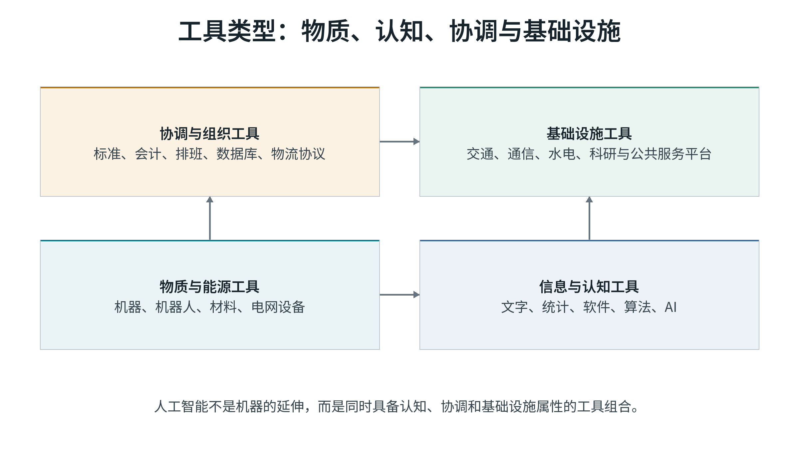
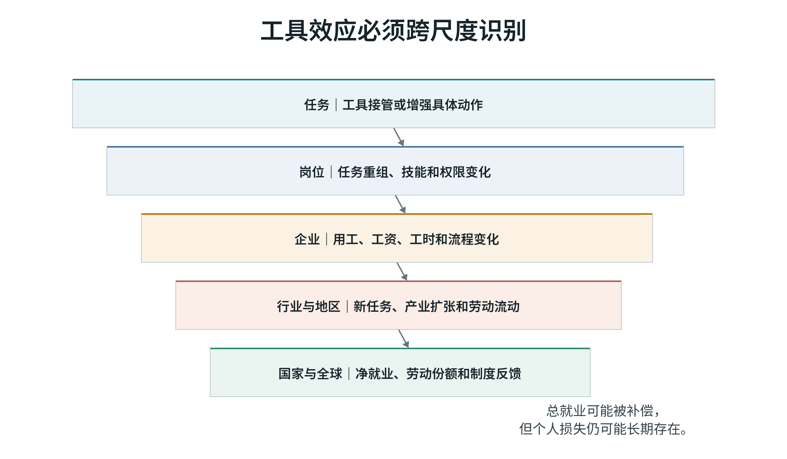
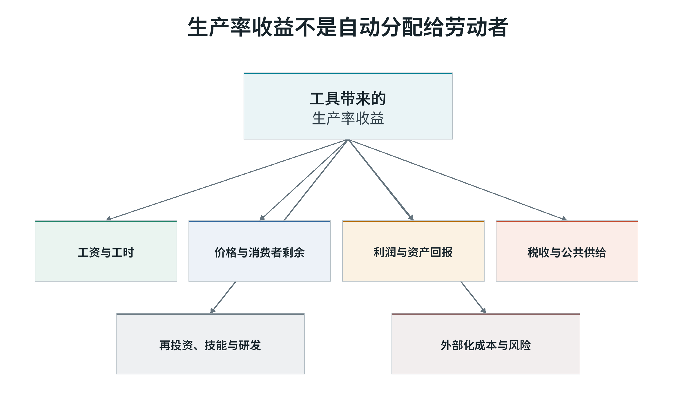
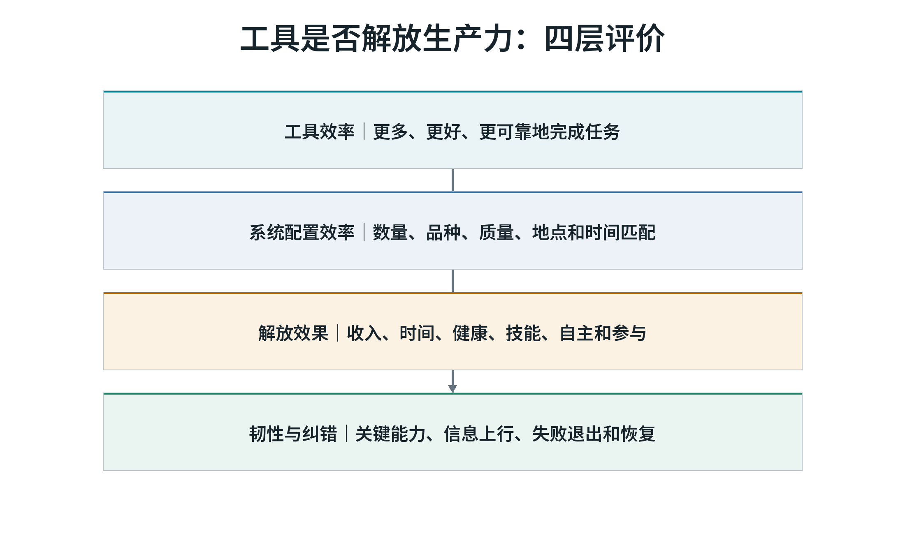
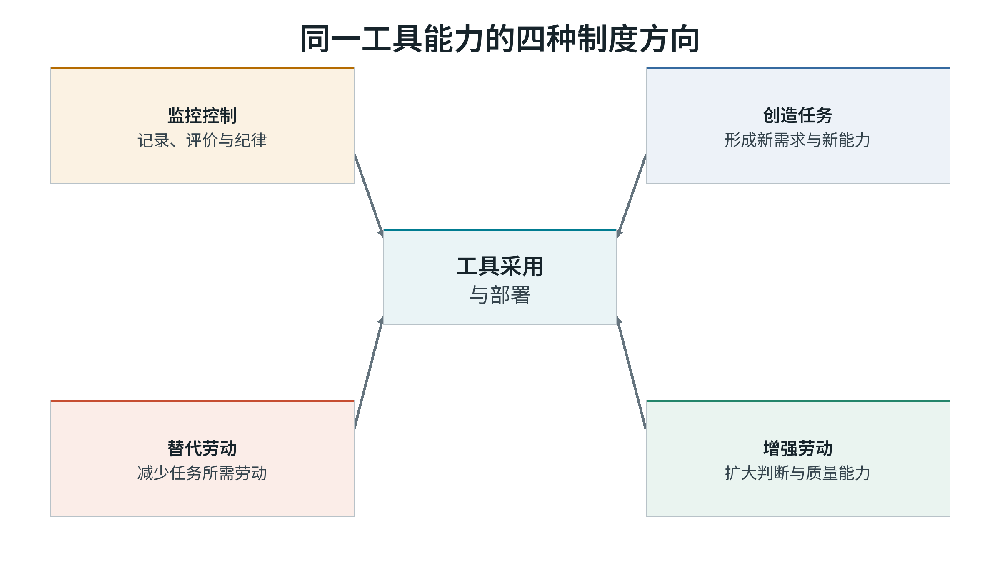

# 第一卷　为什么更强大的工具没有自动带来更多自由

## 本卷导读

工具节省了劳动，节省下来的时间为什么没有普遍成为自由时间？第一卷从机器破坏谈起，考察生产率、技术用途和控制权，为后面的制度比较建立共同的评价标准。

# 作者前言　为什么要追问效率收益去了哪里

我写这本书，源于一个持续很久的疑问：既然每一代工具都能节省一部分劳动，为什么节省下来的时间很少自动变成普通人的自由时间？

蒸汽机、电力、流水线、计算机、机器人、平台和生成式人工智能，各自解决了一批过去必须由人完成的任务。按最简单的想象，完成同样工作所需的人应当越来越少，工作时间应当越来越短，危险的岗位应当逐步消失，人们也应当拥有更多时间照顾家庭、学习、参与公共生活和安排自己的人生。这个方向在局部发生过，却没有成为稳定、普遍的结果。

有些企业用自动化改善了安全和质量，也让劳动者获得更高技能和更稳定的收入。另一些企业把同样的工具用于裁员、降薪、加强监控和压缩岗位。有人获得了新任务，有人失去了旧职业；有些地区形成新产业，有些地区只剩下更难就业的年长工人和被闲置的基础设施。工具的能力相近，结果却相差很大。

这些差异是本书要解释的问题：

> **技术提供可能，制度决定方向；生产率创造收益，控制与分配决定这些收益能否转化为人的自由。**

这个判断要求我们继续追问四件事。谁能够选择技术路线？谁承担采用新工具的风险？谁得到生产率提高形成的收益？受影响的人能否发声、申诉、转换岗位或在必要时退出？如果这些问题没有答案，所谓“技术进步会让大家受益”仍然只是一句未经兑现的承诺。

评价技术，我关心的不仅是产量、速度和成本，还有人们是否少受伤害，是否获得更多时间、技能和选择，以及他们能否约束使用技术的权力。收入、安全、自主和公共知识未必同步改善，评价时需要把这些冲突摆出来。

读者会看到资本、行政机构、专业共同体、劳动者和社区都在选择工具。市场能够发现分散需求、形成价格反馈和组织退出，却容易忽略没有支付能力的人、长期公共知识和不能收费的社会收益。国家和公共机构能够提供普遍权利、长期投资和危机协调，却可能压缩信息、扩大指标考核并让错误退出变慢。专业共同体维护知识标准，也可能形成封闭门槛。劳动者和社区掌握现场知识，却未必拥有决定权。

美国、欧洲、中国和苏联的经验，使我们能够考察不同制度如何发现信息、承担长期风险、分担调整成本和应对危机。比较的落脚点是这些具体安排，以及它们在失败后能否改变。

生产率上升扩大了社会能够支配的资源和时间。新增收益可以用来缩短工时、提高收入、改善安全、支持照护和开放知识；也可能被用于加密考核、扩大监控和集中财富。收益进入哪里，要看权利、风险和分配规则如何安排。

沿着这一问题，全书讨论五件事：

1. 什么条件决定同一种技术产生不同的社会后果？
2. 自动化在什么条件下替代劳动，在什么条件下创造新任务？
3. 市场、公共机构、专业共同体和劳动者各自擅长的发现，怎样进入同一套制度？
4. 集中协调和分散试错分别适合哪些任务和社会状态？
5. 当收入、时间、安全、自主和公共知识无法被压缩成一个数字时，社会怎样判断进步？

我希望这本书推动的，是对技术收益作出更具体的安排：让承担转型风险的人能够分享收益，让受影响者参与决策，也让失败的项目和制度能够被修改或终止。生产力能否改善人的生活，要在这些安排中得到检验。

# 全书导论　节省下来的劳动去了哪里

从蒸汽机、电力和流水线，到计算机、机器人和人工智能，工具不断接管人类的体力与信息处理任务。完成同样的工作所需的劳动减少了，社会也就有了缩短工时、减少危险作业的可能。

这种可能如何兑现，却很不一致。同一项技术可以让工人从危险工序转向设备维护，也可以取消岗位、削弱手艺的价值和议价能力。企业提高了生产率，劳动者可能得到更好的工作，也可能面对更密集的考核。

节省下来的劳动去了哪里？这个问题把技术的能力与人的处境联系起来。

工具改变可完成的任务，制度安排决定采用的目标、决策权、风险和收益归属。从生产率到自由时间，要经过控制与分配这一环。

全书围绕三个层次展开。第一层是技术问题。研发、采购、部署、接口和管理方式会筛选工具方向。工具可以替代劳动，可以增强劳动，可以扩大监控，也可以创造新的判断能力。第二层是制度问题。决定社会后果的，不只是“市场”或“国家”的标签，还包括控制权、信息、风险、分配、发声和退出如何组织。第三层是人的问题。生产率只有在转化为时间、收入、安全、技能、自主、公共知识和真实选择时，才具有解放的意义。

本书以减少不必要的劳动与伤害、扩大人的能力和选择作为评价方向。若一种效率改善要求人们承担无法申诉的风险，就需要重新审视它的代价。收入、时间、安全、健康、生态和公共知识之间的冲突，应当逐项说明。

前言提出的五个问题，将在各卷中逐步展开。第一卷建立评价标准，第二卷考察资本的技术选择，第三卷比较不同制度，第四卷讨论收益和风险的安排，第五卷检验这些安排是否改善了人的生活。

第一部从机器破坏、工厂自动化、平台算法和人工智能出发，解释生产率与人的自由之间的距离。工具完成任务的效率、资源配置、收益分配和纠错能力，需要分别考察。

第二部追问，企业有许多技术路线可选时，哪些路线更容易得到资本。可占有的收益、可计价的回报、投资期限、市场权力和劳动控制共同塑造方向。自动化首先改变任务，继而改变岗位、地区收入和个人职业。工具还会变成管理权，平台评分、设备节奏和绩效算法都会改变劳动者能否申诉和退出。

第三部比较美国、欧洲、中国和苏联如何发现需求、承担长期风险、传递坏消息、分担调整成本和组织危机应对。平稳时期与危机时期的任务不同，同一种制度安排的作用也会改变。

第四部转入制度设计。生产率收益要成为公共能力，需要在技术采用之前安排风险，在设计部署时引入现场知识，在长期创新中承担私人市场难以内部化的不确定性，并在多中心协调中保留边界、共同测度、最低权利和退出规则。这里的关键问题是从“是否采用技术”转向“怎样采用、谁参与、谁受益、失败如何纠正”。

第五部讨论承诺何时值得相信，技术进步是否增加了自由，以及谁能参与评价进步。前四部考察的控制、分配和纠错安排，最终要在人的生活中接受检验。

读者可以按部阅读，也可以把本书当作一套分析工具。每当有人说“技术提高了效率”，我们可以继续追问：效率提高了谁的能力？谁失去了选择？节省的时间去了哪里？风险由谁承担？失败以后谁能要求改变？

# 第一部　为什么更强大的工具没有自动带来更多自由

## 概念说明：为什么本书使用“工具”

机器只是工具史中的一个类别。人类生产力的持续发展依赖累积性的工具系统，而不必然依赖狭义的机器：文字、数字、度量衡、会计、地图、统计、电网、物流、软件、算法和人工智能，都可能在特定制度条件下扩展人类改造物质、处理信息和协调行动的能力。

| 层次 | 定义 | 研究问题 | 例子 |
|---|---|---|---|
| 工具 | 可重复使用并扩展行动能力的人工手段 | 人类能够做什么 | 机器、软件、算法、统计、电网 |
| 工具系统 | 由工具、能源、技能、数据、维护和标准组成的可复制能力 | 能力如何稳定组合 | 工厂体系、云平台、科研基础设施 |
| 组织 | 使用和协调工具系统的具体机构 | 谁在实际部署和维护 | 企业、大学、政府、平台 |
| 制度 | 稳定权利、权限、目标、责任和分配结果的规则与权力结构 | 谁控制、谁受益、如何纠错 | 产权、劳动法、计划、福利、参与制度 |

下文在讨论机器破坏、机器人和机床等历史对象或设备时使用“机器”，并保留“机器换人”“机器学习”等固定名称。涉及文字、统计、软件、算法和基础设施的共同机制时，则使用范围更广的“工具”或“工具系统”。

工具与制度承担不同功能。工具提供行动能力，制度规定谁能够开发、使用、控制工具，以及收益和风险如何分配。工具能力只有通过控制、信息和分配进入社会结果。

### 第一部导言　生产率与自由之间为何还有一道门

工具能够节省劳动、扩大能力，自由时间、安全和选择却未必随之增加。第一部考察两者之间的制度安排。

考察一项工具，需要先弄清它能完成哪些任务，再看谁决定用途、持有数据、承担风险和取得收益，最后追踪工时、收入、健康、技能与自主性的变化。

以下讨论围绕工具与工具系统、组织与制度、工具用途和控制结构展开。这些概念将用于后面的国家比较与制度设计。

## 第一章　工具本应扩展能力，人为何害怕它

机器破坏、工厂自动化、平台算法和生成式人工智能看起来相隔遥远，却反复引出同一组冲突：工具可以节省劳动，也可以改变技能、节奏、监督和谈判力量。如果效率提高本身足以让所有人受益，为什么采用同一种工具的人会得到截然不同的结果？

### 节省劳动需要制度兑现

“工具节省劳动”通常被当作一个技术事实。更准确地说，它是一个关系判断：工具在特定任务上减少了完成既定产出所需的人类劳动，但节省下来的劳动属于谁、以什么形式出现、是否补偿了被替代者，并不由工具单独决定。

同一套设备至少可能产生四种不同结果。

第一，产量不变，工时下降。企业减少劳动时间，或让同一批人承担更少任务。只有当工资、排班和岗位规则同步调整时，这才是真正的劳动节省。

第二，产量增加，总劳动不变。工具提高了单位时间产出，企业继续使用同样多的人，把新增产能转化为市场扩张。工人未必失去岗位，但也没有获得更多自由时间。

第三，产量增加，部分岗位消失。企业用资本接管某些任务，同时保留、扩大或创造其他岗位。岗位总数可能上升，被替代的具体职业仍可能遭受长期损失。

第四，产量增加，劳动强度提高。工具减少一个动作的体力消耗，却通过更少的人、更快的节奏、更严的考核或更高的生产目标，把节省的时间重新填满。

因此，“工具提高生产率”与“劳动者被解放”之间至少隔着三层制度安排：生产率收益如何形成，如何在工资、利润、价格、税收和公共供给之间分配，以及劳动能力如何被重新组织。

产出增加只是评价的起点。劳动者是否受益，还要看分配和工作组织怎样变化。

### 古典政治经济学中的机器悖论

“机器是否伤害劳动”早在古典政治经济学中已经出现。李嘉图最初把机器当作一般资本形式，后来在《政治经济学及赋税原理》第三版“论机器”中作出重要修正：机器可以提高净产出，却可能同时降低对劳动的需求。这一修正没有给出永久结论，却建立了此后争论的基本结构：总产出、净收益与就业分别变化。

马克思把这一问题推进到生产关系。机器的技术能力可以减少必要劳动，但在资本控制下，机器同时被用来延长剩余劳动、增强劳动强度、扩大相对过剩人口，并把技能和过程知识从生产者手中转移给管理者和资本。<super>[45]</super> 因此，机器本身的生产力与机器采用的阶级形式必须分开分析。这个区分直接预告了本书后面的三层生产力标准。

凯恩斯在 1930 年预见到，如果物质稀缺下降，社会的主要问题将转向如何分配自由时间、如何在不再以工作为中心的世界中维持意义和公平。<super>[46]</super> 他指出生产力与制度目标之间存在社会选择。

熊彼特则强调创新的两面性。创造性破坏提高长期能力，也会摧毁旧企业、旧技能和旧社区。<super>[47]</super> 这与当代机器人研究中的“总就业补偿与个人损失并存”并不矛盾。创新和破坏在同一过程中共同出现，只是在不同时间、空间和群体上的表现。

波兰尼提供了第三个维度。劳动、土地和货币若被当作纯粹商品，市场扩张就会触发社会保护的反向运动。<super>[48]</super> 在工具采用中，这意味着劳动者的技能、健康和社区并非可以无成本重新配置的投入品。若市场和行政系统只计算设备成本与产出，而不承担社会和生态成本，所谓效率就是局部核算。

这些经典讨论把问题引向工具的采用条件：谁支配新增收益，谁承担调整成本，劳动者的生活与再生产如何得到保障。

### 机器破坏反映权力与生计冲突

把反对机器的人称为“卢德分子”，已经成为一种常见的贬义表达。它暗示反对者目光短浅，看不到长期总收益，只保护即将消失的旧岗位。历史研究给出了更复杂的图景。

霍布斯鲍姆把英国机器破坏理解为一种集体谈判方式。工人攻击的并非一切机械知识，而是雇主利用机器压低工资、取消习惯权利、雇佣低技能替代者并改变谈判力量的具体做法。<super>[1]</super> 汤普森和兰德尔的研究进一步把机器破坏放回社区习惯、雇佣关系和政治压制之中，说明行动目标通常是恢复习惯权利和限制单方面权力，而不是拒绝所有技术。<super>[60-61]</super> 莫基尔则从有用知识和启蒙经济解释英国为何能够持续产生技术突破，同时提醒制度收益需要在不同社会群体之间重新分配。<super>[64]</super> 近期关于手工纺纱的研究记录了机械化造成的长期职业损失。<super>[2]</super>

这里的冲突有两个维度。

第一个维度是分配。技术带来的总收益可能为正，但损失集中在特定地区、技能和年龄群体。如果收益流向所有者、消费者和高技能岗位，损失却集中在被替代者身上，那么反对采用方式就是理性的风险反应，而不是把总产出误认为个人收入。

第二个维度是权力。工具改变的不只是任务，还改变谁掌握工艺知识、谁决定节奏、谁有资格监督、谁能够拒绝不合理要求。工人保卫的往往不是某个动作的旧做法，而是对工作过程的最低限度的控制。

当代调查得到相近结果。当受访者认为自动化风险高、社会保障弱、利益不能共享时，更可能支持限制或补偿政策；当风险与收益被视为共同承担时，工具接受度会上升。<super>[3]</super> 中国制造业研究还发现，“退出选项”很重要。认为自己离开现有岗位后没有更好选择的人，更容易对自动化感到不安全；部分工人同时承认自动化可以减轻体力负担、改善企业前景。<super>[26]</super>

所以，抵制通常针对一种特定的技术使用方式：风险由自己承担，收益由别人取得，决定过程没有自己的位置，承诺又没有可执行的保障。

### 同一技术在不同尺度上给出不同答案

自动化的就业效果随观察尺度而变化。企业、行业、地区和国家的就业数字，回答的是不同问题。

任务模型提供了一个基本框架。自动化把某些劳动任务转交给资本，产生替代效应；生产率提高可能降低价格、扩大需求；与此同时，新任务又会重新创造对劳动的需要。<super>[4]</super><super>[72]</super> 更早的任务研究还说明，技术变化会改变不同技能在常规、抽象和互动任务中的相对价值，净就业因此是这些力量共同作用的结果，而不是“工具必然抢走多少岗位”的固定常数。<super>[71]</super><super>[73-74]</super>

经验研究也呈现尺度差异。美国通勤区研究发现，机器人暴露较高的地区出现就业人口比和工资下降，冲击尤其落在常规任务群体。<super>[5-6]</super> 德国制造业就业也受到机器人负向影响，但服务业扩张在很大程度上形成补偿，原有制造业工人更多留在企业内部，调整压力转移到年轻进入者和工资结构上。<super>[7]</super> 中国研究则同时出现企业劳动需求下降、行业和城市层面的产业扩张补偿，以及不同所有制、融资约束和地区结构下的异质结果。<super>[16-22]</super> 生产率技术的扩散还可能存在延迟：无形资产、组织重构和技能互补需要时间，短期生产率统计无法立即显示全部收益或损失。<super>[75]</super>

这些发现并不互相否定。一家企业减少用工，可能伴随着上下游企业扩张；一个制造业岗位减少，可能由一个服务业岗位补上；宏观就业没有下降，也不代表被替代者获得了同等收入、保障和职业尊严。相反，城市净就业增加，也不能证明特定工人没有承担不可逆的技能和身份损失。

由此可以得到第一条方法论规则：

> 工具冲击必须分别记录任务、岗位、企业、行业、地区和个人结果。平均值的符号不能替代受损分布。

公式 2 把劳动需求变化拆成替代、恢复和生产率三部分。ΔNdisplace 是工具接管任务造成的替代，ΔNreinstate 是新任务重新带回劳动的效果，ΔNproductivity 是生产率和需求扩张对劳动需求的间接影响。三者符号可以不同，任一项都不能代表全部结果。

### 从机器人到生成式人工智能：先改变任务，后改变总体指标

人工智能与机器人冲击不会只表现为“某个岗位仍然存在或消失”。企业往往先改变职位描述、技能组合和招聘标准，再逐步改变实际人数。美国在线招聘岗位研究发现，在生成式人工智能扩散初期，企业已经调整了部分岗位的技能要求和任务构成，而宏观就业总量未必同步变化。<super>[8]</super> 宏观估计也提醒，AI 的生产率收益、任务替代和劳动份额效应在总量上可能远小于媒体叙事，但在具体职业和组织内部可能非常显著。<super>[87]</super>

这带来两个重要后果。

其一，技术风险可能在失业发生之前就已经出现。劳动者看到职位内部的任务被拆分、经验价值下降、晋升路径变窄，即使短期内仍保有工作，也会对技术产生防御性态度。

其二，用失业率判断技术影响会太迟，也会太窄。工作是否变得可控、可学习、可积累、可持续，属于生产力解放的问题，却在失业统计之外。自动化还可能改变资本与劳动的收益份额，并通过资产价格扩大财富不平等，即使总产出的净效应不明确。<super>[77-79]</super>

技术型工作不安全感研究进一步区分了岗位替代威胁与工作内容转型压力。中国证据还提示，机器人采用可能改善部分体力健康，同时加重心理压力和群体不平等，因此需要把健康拆成多个维度观察。<super>[23-25]</super>

劳动过程理论提醒我们，技术从来不只是投入替代。它还可能拆分技能、把判断编入流程、将监督权集中，并规定何种行为可以被记录和评价。<super>[9-10]</super> 三家中国“机器换人”工厂的社会学研究显示，在政策、资本和劳动力市场共同推动下，由企业单方面主导的工具升级可能减少执行性岗位、加强流程控制，而劳动者很少参与路线选择。<super>[10]</super>

自动化并不必然导致劳动降级；更重要的是，工具形式与组织方式共同决定结果。工业机器人可以完成危险、重复的工作，也可能把工人绑定到更快的生产节拍；生成式工具可以增强普通人的表达和编程能力，也可能被用于压低创作报酬、扩大审查或取代初级学习岗位。工具能力相同，制度用途不必相同。

任务是技术影响的第一层，岗位是第二层，企业和行业是第三层，地区和国家是第四层。短期的任务生产率提高不足以单独推出岗位福利改善，因为企业还可能改变招聘标准、晋升阶梯、工作强度和监督方式。生成式人工智能研究目前能较清楚地识别写作、编程和服务任务的生产率变化，却尚不足以确认长期岗位数量、技能形成和收入分配结果。<super>[76]</super>

### 为什么“以后会更好”需要实际保障

支持工具转型的常见论证是：短期会有损失，但增长最终会创造新岗位和新收益，因此应当接受调整。这个论证在长期总量层面可能成立，却不能自动解决当期政治经济问题。

未来补偿要能够改变今天的行动，需要同时满足几个条件。

1. 收益确实出现，不停留在预测中。
2. 受损者能够识别并实际取得其中一部分。
3. 补偿程序可执行，不依赖企业或政府临时改变承诺。
4. 受损者有能力等待，包括储蓄、社会保障、住房、医疗和家庭支持。
5. 新岗位与旧技能可衔接，或者存在可信的再训练和转岗路径。
6. 受影响者能够参与规则设计，并知道失败时会怎样处理。

缺一项，未来收益的可信度就会下降。缺得越多，“先增长、后分配”就越像要求当前受损者替别人承担转型风险。

劳动者对工具的信心，往往来自可核验的制度经验：收益规则是否兑现，就业保障能否取得，参与和申诉是否有效。积极的宣传很难代替这些经验。

### 为什么本书比较机制组合

工具恐惧把两种制度都推到了检验台上。

在资本控制下，工具选择主要由所有权、预期回报、竞争压力和管理权推动。这个体系可能迅速发现可变现需求、组织试错并扩张成功技术，却也可能忽略没有支付能力的社会需要，把转型损失外部化给劳动者和地区，并因金融期限和市场权力而扭曲研究方向。

在行政控制下，工具选择可以服务于工业化、国防、教育和基础设施等长期目标，并集中资本完成互补投资。这个体系却可能让数量指标替代真实目的，让上级目标压过基层信息，使企业隐藏产能、囤积投入、回避创新，并让失败项目因政治声誉而难以退出。

两种控制结构都能组织生产力，也都存在能力边界。全书不会问“市场好还是计划好”，因为这个问题把所有权、竞争、公共科研、福利制度、行政能力和劳动者参与压缩成两个标签。更可检验的问题是：

> 在具体任务和社会状态下，哪一种控制结构主导工具选择，它拥有什么信息和执行能力，谁承担成本，谁取得收益，失败能否被发现和纠正？

工具恐惧揭示了制度如何选择工具方向。

如果某项技术能够节省劳动，却让损失集中于缺少退出选项的人，让收益流向控制技术的人，让承诺无法执行，让受影响者不能发声，那么抵制就是分配冲突的表现。它没有证明技术有害，却证明了“技术潜力自动等于共同解放”这一判断不成立。

后续分析必须完成三次拆分：

1. 把“技术进步”拆成具体任务、具体用途和具体受益结构。
2. 把“就业影响”拆成企业、行业、地区和个人尺度。
3. 把“接受技术”拆成对未来收益、风险承担、发言权、退出选项和纠错能力的综合判断。

只有完成这三次拆分，才能进入下一章的评价问题：什么才叫生产力得到解放。

## 第二章　效率提高以后，谁得到更多时间？

生产率上升常被当作进步的同义词。但产量、单位工时、系统可用能力和人的自由时间分属不同层次；企业报表变好，不等于劳动者拥有更多可支配时间。

### 生产力至少有四种不同含义

“生产力提高”在日常讨论中经常被当作一个指标。实际上，至少存在四种彼此相关的概念。

第一是总产出。它回答一个经济生产了多少商品和服务。总产出可以因更多劳动、更多资本、更多资源投入、价格变化或借债消费而增加，因此不能单独证明效率提高。

第二是劳动生产率，通常以单位劳动投入的产出衡量。它回答每单位劳动时间生产了多少产出。劳动生产率上升可能来自技术进步，也可能来自资本加深、工人技能提高、企业规模扩大，或者把低生产率活动转移出去。

第三是全要素生产率。它试图衡量不能由已计量资本和劳动投入解释的产出增长，常被视为技术、组织和管理改善的近似指标。它比劳动生产率更接近工具效率，但仍会受到计量误差、产品质量、无形资本和需求波动影响。

第四是人的解放效果。它回答生产力收益是否转化为更少必要劳动、更高收入和保障、更好的健康与安全、更强的学习能力、更大的自主性，以及更多可由公众共同使用的知识。

这四层不是同义词。总产出增长可以伴随工时延长、劳动份额下降和环境退化；劳动生产率提高可以让股东和消费者受益，而工人失去岗位；全要素生产率提高也可能来自裁员和压低维护，而不是可持续创新。

因此，本书采用三层评价标准：

> 工具效率判断投入与产出的关系；系统配置效率判断资源是否到达真正需要它的用途；解放效果判断技术收益是否扩大人的能力与自由。

### 工具效率：产出规模与任务质量

工具效率关心给定投入能否生产更多、更好、更可靠的产品。它是必要信息，却有三个边界。

第一，产出的质量、耐久性、安全性和使用价值必须进入计量。若企业通过降低材料标准、缩短产品寿命或把维修成本转给消费者来提高当期产量，账面效率可能掩盖真实能力下降。

第二，投入必须完整。若生产率提高依赖无报酬加班、过度开采、污染外部化或基础设施补贴，就需要把这些成本重新纳入核算，而不能把成本转移称为效率。

第三，效率是任务和边界条件下的关系。一个系统在高负荷、单一品种和稳定需求下效率很高，可能在需求变化、设备故障或品种切换时极其脆弱。平稳期的局部最优未必等于危机中的系统能力。

工具效率因此不能被否定，也不能被神化。没有效率，社会就缺少扩大福利的物质基础；只有效率，社会却可能把更多产出集中给少数控制者，同时消耗掉劳动者和生态系统。

### 系统配置效率：生产表平衡与需求满足

系统配置效率关心资源是否从低价值用途转向高价值用途，投入端与需求端能否在数量、品种、质量、地点和时间上匹配。

这一层常被总量指标遮蔽。一个计划可以完成钢产量，却缺少所需规格的零部件；一个市场可以生产大量商品，却无法为低收入者提供住房和医疗；一个平台可以提高匹配速度，却可能通过垄断抽成把生产者剩余转化为平台租金。三者的共同点是：总量活动存在，端到端需求仍未满足。

系统配置效率还包含时间维度。投资今天的基础设施、教育和科研，可能减少未来瓶颈；企业今天削减维护和培训，则可能把成本推迟给明天。只看当期价格和利润，容易把未来能力当作免费资源。

因此，判断技术是否提高系统配置效率，需要追问四个问题：

1. 产出是否到达真正需要它的人和用途？
2. 品种、质量和时间是否匹配，而不只是数量平衡？
3. 今天的收益是否以透支未来能力为代价？
4. 资源获取由价格、计划、权力还是关系决定，谁能纠正错误配置？

### 解放效果：节省下来的时间去了哪里

如果工具减少了必要劳动，解放效果的第一项指标就是时间。但工时下降不会自动发生。企业可以用节省的时间扩大产量，管理者可以提高任务密度，消费者可以形成新的必要支出，劳动者也可能因住房、教育和医疗成本而维持长工时。

工业革命提供了一个重要历史提醒。长期生产率跃升与生活水平、工时和劳动条件的改善并不同步，部分群体经历了长期停滞甚至恶化。<super>[43-44]</super><super>[62]</super><super>[81-82]</super> 工业革命创造了前所未有的生产能力，同时说明生产力增长与劳动者福利之间存在制度和分配距离。

解放效果至少包括六个维度。

#### 收入与安全

技术收益是否转化为可支配收入，是否减少失业、疾病和老年风险，是否让转型损失可以被保险，而不是全部由个人承担。

#### 自由时间

节省的劳动是否变成更短工时、更稳定的排班、更充分的休息和照护时间，而不是更高的产出目标或随时待命。

#### 健康与安全

危险、重复和有害任务是否减少；心理压力、监控强度和工伤是否同步下降；技术是否把风险从正式工人转移给外包者、平台劳动者或供应链上的隐蔽劳动。

#### 技能与自主

劳动者是否获得更丰富的判断、学习和解决问题能力，还是只执行被系统分配的碎片任务。技能是否可迁移，经验是否仍被承认。

#### 参与和尊严

受影响者能否对工具采用、工作设计和收益规则表达意见；其异议是否会被记录、回应和申诉，而不是只在执行阶段被要求适应。

#### 公共知识与代际能力

技术收益是否扩大公共知识、公共卫生、教育和基础研究，是否为未来保留选择空间，而不是用短期收益锁定高成本、难退出和生态破坏的路径。

这六项不能被压缩成一个综合指数。它们之间可能存在真实冲突，例如某项技术提高收入却增加监控，或缩短工时却削弱技能积累。价值排序需要公开说明，不能由研究者用一个神秘的总分替社会决定。

### 能力、自由与社会再生产

把“解放效果”写成六项指标仍不够，还需要说明其理论根据。

森把发展理解为实质自由的扩大，而不只是收入和商品数量的增长。一个人是否能够获得教育、参与政治、选择职业、保持健康并参与社会，构成其可行能力。<super>[54]</super> 努斯鲍姆进一步强调身体完整、社会归属、实践理性和尊严等核心能力，并指出这些能力不能被一个收入指标完全替代。<super>[55]</super>

这对技术评价有三个直接含义。

第一，技术收益必须转化为实际能力，而不只是资源总量。若医疗、教育和照护成本上升，工资增长可能没有扩大真实自由。

第二，参与选择本身属于能力。工具采用如果只提供事后补偿，却禁止受影响者参与规则选择，解放效果就是不完整的。

第三，价值不可完全通约。更短工时、更高收入、更大自主性和更多公共知识之间存在冲突，不能假定一个隐藏的世界价格能够把它们自动换算。

赫希曼的“退出、发声与忠诚”补充了动态机制。劳动者若无法退出，又缺少有效的发声渠道，只能在忠诚被消耗后采取消极规避、集体抵制或政治反对。<super>[56]</super> 工具接受因此不是单纯偏好问题，而是受影响者是否拥有改变规则的手段。

还须加入社会再生产和生态边界。若工具减少工厂劳动，却把照护、清洁、平台待命和家庭管理费用留给女性、移民或低收入家庭，社会总工作量并未按同一比例下降。<super>[67-68]</super> 若生产率提高依赖不可再生资源、碳排放或生态修复成本的后移，工具效率也可能只是时间上的转移。

由此，第二章对“解放”的定义必须包含三层限制：

1. 个人实际能够选择什么；
2. 风险、照护和生态成本是否被重新分配或外部化；
3. 受影响者能否参与定义效率、收益和退出规则。

### “节省劳动”为什么可能变成“劳动强化”

技术节省的是一项任务，社会时间仍取决于制度安排。

设想一个岗位原来由十人完成，其中三项任务实现自动化后，企业只保留六人。若产量不变、工资和工时改善，这是一次劳动节省。若企业提高目标，让六人完成原来十二人的产出，并借助系统持续记录速度和错误，那么剩余劳动者承担了更高强度和更强监督。

劳动强化可能通过至少四种机制出现。

第一，**节奏由设备设定**。传送带、算法排班或实时绩效系统缩短了劳动者的自主调整空间。

第二，**目标随生产率上调**。节省下来的时间没有被保留，而是立即转化为更高指标。

第三，**监控范围扩大**。数字系统把原本难以计量的动作、情绪、位置和社交关系纳入考核。

第四，**风险向下转移**。平台化、外包和供应链分包让核心企业取得效率收益，却把需求波动、设备成本和法律责任推给更弱的参与者。

因此，判断工具是否解放劳动，不能只比较自动化前后的单位产出，还要比较同一批劳动者的工时、节奏、权限、技能、健康、收入和申诉能力。

### 收益分配取决于制度安排

生产率收益有若干可能去向：工资、利润、消费者价格下降、税收和公共服务、研发再投资、债务偿还，或者资产价格。收益分配由制度规则决定。

劳动收入份额下降可能意味着资本替代增强，也可能是统计口径、行业结构、全球化和垄断利润变化的结果。<super>[80]</super> 中国机器人研究在不同层级给出不同结论：企业层面可能观察到劳动份额下降，城市或产业结构转型研究则可能出现补偿甚至上升，但制造业、特定地区和弱服务业基础地区仍可能受损。<super>[16-22]</super>

这说明平均劳动份额也不够。必须拆成：

- 谁的收入变化，谁只是换了一份工作；
- 谁的工时和保障变化；
- 企业利润、消费者剩余和公共收入变化；
- 地区之间的转移和补偿；
- 未被纳入正规劳动的照护、平台和供应链工作。

市场并不自动保证技术收益流向最需要的人；行政分配也不自动保证资源到达基层。两者都需要具体规则。若收益分配完全依赖事后慈善、财政余量或政治承诺，被替代者面对的就不是收益，而是风险。

### 评价必须跨过“总产量幻觉”

一个社会可以同时出现以下现象：企业生产率上升，总产出增长，部分劳动者收入下降，区域差距扩大，公共科研获得更多数据却更依赖商业平台，消费者获得便宜服务但生产者失去议价能力。

若只用 GDP 或平均工资，这些变化会被压缩成一个方向。若只用失业率，技能降级、劳动强化和自主性丧失又会消失。若只用主观满意度，既可能受预期和身份影响，也可能忽略客观权利和长期能力。

合理做法是建立一个可审议的仪表盘：

| 评价层 | 理论基础 | 核心问题 | 最低指标组 | 典型误读 |
|---|---|---|---|---|
| 工具效率 | 生产率核算 | 给定投入是否生产更多、更好、更可靠 | 单位投入产出、质量、可靠性、能源与材料使用、维护成本 | 把产量增长当成工具效率 |
| 系统配置效率 | 资源配置与信息理论 | 资源是否到达匹配的用途和时间 | 供需匹配、品种与交付、瓶颈、库存、未来能力、公共需要 | 把生产表平衡当成需求满足 |
| 解放效果 | 能力方法与自由理论 | 技术收益是否扩大人的能力与自由 | 工时、收入、保障、健康安全、技能自主、参与、公共知识 | 把工资增长当成全部自由 |
| 韧性与纠错 | 系统与制度反馈 | 冲击发生时能否维持关键能力并修正错误 | 关键供给、组织冗余、信息上行、退出速度、恢复时间、长期疤痕 | 把平稳期效率当成危机能力 |

这四层不能互相替代。高产出不能抵消失去自由，高保障也不能抵消持续错配，平稳期的效率更不能替代危机中的生存能力。

#### 测量效度与公开规则

指标体系必须接受三项检验。

第一，**构念效度**。工时下降可能是因为经济停滞，劳动份额上升可能是因为统计口径变化，健康改善也可能来自职业转移而非技术。指标必须与理论机制对应。

第二，**尺度一致性**。企业、行业和国家的劳动份额需要分别核算。个体、家庭和工作岗位的时间也不能用同一平均工时替代。

第三，**价值透明**。若研究者最终必须做一个综合判断，应公开权重、替代方案和敏感性结果，而不是把规范性排序隐藏在技术指数中。

使用综合指标时，应说明权重、受影响群体和可能改变判断的证据。综合结果可以帮助比较，但各项指标之间的冲突仍需公开。

生产力既涉及物质生产能力，也涉及能力如何被组织、如何影响人的生活。分层评价，可以保留物质约束，同时追踪收益与代价。

判断一项技术是否解放生产力，至少要回答：

1. 它是否提高真实的工具效率和系统配置效率？
2. 节省的劳动和增加的收入由谁取得？
3. 工时、健康、安全、技能和自主性发生什么变化？
4. 受影响者能否参与规则选择？
5. 当工具路线错误时，社会如何发现、纠正和退出？

这些问题将贯穿对资本控制、行政控制和混合制度的所有分析。

## 第三章　技术有真实能力，但用途由制度选择

机器人、软件和算法都有真实能力，却没有固定用途。同一台设备可以承担危险工序，也可以加强监控和替代熟练判断，选择发生在设计、采购和组织规则之中。

### 技术能力与用途选择分属两层

机器、药物和算法各有能力与限制。工业机器人只能完成特定动作，统计方法依赖数据中的信息，电池化学也受成本和安全约束。讨论技术用途的制度选择，要从这些约束出发。

这里需要区分三种“中性”。

第一，**物理意义上的可替代性**。在给定任务和生产函数中，一种投入可以替代另一种投入，工具本身具有特定功能和精度。

第二，**设计意义上的开放性**。同一技术能力可以有不同接口、权限和用途。算法可以辅助工人判断，也可以单方面分配任务；自动化可以减轻重复劳动，也可以把个人经验编入仅供管理层使用的模型。

第三，**制度意义上的选择**。谁提出目标、谁资助研发、谁决定部署、谁取得收益、谁承担风险，这些不由技术物件自动决定。

技术提供一组真实的可能，也排除另一些可能。制度通过目标、资金、权限和收益规则，在可行范围内选择并固定用途。

### 从技术决定论到社会形塑与定向技术变革

工具方向为何会被制度筛选，需要理论解释。

技术决定论把技术变化视为近乎自主的力量，社会只能适应其结果。该观点捕捉了技术扩散的强制性：企业若不采用具有成本优势的系统，可能被竞争者淘汰。但它无法解释相同技术能力为何在不同组织中选择不同权限、任务组合和收益规则。

社会建构论强调相关群体的解释、争论和稳定化过程。平奇与比克尔说明，人工物的稳定形态来自社会群体对问题和解决方案的竞争性定义。<super>[51]</super> 温纳则提醒，社会建构视角不能把权力差异抹平，因为某些设计会排除特定政治安排。<super>[50]</super> 诺布尔对美国数控机床的经典研究显示，工具路线与技能控制、军方采购和管理目标相互作用，而不是只由最高效率决定。<super>[49]</super>

组织研究进一步说明，技术嵌入组织的规则和权力。奥利科夫斯基提出技术的二重性：行动者在使用中构成技术，技术规范又反过来构成行动。<super>[52]</super> 芬伯格把这种关系推进为技术代码与民主合理化，认为设计可以排除某些社会价值，也可以被受影响者重新打开。<super>[53]</super>

定向技术变革和诱导创新提供经济学补充。技术进步并非完全外生地只提高一种要素效率，而是会回应相对价格、市场规模、制度激励和可占有收益。<super>[69-70]</super> 例如，劳动力昂贵、能源便宜和军事采购可能共同推动不同工具路线。公共采购、标准和基础研究又会创造新的方向约束。

阿西莫格鲁与约翰逊进一步强调，工具方向不是自动共享繁荣的进程，而是不同社会群体围绕愿景、租金和权力持续争夺的结果。<super>[86]</super> 这与 STS 的组织研究互补：前者解释宏观激励，后者解释技术如何进入组织并稳定成规则。

技术能力与制度选择的关系，可以概括为：

> 技术能力设定可能边界，制度通过融资、价格、产权、组织权、标准和收益规则选择并稳定其中一条路线；采用后的反馈又改变下一轮选择。

### 四项不同的工具方向

为了比较制度，本书把工具路线区分为四类。这些功能方向可以同时存在。

#### 替代劳动

技术接管原本由人完成的一组任务，减少完成既定产出所需劳动。替代可以是完全取消岗位，也可以是停止招聘、自然减员、拆分任务或转而使用外包和零工。

替代并不天然有害。危险、单调和损害健康的工作应当被优先替代。但如果替代速度快于工人转岗、社会保障和新任务形成，损失会集中爆发；如果替代收益只归资本，工具效率提高也不会自动改善被替代者生活。

#### 增强劳动

技术提高劳动者处理复杂任务、学习和判断的能力。增强型路线通常让劳动者保留关键决策、获得更高信息质量、减少重复操作，并把新旧技能连接起来。

增强也可能被重新定义为更高负荷。若工具只是让一个人做原先两人的工作、取消学习阶段、要求随时在线，名义上的“辅助”就可能成为劳动压缩。

#### 监控与控制劳动

技术记录行为、评估绩效、分配任务、限制权限，或把基层知识转化为管理资产。算法管理常处于效率和控制的交界：它可以减少任意排班，也可能把不会申诉的评分变成新的纪律机制。<super>[65-66]</super><super>[88-89]</super>

控制型技术不一定降低总产量。相反，它在短期可能提高执行一致性、减少盗窃和管理成本，同时产生压力、规避、低信任和隐性知识流失。

#### 创造新任务与新能力

技术不仅替代旧任务，也创造以前不存在或过去不可行的任务。新任务可以来自互补设备、维护、设计、服务、照护、科研和新型公共需求。

但新任务不会自动匹配旧工人。企业若把新岗位设在其他地区、要求不同教育或使用更年轻的劳动力，宏观新增就业就无法补偿具体人的损失。

一项机器人项目可能同时替代搬运、辅助质检、监测流程并创造维护岗位。评价时需要逐项追踪任务和权力的变化。

| 工具方向 | 主要效率逻辑 | 主要控制效果 | 必须追问 |
|---|---|---|---|
| 替代劳动 | 降低单位劳动成本，提高一致性 | 资本接管任务，削弱特定技能议价 | 节省的工时和收益去了哪里 |
| 增强劳动 | 扩大判断、质量和处理范围 | 劳动者是否保留关键权限 | 是提高能力还是提高负荷 |
| 监控与控制 | 提高执行可见度和响应速度 | 信息、评价和惩罚权集中 | 申诉、隐私和错误纠正如何安排 |
| 创造新任务 | 形成互补岗位和新需求 | 新任务由谁定义、谁能够进入 | 旧劳动者能否实际转岗 |

### 工具方向的操作化

四类方向不能只靠研究者的解释性判断。为了避免事后叙事，应把它们拆成可观察指标。

| 方向 | 任务指标 | 权力指标 | 分配指标 | 反例风险 |
|---|---|---|---|---|
| 替代劳动 | 岗位任务被设备接管的比例 | 采用决策由谁作出，替代速度是否可协商 | 节省工时、工资、利润和就业如何变化 | 企业减员可能被新任务抵消 |
| 增强劳动 | 判断、学习和质量控制是否扩大 | 工人是否保留关键权限和修改能力 | 技能溢价、培训成本和负担如何分配 | 辅助工具也可能提高负荷 |
| 监控与控制 | 任务分配、评价和纪律的自动化程度 | 数据、参数、申诉和解释权归谁 | 监控收益与隐私、健康成本如何分摊 | 透明评价也可能改善公平 |
| 创造新任务 | 新任务数量、任务复杂度和互补性 | 新任务由谁定义，谁能进入 | 新旧岗位工资、技能和保障差异 | 宏观新岗位不一定匹配原工人 |

操作化需要至少四种数据：设备功能与软件权限、任务和岗位变化、劳动者权利与申诉记录、收益和风险分配。只有设备安装量，无法判断一项技术是增强还是控制。

这一定义还要求记录反事实。若没有采用该技术，企业可能通过重新设计任务、增加人员、提高安全标准或改变产品组合解决问题。把工具采用前后的结果全部归因于机器，会把组织、市场和管理变化误写成技术效应。

### 工具路线在哪些节点被选择

工具方向在研发、采购、部署和使用的一连串决定中逐渐形成。

1. **问题选择**：研发和采购试图解决谁的问题，是提高管理控制，减轻劳动，扩大公共能力，还是只是降低工资成本？
2. **融资期限**：项目可以等待多久，失败由谁承担，收益能否被项目发起者占有？
3. **设计和权限**：系统向谁提供信息，谁可以修改参数，工人是否有解释、申诉和拒绝的权限？
4. **采购和标准**：企业、政府或平台采用什么验收标准，是否把安全性、互操作、能耗和劳动影响写入合同？
5. **部署速度**：是一次性全面替换，还是分阶段试验、评估和修正？
6. **劳动组织**：谁接受培训，谁失去经验价值，新任务如何分配，绩效目标是否同步调整？
7. **收益规则**：生产率收益如何在工资、工时、价格、公共收入、再投资和所有者回报之间分配？
8. **退出和替代**：失败设备、失败算法和失败项目如何停用，受影响者如何迁移？

只要这些节点由单一控制者决定，工具选择就可能非常高效，也可能非常封闭。高效是因为命令链短、决策快；封闭是因为基层信息、受影响者风险和被忽略的替代路线难以进入决策。

### “能做什么”与“值得做什么”

技术可能性与社会价值分别判断。两者之间有四种典型偏差。

第一，**可占有偏差**。容易收费、容易专利化、容易转化为平台租金的方案，比开放知识、公共健康和生态修复更容易获得私人投资。

第二，**可计价偏差**。具有市场价格的活动容易被纳入回报计算，照护、社区知识、生态稳定和审慎避灾常被低估。

第三，**控制收益偏差**。若技术的主要收益是让管理者更容易监督和控制，即使它不一定减少社会总成本，也可能被企业采纳。

第四，**短期收益偏差**。若决策者只承担当期成本、未来损失可以外部化，训练数据、设备寿命、安全和维护就会被推迟。

这些偏差不意味着所有工具选择都应交给公共计划。公共机构也会被政治目标、部门利益和指标竞争扭曲。它们意味着不能把“有人愿意投资”直接等同于“社会应当优先发展”，也不能把“技术已经能够实现”直接等同于“现在值得全面部署”。

### 路径依赖：技术一旦被选择，选择空间会缩小

工具路线会形成反馈。

企业购买一套设备后，需要配套培训、维修、数据和流程；工人调整技能；供应商形成专用能力；法规和行业标准围绕既有系统建立。最初的选择因此逐渐变成下一次选择的条件。

路径依赖有正面和负面两面。正面是学习、规模经济和基础设施共享；负面是旧路线锁定、转换成本上升、替代方案被排除。一个国家若把大量研发、教育和基础设施投向单一技术体系，可能获得快速扩张能力，也可能在环境、需求或外部约束变化时难以转向。

评价工具路线，还要考察试验、互操作和退出空间。系统能否及时发现失败并以较低成本转向，决定了它的韧性。

### 从“用了多少设备”转向“工具被用来做什么”

现有机器人研究常以设备数量、进口量或行业渗透率作为工具暴露指标。这些指标适合研究就业和工资冲击，却不足以识别工具方向。

同样数量的机器人可以在不同工厂中用于不同目的：

- 替代危险搬运，还是替代整个质检岗位；
- 给工人提供辅助信息，还是把任务分配权交给算法；
- 缩短换线时间，还是减少工人自主调整；
- 将节省工时转为工时下降，还是转为更高目标；
- 让工人参与调试，还是把经验抽离为工程师和管理层资产。

识别工具方向，需要记录设备权限、任务重组、培训、绩效压力、工时、技能可迁移性和收益分享。设备数量可以衡量采用规模，这些记录才能说明它怎样改变劳动。

技术路线同时受物理能力、产权、融资、设计、采购和组织权影响。用途的选择因此包含制度选择。

控制者也未必能实现预定意图。意外后果、劳动者的规避与再解释，以及组织中的路径依赖，都可能改变结果。制度分析需要同时考察设计目标和实际使用。

这些选择由资本所有者、管理者、行政机构、专业共同体、劳动者和用户作出。第四章将考察他们如何分配决定权。

## 第四章　谁在决定工具怎么被使用？

资本、行政机构、专业共同体和劳动者都能提供能力与知识，也都能形成盲点和控制。真正的问题是，谁拥有决定权，谁承担风险，坏消息能否上行。

### 为什么需要控制结构

“市场配置资源”与“政府配置资源”都太抽象。市场中存在权力，政府也有多重目标。技术由谁选择、用什么信息判断、收益归谁，取决于更具体的控制结构。

本书区分四种机制：

1. 资本控制；
2. 行政控制；
3. 专业共同体控制；
4. 劳动者和受影响者参与。

资本控制和行政控制描述主导权力的来源；专业判断和受影响者参与，则常作为知识与制衡机制嵌入其中。同一国家、行业乃至组织内部，都可能同时存在这些机制。

### 制度比较要回到机制组合

比较制度研究长期提醒，资本主义并非一个类型。艾斯平-安德森的自由、保守和社会民主福利体制，霍尔与索斯凯斯的自由市场经济和协调市场经济，以及施特雷克对资本主义多样化和去民主化的讨论，都说明劳动、资本、国家和专业组织之间的关系会改变技术后果。<super>[57-59]</super> 西伦关于自由化路径的研究进一步指出，即使面对相似压力，不同制度也会通过不同联盟和政治过程形成分化，而不是收敛为一个模型。<super>[83]</super>

波兰尼的嵌入性提供更一般的起点。市场交换、价格和合同并非在真空中运行，它们依赖法律、社会信任、家庭照护、公共基础设施和政治合法性。劳动若被当作完全可替换的商品，企业会忽略技能形成、健康、家庭和社区的时间成本。<super>[48]</super> 工具采用的结果因此不能只从企业利润表推断。

由此，本书把制度比较分为四个问题层。

第一，**主导权层**：谁拥有资产、数据、组织和目标设定权。

第二，**协调层**：价格、计划、谈判、专业规范或社区惯例通过什么渠道协调行动。

第三，**风险层**：调整损失由企业、劳动者、家庭、地区、国家还是供应链分担。

第四，**纠错层**：反对意见、坏消息、失败项目和替代路线如何进入决策。

国家标签只是这些机制的粗略集合。美国内部存在公共科研、国防采购、州级福利和不同劳动制度；欧洲内部存在德国共同决定、北欧普遍福利、南欧分割劳动市场和中东欧依赖型市场经济；中国内部同时存在市场信号、地方竞争、国有资本、产业政策和行政动员。比较必须进入机制层，不能停留在国家类型。

### 资本控制：所有权、回报与退出

资本控制的核心是资产所有权和剩余索取权。企业、投资者、债权人和管理层围绕预期回报配置资源。价格、利润、竞争、融资、并购和破产构成主要反馈。

#### 主要能力

第一，**分散发现**。许多企业可以同时试验不同产品和工艺，不必等一个中央机构知道全部需求。

第二，**快速扩张**。一旦技术被市场验证，资本市场、供应链和企业组织可以迅速复制。

第三，**局部退出**。企业失败、项目关闭和资产重组可以把资源从低回报用途中移出。

第四，**需求反馈**。人们愿意支付的价格会传递部分偏好，尤其适合需求多样、变化迅速和难以集中识别的产品。

#### 主要风险

第一，**支付能力替代社会需要**。没有收入的人无法通过市场价格表达需求，公共服务和跨代利益可能长期不足。

第二，**公共知识投资不足**。知识外溢、不确定性和收益难占有使企业低于社会最优水平投资基础研究和高风险长期项目。<super>[27-30]</super>

第三，**市场权力扭曲选择**。垄断平台、专利壁垒和网络效应可以使优势来自排他能力，而不只是更高效率。

第四，**损失外部化**。企业取得收益，劳动者承担失业和技能损失，地区承担税基流失，生态承担污染和维护成本。

第五，**金融期限改变真实期限**。股东结构、债务压力和季度考核可能压缩研发周期，但这一结果并非所有企业、所有国家的普遍规律。<super>[31]</super>

资本的发现能力与公共目标缺口可以同时存在。需要考察的，是哪些收益能够被占有和计价，哪些回报符合投资期限，以及哪些活动因此被放弃。

### 行政控制：目标、层级与集中动员

行政控制通过政治和行政层级设定目标，以预算、指标、命令、物资平衡和人事体系配置资源。它可以是全国计划，也可以是部委项目、国有企业、产业政策和地方政府执行。

#### 主要能力

第一，**大系统动员**。铁路、电网、重工业、全民教育、公共卫生和国防需要大量互补投资，集中协调可以减少等待和碎片化。

第二，**长期目标承诺**。当收益高度外溢、私人资本不愿承担时，公共机构可以直接配置资源。

第三，**快速培训和部署**。行政系统可以在较大范围内统一标准、调动人员并压缩谈判成本。

第四，**危机中的关键品优先**。在战争、灾害和供应链断裂时，行政控制可以把有限资源集中到生存、医疗和基础设施。

#### 主要风险

第一，**指标替代目标**。数量容易考核，质量、品种、安全、真实需求和使用效果则难以被上级同步观察。

第二，**信息上行失真**。下级有动机高报需求、隐藏产能、低报困难，避免更高目标。坏消息越影响升迁，真实信息越难到达上层。

第三，**软预算和退出困难**。亏损组织可以继续获得资源，失败项目因政治声誉、就业和地方利益而难以终止。<super>[35-42]</super>

第四，**偏好表达不足**。集中目标可以动员能力，却难以知道不同地区、群体和个人的真实优先顺序。

第五，**行政化侵蚀专业判断**。科研、医疗和教育若以短期数量指标管理，专业判断会让位于可上报成果。

行政控制的能力取决于任务结构。目标越清晰、工具路线越成熟、互补投资越大，集中动员优势越明显；需求越多样、质量越复杂、创新越不确定，信息与激励成本越高。这是后续比较苏联和中国、产业政策和科研组织时必须检验的阶段条件。

行政控制的理论不能只依赖“计划失败”的道德判断。韦伯式官僚制说明，规则、层级和专业分工可以带来可预期性，也会产生目标位移和程序刚性；科尔瑙伊对短缺经济和软预算约束的分析则把企业行为连接到价格、补贴、产权和上级承诺。<super>[63]</super> 这些机制可能同时产生动员能力和系统成本。

### 专业共同体：知识标准与相对自治

科学、医学、工程和法律等专业共同体通过训练、同行评议、职业规范、复制验证和声誉机制维护知识质量。

专业控制的优势是把判断权交给拥有前沿知识和长期经验的人。它适合高度不确定、结果难以立即计量、错误会带来严重后果的活动。基础研究尤其需要容许长期探索和公开失败，不能完全由年度产量或短期回报评价。<super>[32-34]</super>

默顿式科学规范强调普遍主义、共享性、无私利性和有组织怀疑；迈克尔·波兰尼的“科学共和国”则强调同行协调不能由中央命令完全替代。<super>[84-85]</super> 专业控制因此具有公共性质：它保护的不只是专业利益，也是知识生产的可靠性。

专业控制也有风险。共同体可能封闭，外部利益和等级结构会影响课题选择；同行可能保护既有范式，创新者难以进入；专业自治若缺少公共问责，也可能忽略受影响者的经验。

因此，专业共同体独立于政府与市场，承担知识判断功能。可靠制度需要同时保护知识标准、透明纠错和跨专业监督。

### 劳动者与受影响者参与：把现场知识和风险带入决策

劳动者、用户和社区掌握控制者看不到的信息：设备在哪里出错，培训是否有效，排班是否可持续，算法评分是否与真实工作相符，服务对象真正需要什么。

参与要使承担风险、了解现场的人能够影响规则，提出异议并推动纠错。不同议题可以采用不同的决定权安排。

参与可能带来四项收益：

1. 降低信息损失，改善问题发现和流程设计；
2. 提高采用合法性，减少被动规避；
3. 把技能、健康、工时和自主性纳入效率判断；
4. 为分配和补偿承诺提供可执行机制。

参与也有真实代价。内部人可能保护既得岗位、抗拒外部进入或延缓必要重组；代表可能偏离普通成员；协商过程可能拖长，甚至把风险转给没有席位的临时工和供应链劳动者。

国际组织关于算法治理和集体协商的研究支持一个有限判断：劳动者参与可以改善信息和工作质量，现有证据没有显示它必然损害生产率。<super>[11-15]</super> 但这不足以推出“参与总是高效”。必须同时观察谁被代表、议题范围、退出选项和外部人保护。

参与权也不能被写成二元变量。至少有四种不同强度：

1. 信息权：及时知道工具采用、风险和工作变化。
2. 协商权：在采用前后表达意见并要求回应。
3. 共同决定权：对预算、权限、排班、岗位和收益规则拥有共同决策。
4. 申诉与退出权：能够质疑算法、拒绝不合理风险，并在必要时低成本退出。

赫希曼的框架说明，只有当发声可能改变结果时，它才会替代退出和抵制。<super>[56]</super> 若企业只提供事后沟通，却保留全部预算和权限决定权，这种参与可能提高接受度，却未必改变工具方向。

### 现实经济都是混合体

把国家标成“市场”或“计划”，会忽略同一制度内部的巨大差别。

美国不是纯市场。国防采购、大学、国家实验室、联邦科研和公共保险长期承担私人资本不愿或不能独自承担的风险，私人企业再进行商业化和扩张。

欧洲包含多个福利模式。德国共同决定和行业协商、北欧普遍福利、南欧劳动市场分割、中东欧跨国制造网络具有不同组织和分配结果。

中国与苏联式计划经济存在制度差异。价格、贸易、地方竞争、混合所有制、企业自主权和大量市场信号共同存在，同时又有产业政策、国有资本、行政目标和地方补贴。

苏联也需要分期。早期工业化中的集中动员、成熟经济中的数量指标和创新迟滞不是同一个阶段。

比较的单位应是具体机制。可以用下表作为后续章节的共同框架。

| 领域 | 常见主导机制 | 可能的主要优势 | 必须配置的制衡 |
|---|---|---|---|
| 基础科学 | 公共资助与专业共同体 | 分担长周期风险，保护开放知识 | 透明评审、组合容错、社会优先排序 |
| 大型基础设施 | 公共规划与资本市场组合 | 协调互补投资，形成规模网络 | 成本审计、地方信息、退出和替代方案 |
| 标准化制造 | 资本竞争与国家产业政策 | 快速扩散、成本下降、供应扩张 | 劳动转型、竞争政策、环境与安全标准 |
| 多样消费品 | 竞争性企业与市场需求 | 快速发现偏好、分散试错 | 反垄断、安全、外部性和支付能力修正 |
| 医疗与教育 | 专业判断与公共供给 | 保护质量、公平和长期能力 | 用户发声、资源透明、跨地区公平 |
| 数字平台 | 私人资本与网络基础设施 | 匹配和扩张速度快 | 数据权利、互操作、劳动保护、公共选择 |
| 危机关键供给 | 行政协调与市场能力混合 | 快速优先级和资源动员 | 信息核实、损失分担、恢复与退出 |

表格中的机制可随制度条件组合变化。现实制度会根据社会状态、技术成熟度和政治能力改变组合，因此第三部还要区分平稳发展、一般危机和剧烈震荡。

工具选择权分布在具体机构和规则中。资本控制影响融资，行政控制设定考核目标，专业共同体判断知识是否可靠，受影响者参与则使现场经验和风险进入决策。

一种制度能否解放生产力，取决于这些机制是否形成互补：

- 分散发现不能变成支付能力专制；
- 公共方向不能变成指标崇拜；
- 专业自治不能变成封闭权力；
- 劳动者参与不能只保护内部人。

有了评价标准、用途分类和控制结构，便可以进一步考察资本怎样选择工具。第二部讨论利润、自动化、管理权、抵制和长期研发。

## 第一部结论　工具只提供可能，制度决定结果

前面四章把工具能力、采用规则与人的处境联系起来：

第一，**工具潜力不会自动成为共同收益**。节省下来的劳动、岗位和收入不会自动流向承担转型风险的人。

第二，**生产力必须分层评价**。工具效率、系统配置效率、人的解放效果和韧性纠错不能互相替代。

第三，**工具方向是制度选择**。研发、融资、设计、采购、部署、劳动组织和退出规则共同决定工具被用来替代、增强、监控还是创造能力。

第四，**控制结构必须混合且可问责**。资本、公共机构、专业共同体和受影响者参与各有能力，也各有盲点。共同风险在于控制者能够过滤坏消息、外部化损失、压制申诉并拖延失败退出。

第五，**判断技术进步要看收益如何进入人的生活**。收入、时间、健康、安全、技能、自主、公共知识和纠错能力必须分别观察，任何单一生产率数字都不能代替公共判断。

# 参考文献

[1] Hobsbawm, E. J. (1952). The Machine Breakers. *Past & Present*, 1(1), 57-70. https://doi.org/10.1093/past/1.1.57

[2] Schneider, B. (2026). Technological Unemployment in the British Industrial Revolution: The Destruction of Hand Spinning. *Past & Present*, 270(1), 105-149. https://doi.org/10.1093/pastj/gtae049

[3] Lee, J. (2024). Luddite or technophile?—policy preferences for governing technology-driven economic change. *Socio-Economic Review*, 22(3), 1019–1046. https://doi.org/10.1093/ser/mwae025

[4] Acemoglu, D., & Restrepo, P. (2019). Automation and New Tasks: How Technology Displaces and Reinstates Labor. *Journal of Economic Perspectives*, 33(2), 3-30. https://doi.org/10.1257/jep.33.2.3

[5] Acemoglu, D., & Restrepo, P. (2020). Robots and Jobs: Evidence from US Labor Markets. *Journal of Political Economy*, 128(6), 2188-2244. https://doi.org/10.1086/705716

[6] Acemoglu, D., & Restrepo, P. (2022). Tasks, Automation, and the Rise in U.S. Wage Inequality. *Econometrica*, 90(5), 1973-2016. https://doi.org/10.3982/ECTA19815

[7] Dauth, W., Findeisen, S., Suedekum, J., & Woessner, N. (2021). The Adjustment of Labor Markets to Robots. *Journal of the European Economic Association*, 19(6), 3104-3153. https://doi.org/10.1093/jeea/jvab012

[8] Acemoglu, D., Autor, D., Hazell, J., & Restrepo, P. (2022). Artificial Intelligence and Jobs: Evidence from Online Vacancies. *Journal of Labor Economics*, 40(S1), S293–S340. https://doi.org/10.1086/718327

[9] Smith, C., & Thompson, P. (2024). Braverman and Labor and Monopoly Capital: A Retrospective. *Contributions to Political Economy*, 43(1), 61–81. https://doi.org/10.1093/cpe/bzae007

[10] 许怡、叶欣（2020）：《技术升级、劳动降级？基于三家“机器换人”工厂的社会学考察》，《社会学研究》第3期，第23-46页。

[11] De Stefano, V. (2018). *Negotiating the Algorithm: Automation, Artificial Intelligence and Labour Protection*. ILO Employment Working Paper No. 246. International Labour Organization

[12] OECD. (2023). Social Dialogue and Collective Bargaining in the Age of Artificial Intelligence. In *OECD Employment Outlook 2023: Artificial Intelligence and the Labour Market*. OECD Publishing

[13] Milanez, A. (2025). Exploring win-win outcomes of algorithmic management: Lessons from a laboratory experiment on worker consultation. *OECD Artificial Intelligence Papers*, No. 43. https://doi.org/10.1787/84b59397-en

[14] Jaeger, S., Schoefer, B., & Heining, J. (2021). Labor in the Boardroom. *Quarterly Journal of Economics*, 136(2), 669-725. https://doi.org/10.1093/qje/qjaa038

[15] Jäger, S., Noy, S., & Schoefer, B. (2022). What Does Codetermination Do? *ILR Review*, 75(4), 857–890. https://doi.org/10.1177/00197939211065727

[16] 王永钦、董雯（2020）：《机器人的兴起如何影响中国劳动力市场？来自制造业上市公司的证据》，《经济研究》第10期，第159-175页。

[17] 周明海、郑天翔、王秋实（2021）：《工业机器人应用的要素收入分配效应》，《浙江社会科学》2021年第6期（总第298期），40–50+157。https://doi.org/10.14167/j.zjss.2021.06.005

[18] 孔高文、刘莎莎、孔东民（2020）：《机器人与就业：基于行业与地区异质性的探索性分析》，《中国工业经济》2020年第8期，80–98。https://doi.org/10.19581/j.cnki.ciejournal.2020.08.005

[19] 李磊、王小霞、包群（2021）：《机器人的就业效应：机制与中国经验》，《管理世界》37(9)，104–119。https://doi.org/10.19744/j.cnki.11-1235/f.2021.0140

[20] 林欣、李春顶（2023）：《国内外工业机器人应用对制造业就业的影响分析》，《财经研究》49(7)，第19-33页。https://doi.org/10.16538/j.cnki.jfe.20230316.203

[21] 王静、王怡静、宋建（2022）：《最低工资、机器人应用与劳动收入份额》，《财经研究》48(12)，第106-120页。https://doi.org/10.16538/j.cnki.jfe.20221014.301

[22] 盛垒、张玺（2026）：《机器人应用、产业结构转型与劳动收入份额变动》，《华东师范大学学报（哲学社会科学版）》58(1)，136–149。https://doi.org/10.16382/j.cnki.1000-5579.2026.01.013

[23] 陈楠、刘湘丽、樊围国、丁微（2021）：《人工智能影响就业的多重效应与影响机制：综述与展望》，《中国人力资源开发》38(11)，125–139。https://doi.org/10.16471/j.cnki.11-2822/c.2021.11.008

[24] 涂艳、蒿坡、龙立荣（2023）：《工作替代还是工作转型？技术型工作不安全感的内涵、影响后果及来源》，《心理科学进展》31(8)，1359–1373。https://doi.org/10.3724/SP.J.1042.2023.01359

[25] Liu, C., Luo, Y., & Seamans, R. (2024). Pain or Anxiety? The Health Consequences of Rising Robot Adoption in China. *Economics Letters*, 236, 111582. https://doi.org/10.1016/j.econlet.2024.111582

[26] Wu, N., & Sun, Z. (2025). Little to Lose: Exit Options and Attitudes towards Automation in Chinese Manufacturing. *The China Quarterly*, 262, 371-391. https://doi.org/10.1017/S0305741024001577

[27] Nelson, R. R. (1959). The Simple Economics of Basic Scientific Research. *Journal of Political Economy*, 67(3), 297-306. https://doi.org/10.1086/258177

[28] Arrow, K. J. (1962). Economic Welfare and the Allocation of Resources for Invention. In R. R. Nelson (Ed.), *The Rate and Direction of Inventive Activity* (pp. 609–626). Princeton University Press

[29] Budish, E., Roin, B. N., & Williams, H. (2015). Do Firms Underinvest in Long-Term Research? Evidence from Cancer Clinical Trials. *American Economic Review*, 105(7), 2044-2085. https://doi.org/10.1257/aer.20131176

[30] Mezzanotti, F., & Simcoe, T. (2023). *Research and/or Development? Financial Frictions and Innovation Investment*. NBER Working Paper 31521. https://doi.org/10.3386/w31521

[31] Kaplan, S. N. (2017). *Are U.S. Companies Too Short-Term Oriented? Some Thoughts*. NBER Working Paper 23464. https://doi.org/10.3386/w23464

[32] OECD. (2021). *Effective Policies to Foster High-Risk/High-Reward Research*. OECD Science, Technology and Industry Policy Papers. https://doi.org/10.1787/06913b3b-en

[33] Mazzucato, M. (2018). Mission-Oriented Innovation Policies: Challenges and Opportunities. *Industrial and Corporate Change*, 27(5), 803-815. https://doi.org/10.1093/icc/dty034

[34] Janssen, M. J., Torrens, J., Wesseling, J. H., & Wanzenboeck, I. (2021). The Promises and Premises of Mission-Oriented Innovation Policy: A Reflection and Ways Forward. *Science and Public Policy*, 48(3), 438-444. https://doi.org/10.1093/scipol/scaa072

[35] Allen, R. C. (1998). Capital Accumulation, the Soft Budget Constraint and Soviet Industrialisation. *European Review of Economic History*, 2(1), 1-24. https://doi.org/10.1017/S136149169800001X

[36] Allen, R. C. (2003). *Farm to Factory: A Reinterpretation of the Soviet Industrial Revolution*. Princeton University Press

[37] Kukic, L. (2024). Technical change and the postwar slowdown in Soviet economic growth in a long run perspective, 1885–2019. *Economic History Review*, 77(2), 644–674. https://doi.org/10.1111/ehr.13284

[38] Carlin, W., Schaffer, M. E., & Seabright, P. (2013). Soviet Power Plus Electrification: What Is the Long-Run Legacy of Communism? *Explorations in Economic History*, 50(1), 116-147. https://doi.org/10.1016/j.eeh.2012.07.003

[39] Kornai, J. (1992). Planning and Direct Bureaucratic Control. In *The Socialist System: The Political Economy of Communism*. Oxford University Press. https://doi.org/10.1093/0198287763.003.0007

[40] Ellman, M. (2021). Janos Kornai and the Soviet System. *Cambridge Journal of Economics*, 45(2), 371-386

[41] IMF, World Bank, OECD, & EBRD. (1991). The Traditional System and Developments through 1985. In *A Study of the Soviet Economy*

[42] Zhang, B. (1992). State Central Economic Bureaucracies and Economic Reform in China and the Soviet Union. *Governance*, 5(3), 312-341. https://doi.org/10.1111/j.1468-0491.1992.tb00042.x

[43] Voth, H.-J. (2003). Living Standards During the Industrial Revolution: An Economist's Guide. *American Economic Review*, 93(2), 221-226. https://doi.org/10.1257/000282803321947083

[44] Crafts, N. (1998). Forging Ahead and Falling Behind: The Rise and Relative Decline of the First Industrial Nation. *Journal of Economic Perspectives*, 12(2), 193-210. https://doi.org/10.1257/jep.12.2.193

[45] Marx, K. (1867/1976). *Capital: A Critique of Political Economy, Volume I*. Penguin

[46] Keynes, J. M. (1930/1972). Economic Possibilities for Our Grandchildren. In *Essays in Persuasion*. Norton

[47] Schumpeter, J. A. (1942/2008). *Capitalism, Socialism and Democracy*. Harper

[48] Polanyi, K. (1944/2001). *The Great Transformation: The Political and Economic Origins of Our Time*. Beacon Press

[49] Noble, D. F. (1984). *Forces of Production: A Social History of Industrial Automation*. Knopf

[50] Winner, L. (1980). Do Artifacts Have Politics? *Daedalus*, 109(1), 121-136

[51] Pinch, T. J., & Bijker, W. E. (1984). The Social Construction of Facts and Artefacts: Or How the Sociology of Science and the Sociology of Technology Might Benefit Each Other. *Social Studies of Science*, 14(3), 399-441. https://doi.org/10.1177/030631284014003004

[52] Orlikowski, W. J. (1992). The Duality of Technology: Rethinking the Concept of Technology in Organizations. *Organization Science*, 3(3), 398-427. https://doi.org/10.1287/orsc.3.3.398

[53] Feenberg, A. (1999). *Questioning Technology*. Routledge

[54] Sen, A. (1999). *Development as Freedom*. Oxford University Press

[55] Nussbaum, M. C. (2011). *Creating Capabilities: The Human Development Approach*. Harvard University Press

[56] Hirschman, A. O. (1970). *Exit, Voice, and Loyalty: Responses to Decline in Firms, Organizations, and States*. Harvard University Press

[57] Esping-Andersen, G. (1990). *The Three Worlds of Welfare Capitalism*. Polity Press

[58] Hall, P. A., & Soskice, D. (Eds.). (2001). *Varieties of Capitalism: The Institutional Foundations of Comparative Advantage*. Oxford University Press

[59] Streeck, W. (2011). Taking Capitalism Seriously: Towards an Institutionalist Approach to Contemporary Political Economy. *Socio-Economic Review*, 9(1), 137-167. https://doi.org/10.1093/ser/mwq028

[60] Thompson, E. P. (1963). *The Making of the English Working Class*. Victor Gollancz

[61] Randall, A. (1991). *Before the Luddites: Custom, Community and Machinery in the English Woollen Industry, 1776-1809*. Cambridge University Press

[62] Allen, R. C. (2009). Engels' Pause: Technical Change, Capital Accumulation, and Inequality in the British Industrial Revolution. *Explorations in Economic History*, 46(4), 418-435. https://doi.org/10.1016/j.eeh.2009.03.001

[63] Weber, M. (1922/1978). *Economy and Society: An Outline of Interpretive Sociology*. University of California Press

[64] Mokyr, J. (2009). *The Enlightened Economy: The Economic History of Britain, 1700-1850*. Yale University Press

[65] Zuboff, S. (1988). *In the Age of the Smart Machine: The Future of Work and Power*. Basic Books

[66] Zuboff, S. (2019). *The Age of Surveillance Capitalism*. PublicAffairs

[67] Cowan, R. S. (1983). *More Work for Mother: The Ironies of Household Technology from the Open Hearth to the Microwave*. Basic Books

[68] Wajcman, J. (1991). *Feminism Confronts Technology*. Pennsylvania State University Press

[69] Acemoglu, D. (2002). Directed Technical Change. *Review of Economic Studies*, 69(4), 781-809. https://doi.org/10.1111/1467-937X.00226

[70] Acemoglu, D. (2003). Labor- and Capital-Augmenting Technical Change. *Journal of the European Economic Association*, 1(1), 1-37. https://doi.org/10.1162/154247603322256756

[71] Autor, D. H., Levy, F., & Murnane, R. J. (2003). The Skill Content of Recent Technological Change: An Empirical Exploration. *Quarterly Journal of Economics*, 118(4), 1279-1333. https://doi.org/10.1162/003355303322552801

[72] Acemoglu, D., & Restrepo, P. (2018). The Race Between Man and Machine: Implications of Technology for Growth, Factor Shares, and Employment. *American Economic Review*, 108(6), 1488-1542. https://doi.org/10.1257/aer.20160696

[73] Autor, D. H. (2015). Why Are There Still So Many Jobs? The History and Future of Workplace Automation. *Journal of Economic Perspectives*, 29(3), 3-30. https://doi.org/10.1257/jep.29.3.3

[74] Bessen, J. (2019). Automation and Jobs: When Technology Boosts Employment. *Economic Policy*, 34(100), 589-626. https://doi.org/10.1093/epolic/eiaa001

[75] Brynjolfsson, E., Rock, D., & Syverson, C. (2021). The Productivity J-Curve: How Intangibles Complement General Purpose Technologies. *American Economic Journal: Macroeconomics*, 13(1), 333-372. https://doi.org/10.1257/mac.20180386

[76] Noy, S., & Zhang, W. (2023). Experimental Evidence on the Productivity Effects of Generative Artificial Intelligence. *Science*, 381(6654), 187-192. https://doi.org/10.1126/science.adh2586

[77] Korinek, A., & Stiglitz, J. E. (2017). *Artificial Intelligence and Its Implications for Income Distribution and Unemployment*. NBER Working Paper 24174. https://doi.org/10.3386/w24174

[78] Acemoglu, D. (2021). *Harms of AI*. NBER Working Paper 29247. https://doi.org/10.3386/w29247

[79] Moll, B., Rachel, L., & Restrepo, P. (2022). Uneven Growth: Automation's Impact on Income and Wealth Inequality. *Econometrica*, 90(6), 2645-2683. https://doi.org/10.3982/ECTA19417

[80] Karabarbounis, L., & Neiman, B. (2014). The Global Decline of the Labor Share. *Quarterly Journal of Economics*, 129(1), 61-103. https://doi.org/10.1093/qje/qjt032

[81] Allen, R. C. (2009). *The British Industrial Revolution in Global Perspective*. Cambridge University Press

[82] Broadberry, S., Campbell, B. M. S., Klein, A., Overton, M., & van Leeuwen, B. (2015). *British Economic Growth, 1270-1870*. Cambridge University Press

[83] Thelen, K. (2014). *Varieties of Liberalization and the New Politics of Social Solidarity*. Cambridge University Press

[84] Merton, R. K. (1942). Science and Technology in a Democratic Order. *Journal of Legal and Political Sociology*, 1, 115-126

[85] Polanyi, M. (1962). The Republic of Science: Its Political and Economic Theory. *Minerva*, 1(1), 54-73

[86] Acemoglu, D., & Johnson, S. (2023). *Power and Progress: Our Thousand-Year Struggle over Technology and Prosperity*. PublicAffairs

[87] Acemoglu, D. (2025). The Simple Macroeconomics of AI. *Economic Policy*, 40(121), 13–58. https://doi.org/10.1093/epolic/eiae042

[88] Kellogg, K. C., Valentine, M. A., & Christin, A. (2020). Algorithms at Work: The New Contested Terrain of Control. *Academy of Management Annals*, 14(1), 366-410. https://doi.org/10.5465/annals.2018.0174

[89] Rahman, H. A. (2021). The Invisible Cage: Workers' Reactivity to Opaque Algorithmic Evaluations. *Administrative Science Quarterly*, 66(4), 949-992. https://doi.org/10.1177/00018392211010118
