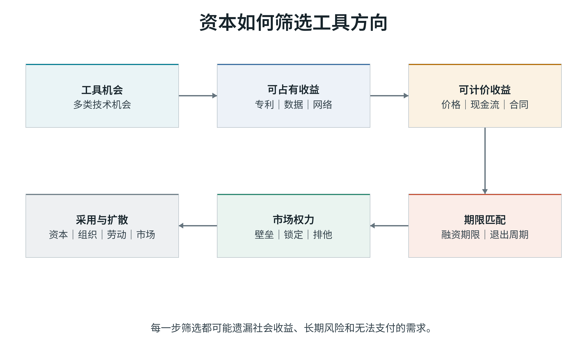
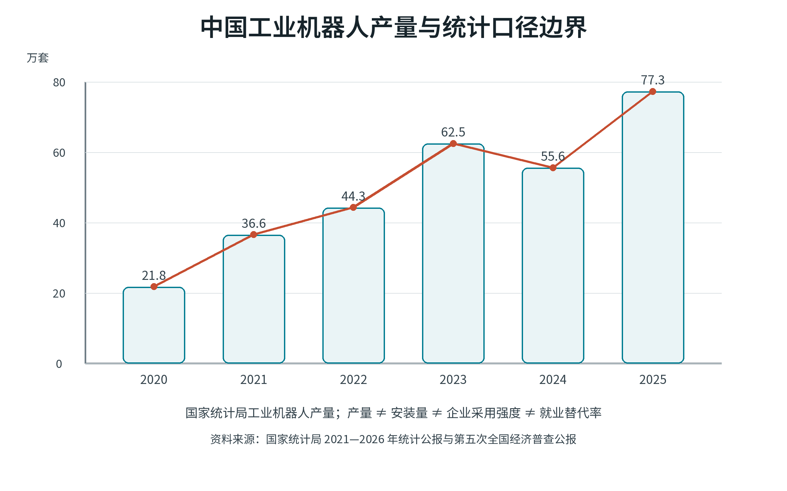
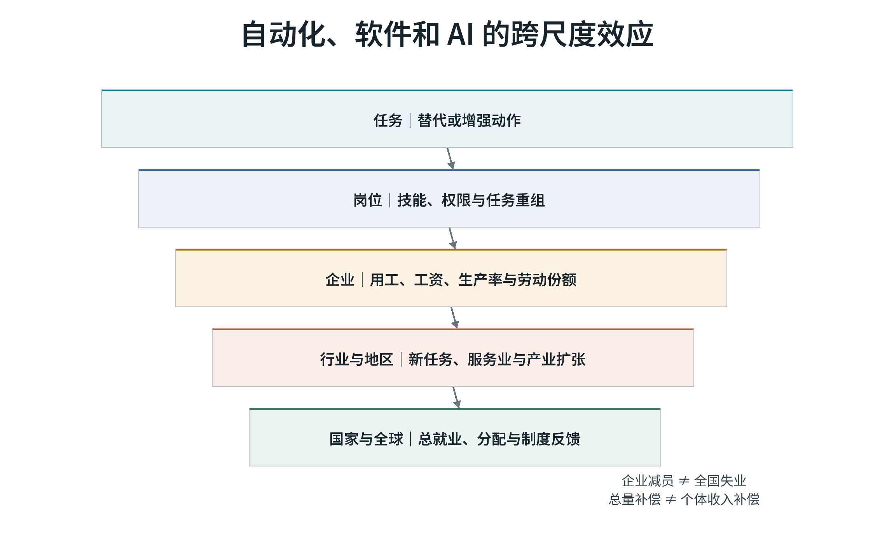
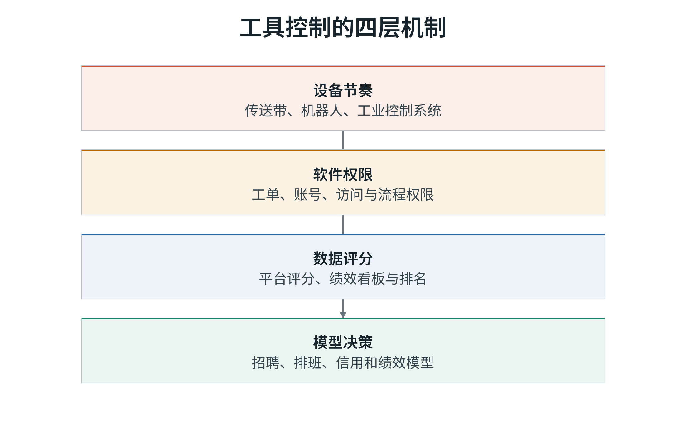
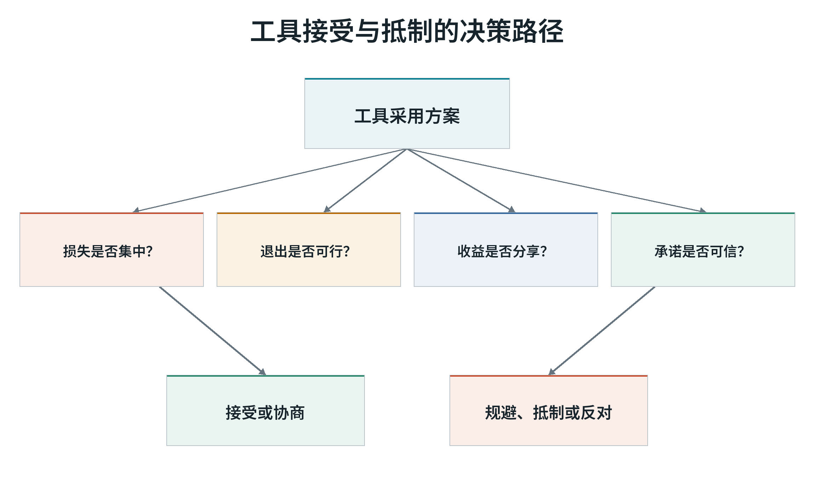
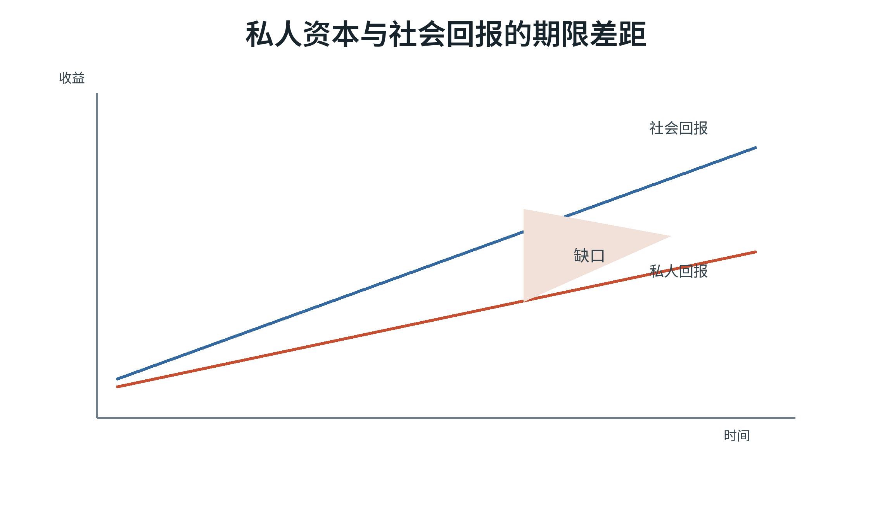
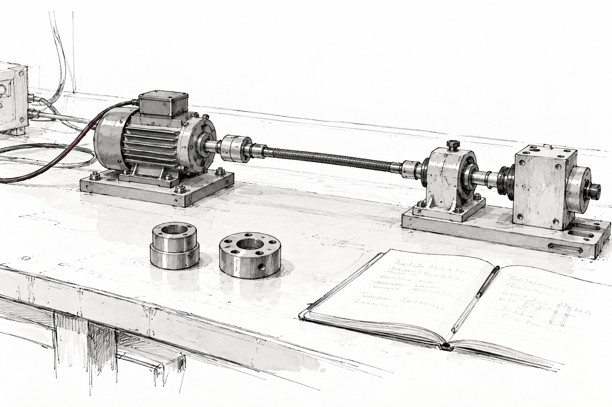
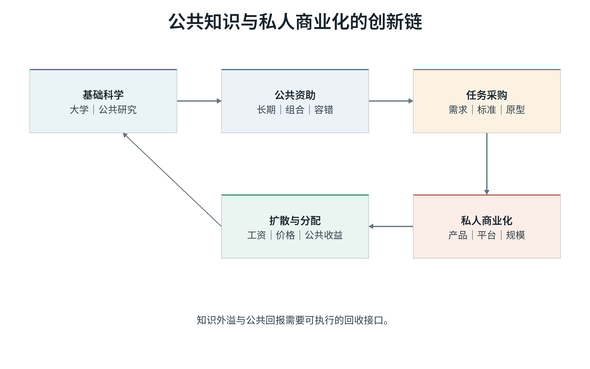
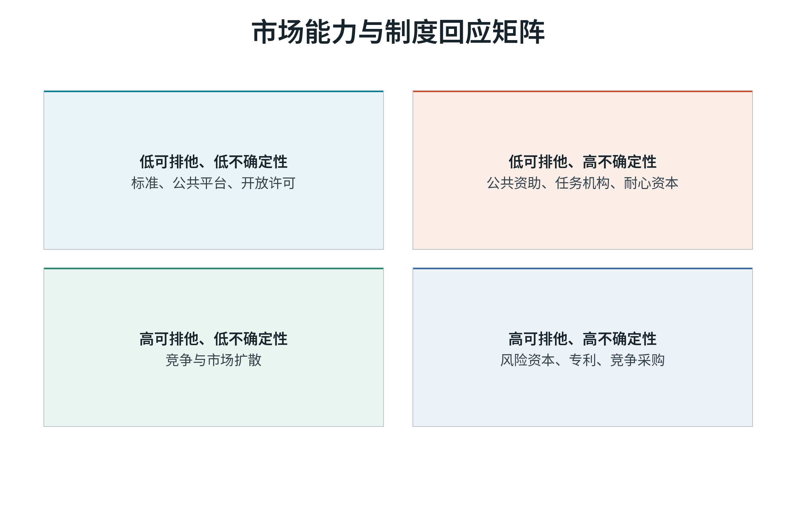

# 第二卷　谁在选择技术的方向

## 本卷导读

企业面对多条技术路线时，资金更容易流向哪里？第二卷考察收益归属、计价方式和投资期限怎样影响选择，以及技术采用如何改变岗位与管理权。

# 第二部　谁在选择技术的方向

## 第二部导言　为什么有些技术更容易得到钱

第二部从一个现实问题开始：一项技术能够改善公共健康，却很难向使用者收费；另一项技术只带来有限社会收益，却能够形成稳定订阅、专利和数据资产。哪一种更容易获得资本？

融资取决于收益能否被占有和计价、回报是否符合投资期限，以及采用后能否扩大市场权力、降低劳动成本或转移风险。这些条件会使某些技术更容易得到资金，即使它们的社会回报并非最高。

长期机构资金、创始人企业、平台资本和承担公共任务的资金，面对不同的期限与责任。采购、资助、开放标准和劳动规则，也会改变私人投资的选择。以下分别考察这些机制。

## 第五章　为什么有些技术更容易得到钱？

一项公共卫生技术可能难以收费，一项订阅服务却能形成稳定现金流。两者获得资金的机会，往往随可占有收益而变化。

资本会优先配置给能够形成可占有现金流、可计价收益、可交易资产和期限匹配回报的方向。该机制能够解释资本为何同时具备强大创新能力和系统性方向偏差。

### 资本如何筛选工具路线

私人投资要求项目能够形成回报。技术路线因此需要经过几项筛选：

1. 问题能否转化为可出售的产品或服务；
2. 收益能否被投资者、企业或平台占有；
3. 成本与收益能否被计价；
4. 回报是否落在投资者可等待的期限内；
5. 竞争者能否迅速复制或绕过；
6. 资产能否融资、出售、上市或作为抵押；
7. 法规是否允许收益集中。

这组筛选形成资本工具选择漏斗。

### 可占有性

可占有性指投资者能否阻止他人免费使用收益。专利、版权、商业秘密、数据权限、网络效应、品牌、规模和政府特许都可以提高可占有性。

高可占有性的工具容易获得投资：

- 专有药物和医疗设备；
- 工业机器人和自动化软件；
- 企业级云服务；
- 平台算法和数字广告；
- 半导体设备；
- 消费软件和数字内容。

低可占有性的活动更难融资：

- 基础科学；
- 开放数据和开放标准；
- 公共卫生监测；
- 生态修复；
- 社区照护；
- 基础技能培训；
- 跨代基础设施。

可占有性描述融资筛选，与道德评价分开。专利在某些行业保护高风险研发，开放标准也可能扩大创新。问题在于，若制度只承认可占有收益，其他高社会价值活动就缺少稳定融资机制。

### 可计价性与期限

工具收益若没有价格、合同或可交易资产，就容易在投资模型中被忽略。

例如，减少空气污染、改善睡眠、避免疾病和维持社区稳定的收益真实存在，却不总是进入企业现金流。照护工作也常被家庭和公共预算吸收，而非由工具生产者的收入体现。

期限同样关键。长期研究需要持续资金、容许失败和组织记忆。若投资者必须在三到五年内退出，项目会被迫偏向短期可见成果、可拆分资产或可被收购的技术。

癌症临床试验研究提供了一个期限证据：验证和商业回报等待时间越长，私人研发越少；可以缩短验证时间的制度变化会改变研究组合。<super>[20]</super>

### 竞争、垄断和创新

竞争可以推动工具发现和扩散，也可能被专利、数据、网络效应和并购削弱。

De Loecker、Eeckhout 与 Unger 发现，美国企业加成率长期上升，市场势力可能改变劳动份额、投资和资源配置。<super>[49]</super> Autor 等提出的“明星企业”机制认为，拥有更高生产率和市场势力的少数企业取得更大市场份额，并可能压低总体劳动份额。<super>[50]</super>

两种解释并不互斥。高加成率可能来自更高质量、规模经济和无形资产，也可能来自进入壁垒、专利丛林、平台锁定和排他行为。

可检验问题在于：

> 收益来自更好满足社会需要，还是来自限制他人进入和选择？

#### 方向偏差如何形成

可占有性、期限和市场权力会产生不同偏离。基础研究主要受知识外溢影响；公共卫生监测同时受公共品和支付能力影响；气候变化受负外溢与代际利益影响；平台市场则更多涉及网络效应、数据积累和转换成本。政策若只增加总研发补贴，却保留相同的专利、采购和竞争结构，资金可能继续流向已经容易占有的方向。

#### 资本类别会改变方向

长期家族所有权、长期机构投资者、企业实验室、任务导向公共采购和风险资本的期限不同。风险资本擅长发现高增长企业，但其基金退出结构和资产流动性要求会偏向可上市、可出售、可快速扩张的技术。<super>[59]</super> 长期机构持股与创新可以正相关，但机制更接近降低管理者职业风险和提高竞争互补性，而非“长期资金必然选择社会最优方向”。<super>[48]</super>

公开上市的研究同样存在两面性。Bernstein 发现上市会改变企业创新数量和结构，既可能扩大融资，也可能提高披露、短期价格压力和收购风险。<super>[56]</super> 股票流动性和分析师覆盖对创新的影响也非单向，<super>[57-58]</super> 因此，所有权形式必须与竞争、技术阶段和管理激励共同分析。

### 资本类别与企业异质

金融化研究指出，股东价值最大化把利润分配、股价、回购、并购和管理层薪酬连接到企业决策，可能压缩长期组织能力。<super>[46]</super> 企业投资与利润的关系变化也不能简单归因于资本成本，市场集中和无形资产可能参与其中。<super>[47]</super>

不同资本的投资期限和治理约束差异很大。

机构持股与创新的关系取决于机构稳定性和竞争结构。<super>[48]</super> 公开上市可能增加融资和知名度，也可能增加披露、短期价格压力和收购风险。<super>[56]</super> 股票流动性和分析师覆盖对创新的影响同样存在正反两面。<super>[57-58]</super>

风险资本能发现新企业并提供网络支持，但基金退出期限也会塑造技术方向。<super>[59]</super>

因此，资本类型必须拆分，不能用“市场”或“私人资本”一个变量解释全部结果。

### 融资规则怎样改变技术选择

资本倾向可占有收益来自其融资和回报结构。它是投资制度在信息、风险和期限约束下的行为规律。

公共制度可以改变这种规律：

- 专利期限和强制许可；
- 公共采购和预商业采购；
- 长期基础研究资助；
- 公共数据与开放标准；
- 竞争政策和互操作；
- 长期机构投资者制度；
- 收益分享和公共股权；
- 失败项目退出。

评价标准在于资本逐利会形成什么方向：

1. 私人收益与社会收益差距有多大；
2. 差距来自知识外溢、期限、市场权力还是政策；
3. 何种制度能够缩小差距；
4. 公共替代是否会制造新的行政和信息失灵。

#### 制度如何改变方向

专利制度可以同时提供研发激励和阻挡后续创新。过强、过宽或过长的保护可能提高许可和诉讼成本，尤其伤害累积性创新。<super>[45]</super> 较优设计通常依赖“范围、期限、公开、强制许可、竞争和公共替代”的组合，而不是单一工具。

公共采购可以把尚未存在的需求转化为可预期市场。任务导向创新能够协调跨部门资源，分担早期风险，并建立标准和原型；其风险是目标政治化、供应商俘获、重复投资和退出困难。<super>[24-25]</super><super>[62-63]</super>

长期机构资金、员工持股、合作社、公共股权和收益分享可以改变期限与分配，但每一种安排都会产生代理、治理或流动性成本。制度评价应比较可观察的期限、外溢覆盖、失败退出和公共收益回收，而不是只比较名义所有制。

资本控制具有真实的发现和扩散能力，也会系统性偏向可占有、可计价、期限匹配和可扩张的工具。

资本是否支持长期创新，需要结合所有权、竞争、融资和公共制度判断。

私人投资缺口更可能出现在以下领域：

> 私人投资不足最可能出现在收益难占有、外溢大、期限长、风险难定价和公共需要无法转化为支付能力的领域。是否出现普遍短期主义，取决于所有权、竞争、融资和公共制度。

## 第六章　当机器开始接管任务，岗位会发生什么？

自动化首先接管具体任务。一个企业可能减少用工，同一地区却出现扩张；被替代的劳动者也未必能进入新岗位。就业问题的关键落在尺度、转换路径和时间窗口上。

自动化首先替代任务，但劳动市场结果是替代、恢复、生产率扩张、市场结构和制度反馈的合成。因而，“机器人是否减少就业”不是单一问题，必须同时指定技术、任务、尺度、群体和时间窗口。

### 任务框架

自动化意味着资本接管一组任务。劳动需求由替代、恢复和生产率效应共同决定。<super>[3]</super><super>[37]</super>

公式 4 中，ΔNdisplace 是替代效应，ΔNreinstate 是新任务恢复效应，ΔNproductivity 是需求扩张和生产率改善的间接效应。三项可以方向相同，也可以相互抵消。

自动化同时改变三类结果：

1. 任务由谁完成；
2. 谁的技能仍有价值；
3. 收益和风险如何分配。

任务替代并不一定意味着岗位消失。岗位由多个任务组成；若被自动化任务可被剩余任务、新任务、质量要求或需求扩张吸收，企业就业可能稳定甚至增加。即使企业就业增加，劳动份额、技能结构和工资仍可能改变。Acemoglu 与 Restrepo 的框架进一步说明，自动化降低劳动比较优势，新任务恢复劳动比较优势，二者的相对速度决定过渡期不平等。<super>[3]</super><super>[5]</super><super>[37]</super>

Autor、Chin、Salomons 与 Seegmiller 把 1940-2018 年美国新职业名称连接到人口普查和专利数据，发现当前多数就业位于 1940 年后出现的新工作中，但新工作创造从 1940-1980 年间的中等工资生产与文职岗位，转向 1980 年后的高工资专业岗位和部分低工资服务岗位；自动化创新抑制职业劳动需求，增强型创新提高劳动需求。<super>[72]</super> 因而，“新任务会出现”不能回答新任务的工资、技能门槛、地区位置和进入机会。

### 跨国产业证据

Graetz 与 Michaels 使用 17 个国家 1993-2007 年的产业机器人面板，发现机器人使用使年度劳动生产率增长约提高 0.36 个百分点，并伴随全要素生产率提高和产出价格下降；总体上未发现显著就业下降，但低技能劳动者就业份额下降。<super>[51]</super> 该研究说明“生产率提高”与“分配改善”是两个结果。

跨国产业研究还显示，自动化对生产率和劳动份额的影响显著异质，行业、技术类型、资本结构和测量方法不能混同。<super>[53]</super> 因而，将不同国家的自动化系数简单平均，会掩盖制度与产业结构差异。

### 美国、德国、法国和日本

美国通勤区研究使用行业机器人推进速度与当地行业就业结构构造暴露指标。结果显示，每千名工人增加一台机器人会使就业人口比下降约 0.2 个百分点、工资下降约 0.42%；常规任务群体受损更大，机器人效应也可与海外贸易和一般资本深化区分。<super>[4-5]</super> 通勤区是地区均衡单位，个人损失需要另行分析；当工人迁出或退出劳动市场时，地区回归可能低估个体福利下降。

德国行政数据提供不同图景。机器人暴露造成制造业岗位减少，但服务业新增岗位完全抵消总量就业变化；主要损失落在进入劳动市场的年轻人，原有企业内部工人更多转向新任务并保持稳定就业，部分新任务质量更高。<super>[6]</super> 这说明制度、企业内部调整和进入者队列决定损失分布。

法国企业层面研究包括 55,390 家制造业企业，其中 598 家在 2010-2015 年间采用机器人，却覆盖制造业就业的约 20%。采用企业的增加值、生产率、总体就业和劳动份额变化显著，生产工人比例下降；企业扩张部分以竞争对手收缩为代价，因此总体就业关联为负。<super>[52]</super> 这一设计清楚展示了“采用企业收益”与“行业总效应”并不相同。

日本 1978-2017 年的长期产业证据又提供了相反方向。Adachi、Kawaguchi 与 Saito 利用机器人不同用途的价格下降差异识别采用冲击，发现机器人价格下降同时提高机器人数量与就业，主要机制是生产率和生产规模扩张。<super>[71]</super> 这一结果没有推翻美国地区替代效应，而是说明需求弹性、产业结构、机器人价格和采用阶段会改变净效应。任何跨国比较都必须报告结果单位和反事实，不能把某国的系数当作技术常数。

### 中国证据

中国制造业上市公司研究发现，机器人渗透提高可能减少企业劳动需求，并降低劳动收入份额。<super>[10-11]</super> 这一结果与法国企业层面方向相近：采用者获得效率或成本优势，但企业内部的劳动分配和技能构成会变化。

行业、城市和地区的产业扩张可能创造补偿性岗位。<super>[12-16]</super> 最低工资、所有制、融资约束、地区产业结构和技术用途会改变估计结果。<super>[15-16]</super> Wu 与 Sun 对南方制造业的调查进一步显示，约 2,400 名工人和 600 家企业的证据不支持“暴露越高就一定越反对自动化”；内部迁移者因拥有可接受的退出选择，反而比本地工人焦虑更低。<super>[17]</super> 这说明制度岗位替代风险与主观抵制之间不存在机械对应。

刘东升与王永中使用中国家庭追踪调查和城市机器人渗透度，发现本地机器人应用与跨省就业回流显著相关，省内跨市回流效应较弱，中低技能劳动者的反应更明显；土地等稀缺资源会削弱本地就业创造并加强挤出。<super>[70]</super> 该研究把劳动力流动纳入机器人效应，却主要采用有序 Logit 和机制回归，仍可能受到地方发展趋势、产业政策和迁移选择的共同影响。它适合说明“地区补偿通过迁移发生”，不宜单独证明机器人提高了个体长期福利。

机器人供给扩张的速度也需要单独记录。国家统计局口径下，中国工业机器人产量从 2020 年的 21.8 万套增加到 2025 年的 77.3 万套，2025 年同比增长 28.0%。<super>[73]</super> IFR 则报告 2024 年中国安装约 29.5 万台工业机器人，占全球新安装量的 54%。<super>[74]</super> 两组数字分别测量国内产量与市场安装量，需要分开核算，企业自动化强度和就业替代率另需证据。

但补偿并不保证被替代者获得同等收入、技能和保障。企业减员、城市净就业和个体职业轨迹是三种不同结果。

**表 4B　中国机器人研究的尺度与解释边界**

| 尺度 | 可能结果 | 不能推出的结论 |
|---|---|---|
| 任务 | 工具接管常规动作 | 整个岗位必然消失 |
| 企业 | 用工减少、劳动份额下降 | 全国就业必然下降 |
| 行业 | 上下游和服务业补偿 | 原工人获得同样岗位 |
| 地区 | 产业扩张和迁移 | 个人损失被完全补偿 |
| 国家 | 总就业可能稳定 | 工资、技能和地区差距不恶化 |

### 软件和生成式 AI

生成式 AI 可以提高写作、编程、客服和管理任务的速度与质量。<super>[38]</super><super>[54]</super>

Noy 与 Zhang 的预注册在线实验包含 453 名受过大学教育的专业人士。获得 ChatGPT 的组平均完成时间下降约 40%，输出质量提高约 18%，组内差距缩小。<super>[38]</super> Brynjolfsson、Li 与 Raymond 研究 5,172 名客服人员，发现 AI 辅助使每小时解决问题数平均提高 15%，收益主要集中于低经验和低技能员工。<super>[54]</super> 两者都支持任务增强和技能差距压缩，但不足以单独推出岗位、工资和劳动份额变化。

快速采用调查的 2025 年修订版显示，截至 2024 年末，接近 40% 的 18-64 岁美国人使用过生成式 AI；23% 的就业者在此前一周用于工作，9% 每个工作日使用。受访者报告约 1%-5% 的总工时得到生成式 AI 辅助，时间节省相当于总工时的 1.4%。<super>[55]</super> 这组自报数据说明采用速度快，但不能替代企业日志、工资或岗位数据。

ILO 2025 年全球指数把职业拆为任务后估计，全球约四分之一劳动者处于某种生成式 AI 暴露之下，最高暴露组占 3.3%，且女性最高暴露比例高于男性。<super>[68]</super> 暴露指数描述“技术可能介入多少任务”，没有估计企业是否采用、采用后选择替代还是增强，也没有纳入工资、谈判权和需求扩张。把暴露比例直接当作失业预测，会同时混淆技术可行性、投资决策和组织重构。

企业采用还受到组织能力约束。OECD、BCG 与 INSEAD 的 2025 年调查覆盖七国 1,007 家采用 AI 的企业，其中 G7 国家 840 家、巴西 167 家；报告指出，管理者经常既难以把 AI 对应到具体工作问题，也低估其对流程和组织文化的系统影响。<super>[75]</super> 该样本以采用者为主，不能估计全国普及率，却支持“互补投资与流程重构决定实际收益”的机制。

任务生产率提高可能带来四种组织选择：

1. 提高质量或扩大需求；
2. 减少重复岗位；
3. 提高剩余劳动者的目标；
4. 把节省时间转化为更多监控、审核和待命。

因此，AI 生产率实验只能支持“任务可以被增强或替代”，不足以单独推出工资、就业和劳动份额。

### 劳动份额、明星企业与买方垄断

自动化只是劳动份额下降的一种可能机制。全球化、行业集中、市场势力、专利、数据和平台网络也会改变分配。

资本替代可能降低劳动份额，但总体劳动份额还取决于：

- 行业结构和企业规模；
- 投入品价格；
- 企业加成率；
- 劳动市场议价能力；
- 最低工资和集体谈判；
- 无形资本和统计口径。

买方垄断研究说明，在少数雇主主导的地方劳动市场中，工资可能低于边际产品价值。<super>[60]</super> 自动化若减少替代雇主或提高工人技能专用性，可能进一步降低谈判力量。

如果自动化同时提高进入壁垒或扩大规模优势，它会与市场集中互相强化。技术替代、市场势力、买方垄断和劳动制度因此不能被写成四个相互排斥的回归。

自动化既可以提高生产率，也可能降低劳动需求、劳动份额和工资增长。其方向和强度取决于任务替代、新任务、需求扩张、市场结构、技能和劳动制度。

技术政策的评价不能只看企业是否采用工具，还要看：

1. 节省的时间去了哪里；
2. 谁获得生产率收益；
3. 被替代者是否拥有转岗和保障；
4. 新任务是否具有同等工资和技能；
5. 企业市场势力是否因自动化进一步集中。

本章的规范含义是把“谁获得生产率收益、谁承担调整成本、被替代者能否重新进入”写进技术评价。若生产率提高伴随利润和工资共同增长，同时劳动者拥有训练、转岗和参与，技术采用可以形成正和结果；若收益集中在企业、损失集中在特定群体、退出和保障不足，自动化的接受危机就是制度结果。

## 第七章　工具也是管理权

流水线把生产节奏写进设备，平台把派单、评分和处罚写进软件，生成式工具进一步介入绩效评价。工具提高生产能力的同时，也会改变管理者与劳动者之间的权力。

工具采用同时改变生产能力与组织权力。设备节奏、软件权限、数据评分和模型决策可以降低协调成本，也可能集中信息、评价与纪律权；当申诉、解释和参与不足时，效率提高不一定转化为劳动改善。

### 劳动过程与控制

工具不仅替代劳动，也改变谁拥有知识、判断和监督权。布雷弗曼指出，管理可以通过把概念与执行分离、标准化流程和机器节奏降低技能。<super>[26]</super> 布洛维强调稳定生产还依赖规则、内部劳动力市场和同意。<super>[27]</super>

爱德华兹把控制区分为简单控制、技术控制和官僚控制，说明管理策略会随组织规模和劳动抵抗调整。<super>[28]</super> 诺布尔关于数控机床的历史研究则表明，技术路线不是效率单变量竞赛：管理者可能选择限制熟练工人判断的自动化路径，即使存在其他技术上可行的组织方案。<super>[29]</super> 温纳提出的问题同样适用于算法系统：人工物是否具有政治？<super>[30]</super>

现代控制不再只发生在工厂。数据、软件、权限、评分和模型把控制嵌入日常工作。控制并不必然表现为命令和惩罚，也可以表现为界面默认值、信息不对称、任务排序和指标可见性。劳动者也可能通过规避、互助、重新解释和谈判改变工具效果。<super>[31-32]</super><super>[42]</super>

### 四种控制机制

**表 5　工具控制机制、权力变化与可观察结果**

| 控制机制 | 工具形式 | 主要权力变化 | 效率可能收益 | 需同时测量的风险 |
|---|---|---|---|---|
| 设备节奏 | 传送带、机器人、工业控制 | 管理者控制速度与动作顺序 | 一致性、产出、安全替代 | 工伤、疲劳、节拍压力 |
| 软件权限 | 工单、账号、访问控制 | 控制任务与信息可得性 | 协调、留痕、标准流程 | 自主性、隐性知识、依赖 |
| 数据评分 | 平台评分、绩效看板 | 持续评价与排序 | 反馈速度、目标可视化 | 压力、规避、低信任 |
| 模型决策 | 招聘、排班、绩效模型 | 自动分类与资源分配 | 降低成本、规模处理 | 不透明、偏差、难申诉 |

控制强度可以抽象为：

### 算法管理

Kellogg、Valentine 与 Christin 把算法管理分为指导、评价和纪律三个控制过程。<super>[41]</super>

Rahman 基于三年多的访谈、档案和平台观察发现，不透明算法评价会让工人持续调整和竞争，却难以确认成功标准，形成“看不见的笼子”。反应并非一致：成功率、对平台的依赖和评分挫折共同影响工人是实验、限制使用还是继续投入。<super>[42]</super>

平台研究显示，工人同时获得部分排班自由和更不透明的规则、收入波动与风险转移。<super>[39-40]</super><super>[43]</super>

平台案例之外，OECD 2025 年雇主调查显示算法管理已经进入普通企业。该调查在 2024 年 6-8 月访问法国、德国、意大利、日本、西班牙和美国 6,047 名中层管理者，覆盖指导、排班、监测、评价和纪律等十五类用途。<super>[69]</super> 60% 的使用者认为软件提高了管理决策质量；美国样本中 76% 的管理者报告企业使用十种以上工具，显示强度而非单纯“是否采用”值得测量。与此同时，近三分之二至少报告一项可信性担忧，其中责任不清、逻辑难解释和劳动者健康保护不足分别达到 28%、27% 和 27%。

这些结果来自管理者的感知，尚需客观生产率和健康数据验证。它们提供了一组可继续追踪的指标：采用范围与强度、决策质量、责任归属、解释、健康和劳动者协商。

因此，算法管理不能用“自主或控制”二分法理解。它可能同时增加：

- 进入机会和地理自由；
- 收入不稳定和规则不透明；
- 工作量选择和平台限制；
- 反馈速度和申诉困难。

算法系统的透明度也不能只用“是否公开代码”衡量。对劳动者更重要的是：哪些数据被采集；评分如何进入任务、收入和停用决定；规则变更是否通知；能否解释、质疑和补救；系统错误的责任由谁承担。有效解释不要求披露商业秘密，但必须让受影响者获得足以采取行动的信息。

### 生产率与控制属于不同评价层次

控制工具可能提高执行一致性，也可能产生：

- 压力和健康成本；
- 规避、游戏和低信任；
- 隐性知识流失；
- 错误不敢上报；
- 合作和培训减少。

因此，管理效率与控制强度必须分别测量。

#### 生产率收益与控制成本

控制技术可能降低任意管理、减少等待、规避危险任务，也可能提高执行一致性。然而管理层的短期产出指标往往遗漏压力、伤病、离职、培训减少、群体合作和错误上报。若这些问题延迟出现，采用期评估会高估净收益。

合理评价至少需要同时报告：单位产出和成本；任务完整性、技能与自主性；工伤、压力和离职；申诉、规则解释和参与；生产率收益在工资、价格、利润和工时之间的分配。没有这些结果的“生产率提高”只能证明某些目标改善，不能证明工作改善。

**表 5B　算法管理证据的测量层级**

| 证据层级 | 典型指标 | 能支持的判断 | 主要局限 |
|---|---|---|---|
| 管理者感知 | 决策速度、信息、满意度、担忧 | 采用经验与治理缺口 | 共同方法偏差、无法识别因果 |
| 劳动者调查 | 自主、压力、公平、申诉 | 主观工作质量与异质性 | 选择进入、态度与行为差距 |
| 企业日志 | 分配、评分、停用、产出、离职 | 规则与行为的时间关联 | 数据由平台控制、指标可能被策略性调整 |
| 政策或规则冲击 | 采用前后、地区或门槛差异 | 局部因果效应 | 外部效度和政策同时变化 |
| 算法审计 | 相同输入的评分和待遇差异 | 偏差、稳定性与可解释性 | 不能单独衡量长期组织结果 |

### 劳动者参与

德国共同决定研究没有发现参与必然损害企业绩效，多数估计为零到小幅正向。<super>[8-9]</super> OECD 的算法协商研究也没有发现协商必然增加成本，并报告了工作质量改善的初步证据。<super>[7]</super>

但参与可能只确认已决定的方案，也可能保护内部人。需要区分信息、协商、共同决定、解释和退出。

共同决定研究还显示制度效果依赖权限与配套。Jäger、Schoefer 与 Heining 利用德国改革发现，三分之一董事会席位安排对工资、工资结构、租金分享和劳动份额没有显著影响，却未发现投资下降。<super>[8]</super> Jäger、Noy 与 Schoefer 的综述和跨国事件研究认为，现有共同决定制度通常只赋予有限权力，并且高基线非正式发声会压缩边际效应；多数微观结果为零或小幅正向，长期证据仍有限。<super>[9]</super>

这意味着参与形式需要与真实权力配套。算法协商若发生在采用之后，只允许对参数作边缘调整，也不能改变方向选择。有效参与至少应覆盖采用前评估、数据与模型用途、绩效和纪律规则、健康与安全、申诉和退出。

工具是管理权的一部分。它既能扩大人的能力，也能扩大管理者的信息、评价和纪律能力。

判断工具是否增强劳动而非控制劳动，需要同时观察：

1. 任务是否更完整；
2. 工人是否保留判断和修改权；
3. 数据与评分是否透明；
4. 是否有申诉通道；
5. 生产率收益是否分享；
6. 技能是否可迁移。

管理工具可以减少危险作业、改善排班，也可能增加控制与健康成本。评价时应追问谁设定目标、谁看到数据、谁能提出异议，以及谁承担错误。收益是否分享、权力是否受到约束，要与效率一并考察。

## 第八章　为什么人会拒绝一项“更高效”的技术？

当收益属于企业、调整成本留给个人，且社会保险和退出选择很弱时，劳动者拒绝一项“更高效”的技术可能是对风险的理性回应。

工具抵制通常是损失集中、退出困难、补偿不可信和发声不足条件下的风险反应。可信风险分担、收益分享和参与可以降低抵制，但不能保证所有抵制都代表公共利益。

### 抵制的分配基础

总生产率提高会产生不同分配结果。损失集中、收益远期、退出困难、补偿不可信时，反对采用方式是理性风险反应。

英国机器破坏是工人围绕工资、习惯权利和谈判力量的集体行动，不是对工具知识的无知。<super>[1]</super><super>[35-36]</super>

当代调查还发现，社会保障弱和收益不共享会提高限制性政策偏好；中国制造业中缺少更好退出选项的劳动者更容易产生工具焦虑。<super>[2]</super><super>[17]</super>

历史证据需要避免两个简化。第一，机器破坏并非同质运动：不同地区、行业、技能和政治联盟针对的对象不同。<super>[35-36]</super> 第二，集体行动通常针对风险和收益分配。工人往往要求工资、工作时长、就业规则、传统权利和谈判程序，其目标是把采用速度和控制权纳入议价。<super>[1]</super><super>[35]</super>

### 退出、发声和忠诚

赫希曼的框架说明，组织衰退时成员可以退出、发声或忠诚。<super>[33]</super>

技术采用中的三种反应对应：

- 退出：转岗、离职、迁移或创业；
- 发声：谈判、申诉、政治参与和集体行动；
- 忠诚：接受短期损失，期待未来补偿。

当退出成本高、发声无效、收益承诺不可信时，忠诚无法长期维持。

### 国际制度比较

**表 6　风险分担、参与和补偿可信度的制度比较**

| 制度机制 | 可能提高接受 | 可能副作用 |
|---|---|---|
| 失业保险 | 降低等待成本 | 岗位匹配可能变慢 |
| 岗位保留 | 保存技能和企业关系 | 固化低效率、内部人保护 |
| 共同决定 | 提供信息和参与 | 决策变慢、代表偏离 |
| 收益分享 | 把增长与工资连接 | 分配规则可能不公平 |
| 终身学习 | 提高转岗能力 | 训练与岗位需求脱节 |
| 工资保险 | 分担转型损失 | 财政成本与逆向激励 |

制度比较不能只列政策名称。失业保险的接受效应取决于替代率、领取条件、再就业服务和区域岗位机会；岗位保留取决于企业是否同时重组任务；共同决定取决于权限范围；收益分享取决于规则是否透明并覆盖非正式劳动者。<super>[7-9]</super><super>[33-34]</super>

### 为什么“先增长、后分配”常失败

未来收益要改变今天行为，必须满足：

1. 收益确实出现；
2. 受损者能取得；
3. 承诺可执行；
4. 受损者能等待；
5. 新任务匹配旧技能；
6. 受影响者能参与规则；
7. 失败时有退出。

缺一项，接受度就会下降。

现实中，补偿可信度往往低于总收益规模。企业可能无法承诺多年不裁员，政府可能换届，技术收益可能由其他地区、职业或资本持有者取得。可信承诺因此需要制度化：法定保障、集体协议、可携带福利、转岗权利、区域基金、收益分享和独立申诉共同作用，而非单次宣传。

### 抵制也有适用边界

内部人可能保护租金，反对有利于外部人的工具；信息不足也可能导致错误风险评估。因此，抵制研究需要同时观察：

- 损失是否真实；
- 替代收益是否可能；
- 外部人是否被代表；
- 工具是否被用于控制；
- 补偿是否实际执行。

因此，抵制研究不能只询问“是否支持技术”，还要区分态度、投票、谈判、规避、退出和集体行动。调查态度适合识别风险感知，集体协议和罢工记录更适合识别组织能力，行政数据适合观察实际流动。不同结果回答不同问题。

还需防止内部人偏误。受保护的在职者可能反对会扩大外部人就业的自动化；社区可能反对有总体收益但集中于其他地区的设施；企业也可能以创新为名规避劳动保护。政策评价需要同时观察受损者身份、替代方案、工具用途、补偿执行和外部人进入。

工具接受取决于可验证的制度经验。

当风险被分担、收益可分享、退出可行、发声有效、补偿可执行时，劳动者更可能支持工具创新。若全部风险由个人承担，抵制就是理性制度反应。

## 第九章　资本的时间尺度与无人愿坐的冷板凳

基础研究、公共卫生、气候治理和通用知识往往回报周期长、外溢广，却难以被单个投资者完全占有。若所有人都等待别人承担早期风险，社会的长期学习能力会不断变薄。

知识外溢、固定专利期限、融资冲击、研发生产率下降和管理考核，都可能压缩长期研究。公共资助、耐心资本和任务采购能够补足部分缺口；竞争、专业自治和退出规则则有助于约束新的失灵。

### 知识公共品与私人回报

基础研究、开放知识、公共卫生和跨代基础设施具有非排他性、外溢性和不确定性，私人回报低于社会回报。<super>[18-19]</super>

罗默的内生增长理论说明，知识积累能够产生规模报酬递增，同时知识外溢使私人收益无法覆盖全部社会收益。<super>[44]</super>

Scotchmer 指出，创新依赖前人知识，过强的专利边界可能提高后续创新的交易成本。<super>[45]</super>

### 期限证据

癌症临床试验表明，验证和商业回报等待时间越长，私人研发越少。<super>[20]</super>

融资冲击研究显示，长期研究比常规开发更容易被削减。<super>[21]</super>

研发生产率下降研究提醒，增加研发投入并不自动产生同等创新，知识前沿变难和组合复杂性也会降低收益率。<super>[61]</super>

这些机制支持“结构性期限和知识缺口”，不证明所有企业都短视。

### 资本类型与长期投入

长期研发的概率取决于：

- 所有者期限；
- 股票流动性和分析师压力；
- 企业内部实验室和组织记忆；
- 公共采购和基础研究；
- 竞争结构和市场进入；
- 可占有性；
- 研究组合与失败容忍。

企业并非普遍短期化。<super>[22]</super> 机构持股对创新的影响也依赖机构稳定性和竞争。<super>[48]</super>

公开上市可能提供资金，也可能增加披露和收购压力。<super>[56]</super> 股票流动性和分析师覆盖的正反效应并存。<super>[57-58]</super>

Kaplan 对“美国企业过度短期化”的系统质疑说明，回购、估值和风险资本回报的长期证据并不一致。<super>[22]</super> 这要求研究将“平均企业是否短视”与“特定公共品方向是否投资不足”区分开。即使大多数企业期限合理，只要社会高度需要的部分方向存在系统性缺口，公共政策仍有必要。

### 公共创新国家

美国、欧洲和其他地区的基础研究、大学、国防采购、公共卫生和国家实验室承担了大量长周期不确定性。

公共采购可以创造新市场、提供需求信号并分担早期风险。<super>[62-63]</super> 任务导向创新能够协调跨部门资源，但存在目标选择、部门协同和退出难题。<super>[24-25]</super>

公共创新并非天然高效。它也可能：

- 被政治目标绑架；
- 被年度指标压缩；
- 形成软预算；
- 重复投资；
- 被少数企业和地区俘获。

### 资金制度比较

**表 7　长期研究资助机制的时间尺度、优势与治理风险**

| 资助机制 | 时间尺度 | 优势 | 风险 |
|---|---|---|---|
| 年度项目制 | 短中期 | 竞争、透明度 | 指标替代、短周期 |
| 长期机构资助 | 长期 | 组织记忆、探索 | 封闭、证明压力低 |
| 任务导向采购 | 中期 | 需求明确、跨部门 | 目标政治化、供应商俘获 |
| 风险资本 | 5-10 年 | 早期发现、网络 | 退出压力、估值泡沫 |
| 企业实验室 | 可变 | 知识与生产连接 | 受利润和重组冲击 |
| 开放科学 | 长期 | 累积、复用、验证 | 资金和职业激励不足 |

资金机制应与研究阶段匹配。早期探索需要小额、组合、容错和同行判断；中试和规模化需要任务采购、工程能力和标准；商业化可以使用风险资本、企业投资和竞争。把同一考核制度应用于所有阶段，会造成短期项目挤出或公共资金包办商业化。

#### 公共创新的失败模式

公共投入不会自动解决方向问题。政治目标可能压倒科学判断；年度预算和短期指标可能挤出高风险研究；部门与地方可能重复投资；软预算可能让失败项目难以退出；大型供应商可能俘获采购标准。<super>[23-25]</super>

公共创新治理需要稳定的长期预算、阶段评估、专业判断、失败公开、跨部门协调和退出规则。研究者应当能够依据证据修正目标，同时说明资金用途与结果。考核若惩罚所有失败，会把研究不确定性变成隐瞒压力。

长期研究缺口往往来自知识收益难以占有、回报期限长、失败概率高，以及社会收益无法进入私人账目。

公共投入、耐心资本、专业自治和公共采购可以缓解缺口，但必须配置阶段评估、竞争性组合、公开失败和退出机制。

## 第十章　哪些问题价格能够发现，哪些不能？

价格能够快速传递分散偏好、稀缺和退出信号，却难以充分表达无支付能力需求、公共品、长期知识和不可逆损害。

市场的相对优势是分散利用信息、允许局部试错、反映部分偏好并通过退出重新配置资源；其边界来自公共品、外部性、无支付能力需求、市场权力、长周期不确定性和代际利益。公共行动具有潜在补足作用，也面临信息、激励、俘获和退出风险。

### 市场擅长什么

市场在以下任务中有独特能力：

1. 分散发现不同需求；
2. 允许局部试验；
3. 通过价格反映部分偏好；
4. 通过竞争降低成本；
5. 通过破产和退出重新配置资源；
6. 快速扩散可占有产品。

这些能力不能被中央计划轻易替代。

这一判断与哈耶克关于分散知识的问题相通：价格体系能够汇总大量局部信息，任何中央机构都难以完整复制。<super>[64]</super> 科斯则指出，市场交易本身需要搜寻、谈判、合同和执行成本，企业边界取决于不同治理方式的相对成本。<super>[65]</super> 西蒙的有限理性说明，组织无法在采用前计算所有结果，因此需要规则、反馈和局部适应。<super>[66]</super>

市场的关键能力来自分散试错、价格反馈和退出：多主体独立试错、利润和亏损提供反馈、进入退出更新资源配置、价格传播局部信息。问题在于，这些能力只在特定条件下充分运作。

### 市场难以处理什么

公共品、支付能力、长期知识和不可逆损害，构成几类主要的市场边界：

**表 8　市场能力边界与可能的制度回应**

| 问题 | 机制 | 典型工具缺口 | 可能回应 |
|---|---|---|---|
| 公共品 | 非排他、非竞争 | 基础科学、公共卫生 | 公共资助、开放科学 |
| 正外溢 | 投资者收益不足 | 教育、疫苗、基础软件 | 补贴、采购、开放许可 |
| 负外溢 | 成本由社会承担 | 污染、监控、健康损害 | 税、监管、责任 |
| 市场权力 | 数据、专利、网络效应 | 平台租金、进入壁垒 | 反垄断、互操作 |
| 支付能力 | 穷人的需求无法付费 | 住房、医疗、照护 | 公共供给、转移支付 |
| 长周期不确定性 | 风险难定价 | 基础研究、跨代设施 | 组合资助、耐心资本 |
| 代际利益 | 未来没有市场代表 | 气候、生态、债务 | 公共受托、长期预算 |

奥斯特罗姆对公共池塘资源的研究表明，公共品治理并非只有国家或市场两极。使用者可以在边界、规则、监督、冲突解决和惩戒方面形成多层次自治制度。<super>[67]</super> 该传统扩大了“制度回应”的范围：公共供给、公共采购、共同治理、合作社、平台规则和受监管竞争都可能适用。

市场失灵也不自动证明政府或共同治理有效。后者同样面对信息不完整、目标冲突、预算软约束、政治俘获和执行能力不足。第二部的比较原则是对称的：不同治理机制都可能成功或失败，关键是比较任务特征与制度能力。

### 公共能力如何补足市场的支付边界

判断应使用何种机制，需要看：

1. 排他性；
2. 外部性；
3. 不确定性和期限；
4. 规模报酬；
5. 分配与支付能力；
6. 信息分散程度；
7. 失败和退出成本。

下图汇总不同任务中市场机制的适用条件及相应的制度安排。

### 平台、数据与网络效应

平台可以降低搜索和匹配成本，也可能通过数据、网络效应和转换成本形成进入壁垒。

平台能力具有双边或多边结构。降低匹配成本可以提高利用率和进入机会，网络效应也可能形成赢家通吃。平台价格为零或低于边际成本时，竞争重点会转向数据、排序、抽成、默认设置和互操作，而非消费者可见价格。传统以价格为中心的福利指标会低估锁定、隐私、劳动者身份和上游创新限制。

平台治理需要同时考虑：

- 消费者价格和便利；
- 生产者与劳动者的抽成；
- 数据权利和隐私；
- 互操作和可携带；
- 劳动身份和保障；
- 内容与算法责任；
- 创新进入和竞争。

### 公共能力与市场能力的组合

市场发现局部机会，公共机构承担长期和公共目标，专业共同体维护知识标准，劳动者参与工作场所决策。

组合机制按任务选择：

- 竞争性消费：市场主导；
- 公共科研：公共资助 + 专业自治；
- 大型基础设施：公共规划 + 竞争采购；
- 平台网络：竞争 + 互操作 + 数据治理；
- 照护和健康：公共供给 + 专业判断 + 用户参与；
- 危机关键品：行政协调 + 市场能力。

**表 9　不同任务特征下的机制组合**

| 任务特征 | 主要协调机制 | 需要防止的失败 | 可观察指标 |
|---|---|---|---|
| 偏好分散、可排他、可竞争 | 竞争性市场、进入退出 | 集中、欺诈、负外溢 | 价格、质量、进入率 |
| 强知识外溢、长期不确定 | 公共资助、大学、耐心资本 | 短期指标、政治选择 | 知识扩散、研究组合、失败退出 |
| 需求明确但市场未形成 | 公共采购、标准、原型 | 供应商俘获、目标漂移 | 成本、竞争、扩散、公共收益 |
| 网络效应强、转换成本高 | 竞争政策、互操作、数据规则 | 锁定、抽成、创新壁垒 | 多归属、进入、抽成、质量 |
| 公共品和资源共同体 | 公共供给、共同治理 | 搭便车、俘获、供给不足 | 使用、维护、参与、监督 |
| 无支付能力但高社会需要 | 转移支付、公共供给 | 财政不可持续、排斥 | 覆盖率、可及性、健康结果 |

组合治理需要规定各方怎样协作：谁发现需求，谁承担长期目标，谁判断知识质量，谁代表受影响者，以及谁有权要求修改或终止项目。公共品和长期不确定性越重要，这些责任越需要明确。

市场的作用取决于任务和制度条件。

它的核心优势是分散发现、试错和退出；核心边界是公共品、外部性、支付能力、市场权力、长周期和代际利益。

因此，关键问题是：

> 在具体任务、信息和权力结构下，哪种机制能够发现需求、承担期限、分担风险、保护能力并允许失败退出？

## 第二部结论　资本善于发现，也需要公共方向和退出

资本控制下的工具创新具有强大的发现、试错、扩散和成本下降能力。它的主要方向偏差来自收益难以占有、回报期限过长、市场权力维持租金、劳动控制能够增加利润，以及风险和损失能够转嫁给劳动者、社区、公共财政或未来世代。

由此得到四项政策原则。第一，政策不能只补贴设备采用，还要评价工具解决什么社会问题、收益能否覆盖外溢。第二，转型损失集中时，补偿必须可取得、可执行和可携带。第三，工具改变信息和纪律权时，数据用途、评分规则、申诉和参与必须同步建设。第四，市场发现、公共方向、专业判断和劳动者现场知识需要组合，并保留公开失败和退出机制。

资本的重要能力是发现分散机会和组织退出；资本的重要边界是公共品、无支付能力需求、长期知识、市场势力和劳动权利。第三部将把这些能力与边界放进不同国家制度和社会状态中比较。

# 参考文献

[1] Hobsbawm, E. J. (1952). The Machine Breakers. *Past & Present*, 1(1), 57-70. https://doi.org/10.1093/past/1.1.57

[2] Lee, J. (2024). Luddite or technophile?—policy preferences for governing technology-driven economic change. *Socio-Economic Review*, 22(3), 1019–1046. https://doi.org/10.1093/ser/mwae025

[3] Acemoglu, D., & Restrepo, P. (2019). Automation and New Tasks: How Technology Displaces and Reinstates Labor. *Journal of Economic Perspectives*, 33(2), 3-30. https://doi.org/10.1257/jep.33.2.3

[4] Acemoglu, D., & Restrepo, P. (2020). Robots and Jobs: Evidence from US Labor Markets. *Journal of Political Economy*, 128(6), 2188-2244. https://doi.org/10.1086/705716

[5] Acemoglu, D., & Restrepo, P. (2022). Tasks, Automation, and the Rise in U.S. Wage Inequality. *Econometrica*, 90(5), 1973-2016. https://doi.org/10.3982/ECTA19815

[6] Dauth, W., Findeisen, S., Suedekum, J., & Woessner, N. (2021). The Adjustment of Labor Markets to Robots. *Journal of the European Economic Association*, 19(6), 3104-3153. https://doi.org/10.1093/jeea/jvab012

[7] Milanez, A. (2025). Exploring win-win outcomes of algorithmic management: Lessons from a laboratory experiment on worker consultation. *OECD Artificial Intelligence Papers*, No. 43. https://doi.org/10.1787/84b59397-en

[8] Jaeger, S., Schoefer, B., & Heining, J. (2021). Labor in the Boardroom. *Quarterly Journal of Economics*, 136(2), 669-725. https://doi.org/10.1093/qje/qjaa038

[9] Jäger, S., Noy, S., & Schoefer, B. (2022). What Does Codetermination Do? *ILR Review*, 75(4), 857–890. https://doi.org/10.1177/00197939211065727

[10] 王永钦、董雯（2020）：《机器人的兴起如何影响中国劳动力市场？来自制造业上市公司的证据》，《经济研究》第10期，第159-175页。

[11] 周明海、郑天翔、王秋实（2021）：《工业机器人应用的要素收入分配效应》，《浙江社会科学》2021年第6期（总第298期），40–50+157。https://doi.org/10.14167/j.zjss.2021.06.005

[12] 孔高文、刘莎莎、孔东民（2020）：《机器人与就业：基于行业与地区异质性的探索性分析》，《中国工业经济》2020年第8期，80–98。https://doi.org/10.19581/j.cnki.ciejournal.2020.08.005

[13] 李磊、王小霞、包群（2021）：《机器人的就业效应：机制与中国经验》，《管理世界》37(9)，104–119。https://doi.org/10.19744/j.cnki.11-1235/f.2021.0140

[14] 林欣、李春顶（2023）：《国内外工业机器人应用对制造业就业的影响分析》，《财经研究》49(7)，第19-33页。https://doi.org/10.16538/j.cnki.jfe.20230316.203

[15] 王静、王怡静、宋建（2022）：《最低工资、机器人应用与劳动收入份额》，《财经研究》48(12)，第106-120页。https://doi.org/10.16538/j.cnki.jfe.20221014.301

[16] 盛垒、张玺（2026）：《机器人应用、产业结构转型与劳动收入份额变动》，《华东师范大学学报（哲学社会科学版）》58(1)，136–149。https://doi.org/10.16382/j.cnki.1000-5579.2026.01.013

[17] Wu, N., & Sun, Z. (2025). Little to Lose: Exit Options and Attitudes towards Automation in Chinese Manufacturing. *The China Quarterly*, 262, 371-391. https://doi.org/10.1017/S0305741024001577

[18] Nelson, R. R. (1959). The Simple Economics of Basic Scientific Research. *Journal of Political Economy*, 67(3), 297-306. https://doi.org/10.1086/258177

[19] Arrow, K. J. (1962). Economic Welfare and the Allocation of Resources for Invention. In R. R. Nelson (Ed.), *The Rate and Direction of Inventive Activity* (pp. 609–626). Princeton University Press

[20] Budish, E., Roin, B. N., & Williams, H. (2015). Do Firms Underinvest in Long-Term Research? Evidence from Cancer Clinical Trials. *American Economic Review*, 105(7), 2044-2085. https://doi.org/10.1257/aer.20131176

[21] Mezzanotti, F., & Simcoe, T. (2023). *Research and/or Development? Financial Frictions and Innovation Investment*. NBER Working Paper 31521. https://doi.org/10.3386/w31521

[22] Kaplan, S. N. (2017). *Are U.S. Companies Too Short-Term Oriented? Some Thoughts*. NBER Working Paper 23464. https://doi.org/10.3386/w23464

[23] OECD. (2021). *Effective Policies to Foster High-Risk/High-Reward Research*. OECD Science, Technology and Industry Policy Papers. https://doi.org/10.1787/06913b3b-en

[24] Mazzucato, M. (2018). Mission-Oriented Innovation Policies: Challenges and Opportunities. *Industrial and Corporate Change*, 27(5), 803-815. https://doi.org/10.1093/icc/dty034

[25] Janssen, M. J., Torrens, J., Wesseling, J. H., & Wanzenboeck, I. (2021). The Promises and Premises of Mission-Oriented Innovation Policy: A Reflection and Ways Forward. *Science and Public Policy*, 48(3), 438-444. https://doi.org/10.1093/scipol/scaa072

[26] Braverman, H. (1974). *Labor and Monopoly Capital: The Degradation of Work in the Twentieth Century*. Monthly Review Press

[27] Burawoy, M. (1979). *Manufacturing Consent: Changes in the Labor Process under Monopoly Capitalism*. University of Chicago Press

[28] Edwards, R. (1979). *Contested Terrain: The Transformation of the Workplace in the Twentieth Century*. Basic Books

[29] Noble, D. F. (1984). *Forces of Production: A Social History of Industrial Automation*. Knopf

[30] Winner, L. (1980). Do Artifacts Have Politics? *Daedalus*, 109(1), 121-136

[31] Pinch, T. J., & Bijker, W. E. (1984). The Social Construction of Facts and Artefacts: Or How the Sociology of Science and the Sociology of Technology Might Benefit Each Other. *Social Studies of Science*, 14(3), 399-441. https://doi.org/10.1177/030631284014003004

[32] Orlikowski, W. J. (1992). The Duality of Technology: Rethinking the Concept of Technology in Organizations. *Organization Science*, 3(3), 398-427. https://doi.org/10.1287/orsc.3.3.398

[33] Hirschman, A. O. (1970). *Exit, Voice, and Loyalty: Responses to Decline in Firms, Organizations, and States*. Harvard University Press

[34] Esping-Andersen, G. (1990). *The Three Worlds of Welfare Capitalism*. Polity Press

[35] Thompson, E. P. (1963). *The Making of the English Working Class*. Victor Gollancz

[36] Randall, A. (1991). *Before the Luddites: Custom, Community and Machinery in the English Woollen Industry, 1776-1809*. Cambridge University Press

[37] Acemoglu, D., & Restrepo, P. (2018). The Race Between Man and Machine: Implications of Technology for Growth, Factor Shares, and Employment. *American Economic Review*, 108(6), 1488-1542. https://doi.org/10.1257/aer.20160696

[38] Noy, S., & Zhang, W. (2023). Experimental Evidence on the Productivity Effects of Generative Artificial Intelligence. *Science*, 381(6654), 187-192. https://doi.org/10.1126/science.adh2586

[39] Srnicek, N. (2017). *Platform Capitalism*. Polity

[40] Vallas, S., & Schor, J. B. (2020). What Do Platforms Do? Understanding the Gig Economy. *Annual Review of Sociology*, 46, 273-294. https://doi.org/10.1146/annurev-soc-121919-054857

[41] Kellogg, K. C., Valentine, M. A., & Christin, A. (2020). Algorithms at Work: The New Contested Terrain of Control. *Academy of Management Annals*, 14(1), 366-410. https://doi.org/10.5465/annals.2018.0174

[42] Rahman, H. A. (2021). The Invisible Cage: Workers' Reactivity to Opaque Algorithmic Evaluations. *Administrative Science Quarterly*, 66(4), 949-992. https://doi.org/10.1177/00018392211010118

[43] Rosenblat, A. (2018). *Uberland: How Algorithms Are Rewriting the Rules of Work*. University of California Press

[44] Romer, P. M. (1990). Endogenous Technological Change. *Journal of Political Economy*, 98(5), S71-S102. https://doi.org/10.1086/261725

[45] Scotchmer, S. (1991). Standing on the Shoulders of Giants. *Journal of Economic Perspectives*, 5(1), 29-41. https://doi.org/10.1257/jep.5.1.29

[46] Lazonick, W., & O'Sullivan, M. (2000). Maximizing Shareholder Value. *Economy and Society*, 29(1), 13-35. https://doi.org/10.1080/030851400360541

[47] Gutierrez, G., & Philippon, T. (2017). Investment-less Growth: An Empirical Investigation. *Brookings Papers on Economic Activity*, 48(2), 69-117

[48] Aghion, P., Van Reenen, J., & Zingales, L. (2013). Innovation and Institutional Ownership. *AER*, 103(1), 277-304. https://doi.org/10.1257/aer.103.1.277

[49] De Loecker, J., Eeckhout, J., & Unger, G. (2020). The Rise of Market Power and the Macroeconomic Implications. *QJE*, 135(2), 561-644. https://doi.org/10.1093/qje/qjz041

[50] Autor, D., Dorn, D., Katz, L. F., Patterson, C., & Van Reenen, J. (2020). The Fall of the Labor Share and the Rise of Superstar Firms. *QJE*, 135(2), 645-709. https://doi.org/10.1093/qje/qjaa004

[51] Graetz, G., & Michaels, G. (2018). Robots at Work. *Review of Economics and Statistics*, 100(5), 753-768. https://doi.org/10.1162/rest_a_00754

[52] Acemoglu, D., Lelarge, C., & Restrepo, P. (2020). Competing with Robots: Firm-Level Evidence from France. *AEA Papers and Proceedings*, 110, 383-388. https://doi.org/10.1257/pandp.20201003

[53] Kromann, L., Malchow-Moeller, N., Skaksen, J. R., & Soerensen, A. (2020). Automation and Productivity: A Cross-Country, Cross-Industry Comparison. *Industrial and Corporate Change*, 29(2), 265-287. https://doi.org/10.1093/icc/dtz039

[54] Brynjolfsson, E., Li, D., & Raymond, L. R. (2025). Generative AI at Work. *The Quarterly Journal of Economics*, 140(2), 889–942. https://doi.org/10.1093/qje/qjae044

[55] Bick, A., Blandin, A., & Deming, D. J. (2024). *The Rapid Adoption of Generative AI*. NBER Working Paper 32966. https://doi.org/10.3386/w32966

[56] Bernstein, S. (2015). Does Going Public Affect Innovation? *Journal of Finance*, 70(4), 1365-1403. https://doi.org/10.1111/jofi.12275

[57] Fang, V. W., Tian, X., & Tice, S. (2014). Does Stock Liquidity Enhance or Impede Firm Innovation? *Journal of Finance*, 69(5), 2085–2125. https://doi.org/10.1111/jofi.12187

[58] He, J., & Tian, X. (2013). The Dark Side of Analyst Coverage: The Case of Innovation. *Journal of Financial Economics*, 109(3), 856-878. https://doi.org/10.1016/j.jfineco.2013.04.006

[59] Lerner, J., & Nanda, R. (2020). Venture Capital's Role in Financing Innovation. *Journal of Economic Perspectives*, 34(3), 237-261. https://doi.org/10.1257/jep.34.3.237

[60] Manning, A. (2021). *Monopsony in Labor Markets: A Review*. ILR Review, 74(1), 3-26. https://doi.org/10.1177/0019793920922499

[61] Bloom, N., Jones, C. I., Van Reenen, J., & Webb, M. (2020). Are Ideas Getting Harder to Find? *AER*, 110(4), 1104-1144. https://doi.org/10.1257/aer.20180338

[62] Edquist, C., & Zabala-Iturriagagoitia, J. M. (2012). Public Procurement for Innovation as Mission-Oriented Innovation Policy. *Research Policy*, 41(10), 1757–1769. https://doi.org/10.1016/j.respol.2012.04.022

[63] Weber, K. M., & Rohracher, H. (2012). Legitimizing Research, Technology and Innovation Policies for Transformative Change. *Research Policy*, 41(6), 1037–1047. https://doi.org/10.1016/j.respol.2011.10.015

[64] Hayek, F. A. (1945). The Use of Knowledge in Society. *American Economic Review*, 35(4), 519-530

[65] Coase, R. H. (1937). The Nature of the Firm. *Economica*, 4(16), 386-405. https://doi.org/10.1111/j.1468-0335.1937.tb00002.x

[66] Simon, H. A. (1947). *Administrative Behavior: A Study of Decision-Making Processes in Administrative Organization*. Macmillan

[67] Ostrom, E. (1990). *Governing the Commons: The Evolution of Institutions for Collective Action*. Cambridge University Press. https://doi.org/10.1017/CBO9780511807763

[68] Gmyrek, P., Berg, J., Kamiński, K., Konopczyński, F., Ładna, A., Nafradi, B., Rosłaniec, K., & Troszyński, M. (2025). Generative AI and Jobs: A Refined Global Index of Occupational Exposure. *ILO Working Paper 140*. https://doi.org/10.54394/HETP0387

[69] Milanez, A., Lemmens, A., & Ruggiu, C. (2025). *Algorithmic Management in the Workplace: New Evidence from an OECD Employer Survey*. OECD Artificial Intelligence Papers, No. 31. OECD Publishing. https://doi.org/10.1787/287c13c4-en

[70] 刘东升、王永中（2025）：《机器人应用对就业转移的影响》，《财经研究》第51卷第2期，第79-93页。https://doi.org/10.16538/j.cnki.jfe.20241014.404

[71] Adachi, D., Kawaguchi, D., & Saito, Y. U. (2024). Robots and Employment: Evidence from Japan, 1978-2017. *Journal of Labor Economics*, 42(2), 591-634. https://doi.org/10.1086/723205

[72] Autor, D. H., Chin, C., Salomons, A., & Seegmiller, B. (2024). New Frontiers: The Origins and Content of New Work, 1940-2018. *Quarterly Journal of Economics*, 139(3), 1399-1465. https://doi.org/10.1093/qje/qjae008

[73] 国家统计局（2022–2026）：《中华人民共和国国民经济和社会发展统计公报》及“十四五”经济社会发展成就系列。https://www.stats.gov.cn/（访问日期：2026-09-23）

[74] International Federation of Robotics. (2025). *World Robotics 2025: Industrial Robots*. https://ifr.org/worldrobotics/report-2025

[75] OECD, BCG, & INSEAD. (2025). *The Adoption of Artificial Intelligence in Firms: New Evidence for Policymaking*. OECD Publishing. https://doi.org/10.1787/f9ef33c3-en
