# 第三卷　不同制度如何组织技术

## 本卷导读

第三卷比较美国、欧洲、中国和苏联如何组织技术。共同的尺度是需求发现、长期投资、信息反馈、成本分担、危机协调与失败退出；历史时期和社会状态则决定这些能力何时更重要。

# 第三部　不同制度如何组织技术：美国、欧洲、中国与苏联

## 第三部导言　比较制度完成不同任务的能力

国家名称帮助组织历史材料，具体的制度安排才是比较的对象。

这组任务包括六个问题：谁能快速发现分散需求；谁能承担长期和公共风险；坏消息能否上行；调整成本如何分配；危机状态下能否集中协调；错误项目和失败制度能否退出。

平稳发展、一般危机和剧烈震荡，对制度提出不同要求。大规模动员需要集中协调，复杂需求和前沿创新需要分散探索；地方试验能发现新办法，却可能在危机中协调迟缓。以下把四组历史经验放在各自的任务和状态中考察。

## 第十一章　平稳、危机与剧烈震荡有什么不同？

同一套制度在平稳时期可能显得迟缓，在危机中却能快速动员；在危机中有效的集中权力，也可能在常态中压制试错。

### 状态分类需要可检验标准

NBER 将衰退识别建立在经济活动下降的深度、扩散与持续时间上，而不是连续两个季度负增长的机械规则<super>[3]</super>。Laeven 与 Valencia 识别 1970—2017 年 151 次系统性银行危机，强调显著金融困境与重大政策干预的共同出现<super>[4]</super>。IPC 的 Phase 5 饥荒标准同时要求极端食物缺口、急性营养不良和死亡率阈值<super>[5]</super>。这些标准来自不同知识共同体，却共享一个原则：社会状态必须由多维、可观察后果界定。

本书从五个维度观察社会状态：产出与就业、基本生活供给、金融与支付、国家执行能力，以及暴力与流离失所。各维度可标准化为 0—1 的压力值，综合判断时还须记录关键维度发生断裂的数量。

按本书的分类规则，升级到 S2 不仅要求综合压力超过阈值，还要求至少两个关键维度同时断裂。这可以避免把短而深的金融波动自动等同于战争，也避免用尚存的工业产出掩盖大规模饥饿。指标权重应公开，并用于敏感性分析，不能借此制造虚假精确。

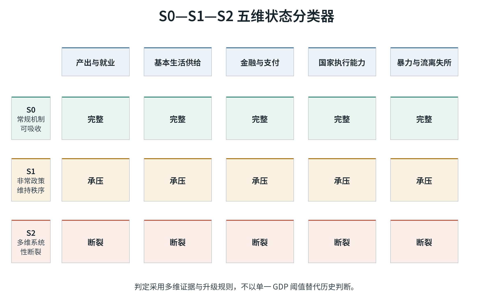

| 状态 | 产出就业 | 基本供给 | 金融支付 | 国家执行 | 暴力与流离失所 | 首要政策目标 |
|---|---|---|---|---|---|---|
| S0 平稳 | 波动可被常规制度吸收 | 供应连续 | 清算和信用正常 | 程序性执行 | 低水平 | 创新、分配、长期能力 |
| S1 危机 | 广泛显著下滑 | 局部紧张 | 系统压力或非常支持 | 仍能实施非常政策 | 可控 | 阻断反馈、保就业和支付 |
| S2 震荡 | 统计本身可能失真 | 生存品断裂 | 货币或支付失序 | 多层级失灵或强制化 | 战争、饥荒、大规模迁移 | 生存、关键供给、秩序重建 |

### 状态转换取决于缓冲能力

相同外生冲击不会产生相同社会状态。粮食减产在有库存、运输、可信信息和普遍购买力时可能停留在 S0/S1；在刚性征购、迁移限制和坏消息受罚的制度中则可能进入 S2。

状态转换与冲击强度和社会缓冲能力有关，但具体关系仍需经验检验，不能据此自动裁判历史事件。财政空间、福利、库存、冗余产能、支付网络、基层信息和政策纠错，都是需要分别观察的缓冲条件。

### 边界案例与编码纪律

恶性通胀可能在没有战争时摧毁支付；疫情可造成巨大死亡却保留国家执行；战争中的某些后方工业部门甚至扩张。因此编码必须记录“总体状态”和“群体状态”。2025 年全球被迫流离失所人数约 1.178 亿，提示宏观国界并不能覆盖个人处境<super>[6]</super>。本研究采用三条纪律：第一，不以现行 IPC 标准追溯性“认证”1930年代事件；第二，不把国家平均覆盖当作农村、少数群体或占领区状态；第三，报告所有可能改变分类的证据，而不是只选择支持既定制度判断的指标。

### 案例 11.1：大萧条中不同地区的状态差异

1929 年开始的大萧条是区分社会状态的边界案例。它证明金融和就业可以遭受极深冲击，却不能因此把“经济极差”与“社会生存系统全面断裂”混为一谈。美国在大萧条中经历银行恐慌、信用收缩、价格下降、投资崩塌和长期高失业；银行困境并不是事后装饰，而是通过信贷和支付网络把初始衰退放大为真实经济收缩。Calomiris 与 Mason 的银行—地区研究显示，银行困境更严重的地区出现了更大的实体经济损失<super>[46]</super>。但同一时期，美国并未普遍出现区域性食物配给体系崩溃、人口大规模饿死和全国支付系统完全消失，国家执行与基本供给虽承受巨大压力，仍保有恢复和纠错能力。因此，就总体状态编码而言，大萧条更接近持续而深的 S1，而不是 S2。局部群体仍可能进入 S2 式困境，但这必须由群体指标单独记录。

大萧条的制度教训不在于“危机一定来自错误货币政策”这一单因解释，而在于多个放大器彼此强化。固定汇率或金本位约束限制货币和汇率调整；通缩提高实际债务负担；银行倒闭破坏信用中介；失业保护不足将企业资产负债表压力转移给家庭；政策若坚持预算平衡，又会把私人需求下降转化为更长的公共收缩。Romer 与 Romer 对 24 个 OECD 国家战后金融危机的半年度研究发现，金融危机的平均后续产出损失存在，但对模型和样本敏感，不同危机之间差异很大；金融困境自身越严重、越持久，后续损失通常越大<super>[47]</super>。这说明国家能否及早处理金融中介、支付连续和债务重组，是状态是否长期固化的关键，而不是危机名称本身决定结果。

可以从暴露、脆弱性、放大机制和持续时间分析这个案例：暴露集中在银行、债务人和依赖信用投资的行业；脆弱性来自高杠杆、失业保护和存款保险薄弱；放大器包括银行挤兑、通缩、固定汇率与财政紧缩；持续时间取决于支付体系修复和政策退出时点。反事实比较不是假设“没有大萧条”，而是比较更早稳定银行、允许汇率调整、保护基本支付和需求的政策组合。这类反事实可提高机制可信度，但不能把不同国家的历史路径压缩为一个精确政策乘数。

**表 3-2　大萧条的 S1 编码与可能的 S2 局部边界**

| 维度 | 总体判断 | 主要事实 | 不能推出 |
|---|---|---|---|
| 产出与就业 | 严重断裂 | 长期高失业、投资和信用收缩 | 经济极差就等于战争或饥荒状态 |
| 基本生活供给 | 承压但未全国断裂 | 贫困和营养不良增加，基本市场与救济仍有运行 | 平均供给存在就等于所有家庭安全 |
| 金融与支付 | 严重压力 | 银行恐慌和信用中介破坏 | 银行危机自动解释全部实体后果 |
| 国家执行 | 受挑战但持续 | 税收、救济、监管和政策调整继续实施 | 国家执行存在就等于政策及时正确 |
| 暴力与流离失所 | 未达到 S2 主阈值 | 政治冲突与社会动荡上升，但非普遍战争、饥荒和流离失所 | 无需处理政治后果和群体极端损失 |

这一编码的意义是迫使分析者承认两种同时成立的事实：大萧条的损失足以推翻“市场自动恢复”的乐观判断；但社会并未在所有维度同时失效，因此也不能把非常时期的紧急权力无限外推到常态。

### 案例 11.2：2008 年危机与 2020 年疫情的状态差异

2008 年金融危机首先击中批发融资、银行资产负债表、抵押品价格和跨境信用，随后通过需求、就业和财政传导到社会。它通常表现为金融—就业型 S1：部分国家出现主权债务和长期失业，但国家执行、人口安全和基本供给没有普遍崩溃。Romer 与 Romer 的研究表明，危机后的产出路径跨国家差异显著，金融困境持续期比“是否发生过危机”更能解释后续损失<super>[47]</super>。因此，同样的金融冲击是否固化为长期停滞，取决于去杠杆速度、银行重组、财政支持和货币空间，而不是危机标签。

2020 年疫情冲击更清楚地暴露状态编码的群体性。公共卫生限制同时造成需求下降和供给中断，美国非农就业在 2020 年 4 月急剧减少，而欧洲多个国家通过短时工作、工资补贴或其他岗位保留机制减少雇佣关系断裂<super>[10-12]</super>。两类政策都可能是 S1 应对：前者保留劳动市场重新配置速度和失业保险连接，后者保留企业专用技能与雇佣关系。真正的比较指标不是“失业数字谁更小”，而是收入损失、债务、企业存活、重新匹配、健康、性别照护负担和长期职业轨迹。

这两个案例共同支持一个有限判断：状态分类必须记录主要断裂维度和群体分布。2008 年金融断裂可能对青年、移民和债务家庭造成长期伤痕；2020 年健康冲击可能对老年人、基础劳动者和照护承担者造成不对称风险。若只用 GDP 或总失业率，制度能力评价会遗漏风险承担者。

## 第十二章　平稳发展时，制度如何选择工具方向？

平稳发展中的关键困难是方向：技术路线可以增加产出，也可能锁定技能、能源和组织路径。

### S0 的难题是方向，不只是速度

在平稳期，各制度都能增加资本和技术，但选择函数不同。美国更依赖预期可占有收益、证券估值和企业战略；欧洲把行业谈判、职业技能与监管约束部分纳入选择；中国由中央方向、地方竞争、银行信贷和企业市场判断共同决定；苏联则主要通过计划指标和部门行政分配。问题不是哪一种“有投资”，而是哪一类工具更容易获得资金：能否专利化、能否计价、是否符合计划数量指标、是否支持就业质量，都会改变技术方向。

### 效率、冗余与劳动能力的三角关系

竞争会淘汰低效率组织，并通过价格发现局部知识；但极致库存压缩、单一供应商和短期回报约束可能减少社会冗余。行政体系可以保留战略产能，却可能因软预算使低效项目无法退出。协商体系可使企业选择增强技能的工具，但若发声权只覆盖稳定雇员，外包者与青年会承担调整。因而 S0 的评价至少包括生产率、韧性和劳动能力三维。

| 制度组合 | 主要选择机制 | 平稳期优势 | 内生风险 | 关键校正装置 |
|---|---|---|---|---|
| 美国资本市场主导 | 企业、投资者、采购、大学网络 | 分散试错、快速规模化 | 垄断、短期化、地区锁定 | 竞争政策、公共回报、可携带保障 |
| 欧洲社会协商 | 企业、行业组织、工会、公共规则 | 技能积累、关系投资、风险共担 | 内部人保护、碎片化、退出迟缓 | 扩大覆盖、青年入口、跨境协调 |
| 中国国家—市场混合 | 规划方向、地方竞争、银行和企业 | 基础设施、追赶、快速扩散 | 指标替代、重复投资、软预算 | 竞争中性、财税纪律、劳动可携带性 |
| 苏联行政计划 | 计划机关、部委、国企 | 已知路线集中复制 | 信息扭曲、品种错配、创新停滞 | 真实反馈、企业边界、失败终止 |

### 生产率是否转化为解放

工具提高单位劳动产出，劳动者能否获得时间、工资和自主仍取决于分配制度。转化链条依赖议价、税收、社会保障和所有权。若生产率收益主要进入地租、垄断租金或资产估值，技术进步可与时间贫困并存；若谈判和社会政策把部分收益转为休息、教育与健康，生产力才成为能力扩展。平稳期最重要的制度测试，是能否在没有灾难压力时投资于低可占有、高社会回报的基础科学、公共卫生、照护与生态韧性。

### 案例 12.1：德国的“病夫—明星”转换说明什么

德国在 1998—2005 年间常被称为“欧洲病夫”：年均增长约 1.2%，2003 年出现衰退，失业率由 1998 年的 9.2% 升至 2005 年的 11.1%。随后，德国在大衰退中经历 GDP 急剧下降，却没有出现与美国、西班牙等国相当的失业上升<super>[48]</super>。这一对照常被简化为“灵活劳动市场改革成功”，但证据不足以支持这种单因叙事。德国的调整能力同时来自行业谈判、工作委员会、职业教育、企业内部技能、短时工作以及出口制造结构。劳动市场制度不是简单地“保护”或“放开”，而是把外部冲击转化为工时、利润分享和内部重新配置。

该案例支持 S0 中的制度互补判断：工具采用、技能形成和劳动关系可以互为条件。若企业预计能够保留核心技能，就更有动力投资培训和长期工艺；若劳动者拥有信息和协商权，组织调整也更容易把现场知识用于工艺优化。反过来，若制度只降低解雇成本而不提供收入、培训和区域调整能力，企业可能获得更快裁量，劳动者却承担全部转型风险。德国经验因此不能被压缩为“裁员自由”或“保障充分”，而应被理解为调整成本在时间、群体和企业内部如何分摊。

### 案例 12.2：中国新能源汽车与机器人扩散的方向协调

中国新能源汽车和机器人产业提供另一个 S0 观察窗口。政策体系并非单一行政命令，而是中央目标、地方试点、目录和标准、公共采购、信贷与资本市场、企业竞争和全球供应链共同形成方向。新能源汽车早期依赖试点城市、购置补贴和充电基础设施；随后逐步引入双积分、技术标准和市场竞争，企业必须在成本、续航、质量和供应链上竞争，而非只完成口号。国际能源署的统计显示，2024 年全球电动汽车销量超过 1700 万辆，中国占全球销量的一半以上，说明方向协调可以在一个尚未成熟的市场中形成规模、学习和技术扩散<super>[57]</super>。

机器人扩散则显示“国家—市场混合”并非一层逻辑。中国工业机器人产量由 2020 年 21.8 万套增至 2025 年 77.3 万套，2024 年安装量约 29.5 万台，占全球 54%<super>[35-36]</super>。产业扩张可能通过设备、零部件、系统集成和出口创造新任务，也可能在企业内替代某些岗位、压低常规劳动者的议价权。现有中国企业、行业和城市研究之所以结论不同，往往是分析尺度不同：企业可能减少用工，地区可能通过上下游扩张吸收就业，个体则可能经历工资、技能和保障断裂。因此，国家方向、市场竞争、地方补贴和劳动者可携带保障必须分别检验。

### 案例 12.3：苏联集中复制路线的适用边界

苏联在钢、电、铁路、机床和军工等目标明确、产品相对标准化的领域，能够集中投资、协调上下游并快速形成生产能力。Allen 的反事实研究认为，重工业投资和计划体系对快速工业化有显著贡献，而集体化对增长的额外贡献较小<super>[1]</super>。这表明 S0 不能简单等同于“市场最擅长一切”：在外部威胁、技术路线已知和互补投资必须同步时，集中协调确有真实能力。

需求变得多样以后，单一数量目标的局限更明显。按吨数、件数或总产值考核，企业容易选择体积大、重量重、便于完成指标的产品，忽略质量、品种、服务和维修。若报告困难会招致惩罚，基层还可能隐藏产能、夸大需求或掩盖不合格品。资源配置便从解决实际问题转向满足指标。判断这种安排的适用范围，要看任务是否明确、用户能否反馈、预算是否受到约束，以及失败项目能否终止。

### 平稳期的能力转化

平稳期的净生产率收益，要经过议价与参与、公共供给、所有权和公共回报安排，才能转化为更广泛的实质能力。评估时还须扣除技能、地区、健康和照护方面的调整成本。任何关键环节缺失，都可能阻断这种转化。分析的目的在于辨明收益的去向，而非用单一分数代替制度判断，或把产出提高直接等同于社会改善。

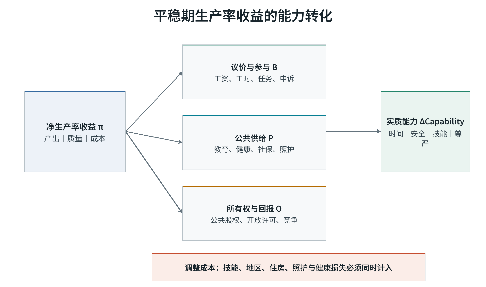

三个 S0 案例共同表明：美国的分散发现可以快速形成新产业，但收益可能向平台、专利和地区集中；欧洲协商可以保存技能和组织关系，但可能保护内部人并削弱外部人的进入；中国的国家—市场混合可以快速扩大方向明确的市场，同时面临地方重复投资、软预算和劳动保障分割；苏联集中动员可以复制已知路线，却在品种、质量、反馈和创新退出上付出代价。制度比较的目标不是寻找一个在所有维度上都占优的模式，而是识别收益在哪一环节被创造、在哪一环节被截留、成本由谁承担。

## 第十三章　危机中哪些能力决定损失与恢复？

金融冲击、需求下降和公共卫生限制会通过不同链条进入企业、家庭和地方财政。危机中的快速救助也可能把损失推迟到未来。

### 危机损失需要多维衡量

危机损失需要同时衡量产出缺口、失业、健康损失、金融破坏与分配恶化。

失业损失包括劳动者与岗位匹配关系的破坏，健康损失包括疾病与死亡，金融损失包括中介功能受损。若对不同损失加权，权重必须公开，并在不同伦理权重下检验结论是否稳健。大萧条研究显示，银行恐慌和金本位约束与更深萧条相关，较早脱离金本位的国家通常较早复苏<super>[7-9]</super>。这些结果涉及固定汇率约束、通缩、银行资产负债表和政策可信度的联动，不能归结为货币单因解释。

### 三种危机传导

2020 年 4 月美国非农就业减少 2050 万，失业率升至 14.7%<super>[10]</super>。同期 OECD 岗位保留计划覆盖约 6000 万份工作，约占成员经济体就业的 20%；5月实际支持约 5000 万份<super>[11]</super>。欧盟 SURE 在 2020 年支持约 3150 万名劳动者和 250 万家企业<super>[12]</super>。这些数字不是同口径绩效排名，却清楚显示危机策略分岔：美国更常通过失业保险和现金支持个人，欧洲更常通过工时补贴保存雇佣关系，中国则更多通过信贷、地方政府融资与投资维持需求和生产网络<super>[13]</super>。

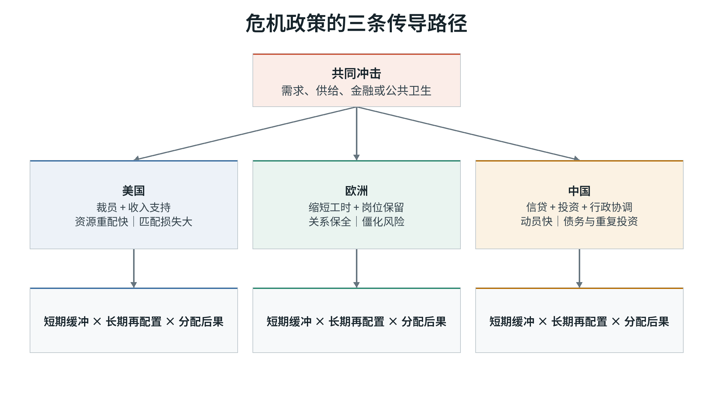

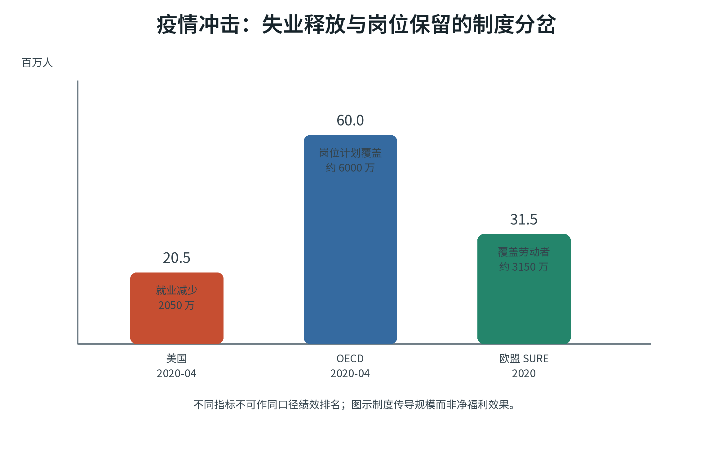

就业变化可分解为：

Loff 是离岗，Rkeep 是岗位保留，Mrealloc 是跨企业重新匹配，Ncreate 是新岗位。岗位保留减少短期匹配损失，但可能把资源锁在无前景企业；裁员促进重新配置，却在住房、医保、教育和地域不可携带时制造长期伤痕。优良危机制度应“保存可恢复的关系、退出不可恢复的组织”，而不是无差别保企业或无差别放任失业。

### 危机中的集中与道德风险

危机会扩大政府和大企业资产负债表。救助若没有条件，可能保护股东和管理层而把财政成本社会化；信贷扩张若主要依赖地方抵押和基建，短期乘数可能与地方债、土地依赖和重复工程并存；过早财政紧缩则会把暂时冲击转化为人力资本永久损失。危机治理的可检验原则包括：支持与就业、投资或公共服务挂钩；股东和高管先承担可识别损失；公布受益者；设置复审和日落条款；把劳动者与地方社会纳入退出方案。

### 案例 13.1：美国大萧条中的银行—就业传导

大萧条最重要的机制教训，是金融中断会改变实体经济的恢复函数。银行危机不仅反映先前衰退，还可能通过销毁信息资本、压缩信贷、迫使企业低价处置资产和提高预防性储蓄，继续制造失业和破产。Calomiris 与 Mason 的地区研究显示，银行困境程度与实体经济损失同向变化<super>[46]</super>。因此，政策只恢复总需求而不同时修复支付、存款和信用中介，恢复会更慢；政策只救助银行而不处理家庭债务和失业，也会把资产负债表压力重新输送回金融体系。

这一案例同时需要反例约束。银行困境不能解释大萧条的全部深度，因为金本位约束、工资和价格调整、农业冲击、保护主义、预期和政策制度都在共同作用。将危机归结为某一项政策错误，可能产生事后归因偏差。较可靠的表述是：金融脆弱性提高了冲击的放大倍数，而政策纠错速度决定放大器持续多久。

### 案例 13.2：2008 年后为什么相同的金融冲击产生不同恢复

2008 年金融危机后，不同发达国家的产出和就业恢复差异很大。Romer 与 Romer 发现，战后金融危机的平均产出损失存在但并非固定不变，估计对样本和模型敏感；金融困境的严重性和持续时间是后续差异的重要来源<super>[47]</super>。这支持一个制度结论：危机政策不应以“救或不救”二分，而应区分支付连续性、损失确认、债务重组、需求支持与生产能力重建。

若政府无条件保护所有负债和股东，道德风险与僵尸企业会上升；若政府迅速抽离支持或同步紧缩，银行和家庭修复尚未完成，需求下降又会造成第二波违约。有效政策需要一个有条件的时间序列：先稳定支付和基本信用，随后强制确认损失、重组可持续债务、保护失业者基本收入，再逐步将资源转向新企业和公共能力。政策退出本身也必须可验证，否则“暂时”支持会固化为长期租金。

### 案例 13.3：新冠冲击中的就业与供给双重断裂

2020 年疫情同时包含供给与需求冲击。限制接触同时减少生产、服务需求、交通和照护供给，家庭又因健康风险降低消费。美国失业急剧增加，欧洲岗位保留机制覆盖大量劳动者，而中国较多使用信贷、投资和地方协调维持供给网络<super>[10-13]</super>。三种选择的即时目标不同：美国保障被裁者收入和重新配置；欧洲保存雇佣关系和企业专用技能；中国保持项目、产业链和地方财政的连续性。

这些策略的长期成本也不同。美国若失业保险和医保不可携带，重新配置可能变成长期贫困和地区退出失败；欧洲若补贴无前景企业，可能延迟生产率重组；中国若信贷与基建缺少收益和退出纪律，可能把短期稳定转化为债务和重复投资。由此，危机评价不能只看救助规模，还应看损失确认、受益公开、企业退出、劳动者再进入和财政复盘。

衡量危机政策的净社会价值，需要比较支付和信用连续、收入与岗位关系保护、公共投资和生产能力恢复带来的收益，与财政成本、未受约束的私人风险转嫁，以及无前景企业和项目长期占用资源造成的损失。各项应分别测量，救助总额不能代替净效果。

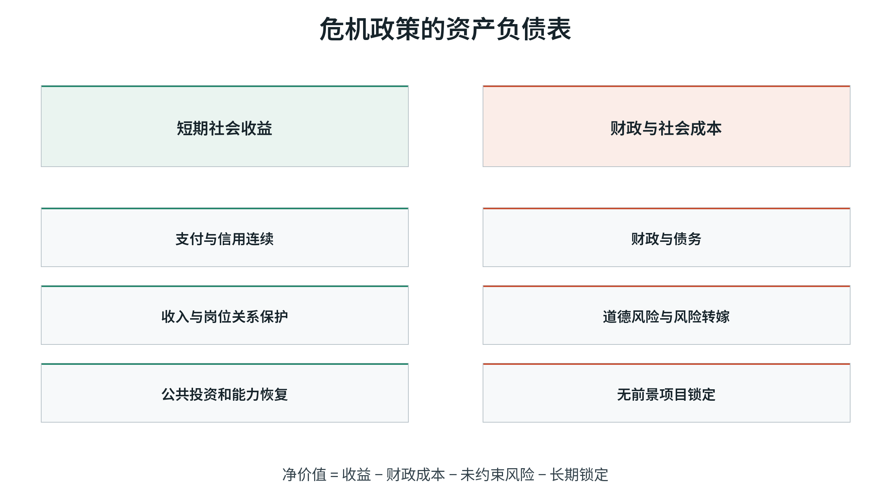

**表 3-3　三次危机的传导、承受者与退出条件**

| 案例 | 初始断裂 | 主要放大器 | 短期承受者 | 主要退出条件 | 其他解释 |
|---|---|---|---|---|---|
| 大萧条 | 银行、信用、需求 | 金本位、通缩、银行恐慌、政策紧缩 | 失业者、债务人、农民、小企业 | 支付恢复、债务重组、需求支持、政策纠错 | 技术性失业、结构错配、国际体系冲击 |
| 2008 年危机 | 批发融资、抵押品、跨境银行 | 杠杆、影子银行、主权—银行反馈 | 青年、债务人、边缘地区、临时工 | 银行重组、需求支持、债务减记、再培训 | 全球储蓄过剩、监管失败、需求不足 |
| 新冠疫情 | 健康、接触型服务、供给 | 封锁、需求骤降、照护缺口、政策覆盖差异 | 服务业、女性、非标准劳动者、移民 | 收入支持、岗位保留、公共卫生、重新匹配 | 财政过度支持、技术替代、消费偏好变化 |

危机政策需要保存可恢复的生产与雇佣关系，也要及时保障安全、收入、支付和健康。支持措施应确认损失、公开受益者，并允许没有恢复前景的主体退出。第四部将进一步讨论如何把这些要求写进规则。

## 第十四章　剧烈震荡为什么会击穿生产能力？

饥荒、战争和全国性断裂会压缩常规反馈；生产统计、强制征购、运输网络和权利缺失共同决定生命后果。

### 从粮食总量到获得权与强制权

苏联 1932—1933 年饥荒的死亡估计与意图判断存在持续争议。Davies 与 Wheatcroft 根据档案研究强调低收成、集体化破坏、严厉征购和政策失误的复合过程，并给出约 550万—650万饥荒死亡的最佳估计区间<super>[14]</super>。Naumenko 等人的区域研究则发现，乌克兰总体存在避免饥荒的粮食条件，死亡率与乌克兰人口占比、征购和留粮负相关，迁移限制进一步加重死亡<super>[15]</super>。这两类研究并非在所有判断上互斥：自然与农艺冲击可降低可用粮，政治征购、留粮和迁移制度决定谁死亡；但“是否存在针对特定民族的灭绝意图”需要独立历史证据，不能由一个回归系数直接替代。

中国 1959—1961 年大饥荒死亡估计范围约 1650万至4500万。Meng、Qian 与 Yared 发现，饥荒年份农村死亡率反而与人均粮食产量正相关；一种解释是征购按预期产量渐进且不能随当期减产灵活调整，使高产地区保留粮下降<super>[16]</super>。该发现支持“刚性征购 × 信息滞后 × 地区不平等”的机制，并不排除自然灾害、公共食堂、激励破坏和政治运动的作用。

| 机制 | 对总量的影响 | 对死亡分布的影响 | 可观察证据 | 反事实缓冲 |
|---|---|---|---|---|
| 收成/农艺冲击 | 降低可用粮 | 随生态暴露变化 | 收成、天气、病虫害 | 储备、进口、替代作物 |
| 刚性征购 | 农村留粮下降 | 高征购地区更重 | 计划与实际征购 | 随当期产量调整、最低留粮 |
| 迁移限制 | 不改变总量 | 阻断家庭自救 | 通行与返乡政策 | 开放迁移、救济通道 |
| 信息压制 | 延误政策纠偏 | 无发声地区更重 | 报告偏差、惩罚记录 | 独立统计、保护坏消息 |
| 权利不平等 | 决定配给优先序 | 农村与边缘群体承压 | 口粮、身份、死亡差异 | 普遍最低保障与申诉 |

### 战争动员的能力与边界

美国在第一次世界大战后期可把约五分之一资源投入战争，显示采购、价格管理、征税与金融动员的组合能力<super>[17]</super>；二战时期对航运、铝、橡胶等稀缺资源的配额与替代也展示集中协调的有效性<super>[18]</super>。但战争共识、强制权和外部威胁不可直接移植到气候或常态产业政策。战时动员的成功指标是关键产量，而社会评价还必须计入征兵、配给不平等、通胀、债务、民用消费压缩和战争死亡。

### 退出 S2 的最低序列

退出 S2 需要按相互依赖的次序重建：先恢复安全、人道通道、水粮能源和医疗，再修复支付、身份、交通和学校，随后重建企业信用、产权争议处理与政治问责。过早私有化或紧缩可能在秩序尚未恢复时助长掠夺，长期配给则可能固化紧急权力。日落条款、独立统计、最低供给保障、地方反馈和国际核验，需要与重建同时推进。

### 案例 14.1：苏联 1932—1933 年饥荒的制度放大器

苏联饥荒不能被写成单一天灾。Davies 与 Wheatcroft 的档案研究强调低收成、集体化破坏、征购压力和政策失误共同作用，并给出约 550 万至 650 万饥荒死亡的最佳估计区间<super>[14]</super>。Naumenko 的区域研究进一步发现，乌克兰在总体粮食条件下并非必然发生如此规模的死亡，死亡率与乌克兰人口占比、征购和农村留粮呈负相关，迁移限制又切断了家庭自救通道<super>[15]</super>。这些证据并不要求把所有死亡都归因于一个单一意图，却足以识别一组可检验的放大器：征购缺乏随收成调整的弹性，地方执行者面对政治压力，离乡寻找食物受限，救济与信息反馈迟缓。

该案例的分析关键是分开三个问题。第一，粮食可供量与农艺冲击是否恶化？第二，政治决策和征购制度如何决定谁能保留粮食？第三，意图、歧视性选择与制度性后果之间是什么关系？第三个问题尤其不能用一个回归直接替代。若不同群体在征购、配给、迁移和救济上面对不同规则，且这些差异与死亡分布一致，可以支持制度性权利不平等机制；是否存在特定灭绝意图仍需独立历史证据。把“制度导致不对称死亡”与“特定意图已被证明”分开，是保证案例分析严谨性的必要条件。

### 案例 14.2：中国 1959—1961 年大饥荒的“产量—征购—留粮”机制

中国大饥荒死亡估计仍有较宽区间。Meng、Qian 与 Yared 发现，在饥荒年份，农村死亡率在部分设定下与人均粮食产量呈正相关；其解释是征购按预期产量、历史产量或政治目标渐进执行，不能随当期减产迅速下调，导致高产地区反而可能因被征购更多而减少农村留粮<super>[16]</super>。Lin 与 Yang 进一步强调“可获得性—权利”分离：总产量下降重要，但公共食堂、征购、城乡配给和农村退出权变化决定个体能否真正获得食物<super>[56]</super>。

因此，中国案例不支持“自然灾害一切”或“制度一切”的简单答案。自然与农业冲击降低可用粮；公社化改变激励、自留地和家庭储备；公共食堂削弱家庭调节；高征购把区域余粮抽走；信息上报与政治压力延误纠错；迁移限制降低寻找食物和救济的机会。死亡在各地区、年龄和身份群体间分布不均，说明总量下降必须通过权利和分配机制才能转化为个体死亡。

**表 3-4　两次大饥荒的比较与不可直接外推之处**

| 维度 | 苏联 1932—1933 | 中国 1959—1961 | 可比较机制 | 不可混同 |
|---|---|---|---|---|
| 初始冲击 | 低收成、集体化、征购 | 农业减产、激励破坏、公共食堂 | 总量不是唯一变量 | 气候与制度组合不同 |
| 权利分配 | 地区、身份、迁移与征购差异 | 城乡、地区、公社和身份差异 | 权利不平等决定死亡分布 | 具体政策工具与政治背景不同 |
| 信息反馈 | 报告与地方执行受政治压力 | 高指标、瞒报与纠错滞后 | 坏消息上行受阻会放大灾难 | 不能用同一行政体制标签解释 |
| 自救与迁移 | 外出和返乡限制 | 人口流动与家庭储备受限制 | 迁移权具有生存价值 | 时间、范围和执行机制不同 |
| 责任判断 | 意图问题存在历史争议 | 政策错误与政治机制存在不同解释 | 机制证据与意图证明分层 | 死亡相关与单一意图证明分层 |

两案例最重要的方法教训，是 S2 识别不能等待完整死亡统计。粮食库存、农村留粮、征购计划、迁移和救济许可、报告偏差与地方申诉，往往在最终死亡统计公开之前就已发生变化。保护坏消息和允许即时救济，是降低不可逆死亡的基础制度。

### 案例 14.3：美国二战动员的任务适用边界

二战时期美国通过采购、价格和物资管理、税收、债券和金融监管动员大量资源，航运、铝、橡胶等关键品实施配额与替代，军品产出迅速上升<super>[17-18]</super>。这个案例证明，在目标单一、外部威胁明确、需求可集中汇总且生产技术相对成熟时，民主国家也能使用接近行政配置的工具完成任务。动员能力是真实的，不能被“市场不会计划”一句话抹去。

但战争经济的经验需要限定在特定任务与授权期限。目标由军事必要性压缩，消费者选择被暂停，工资和价格受控制，税收和配给把成本转移给家庭，部分少数群体和女性承担劳动与迁移成本，死亡不可逆。战争期间的有效产出指标主要是武器、舰船和物资，不代表医疗、照护、生态、消费品多样性和个人自由同样最优。制度比较必须区分“动员已知关键品”的能力和“发现未知偏好与创新”的能力。

### S2 案例的统一结论

四个 S2 案例显示，集中权力并非天然有效或天然灾难。它的价值取决于任务是否清晰、信息是否真实、必需供给是否能普遍到达、受影响者是否有救济和迁移权、错误是否能被承认。其风险则来自同样的集中：当征购、配给、迁移、报告和救济权限同时被政治目标锁定，地方和家庭失去自我调节空间，坏消息无法上行，局部失误会被系统放大。

家庭能否获得食物、药品、住所和安全，是判断 S2 是否结束的起点。还要看支付和交通是否恢复，学校、医疗和市场能否运行，迁移者是否取得身份和返回选择，以及死亡是否得到记录、承认和救济。紧急权力的期限与审查程序，也应纳入恢复标准。

## 第二编 美国 公共创新与分配断裂

## 美国部分导论 联邦体系中的公共和私人组合

美国创新体系由联邦科研、国防与健康采购、大学、国家实验室、风险资本、大企业和地方产业集群共同构成。公共部门承担大量基础研究和早期不确定性，私人主体在专利、产品、渠道和平台上组织商业化。<super>[19-24]</super><super>[49-50]</super> “纯市场美国”会遗漏公共风险承担；“国家创造一切”又会遗漏企业工程、竞争、用户和资本选择。

美国的分配断裂具有空间性。新工具的收益集中在拥有大学、资本、供应商和高技能劳动的城市，传统制造地区可能因贸易、自动化和需求变化同时受损。全国就业恢复并不保证受冲击工人恢复原工资，地区房价下降也会削弱迁移能力。Autor、Dorn和Hanson关于进口竞争的研究说明，地方劳动市场调整可以持续很久。<super>[22]</super>

## 美国专题 公共科研的风险链

公共科研的价值不只体现在直接专利。NIH、NSF、国防机构、大学和国家实验室生产论文、人才、数据、仪器、标准和可继续开发的技术选项。Galkina Cleary等追踪2010至2016年获批新药，发现相关基础知识与NIH资助联系广泛。<super>[49]</super> 该结果证明公共研究参与了知识链，不能解释为政府创造了药物全部价值。

公共知识进入产品，还需要临床试验、工程、制造、监管、融资、营销和医疗支付。私营企业承担部分失败风险，也可能利用专利、市场排他和定价权取得超出其边际贡献的回报。公共回报需要分别考察知识开放、产品可及性、制造能力、竞争和财政回收。

Bayh-Dole法案推动受联邦资助发明由大学和承包方许可商业化，同时保留政府权利和报告要求。GAO对报告与监督的审查说明，权利是否有效取决于数据完整和执行能力。<super>[24]</super> 如果政府不知道哪些发明进入产品，就难以评估可及性、制造和介入权。

## 美国专题 DARPA与任务型采购

DARPA式组织的优势来自明确任务、专业项目经理、有限任期、多路线竞争和停止失败项目的权力。它不同于给既有企业提供永久补贴，也不同于用短期论文指标管理基础科学。任务机构可以跨越实验室和原型之间的融资缺口，但仍依赖大学、企业与公共采购共同形成技术生态。

任务型采购的风险包括军事目标挤压民用需求、供应商集中、保密限制和项目经理判断错误。评估不应只数成功项目，因为高风险组合必然包含失败；也不能忽略失败成本。适当指标包括技术选项价值、后续私人投入、开放标准、供应商进入和任务完成率。

## 美国专题 平台集中与人工智能

人工智能基础模型需要算力、数据、人才和分发渠道，规模经济与网络效应可能提高进入门槛。公共科研和开放论文为模型发展提供知识底座，云平台和大型企业控制训练基础设施与用户入口。工具创新由此可能同时扩大能力和集中控制。

劳动结果不能由职业暴露预测。生成式人工智能可提高部分客服、编程和写作任务效率，收益大小随经验、任务和组织流程变化。企业可能用它增强低经验劳动者，也可能缩减入口岗位、加强监控或把质量风险转给承包者。美国部分沿用第二部“暴露—使用—采用—产量—安装—劳动结果”链条，不把模型能力演示当作就业结果。

## 美国专题 地区调整和地方财政

技术集群产生知识溢出和高工资，也推高住房成本。受冲击地区的工人理论上可以迁往增长地区，实际上住房、家庭、医疗保险和技能认证限制移动。地方税基下降又削弱教育、交通和公共服务，形成累积衰退。企业退出是市场纠错机制，但若没有地方缓冲，退出成本由无法迁移的居民承担。

地点导向政策需要区分公共品与企业补贴。交通、宽带、社区学院、住房和清洁环境可以提高多类企业与居民能力；为单一企业提供长期税收优惠可能转移选址租金。评价应比较新增活动、替代活动、财政机会成本和十年以上的地方工资，而不是只报告宣布投资。

## 美国专题 危机救助的所有权与条件

金融和疫情危机中，政府可以用贷款、担保、资产购买和财政转移迅速稳定系统。救助条件决定社会回报。对支付系统和小企业流动性的支持可以避免连锁破产；无条件保护股东、回购和高管报酬可能把下行风险社会化。救助设计应包括损失承担顺序、分红限制、就业或能力条件、透明披露和退出日期。

“救助是否有效”不能只用受助企业存活回答。若本来可融资的企业占据资源，额外性有限；若支持维持了短期可行企业的匹配关系，收益可能很高。需要利用资格阈值、政策时点和地区差异建立反事实。

## 第十五章　美国式创新为何同时产生突破和分配断裂？

美国公共科研、军工采购、大学、风险资本和平台企业共同形成创新优势，地区调整和地方财政却承担了高度不均的成本。

### 美国的公共与私人机制如何结合

美国 2023 年研发支出约 9370 亿美元，其中基础研究约 1380 亿、应用研究约 1740 亿、试验发展约 6250 亿；2024 年总额估计约 9930 亿美元<super>[19]</super>。企业 2023 年执行研发约 7220 亿美元<super>[20]</super>，占全国研发执行约 78%、资助约 75%；但联邦政府仍资助约 41% 的基础研究<super>[21]</super>。这些事实描述的是一种分工：公共部门承担知识、人才和任务采购的上游不确定性，企业以产品、专利、平台和规模化组织下游。

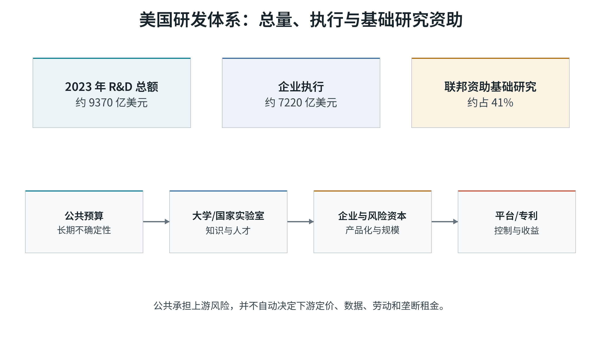

### 地区、教育与种族的非对称调整

自动化冲击通过地方产业集中、住房成本、社区财政与教育机会放大。劳动力流动受房产负资产、照护责任、医保和资格认证约束。Autor、Dorn 与 Hanson 对中国进口竞争的研究显示，地方劳动力市场调整缓慢，工资、就业和转移支付影响可持续多年<super>[22]</super>；这一证据不能直接等同自动化效应，却说明地区锁定会使全国净收益与地方持久损失并存。

### 创新价值链与社会回报

公共创新的价值包括知识积累、知识溢出和未来选择空间，也可能因垄断、定价或数据控制而流失。政策应使公共投入保留开放知识、合理许可、竞争入口与可审计回报，同时允许私人商业化。对药品、AI 和国防衍生技术，还需把安全、可及性和劳动影响写入采购合同。

### 案例 15.1：美国“隐藏的发展型国家”

美国创新系统并非政府缺位下的纯市场奇迹。Block 与 Keller 对 1970—2006 年美国经济中重大创新来源的研究发现，公共资助、大学、国家实验室、国防采购和政府培育的企业在网络、计算、生命科学等关键领域持续发挥中心作用；随着企业实验室和传统工业研发结构变化，这一公共—私人网络的重要性反而更突出<super>[50]</super>。美国优势来自多中心发现：联邦机构、州政府、大学、企业、风险资本、用户市场和专业共同体可以并行试验，失败项目能够相对容易地被竞争者替代。

公共底座需要回报契约和可及条件。公共机构创造知识、人才、初始需求和标准，企业则可能通过专利、平台、渠道、数据或供应链锁定把后续租金集中起来。DARPA 式的任务机构之所以有效，通常不是因为官僚命令比市场更聪明，而是因为其项目经理拥有较高专业自治，采取小规模组合资助，允许失败，并在竞争者之间保持入口。若采购被单一承包商锁定，或公共资助只考核论文和短期指标，同样的制度形式也会失灵。

### 案例 15.2：地区调整为什么能把全国净收益转化为地方损失

Autor、Dorn 与 Hanson 的“中国综合症”研究显示，中国进口竞争对美国地方劳动力市场造成持续冲击，制造业就业和工资承压，转移支付增加且调整缓慢<super>[22]</super>。该案例不直接测量机器人，却揭示了一个更一般的机制：全国消费者获得更低价格、进口企业和物流获得利润，局部制造社区却同时失去工资、税基、住房价值和公共投资。贸易或自动化的全国净收益与地方损失因此可以并存。

地区锁定来自多重成本。工人可能拥有只适用于本地产业的技能；住房负资产使迁移无法变现；医保、养老金、配偶工作和子女学校增加流动成本；新岗位可能要求不同职业资格；社区税基下降又削弱教育和公共服务。把“劳动可以流动”写成个体选择，会遗漏这些制度性退出成本。政策若只提供一次性补贴或泛化培训，通常不足以恢复地区能力；需要产业转移、工资保险、可携带福利、住房和公共服务的组合。

### 案例 15.3：创新系统中的分配结果必须进入生产率评价

美国研发体系的高总量说明资源和人才集中，却不说明收益分配。公共基础研究可能带来新药、算法、互联网和国防衍生技术；企业商业化也可能带来速度、质量和规模化。只有当公共合同保留开放标准、可负担定价、竞争入口、国内制造和劳动者转型条件时，公共风险才与公共权利对称。否则，公共部门承担早期失败，私人控制取得后续租金，地区和社会承担调整成本。

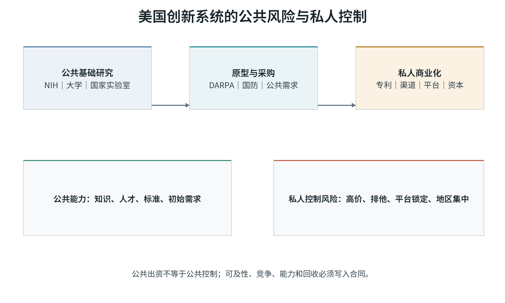

该案例支持本书第三部的一个核心判断：评价创新系统必须同时记录知识产出、产品扩散、价格与可及性、产业能力、劳动结果和地区分布。单一专利数量、企业估值或总研发金额，都不足以代表创新是否扩大社会能力。

## 第十六章　公共突破为什么会变成私人控制？

公共资金承担早期不确定性，私人企业随后把成果转成专利、价格、平台和数据资产。

### NIH、大学与长期不确定性

NIH 年预算约 480 亿美元，其中约 82% 通过竞争性方式支持外部研究组织<super>[23]</super>。这类组合资助允许失败、同行评议和知识积累，适合私人资本难以独占的上游领域。但进入商业化以后，专利组合、临床试验、制造能力、渠道和支付体系会重新集中控制。公共知识与私人产品之间经历多次权利重组。

### Bayh-Dole 的成就与治理缺口

Bayh-Dole 允许受联邦资助机构保留发明产权，意在提高技术转移；GAO 的最新审计同时指出发明披露和商业化报告仍存在数据完整性问题<super>[24]</super>。因此争论不能停在“专利促进或阻碍创新”。应分别评估：许可是否排他、公共资助是否披露、产品是否可负担、未商业化专利是否阻断后续研究、政府保留权是否可执行。

| 环节 | 公共贡献 | 私人贡献 | 可能的控制瓶颈 | 制度接口 |
|---|---|---|---|---|
| 基础研究 | 长期资助、开放知识 | 企业实验室、问题反馈 | 议题偏向可商业化领域 | 多元同行评议、开放数据 |
| 原型与任务采购 | 首批需求、标准、风险承担 | 工程整合、制造 | 采购锁定单一承包商 | 模块化标准、多源采购 |
| 商业化 | 人才、基础设施、公共数据 | 产品、营销、规模资本 | 专利丛林、平台网络效应 | 许可条件、互操作、竞争政策 |
| 扩散 | 医保、教育、公共采购 | 服务网络、持续改进 | 高价、地域和群体排除 | 可及性条款、公共收益回收 |

### 从“纳税人出资”到可执行权利

公共回报可以是财政收益，也可以是更低价格、开放标准、国内制造能力、培训、数据访问和知识共享。与其事后争论谁“应当感恩”，更可执行的办法是在资助与采购时写入里程碑、透明度、许可边界、回购或收益分享、劳动转型和终止条款。美国体系最需要补足的不是创新冲动，而是把公共风险与公共权利对称化。

### 案例 16.1：NIH 基础研究如何进入新药

Galkina Cleary 等追踪 2010—2016 年 FDA 批准的 210 个新分子实体，发现每一个获批新药的已发表研究都同 NIH 资助存在关联；相关研究累计超过 20 万个资助年，涉及超过 1000 亿美元投入，其中 90% 以上投向药物靶点和疾病机制的基础研究，而不是药物本身的后期开发<super>[49]</super>。这一事实支持公共基础研究与私人应用开发之间的互补关系：政府承担知识发现和靶点验证的长期不确定性，企业承担临床开发、制造、监管和商业化。

但“所有新药都受益于 NIH”不能被解释成“公共部门应当拥有全部药品”。公共研究产生大量不可排他的知识，私人企业需要组织试验、生产、风险管理并面对监管责任。更精确的结论是：公共风险贡献与私人收益控制之间缺少对称的权利接口。若公共资助只换来论文，而没有知识开放、可负担定价、竞争性许可、生产能力和失败披露，社会回报可能被下游专利、渠道和支付权力截留。

### 案例 16.2：Bayh-Dole 的成就与反事实

Bayh-Dole 允许受联邦资助的大学和小企业保留发明权，意在促进技术转移。它的支持者强调商业化激励、大学专利和技术创业；批评者则担心排他许可、专利丛林和高价阻断后续研究。GAO 的审计显示，发明披露和商业化报告仍存在数据完整性问题<super>[24]</super>。因此，政策评价必须区分“大学是否更容易申请专利”与“社会是否更快获得可负担、可扩散的产品”。

可行的反事实不是简单取消专利，而是比较不同权利组合：非排他许可与独家许可；里程碑付款与统一低价；公共专利池与专利垄断；开放数据与商业秘密；公共制造与外包。对每一种组合，至少需要测量研发方向、后续引用、产品价格、可及性、企业进入和公共财政回收。只有当权利设计同时保留研发激励与后续竞争，公共投入才更可能变成公共能力。

**表 3-5　公共突破到私人控制的五道接口**

| 接口 | 公共贡献 | 私人能力 | 主要风险 | 可执行条件 |
|---|---|---|---|---|
| 基础科学 | 长期资助、人才、数据 | 问题反馈、工程化 | 目标被短期可商业化方向扭曲 | 开放出版、长期拨款、复现要求 |
| 早期原型 | 采购、试验、标准 | 快速迭代、制造 | 公共试验成功被私人锁定 | 里程碑、分阶段资金、竞争入口 |
| 知识产权 | 发现、风险承担 | 许可、投资、商业化 | 排他许可阻断后续创新 | 许可边界、政府介入权、专利池 |
| 市场扩散 | 医保、采购、基础设施 | 生产、渠道、服务 | 高价和地域排除 | 可及性、价格、数据与制造条件 |
| 收益分配 | 税收、公共风险 | 股东回报、再投资 | 公共收益被私人租金截留 | 收益分享、回购、终止和转授权 |

### 公共回报的可执行形式

公共回报可以从开放知识和数据、价格与覆盖、制造技能和基础设施、后续创新入口，以及税收或收益回收五个方面观察。这些回报可部分替代，却不能由企业估值代替。政策工具应随产品特征变化：公共卫生更强调普遍可及，国防技术更强调安全和供应链，软件和 AI 更强调互操作、数据权和模型责任。

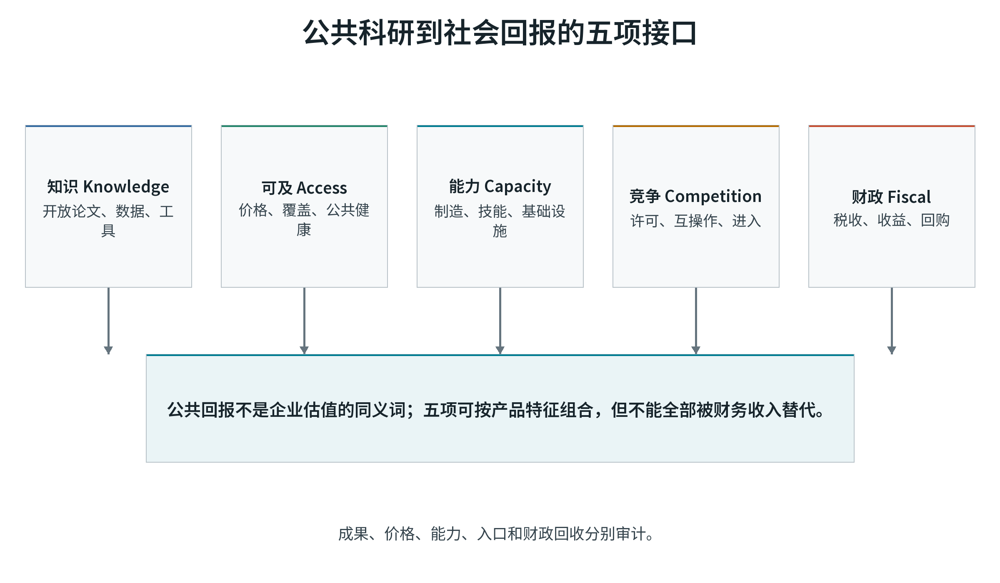

美国案例提出了一个持续的制度难题：怎样保留商业化激励，同时让公共投入带来知识扩散、竞争机会和可执行的社会回报。第四部的公共采购、专利治理和长期创新安排，将围绕这一问题展开。

## 第三编 欧洲 社会市场 劳动协商与制度多样性

## 欧洲部分导论 制度家族而非欧洲模式

欧洲至少包含北欧高覆盖协调、德语区共同决定与职业教育、南欧劳动市场分割、中东欧生产网络追赶，以及各国内部显著地区差异。<super>[25-34]</super> 欧盟层面制定竞争、贸易、数据、平台劳动和绿色产业规则，工资形成、福利和执行仍主要由成员国制度决定。将欧洲写成高福利单一模式，会同时高估统一性和低估制度互补。

协商制度的效应不能从工会密度单独判断。行业谈判覆盖、工作委员会权限、企业信息、执行与申诉共同决定参与是否真实。Jager、Noy和Schoefer的综合研究发现德国共同决定对工资、生产率和投资的平均效应多为零或小幅正值，但制度可能改变信息、程序正义、长期资本和冲突方式，而未在短期平均值中表现。<super>[25]</super>

## 欧洲专题 德国岗位保留的条件

德国短时工作通过减少工时而非立即解除劳动关系吸收暂时冲击。它保存企业专用技能，降低重新招聘成本，并让社会保险分担收入损失。疫情期间德国和其他欧洲国家大幅扩大相关计划，德国部分行业协议进一步提高替代率。<super>[11]</super><super>[11]</super>

岗位保留需要同时评估工资、技能与安全。若企业需求永久消失，补贴会锁定劳动和资本；边缘工、微型就业者和自雇者可能被排除；企业也可能获得本来会保留岗位的补贴。有效制度需要企业共付、定期复审、培训支持和逐步退出，并为不可持续岗位提供转岗服务。

德国经验还依赖职业教育、行业组织、社会保险管理和企业信息，不能把短时工作政策单独移植。没有可信工资记录和执行机构时，同一补贴可能变成企业现金支持而未保护工人。

## 欧洲专题 北欧协调与数字化

北欧制度常把较灵活的企业调整与普遍福利、培训和高谈判覆盖结合。企业可以重组，劳动者因收入保障和公共服务拥有更强退出能力。技术接受因此不只来自文化信任，而来自对失业、医疗和再就业规则的可预期性。

高税收和高保障也有边界。培训项目可能与实际岗位脱节，技术密集企业仍会集中在大城市，移民和平台劳动者可能覆盖不足。评价应比较失业后收入轨迹、培训完成后的岗位质量和地区迁移，而不是只观察福利支出。

## 欧洲专题 南欧内部人与外部人

南欧部分国家的长期合同保护与临时合同、高青年失业并存。企业采用自动化时，受保护内部人可能通过协商获得培训，青年和临时工则难以进入稳定岗位。总就业保护指数无法显示这种分割。

危机中，岗位保留若主要覆盖正式合同，会加剧代际和合同差异。制度改进需要让保险随劳动者而非合同类型移动，并减少企业通过连续临时合同规避责任。技术政策还要把青年入口岗位作为独立指标，防止自动化先消除学习任务。

## 欧洲专题 中东欧生产网络

中东欧通过汽车、电子和机械供应链进入欧洲制造体系，外资带来设备、标准和出口需求。追赶收益取决于本地供应商、工程人才和研发是否升级。若关键设计和采购由总部控制，地区可能长期停留在装配和成本竞争。

机器人采用可能提高工厂效率并保住出口，也可能减少低技能入口。欧盟凝聚政策和国家教育投资可以建设本地能力，但补贴竞赛可能把公共资源转给跨国企业。评价应记录本地采购、研发人员、工资、利润留存和企业退出后的资产可再利用性。

## 欧洲专题 平台工作指令和算法管理

欧盟2024年平台工作指令处理就业身份推定、算法透明、人类监督和数据限制等问题。<super>[31]</super> 它的重要贡献是把算法管理视为劳动治理，而不只是数据保护。就业身份决定最低工资、工时、社会保险和集体权利；算法规则决定派单、评分和停用。

法律文本与实际保护之间仍有执行距离。平台跨境经营、承包链和自雇形式会增加责任识别难度；监管机构需要访问系统日志和决策依据；劳动者需要低成本申诉和代表支持。成员国转置差异将形成新的比较材料。

## 欧洲专题 绿色任务与产业能力

Horizon Europe和净零工业法试图把科研、示范、制造和市场规则连接到长期公共目标。<super>[32-34]</super> 绿色任务面临技术路线、许可、电网、原料、技能和地区分配的多重协调。单纯补贴工厂无法解决电网接入和需求不足，单纯设定排放目标也不能形成制造能力。

欧盟产业政策还受到成员国财政能力差异约束。财力强的国家可以提供更多支持，可能把产业进一步集中。共同融资、竞争审查和地区能力投资是避免内部补贴竞赛的必要条件。成功指标应包括实际减排、成本、供应链韧性、就业质量和地区收敛。

## 欧美比较 科研资助与劳动保障的不同安排

美国的公共性更多集中在科研、采购和危机融资，劳动调整依赖企业和地方市场；欧洲在科研之外拥有更广的社会保险、岗位保留和协商制度。美国可能更快重配资本和劳动，也更容易形成地区与个人持久损失；欧洲可以保存技能和收入，却面临内部人保护、财政差异和重组延迟。

这种比较不产生固定优胜者。对于高不确定前沿研究，美国多元资金和快速商业化具有优势；对于暂时需求冲击，欧洲岗位保留可能减少匹配损失；对于平台与算法劳动，欧盟权利框架提供更明确程序，但执行效果仍待观察。制度选择应匹配任务和状态。

## 第十七章　欧洲为什么需要按制度家族解释？

德国共同决定、北欧普遍福利、南欧劳动分割和中东欧生产网络都属于欧洲，却产生不同风险分布。

### 四种欧洲制度组合

德国行业谈判与共同决定形成企业合作能力，但工会密度与覆盖下降使双元体系的代表性受到挑战<super>[25]</super>。OECD/AIAS ICTWSS 数据覆盖 56 个国家、60年和百余变量；在欧盟，只有 10 个国家达到 80% 集体谈判覆盖门槛<super>[26]</super>。因此“欧洲劳动模式”只是一组制度家族。

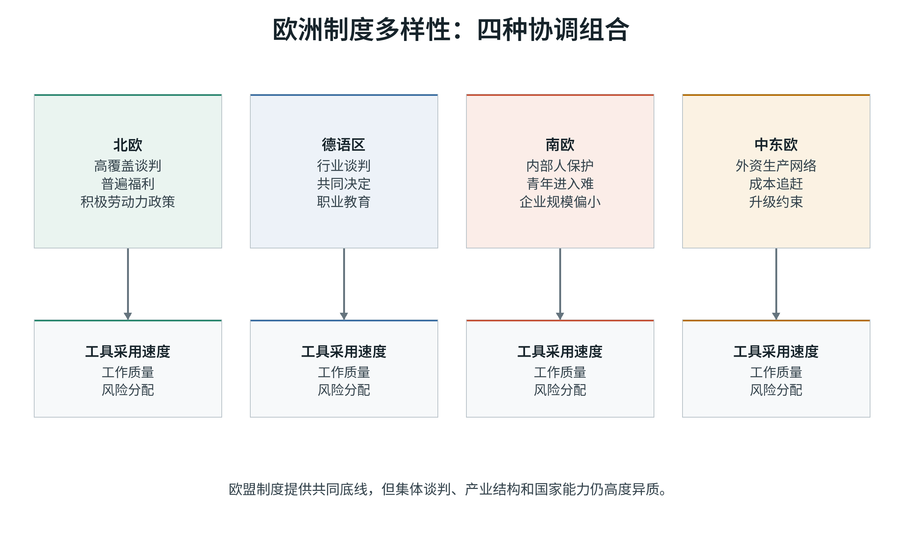

北欧以高覆盖谈判、普遍福利和积极劳动力政策组合“安全与流动”；德语区以行业工资、工作委员会、职业教育和共同决定积累企业专用技能；南欧更常出现稳定内部人、临时青年和小企业并存；中东欧依靠较低单位劳动成本、邻近核心市场和单一市场准入进入全球价值链，并在部分地区向高附加值活动升级<super>[27]</super>。

全球价值链并未在 2023—2024 年出现普遍、急剧的“回流”：OECD 的实验性估计显示，整合程度变化有限且国家异质性显著<super>[45]</super>。这意味着中东欧的制度问题不是简单等待制造业回迁，而是如何把外资生产节点转化为本地研发、供应商能力、职业上升和议价权。

### 内部人—外部人与青年入口

2025 年欧盟就业率达 76.1%，但成员国从意大利 67.6% 到马耳他 83.6% 差异显著<super>[28]</super>；同年欧盟失业率为 6.0%，西班牙 10.5%、希腊 8.9%，捷克仅 2.8%<super>[29]</super>。欧盟 15—29 岁 NEET 比例为 11.0%<super>[30]</super>。这些统计不证明就业保护导致青年失业，却表明平均值无法代表转型风险。若协商权集中在大企业正式工，算法管理、外包、平台劳动和青年临时合同仍可能在制度外部。

### 协商权是乘法结构

覆盖率高但没有决策权，或有咨询权却没有算法信息，Voice 都接近零。欧洲优势只有在四者同时存在时才成立：覆盖非标准劳动者；工作委员会有实质权限；企业披露模型目标、数据和错误率；申诉决定可执行。

### 案例 17.1：德国共同决定的效率效应为什么“接近零”却仍重要

Jäger、Schoefer 与 Heining 利用德国 1994 年改革造成的公司董事会三分之一工人代表制度变化，比较改革前后成立的企业以及受影响的公司类型。研究发现，董事会共同决定对工资水平和工资结构没有显著影响，租金分享和劳动份额也没有明显改变；研究还拒绝了共同决定通过减少投资压低工资的机制，因为共同决定若产生作用，反而提高了资本形成<super>[25]</super>。Jäger、Noy 与 Schoefer 的比较研究也表明，现有证据不足以支持“工人进入董事会必然损害企业绩效”这一强判断<super>[25]</super>。

平均工资或利润的变化，只反映共同决定的部分作用。它还可能影响信息流、事故、技能投资、危机中的工时调整和申诉渠道；同时也可能保护内部人，使外包工、青年和临时劳动者承担更多调整成本。评价时需要把企业绩效、工作质量、进入机会和未被覆盖者的成本放在一起。

### 案例 17.2：德国大衰退中的岗位保留

德国在 2008—2009 年 GDP 显著下降，却没有出现与产出下降等比例的失业上升<super>[48]</super>。这一结果来自制度互补：行业谈判、工作委员会、短时工作、技能投资和企业内部调整共同分担需求下降。企业保留熟练工人，劳动者接受工时和收入下降，公共社保部分承担成本，待需求恢复后生产能力较快恢复。对高技能、企业专用能力强和培训成本高的行业，这种做法具有清晰经济逻辑。

其风险是选择性保护。短时工作若长期补贴无前景企业，会延迟资源重新配置；企业若借短时工作压缩工资和培训，而利润不分享，则劳动者承担过多。另一个风险是外部人：临时合同、平台劳动者和进入市场者可能不在制度覆盖内。案例支持的不是无条件岗位保留，而是“对可恢复关系进行有期限、分阶段的共同调整”。企业必须证明恢复路径，政府必须设置时限和复审，劳动者要有培训、收入和申诉保障。

### 案例 17.3：南欧青年与中东欧升级的两种外部性

2025 年欧盟就业率平均为 76.1%，但成员国从意大利 67.6% 到马耳他 83.6% 差异显著；失业率从捷克 2.8% 到西班牙 10.5%、希腊 8.9% 不等；15—29 岁 NEET 比例为 11.0%<super>[28-30]</super>。这些差异说明欧洲包含多个制度家族。南欧部分国家同时面对稳定内部人、青年临时合同、小企业低生产率和家庭照护负担；中东欧则更多处于外资生产网络、成本追赶和向高附加值升级的张力中。

OECD 对全球价值链的实验性估计显示，2023—2024 年并未出现普遍、急剧的制造业回流，制度差异和行业位置仍高度重要<super>[45]</super>。中东欧若只承接低附加值组装，外部需求冲击会直接转化为就业和地方财政风险；若能形成本地供应商、研发、技能和议价组织，外资生产节点才可能转为长期能力。两种路径都说明，区域政策不能只看投资流入，还要看技术溢出、收入分配、工会覆盖和退出成本。

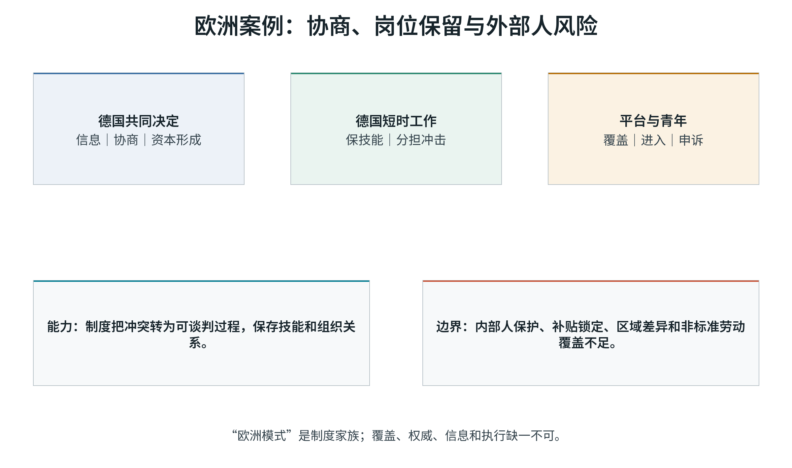

**表 3-6　欧洲案例的能力与边界**

| 案例 | 主要能力 | 支持机制 | 反例或风险 | 需要的校正 |
|---|---|---|---|---|
| 德国共同决定 | 信息共享、重组合法性、资本形成 | 董事会代表、工作委员会、行业谈判 | 平均工资效果小、内部人可能受保护 | 扩大代表覆盖、保护外部人和青年 |
| 德国短时工作 | 保存技能、降低失业、共同承担冲击 | 工时调整、社保补贴、企业协商 | 补贴无前景企业、工资和培训被压缩 | 时限、复审、利润分享、培训和退出 |
| 南欧青年市场 | 正式员工稳定、企业内部技能 | 雇佣保护、家庭支持、职业网络 | 临时合同、青年入口难、区域差距 | 可携带福利、学徒、公共服务和竞争 |
| 中东欧生产升级 | 外资、出口和供应链学习 | 单一市场、成本优势、产业基础 | 低附加值锁定、外部需求波动 | 本地研发、技能、供应商和议价权 |

## 第十八章　协商式转型能保存岗位与能力吗？

当劳动者参与、短时工作和技能形成同时存在时，技术转型可以保存匹配并改善安全；覆盖不足时，调整成本会转给外部人。

### 劳动者知识进入技术选择

车间劳动者了解设备异常、维护问题、客户反馈和隐性安全风险。采购和部署前引入这些知识，可能减少实施失败、改善培训并提高接受度。协商也可能保护既有岗位、延迟重组，或把成本转给外包者。判断其效果，需要比较生产率、事故、离职、工资、任务自主和外部就业。

### 平台工作和算法管理

欧盟平台工作指令 2024/2831 对自动化管理的信息、咨询、数据处理和人工复核提出要求，成员国应在 2026 年 12 月前转化为国内法<super>[31]</super>。其制度创新是把算法从“企业内部工具”转为可被解释、申诉和协商的劳动规则。但执行效果取决于雇佣身份推定、监管资源、跨境平台数据访问与集体代表覆盖。

### 公共任务与绿色产业

Horizon Europe 2021—2027 年指示性预算为 935 亿欧元<super>[32]</super>。净零工业法提出到 2030 年欧盟战略净零技术制造能力接近或达到年度部署需求的 40%<super>[33]</super>。这些任务可以解决长期外部性和协调失灵，也可能演变成国家补贴竞赛。欧洲创新计分板持续显示成员国和地区创新能力显著异质<super>[34]</super>；共同目标若没有财政能力、技能和电网许可的配套，可能把产业集中到原有强区。

### 案例 18.1：欧盟平台工作指令的权利结构

欧盟 2024/2831 号平台工作指令为自动化管理建立了信息、咨询、人工复核和数据保护要求，成员国原则上须在 2026 年 12 月前转化为国内法<super>[31]</super>。它的制度意义不在于简单禁止算法，而在于把算法系统拆成可治理的对象：系统是否使用自动决策；规则如何分配任务和收入；数据如何被使用和保存；劳动者能否获得解释和人工复核；代表机构何时获得信息和协商。

执行风险同样清楚。平台可能通过雇佣身份分类规避劳动保护；跨境平台的数据和运营主体分散，监管机构难以取证；集体代表若只覆盖正式雇员，算法评分、众包和自雇劳动者仍可能落在制度外；人工复核若没有时限、权限和结果公开，就只是形式。该指令的真正检验是申诉能否改变决定、数据能否被劳动者和代表访问、算法错误是否降低收入或造成处罚，以及跨境执法是否有统一最低标准。

### 案例 18.2：公共任务是否形成产业能力

Horizon Europe 和净零工业法的目标具有长期性和跨部门外部性，适合公共方向、组合资助和标准建设。任务导向创新需要公共方向与分散试验并存。一个有效任务需要明确问题、多个技术路线并行、阶段性评估、专业同行评议、采购需求、供应链标准和失败退出。若资金按政治关系或地方指标分配，任务就容易变成补贴竞赛；若只资助实验室而不建设电网、许可、技能和制造能力，产品无法扩散。

欧洲创新能力强的地区拥有大学、企业、资本和基础设施，任务资金可能继续向核心区集中。因此，绿色产业的分配结果应进入评价：新增制造和研发是否进入落后地区；劳动者是否得到再培训、工资保险和区域公共服务；能源和交通基础设施的许可是否与产业目标同步；失败项目能否退出并把资源转向其他路线。公共任务的成功标准不是补贴金额，而是问题解决、产业能力、可负担性和区域包容性的组合。

**表 3-7　欧洲公共任务的四类治理风险**

| 风险 | 表现 | 可能后果 | 治理装置 |
|---|---|---|---|
| 目标替代 | 以投资额和项目数代替减排与可及性 | 补贴膨胀、效果不清 | 结果指标、独立评估、公开里程碑 |
| 单一技术锁定 | 过早押注一种路线 | 沉没成本、失败难退出 | 技术组合、阶段门、日落条款 |
| 区域集中 | 资金流向原有强区 | 区域差距扩大 | 地方能力、基础设施和技能配套 |
| 劳动外部化 | 转型成本由工人和社区承担 | 抵制、技能断裂、政治反弹 | 协商、工资保险、培训和可携带福利 |

## 第四编 中国 国家市场混合体系与多层国情

## 中国部分导论 国家能力的多重结构

中国部分不能从“国家推动机器换人”这一句话出发。中国的技术转型发生在一个人口规模巨大、地区发展阶段不同、城乡制度仍有分割、所有制并存、地方政府承担发展职责、企业深度嵌入全球供应链的经济体中。中央部门确定方向、标准和部分资金条件，省市县政府配置园区、土地、信贷协调和公共采购，国有企业承担基础设施与战略任务，民营企业承担大量就业和产品竞争，外资企业及出口市场传递工艺、订单和质量约束，劳动者则通过迁移、换岗、离职、平台就业与家庭分工吸收调整成本。把这些主体压缩为“国家”，会遗漏政策在执行层的变形；把它们压缩为“市场”，又会遗漏融资、土地、标准和基础设施中的公共权力。<super>[39]</super><super>[51]</super><super>[58-59]</super>

“机器换人”更适合描述特定时期、特定地方和特定企业的政策语言。它不能概括工业软件、质量检测、数控设备、物流系统、人工智能、能源网络和组织流程的全部变化，也不能预先假定净就业必然减少。企业采用机器人可能替代装配、搬运、焊接或喷涂任务，也可能提高产量和质量，增加研发、维护、系统集成与销售岗位；采用企业扩张还可能挤压未采用企业及其供应商。工厂就业、城市就业、劳动参与、工资、劳动份额、健康和家庭照护因此必须分别测量。<super>[63-67]</super>

本编把中国国情拆成八个不能互换的层次：人口与家庭、城乡与户籍、区域产业结构、企业所有制与规模、中央和地方治理、国内需求与全球贸易、劳动制度与社会保障、数据生产与反馈机制。只有说明冲击穿过哪些层次，才有资格讨论技术的社会后果。

**表 3-C1 中国国情的八层分析框架**

| 层次 | 关键事实 | 对工具选择的影响 | 常见误判 | 最低证据要求 |
|---|---|---|---|---|
| 人口与家庭 | 劳动年龄人口、老龄化、照护负担并存 | 招工难和质量要求可推动自动化，家庭风险影响换岗 | 把人口下降直接等同于全国缺工 | 年龄、地区、职业和家庭结构 |
| 城乡与户籍 | 迁移规模大，公共服务可携带性仍不完全 | 企业获得跨地区劳动力，劳动者退出成本较高 | 把迁移视为无成本重新配置 | 户籍、居住地、参保地和子女教育 |
| 区域产业 | 沿海集群、内陆承接、资源地区和老工业基地差异显著 | 同一设备在不同供应链中回报不同 | 用全国机器人密度解释所有城市 | 城市行业结构、基期暴露和产业链位置 |
| 企业结构 | 国企、民企、外企及大中小企业并存 | 融资、目标、采购和退出约束不同 | 把企业平均值解释为所有制效应 | 企业级采用、融资、生产率和退出 |
| 多级治理 | 中央定向、地方执行和横向竞争同时存在 | 可加快试点与集群，也会重复投资 | 把地方行为等同中央意图 | 政策层级、资金来源和执行差异 |
| 国内外市场 | 超大国内市场与出口网络共同作用 | 需求、标准、学习和规模经济相互强化 | 把出口成功全部归因补贴 | 市场份额、价格、质量、进口投入和出口目的地 |
| 劳动制度 | 合同、工会、平台规则、社保和技能制度覆盖不一 | 决定收益分享和调整成本 | 以岗位总量替代工作质量 | 工资、工时、社保、健康、发声和家庭后果 |
| 数据与反馈 | 普查、抽样、行政记录、企业报表和地方统计并存 | 决定政策能否发现损失并及时纠错 | 把一个统计口径当作完整国情 | 多源交叉验证、修订记录和不确定区间 |

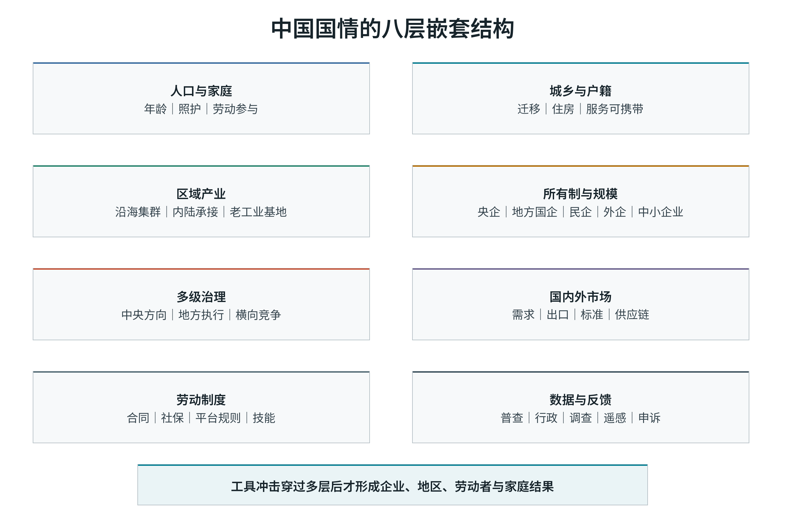

## 中国国情章一 人口转折如何改变有效劳动供给

2025年末，中国16至59岁人口为8.5136亿，占总人口60.6%；60岁及以上人口为3.2338亿，占23.0%。全国就业人员7.2504亿，城镇就业人员4.7535亿。劳动力总量仍然庞大，但年龄结构、技能结构和空间分布都在变化。<super>[60]</super> 企业所说的“招工难”可能是某一城市生活成本过高、某一工序劳动强度过大、某一技能供给不足或订单季节性过强，并不能推出全国劳动力绝对短缺。

机器人采用对老龄化的回应也具有任务差异。搬运、焊接、喷涂和高温高危工序的自动化可以减少职业伤害和体力负担；柔性装配、维修、异常处置和小批量生产仍高度依赖经验劳动。若企业只用设备替代一线岗位而不改变工时、培训和晋升，年龄较大的工人可能从正式制造业流向低保障服务业。若设备改造与工位工程、辅助装置和在职培训结合，技术反而可以延长部分劳动者的职业寿命。人口老龄化为工具创新提出的是“怎样重组任务”，不是“怎样用机器清空岗位”。

家庭是中国劳动调整中经常被遗漏的单位。迁移工人的就业选择同时受到住房、子女教育、老人照护和配偶工作的约束。自动化造成的失业若由返乡、家庭农业或平台零工吸收，城镇登记数据可能没有完整记录收入和福利损失；企业扩张带来的加班和夜班也可能把照护成本转移给女性和祖辈。因而劳动结果应使用家庭可支配收入、照护时间、参保连续性与儿童教育稳定性补充个人工资。<super>[61]</super><super>[68]</super>

人口约束应结合地区和技能条件，用有效劳动供给来衡量。

有效劳动供给不是劳动年龄人口的简单总和，而要扣除迁移、住房、照护、健康和技能不匹配造成的不可达部分。一个城市即使拥有大量潜在劳动力，也可能因公共服务门槛和住房成本形成企业层面的紧缺；另一个人口减少地区则可能同时存在青年外流与中年失业。

## 中国国情章二 三亿农民工与半城市化的调整成本

2024年全国农民工总量为2.9973亿，其中外出农民工1.7871亿；外出农民工中跨省流动6840万人。2025年农民工总量进一步达到3.0115亿。<super>[61]</super><super>[60]</super> 这组规模说明中国制造业和城市服务业长期依赖跨地域劳动供给。它也说明“劳动从低生产率部门转向高生产率部门”并不是一次完成的转换，而是一条涉及居住、参保、教育和家庭分离的制度路径。

户籍制度的迁移限制功能已经显著减弱，但权利与服务的可携带性仍不完全。世界银行对经济流动的分析指出，取得当地户籍或拥有城市户籍的迁移者上升机会通常优于农村户籍的城市迁移者；后者虽然可能比留在农村获得更高收入，却更容易停留在不稳定和低保障位置。<super>[68]</super> ILO对中国内部迁移社会保障的研究也把统筹层级、跨省转移、参保资格和信息系统分割列为关键障碍。<super>[80]</super>

这改变了自动化冲击的含义。对拥有本地住房和完整社保的技术工人，岗位消失可能意味着经过培训进入相邻企业；对居住在宿舍、子女留在户籍地、社保缴费断续的农民工，同一冲击可能意味着离开城市、放弃累计权益或进入平台零工。企业名册中的“自然流失”可能是家庭层面的强制退出。研究若只观察城市就业总量，就可能把劳动者承担的迁移成本误判为顺利再配置。

**表 3-C2 自动化冲击下四类迁移路径**

| 路径 | 表面统计 | 真实调整 | 潜在损失 | 应记录指标 |
|---|---|---|---|---|
| 原厂转岗 | 就业未变 | 工序、班次、技能改变 | 强度上升、晋升受限 | 任务、工时、培训和工资 |
| 同城换厂 | 城市就业未变 | 搜寻和试用期成本 | 社保断缴、工资折损 | 换岗时长、合同和参保 |
| 跨城返乡 | 城镇就业下降有限 | 家庭重新配置劳动 | 收入下降、技能折旧 | 户籍地、居住地和家庭收入 |
| 转入平台 | 灵活就业增加 | 风险由企业转给个人 | 算法控制、职业伤害和无薪等待 | 在线时间、净收入、保险和申诉 |

## 中国国情章三 地区差异决定自动化的含义

珠三角和长三角拥有密集供应链、港口、工程师、系统集成商和大规模客户，机器人可以嵌入快速迭代的产品网络。中西部承接产业转移的城市可能同时面对较低工资、地方招商补贴和技能供给不足；东北老工业基地拥有重工业设备和技术传统，却可能受到人口外流、需求不足与企业治理约束。资源型城市的自动化更多围绕矿山安全、能源和运输，县域小微企业则可能首先采用数字支付、数控机床或共享工业互联网，而不是成套机器人。

最低工资上升对机器人采用的影响在2008至2012年更明显，而且集中于生产率较高、沿海、民营和技能密集企业。<super>[63]</super> 这一结果否定“工资一涨，所有企业都会机器换人”的机械推论。自动化需要融资、工程能力、稳定订单和组织改造；低生产率企业可能退出、转移、外包或延长工时，未必有能力购买设备。由此产生选择偏差：观察到的机器人企业通常本来就更大、更高效、更有出口联系。

地区研究还面临暴露指标问题。将某行业在全国的机器人增长按城市基期行业份额加权，可以估计潜在暴露，却不能确认当地企业真正安装、使用或维护了设备。沿海城市的总部与内陆工厂、海关进口主体与实际使用地点、集团内部调拨都会造成错配。因此每项地区结论至少应同时报告行业暴露、企业采用、设备安装地和劳动者居住地。

构造地区机器人暴露指标时，行业机器人变化必须与城市基期就业结构相乘，并以基期行业规模归一化。它衡量潜在冲击，实际处理还需另行评估。若把它直接解释为“每增加一台机器人导致多少人失业”，就跨越了采用地点、任务替代和需求扩张三道识别缺口。

### 珠三角案例 从招工压力到柔性制造

珠三角早期自动化常与工资上升、订单波动和招工压力并存。地方“机器换人”项目通过设备补贴、技术改造备案、融资和示范工厂降低了采用成本，但企业目的并不一致。大型电子和汽车供应商重视质量一致性、交付周期和客户认证；小型加工企业更关心少人化、夜间连续生产和减少熟练工依赖。前者可能建立工程团队并增加技术岗位，后者可能只购买孤立设备，因换线、维护和订单不足而利用率偏低。

珠三角案例应同时检查四个反事实。没有补贴时企业是否仍会因工资、客户标准和设备降价而采用；获得补贴但缺少订单的企业是否形成闲置资产；劳动者离厂后是进入更高生产率企业还是低保障服务业；地方是否公开项目退出、设备利用率和就业质量。补贴项目数和设备投资额只能证明政策投入，不能证明社会回报。

### 长三角案例 产业链密度与知识扩散

长三角的汽车、电子、机械和软件网络使自动化收益不仅来自单厂节省人工，还来自供应商共同标准、工业软件接口、质量追溯和客户协同。产业链密度降低了维修、零部件和工程人才的搜寻成本，也使采用企业更容易通过订单扩张吸收劳动。这里更适合研究“工具系统扩散”。

密集网络也会放大支配关系。核心企业的数字质量系统、交付评分和价格要求可能迫使供应商投资，但供应商无法取得相应利润；客户机器人采用还可能通过议价和财务压力减少供应商就业，同时通过信息扩散增加高技能岗位。<super>[66]</super> 链主企业生产率提高可能改变供应链分配。

### 中西部案例 产业承接如何转化为能力升级

中西部城市承接沿海制造时，土地、厂房、税收优惠和劳动力供给能够迅速形成产能。若研发、供应商、维修和职业教育仍集中在沿海，承接地可能只获得装配与低利润环节。设备更新会减少低技能入口，却未必在当地创造足够工程岗位。地方统计中的工业增加值上升，需要与本地工资、税收留存、供应商采购和技能积累共同评价。

对产业承接的高标准检验是能力是否在本地沉淀：设备停机能否由本地团队处理，关键软件和数据是否可访问，职业院校课程是否与真实工序连接，中小供应商能否进入采购网络，补贴退出后企业是否仍有订单。若这些条件不成立，地区得到的可能是可移动产能，而不是可持续工具能力。

### 东北案例 存量工业能力与需求约束

东北拥有重工业、装备制造和技术教育积累，不能被写成等待新机器拯救的落后地区。问题可能在于需求、人口、企业治理、资本更新周期和产业链断裂。向存量工厂投入先进设备，如果没有产品更新、市场订单和组织权限，可能只增加折旧负担。相反，围绕轨道交通、能源装备、航空、农业机械和工业服务重建需求，可以使既有技能与数字工具结合。

东北案例提示，地区技术政策应从“买了多少设备”转向“解决了什么生产问题”。设备稼动率、产品合格率、交付周期、维修能力、工资和青年留存比项目投资额更接近真实结果。

## 中国国情章四 所有制与企业规模改变目标函数

截至2025年5月，市场监管总局报告私营企业超过5800万户；民营经营主体占经营主体总量的比例很高。<super>[77]</super> 这一口径包括大量小微企业和个体工商户，不能与规模以上工业产出或研发占比直接比较。国资监管系统披露的中央企业则资产规模大、承担基础设施和战略性新兴产业投资，2024年中央企业战略性新兴产业投资为2.7万亿元。<super>[78]</super> 两组数字说明主体结构多样。

国有企业可能获得长期资金、承担电网、通信、轨道交通和重大装备等系统任务，也可能受到多重目标、软预算和行政考核影响。大型民营企业面对产品市场和资本约束，能够快速迭代，也可能凭平台、数据和供应链权力把风险转给劳动者及供应商。外资企业带来设备、订单和标准，同时会根据全球成本和地缘风险重新配置。中小企业最接近细分需求，却常受融资、人才和系统集成能力约束。

“国家推动、企业执行”的二分法无法描述这些差异。中央企业内部也有上市公司、研究院、子公司和地方合资平台；民营企业也可能获得政府基金、政策性担保、国有客户和园区支持。更有效的分类应记录控制权、现金流约束、采购来源、竞争强度、公共任务和退出方式。

**表 3-C3 企业类型与自动化机制**

| 企业类型 | 主要融资与需求 | 采用优势 | 主要风险 | 适宜评价 |
|---|---|---|---|---|
| 中央国企及基础设施企业 | 国有资本、公共任务、长期合同 | 系统工程、标准和长期投资 | 多重目标、软预算、内部扩散慢 | 任务完成、全寿命成本、开放接口和公共回报 |
| 地方国企与平台 | 地方资本、土地和区域项目 | 协调园区与基础设施 | 债务、项目重复、地方保护 | 现金流、财政风险、退出与跨地竞争 |
| 大型民营制造商 | 销售收入、资本市场、供应链金融 | 产品迭代、成本和出口响应 | 链主压价、劳动强度、市场集中 | 生产率、质量、工资、劳动份额和供应商结果 |
| 外商投资企业 | 全球订单、母公司技术和内部资本 | 标准、设备和管理扩散 | 利润转移、产能重配、技术边界 | 本地采购、知识扩散、工资和稳定性 |
| 中小微企业 | 自有资金、银行贷款、应收账款 | 细分需求与灵活试错 | 融资约束、设备闲置、数字依附 | 利用率、现金流、人员培训和平台费用 |

## 中国国情章五 从机器换人转向工具系统转型

机器换人叙事有三个分析偏差。第一，它把技术方向预设为替代，忽略增强劳动、改善质量、减少危险、节能减排和创造新任务。第二，它把设备视为独立投入，忽略数据、软件、标准、维护和组织权限。第三，它把企业成本下降视为社会收益，忽略工资、劳动份额、供应链与家庭后果。

中国工业升级应按任务重新分类。危险岗位替代关注安全和暴露；重复工序自动化关注成本、质量与工时；数字质量工具关注可追溯和缺陷发现；工业软件关注设计、排程和协同；平台算法关注交易匹配与劳动控制；人工智能辅助工具关注知识工作和决策。每一类工具有不同的受益者、风险和数据口径。

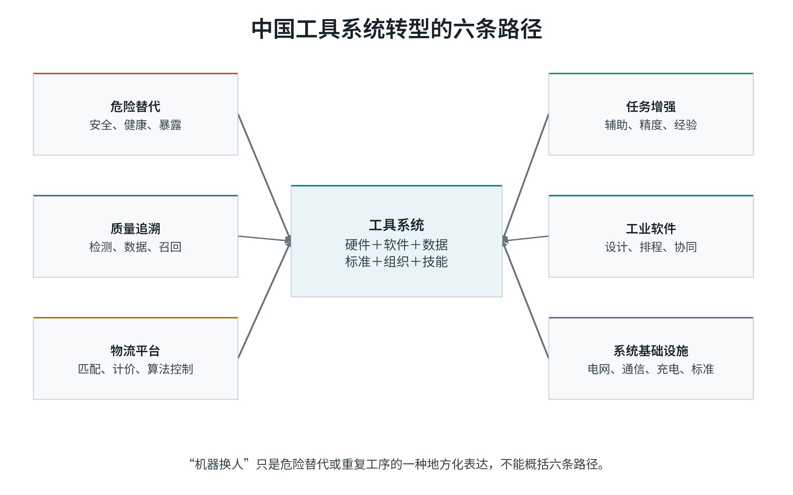

### 汽车产业 机器人只是系统中的一个环节

汽车工厂机器人密度较高，但新能源汽车竞争优势还来自电池化学、功率电子、软件、供应链组织、充电网络和大规模用户反馈。<super>[57]</super> 焊接机器人减少某些工位，并不能解释整车价格、续航和迭代速度。反过来，销量增长也不能证明每项地方补贴有效。需要把中央标准、地方基础设施、企业竞争、消费者需求和出口规则放入同一时间线。

新能源汽车政策经历了试点、购买补贴、目录管理、充电设施、双积分、补贴退坡和市场竞争加剧。这个序列更接近政策学习，而非一次性国家命令。成功部分来自早期需求和协调，代价包括地方保护、企业进入过多、价格战和部分产能退出困难。评价应比较每一阶段的额外性：公共资源是否解决当时存在的电池成本、充电网络和用户信心问题；问题消失后工具是否退出或转型。

### 电子产业 高速迭代与工人可替代性并存

电子制造订单周期短、产品更新快、用工规模大。柔性自动化可以提高一致性并缓解旺季招工，但频繁换线和小批量订单限制固定设备回报。企业可能采用自动测试、机器视觉和数字排程，而不是完全无人化。劳动者的经验在异常处理、返修和工艺爬坡中仍重要，却常未被正式技能认证。

若技术知识沉淀在工程师和软件供应商，生产工人的经验只被数据系统抽取而没有转化为晋升，企业会获得组织学习，劳动者却提高不了市场能力。评价电子产业自动化必须跟踪生产工人是否进入调机、维护、质量和班组协调岗位，以及培训是否发生在带薪时间。

### 纺织服装 小批量需求限制完全自动化

纺织和服装包含纺纱、织造、染整、裁剪、缝制与物流，技术条件差异极大。纺纱、织造和裁剪较易设备化，柔软材料缝制、款式变化和小单快反仍依赖劳动。将整个行业写成“机器替代低技能工人”会掩盖工序差异，也会忽略订单平台、设计软件和物流系统的控制作用。

技术升级可能把部分岗位从沿海转移到内陆或海外，也可能通过快速反应和小批量保留国内生产。需要同时观察订单交付、单件工时、工资、淡旺季波动、女工就业与宿舍制度。行业产出增长若依赖更强劳动强度和不稳定订单，则不足以视为解放效果。

### 矿山化工和高危工序 安全收益优先

在矿山、化工、高温、粉尘和有毒环境中，机器人替代首先应按死亡和职业病风险评价。即使岗位数量下降，只要劳动者获得安全转岗、收入保障和培训，社会收益可能显著。问题在于企业可能把高危核心工序自动化，同时把清洁、检修和承包环节外包给保障更弱的工人。安全统计必须覆盖承包商和维修停机期，不能只观察正式员工。

## 中国国情章六 企业采用与劳动者暴露产生相反结论

中国机器人研究已经出现看似矛盾的结果。使用企业进口机器人数据的研究发现，采用企业可能提高生产率、就业和高技能劳动需求。<super>[64]</super> 使用地区行业暴露与家庭调查的研究则发现，机器人暴露与劳动参与、就业和小时工资下降相关。<super>[65]</super> 供应链研究发现，下游客户采用机器人可能压低供应商就业，却提高供应商高技能劳动比例。<super>[66]</super> 性别研究发现企业内部性别工资差距可能缩小，但部分原因是重复任务中的女性更容易被挤出，因而整个劳动力市场的性别不平等可能加剧。<super>[67]</super>

这些结论不应通过选择其中一个来“统一”。采用企业的增长可以与地区受暴露劳动者受损同时成立，因为市场份额从未采用企业流向采用企业；企业平均工资上升也可以与低技能劳动者退出同时成立，因为员工构成发生变化；制造业城市总就业稳定也可以与原制造工人收入下降同时成立，因为服务业吸收了部分劳动力。

应将总效应分解为：

其中，企业内部替代、采用企业规模效应、同行企业重配、供应链溢出、新任务和劳动者退出必须分别估计。任何只观察一个分量的研究只能回答局部效应。

**表 3-C4 中国机器人研究的尺度对照**

| 研究尺度 | 典型处理变量 | 可回答问题 | 边界外的问题 | 主要偏误 |
|---|---|---|---|---|
| 采用企业 | 进口或购买机器人 | 企业采用后的就业、质量和生产率 | 全国净就业 | 采用选择、幸存者和集团调拨 |
| 供应链 | 客户采用与供应商关系 | 议价、信息和订单溢出 | 非供应链地区结果 | 客户披露和关系稳定性 |
| 行业城市 | 基期就业权重乘行业机器人增长 | 地区潜在暴露 | 实际安装与个人使用 | 暴露错配、产业趋势 |
| 劳动者家庭 | 地区暴露连接调查 | 工资、参与、迁移和家庭调整 | 具体企业生产率 | 迁移选择、样本流失 |
| 全国统计 | 产量、安装、就业总量 | 宏观趋势和结构 | 个体因果效应 | 口径变化、聚合抵消 |

## 中国国情章七 平台算法是另一种工具政治

制造业机器人只覆盖中国技术转型的一部分。配送、网约车、电商、直播、家政和众包劳动由平台规则、评分、派单、计价和封禁机制组织。平台劳动者形式上可以决定上线时间，实际收入却受需求预测、动态价格和接单率约束。算法既降低交易成本，也可能把等待、设备、保险和职业伤害风险转给劳动者。<super>[69-71]</super>

2023年发布、2024年施行的相关指引要求平台合理确定工作量和劳动强度，将企业要求的在线时间及线下管理时间计入工作时间，并对直接涉及劳动者权益的规则公开征求意见。<super>[70]</super> 这些规则的重要性不在于是否出现“算法”一词，而在于把工作时间、规则知情和反馈程序变成可执行权利。执行效果仍需观察平台是否披露关键参数、劳动者能否获得个案解释、申诉期间是否暂停不利决定，以及合作用工企业是否承担责任。

平台案例纠正了机器换人的设备偏见。软件不一定替代整个岗位，却可以把管理权嵌入计价和排序，使劳动者承担更密集的时间压力。生产率评价因此必须加入无薪等待、交通风险、设备折旧、平台抽成和申诉成本。

## 中国国情章八 数据能否准确描述国情

“国家无法准确描述国情”需要被改写为可检验判断。任何大型国家都面临聚合损失；中国还存在地区层级多、流动人口规模大、平台和非正规就业难记录、地方绩效激励以及统计口径调整等问题。由此不能推出所有官方数据无效，也不能因为存在全国公报就认为国情已经被完整捕捉。严谨结论是：不同指标具有不同测量误差，必须建立多源校验和修订制度。

地区GDP曾由地方分级核算，2019年数据起实施国家统一核算，以解决地区汇总与全国核算差距并提高一致性。<super>[73]</super> 这说明统计制度能够识别并修正自身问题。学术研究利用市长晋升年龄规则和夜间灯光、电力等较难操纵指标，发现2013年前强调GDP绩效时，晋升激励显著提高统计GDP增速而未同步提高外部指标；2013年后该模式明显减弱。<super>[72]</super> 另一项夜间灯光研究却发现部分时期官方增长可能被低估。<super>[74]</super> 两类结果共同反对简单的“全部高估”或“全部可信”。

机器人统计也有类似问题。国家统计局工业机器人产量、IFR市场安装量、海关进口机器人、企业问卷采用和城市行业暴露分别描述供给、销售、购买、使用与潜在冲击。<super>[35-36]</super><super>[62-65]</super> 国产机器人在集团内部调拨、进口机器人由总部报关、系统集成后跨地安装，都可能使地点错位。调查中的“采用人工智能”还取决于问卷定义，不能与模型算力或岗位替代相互替换。

国情测量应建立五源交叉：官方普查和抽样调查提供总体边界；行政记录提供参保、税收和企业存续；企业与劳动者调查提供任务和工作质量；遥感、电力、运输和互联网等外部数据校验活动；定性访谈和档案解释机制。各源之间不一致时，应公开差异并说明取舍。

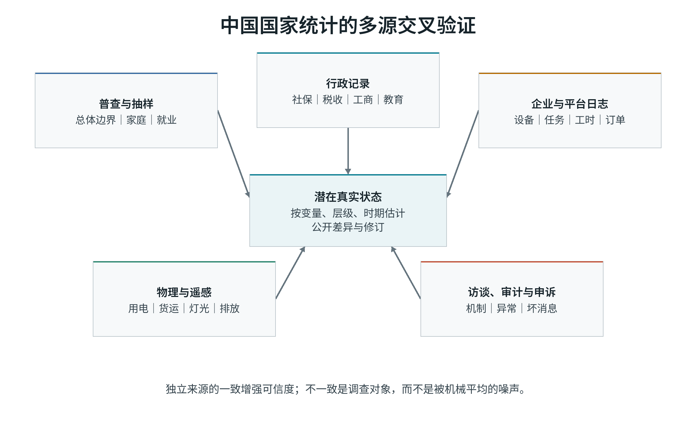

测量国情时，真实状态往往无法直接观察，各数据源又同时包含系统偏差和随机误差。权重不能只按样本量确定，还应依据覆盖、独立性、修订记录和被操纵激励。全国平均值与县级、职业和群体估计需要分别评估。

**表 3-C5 中国国情数据的适用范围**

| 数据源 | 优势 | 盲点 | 交叉校验 | 适合结论 |
|---|---|---|---|---|
| 人口与经济普查 | 覆盖广、结构完整 | 周期长、无法追踪短期任务 | 抽样调查、行政记录 | 存量和结构边界 |
| 月季年度统计 | 时间及时、可比较 | 聚合抵消、口径修订 | 普查基准、行业数据 | 宏观趋势 |
| 社保税收行政数据 | 连续、接近实际交易 | 非正规就业和跨地匹配不足 | 家庭调查、平台数据 | 正式就业和缴费 |
| 企业调查与财报 | 可见采用、产出和融资 | 大企业偏重、幸存者偏差 | 海关、工商和用电 | 企业机制 |
| 家庭和劳动者调查 | 可见工资、健康和迁移 | 回忆误差、样本流失 | 行政参保、地区暴露 | 个体与家庭结果 |
| 夜间灯光和用电 | 相对独立、空间细 | 服务业、节能和亮度饱和 | GDP、税收、货运 | 活动交叉校验 |
| 平台日志 | 高频、任务细 | 企业控制、定义不透明 | 劳动者日记、监管抽样 | 算法劳动过程 |

## 中国国情章九 国家能力的上限来自反馈而非规模

中国的公共部门能够建设电网、高铁、通信、充电设施和产业园区，这类网络工具需要统一标准、大规模融资和跨地区协调。能力不能由投资规模单独证明。基础设施是否连接真实需求、维护是否有稳定现金流、数据能否跨部门互操作、失败项目能否退出，决定投资能否形成长期生产力。

地方试验提供了发现机制。政策可以先在城市或园区实施，通过比较结果再推广；Heilmann把这种从地方试验到国家政策的过程视为中国政策形成的重要特征。<super>[59]</super> 试验的有效性依赖真实差异、可观察结果和停止失败方案。如果试点被预先要求成功，地区只报告投资和示范数量，试验会退化为政策表演。

国家能力的另一边界是坏消息传递。地方担心招商失败、企业担心失去补贴、部门担心目标未完成时，闲置设备、工资拖欠和安全风险可能延迟上报。更高层级的集中监督能减少部分地方偏差，却无法替代劳动者、供应商、消费者、审计机构和独立研究的多点反馈。准确国情来自可纠错的信息制度，不来自一个无所不知的主体。

## 中国国情章十 工业政策的收益和成本必须同表核算

工业政策可以解决知识外溢、协调失败、融资期限和初始需求不足。它也可能产生寻租、地方保护、重复产能、债务和贸易摩擦。Juhasz、Lane和Rodrik的综述强调，现代证据对产业政策给出条件化而非无条件的支持；政策工具、市场结构和治理能力决定结果。<super>[52]</super> 中国企业研究表明，促进竞争的行业政策与更高生产率更一致。<super>[39]</super>

工业政策审计应设置财政、竞争、劳动和生态四本账。财政账记录补贴、税收优惠、土地、担保和损失；竞争账记录进入、退出、价格、质量和市场集中；劳动账记录工资、工时、技能、社保与地区迁移；生态账记录能源、材料、污染和全生命周期减排。出口和低价可以是规模效率，也可能包含未计入的财政与环境成本，需要证据区分。

大规模设备更新政策明确提出市场化推进、标准引领和软硬件一体化。<super>[75-76]</super> 对这一政策的评价不应停在投资拉动。应抽样追踪旧设备淘汰、新设备利用率、软件兼容、能耗、质量、劳动任务和企业现金流；并比较获得支持与未获得支持企业的趋势。若政策只加快本来就会发生的购买，额外性有限；若它解决了中小企业融资、标准或协调瓶颈，社会回报可能更高。

## 中国国情章十一 技能形成需要看实际能力积累

机器人、工业软件和人工智能需要工程、维修、数据和复合工艺能力。职业院校与企业合作可以缩短技能形成，但“培训人次”无法说明劳动者是否真正掌握可迁移能力。企业专用操作证可能提高当前岗位效率，却不一定被其他企业承认；短期课程也可能把设备厂商的产品介绍包装为技能提升。

技能政策应记录训练时长、是否带薪、考核方式、资格可携带性、培训后任务和工资变化。对于被替代风险较高的劳动者，培训要在失业前发生，并与岗位空缺和地区产业需求连接。若培训要求劳动者自费停工，最需要培训的人反而最难参加。

中国教育和技能差异具有城乡与地区维度。世界银行指出，经济转向知识和高价值服务后，教育差距可能限制低教育群体的上升流动。<super>[68]</super> 第五次全国经济普查进一步提供了分行业从业人员、数字化和研发活动的结构基线，可用于识别设备采用与人力资本差异是否同步扩大。<super>[79]</super> 这意味着工具政策若只补贴设备，可能扩大企业和劳动者之间的能力差距。

## 中国国情章十二 劳动参与和社会回报

劳动者参与不能只理解为事后安置。工人在选型、工位设计、节拍、质量、维护和安全方面拥有现场知识。参与机制可以减少设备与工序不匹配，也能发现企业没有计入的疲劳和风险。参与的最低层次是提前告知，其上依次是数据访问、方案咨询、协商、共同决定和申诉。不同企业可采用不同形式，但不能把宣传会算作参与。

工具收益的社会回报可以分为工资、工时、安全、技能、发声、公共知识和财政回收。企业生产率提高而劳动份额下降时，工资总额可能仍增加，但收益集中于高技能和管理岗位；平均工资上升也可能来自低工资员工退出。必须报告同一劳动者的变化和员工构成变化。

其中每个分量都要保持可见，不能由单一总分掩盖。安全和基本权利应设最低约束，不允许用产出收益抵消严重职业伤害或无保障失业。

## 中国部分结论 多层国情取代单一机器换人叙事

中国案例支持的结论不是“国家比市场更能推动机器人”，也不是“机器必然替代劳动”。更准确的结论有五点。第一，中央方向、地方试验、企业竞争、全球学习和超大市场共同形成高速扩散。第二，地区、所有制、企业规模和任务差异使平均效应缺乏代表性。第三，采用企业扩张与受暴露劳动者受损可以同时发生，劳动结果必须跨尺度追踪。第四，户籍、住房、照护、社保和平台就业决定退出成本，是中国国情的核心而非附属变量。第五，国家能力取决于数据交叉验证、坏消息上行、竞争纪律和失败退出，不能由投资规模或政策数量替代。

“机器换人”是部分地方政策与企业策略使用的语言，不能概括中国技术转型的全部路径。公共方向、市场和用户反馈、地方试验、劳动参与与社会保障，各自在工具扩散中发挥作用。它们能否互相配合，影响规模扩张最终带来能力增长，还是错配、过剩与不平等。

## 第十九章　机器换人与中国国家—市场混合体系如何共同作用？

中国同时存在国家方向、地方竞争、企业扩散、平台系统和多层劳动力市场。机器换人的含义会随地区、产业、所有制和劳动身份改变。

### 国家与市场的机制组合

国家方向、市场竞争、地方政府与全球供应链共同决定工具组合，权重随行业和时期变化。新能源汽车、工业机器人、平台算法和医疗研发不能用同一权重解释。国家可提供标准、基础设施和耐心资本；企业进行产品和流程试错；地方提供园区、融资与审批；出口和外资带来需求、竞争与学习。

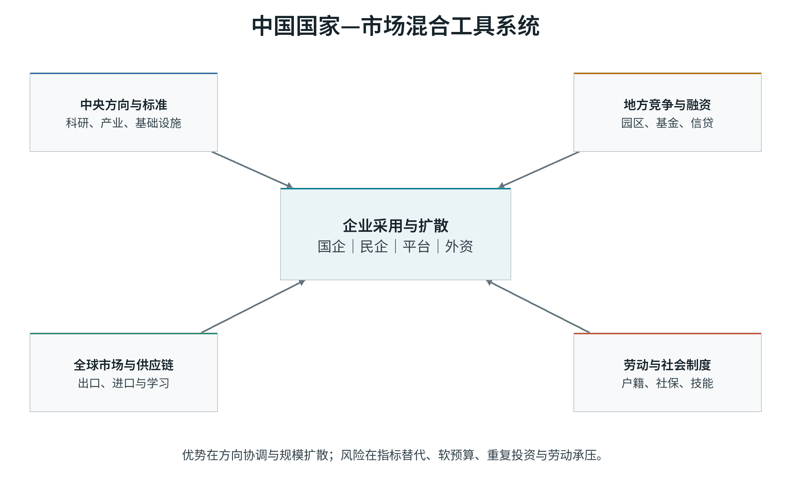

### 机器人扩散与口径纪律

中国工业机器人产量由 2020 年 21.8 万套增至 2025 年 77.3 万套<super>[35]</super>。IFR 记录 2024 年中国安装工业机器人 295,045 台，占全球安装量 54%<super>[36]</super>。产量、安装量、保有量和企业采用强度需要分开核算。自动化可在企业内减少某些任务，同时通过价格下降、质量改善、上游零部件和地区产业扩张创造岗位；净效应取决于需求弹性、贸易、进入和培训。

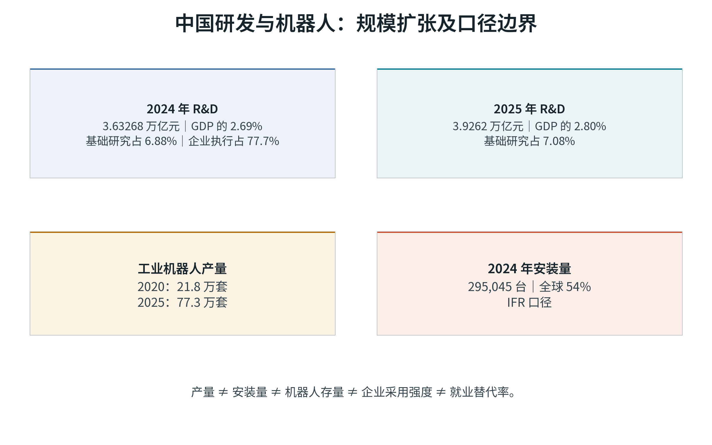

### 劳动者的退出选择

工具焦虑不仅由替代概率决定，还由替代后的医保、社保、住房、子女教育、培训和地域迁移成本决定。户籍和福利可携带性不足会使“换城市、换行业”成为高成本选择；平台评分和算法排班又可能把形式自由转为事实依赖。因此技术政策不能只给企业设备补贴，还需给劳动者可携带账户、在职培训时间、工资保险、算法申诉和跨地区公共服务。

### 案例 19.1：新能源汽车为什么既是产业政策，也是市场学习

中国新能源汽车的扩张不能只用补贴解释。早期试点提供初始需求，地方建设充电设施和公共采购，目录、标准和安全监管降低不确定性；随后双积分、补贴退坡和市场竞争把企业推向成本、续航、质量和供应链竞争；电池、材料、零部件、软件和充电网络又形成上下游学习。IEA 报告显示，2024 年全球电动汽车销量超过 1700 万辆，中国占全球销量的一半以上<super>[57]</super>。这个结果同时依赖公共方向、巨大国内市场、企业进入、全球供应链和持续试错。

产业政策的其他解释也必须保留。中国市场规模使单位成本快速下降，加入全球贸易体系带来设备、材料、知识和需求，地方政府竞争加快基础设施与产能形成，这些因素并非单纯的中央计划能力。持续补贴还可能造成产能过剩、价格战、地方债和弱势企业难以退出。Aghion 等发现，产业政策投向竞争更强行业或促进竞争时，生产率效果更好<super>[39]</super>；Juhász、Lane 与 Rodrik 对近期产业政策研究的综述也强调，结果高度依赖政策工具、测量、市场结构和治理能力，不能把“有政策”直接等同于“政策有效”<super>[52]</super>。

新能源汽车案例因而支持一个条件化判断：公共方向可以缩短协调时间和建立基础市场，但只有当企业面对真实用户、竞争、技术标准和退出纪律时，方向协调才会转化为生产率。若政策只保护身份或产能，补贴会变成租金，规模会变成过剩。

### 案例 19.2：机器人扩散与劳动结果的多尺度分离

中国工业机器人产量由 2020 年 21.8 万套升至 2025 年 77.3 万套；IFR 记录 2024 年中国安装约 29.5 万台，占全球安装量 54%<super>[35-36]</super>。这组数字证明供给和采用规模，却不足以单独推出失业规模。机器人可以在企业内替代某些任务，企业也可能扩大产量并增加维护、系统集成、销售和研发岗位；地区层面还可能通过零部件、上下游和服务业产生补偿。不同研究使用企业、行业、城市或个体样本，结论自然不会完全一致。

更精确的分析需要六层链条：技术暴露、劳动者实际使用、企业采用、产量或服务扩张、市场安装、劳动结果。中国制造业上市公司研究可能发现企业劳动需求和劳动份额下降；地区研究可能发现结构性补偿；个体研究则可能发现跨省回流、岗位转换或收入波动。六层不能互相替代，也不能把产量当作替代率。政策评价应同时报告岗位数量、工资、劳动份额、技能、健康、职业安全和地区分布。

### 案例 19.3：地方竞争为什么能加速也会重复

地方竞争是中国国家—市场混合的重要机制。地方政府通过园区、土地、信贷、补贴、审批和公共采购吸引企业，能够快速形成产业集群和基础设施。但这种竞争也可能导致同质项目重复、土地和债务依赖、统计指标美化、企业跨地套利和地方保护。结果是同一政策在不同地区产生截然不同的生产率效果。

解决重复投资不能只依靠更集中的审批，因为中央机关同样面临信息不足和地方差异。更可行的组合是：全国统一竞争、环境、安全和会计规则；地方公开补贴、土地、信贷和绩效数据；企业承担真实资本和退出责任；跨地区比较生产率、就业质量和财政回报；对失败园区和地方融资设置重组和问责。地方试验的价值在于发现和纠错。

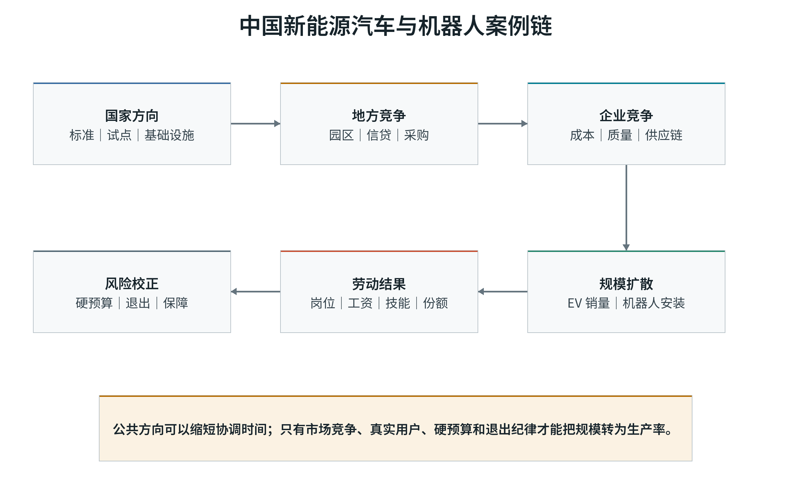

**表 3-8　中国案例的机制、证据与反向风险**

| 机制 | 支持事实 | 可能结果 | 反向风险 | 需要的证据 |
|---|---|---|---|---|
| 中央方向与标准 | 研发增长、产业目录、技术标准 | 降低协调成本和不确定性 | 目标过宽、指标替代 | 项目选择、退出率和结果指标 |
| 地方试点与竞争 | 园区、基础设施、采购、信贷 | 加速集群形成 | 重复投资、地方债、保护主义 | 财政成本、产能利用率、跨地进入 |
| 企业市场竞争 | 新能源车和机器人快速迭代 | 成本下降、质量提升、扩散 | 价格战、弱势企业难退出 | 企业进入退出、利润、生产率、劳动份额 |
| 全球供应链 | 出口、外资、设备和材料学习 | 技术扩散与规模经济 | 外部冲击、地缘政治风险 | 进口依赖、出口市场、知识流向 |
| 劳动调整 | 行业和地区可能补偿企业损失 | 新任务和服务业吸收 | 个体长期失业、技能与保障断裂 | 个体追踪、工资、社保、健康和迁移 |

## 第二十章　公共目标如何避免变成行政化激励？

公共目标能够集中资源并加速能力形成，也可能通过指标压力产生重复投资、统计高估和软预算。

### 研发规模与结构

中国 2024 年研发经费为 3.63268 万亿元，占 GDP 2.69%；基础研究 2500.9 亿元，占研发 6.88%；企业执行占 77.7%<super>[37]</super>。2025 年研发经费升至 3.9262 万亿元，占 GDP 2.80%，基础研究 2778 亿元、占 7.08%<super>[38]</super>。规模增长显示国家战略、企业研发与产业扩散共同作用；但基础研究占比、原创质量、开放知识和中小企业扩散仍需分开评价。

### 竞争纪律为何重要

Aghion 等利用 1998—2007 年中国企业数据发现，投向竞争更强行业或促进竞争的产业政策与更高生产率相关<super>[39]</super>。这说明产业政策与竞争不是对立项：方向性支持若奖励进入、性能和真实用户，可能加速学习；若绑定行政身份、维持低效主体或追逐同质指标，则会压低退出和创新。对国企分权的研究也表明，地方信息能够改善决策，但地方目标和软预算同时可能扭曲资源<super>[40]</super>。

| 治理装置 | 要解决的市场失灵 | 可能产生的政府失灵 | 可审计约束 |
|---|---|---|---|
| 产业基金 | 长期限、外部性、协调 | 追逐热点、关联配置 | 专业治理、分阶段拨付、损失披露 |
| 地方补贴 | 集群和基础设施 | 重复投资、跨地保护 | 全国竞争中性、退出率审计 |
| 国有资本 | 战略能力、逆周期投资 | 软预算、目标多重 | 商业与公共任务分账 |
| 数据与平台治理 | 网络效应、信息不对称 | 行政不透明、创新准入 | 程序规则、申诉、互操作标准 |
| 科研计划 | 知识外溢、高不确定性 | 指标化、短周期项目制 | 同行评议、长期资助、开放复现 |

### 中国与苏联的制度差异

中国与苏联都存在国家定向，但中国的价格、贸易、民营和外资企业、地方竞争及混合所有制，形成了不同的发现与学习渠道；土地、金融、产业标准和基础设施又使国家作用持续存在。比较时需要逐项考察预算、价格、信息反馈、企业退出和劳动参与。

### 案例 20.1：产业政策的比较证据为什么比口号更复杂

Juhász、Lane 与 Rodrik 对近期产业政策研究的综述指出，较新的研究在测量、因果识别和经济结构上明显改进，整体上对产业政策给出了比早期相关性研究更积极但条件化的评价。成功并不来自财政补贴本身，而来自补贴是否纠正外部性、能否形成学习、是否面对竞争、是否有出口或用户验证、是否能退出失败项目，以及政府机构是否具有专业能力和反俘获约束<super>[52]</super>。这一结论与 Aghion 等关于竞争和生产率的研究相互支持<super>[39]</super>。

中国的经验必须放入这一框架。新能源汽车、机器人和部分数字基础设施说明国家方向可以形成快速规模；Hsieh 与 Song 对国有部门转型的研究则表明，提高竞争、硬化预算、改善资本配置和允许低效企业退出，能够显著提高总体生产率<super>[51]</super>。另一方面，地方补贴、政策性信贷和土地融资若把风险和损失社会化，就会形成软预算和重复投资。公共目标与资本纪律不是矛盾修辞，而是成功政策的两个必要条件。

### 案例 20.2：研发规模、基础研究和原创能力

中国 2024 年研发经费为 3.63268 万亿元，占 GDP 2.69%，基础研究占 6.88%，企业执行占 77.7%；2025 年研发经费升至 3.9262 万亿元，占 GDP 2.80%，基础研究占 7.08%<super>[37-38]</super>。这些数据表明中国已从技术追赶进入大规模研发阶段，企业是执行主力，公共方向、大学、科研机构和产业基金共同提供长期资源。规模并不自动等于原创质量，还需观察基础研究占比、开放知识、国际合作、科研评价、失败容忍和中小企业扩散。

中国与苏联的关键差异之一，是市场主体和价格机制更广。企业必须在消费市场、出口市场和资本竞争中获得收入，地方也要通过就业、税收和产业升级证明政策效果。但差异不只来自“有没有市场”，还来自竞争是否公平、预算是否硬、数据是否真实、坏消息能否上报、企业能否退出。若这些机制削弱，国家—市场混合可能逐渐向行政化偏移；若竞争与问责增强，公共方向反而可以为长期能力提供稳定预期。

**表 3-9　公共目标与资本纪律的制度组合**

| 组合 | 目标方向 | 竞争纪律 | 信息反馈 | 退出能力 | 预期结果 |
|---|---|---|---|---|---|
| 方向强、竞争强 | 高 | 高 | 中高 | 中高 | 可能形成学习和规模，需防止政策俘获 |
| 方向强、竞争弱 | 高 | 低 | 低 | 低 | 项目重复、软预算、创新选择失真 |
| 方向弱、竞争强 | 低 | 高 | 高 | 高 | 分散发现较强，公共品与长周期投入不足 |
| 方向弱、竞争弱 | 低 | 低 | 低 | 低 | 租金、垄断和低投资可能并存 |

该矩阵比较制度能力，不形成国家排名。现实制度在不同行业和时期会移动。重要的是把方向、竞争、信息和退出分别审计，而不是用“政府多一点”或“市场多一点”解释全部结果。

## 中国案例群增补 省域 行业 劳动与政策

## 中国案例群 同一政策在不同地区的结果

中国的技术转型同时发生在超大城市、县域产业集群、资源型地区、农业人口输出地和全球供应链节点。中央规划和行业标准提供方向，地方财政、土地、园区和国有资本影响实施，企业订单与现金流决定工具能否投入使用，劳动者家庭承担迁移、培训、照护和失业风险。以下沿地区、行业、企业和劳动者四个层次，考察同一政策在不同约束下的结果。<super>[58-61]</super>

中国2024年工业机器人安装规模居全球首位，但这一事实只是流量和市场规模，不是自动化深度、有效利用率或净就业结果。<super>[62]</super> 企业研究发现，最低工资、企业生产率、所有制、沿海区位和技能结构影响采用；采用企业的就业可能增加，地区和个人暴露却可能出现负面劳动结果，供应链上下游又有不同方向。<super>[63-67]</super> 这种表面矛盾来自尺度不同。案例群的任务正是追踪收益与成本如何跨尺度移动。

**表 3-C6 中国案例群的嵌套结构**

| 层级 | 研究对象 | 关键约束 | 主要结果 | 典型误判 |
|---|---|---|---|---|
| 国家 | 人口、标准、宏观需求、技术与贸易 | 人口老龄化、外部市场、研发结构 | 总就业、生产率、劳动份额、韧性 | 以机器人安装推断全国就业 |
| 地区 | 产业集群、财政、土地、教育和社保 | 财政空间、迁移、产业链密度 | 工资、税基、青年留存、能力沉淀 | 以投资额推断地方升级 |
| 企业与供应链 | 订单、融资、所有制、软件和设备 | 现金流、客户标准、维护和议价 | 产量、质量、利润、用工和账期 | 以链主绩效代替全链绩效 |
| 劳动者与家庭 | 任务、技能、工时、健康和照护 | 户籍、住房、社保、家庭分离 | 净收入、参与、职业伤害、儿童教育 | 以在岗工资代替家庭福利 |

## 地区案例一 珠三角 外向型制造的柔性压力

珠三角的电子、电器、家具、玩具和汽车零部件企业长期面对出口周期、短交期、多品种和劳动力流动。企业采用自动化往往同时回应工资、招工、客户审核、产品一致性和夜间生产，不宜归结为单一“替代人”。最低工资推动采用的研究结果在后期、沿海、高生产率、民营和技能密集企业更突出，说明采用发生在特定能力基础上。<super>[63]</super>

大型供应商能把机器人、视觉检测、数控、仓储和制造执行系统连接起来。系统集成改变质量反馈、排程和工程职责，节省的一线工时可能被更高产量吸收。小企业即使购入相同设备，也可能因订单波动、换型成本和维修等待而无法稳定运行。地方政策若按购置额兑付，容易奖励买设备而非解决生产问题；若按验收产量，又可能鼓励短期冲量而忽略人员培训和安全。

珠三角劳动市场的高流动性具有双重含义。企业可以通过自然离职减少显性裁员，统计上看不到一次集中冲击；劳动者却可能反复换厂、降低工资、进入配送或返乡。外来劳动者的宿舍、社保、子女教育和配偶就业约束，使“去另一家工厂”不是无成本重新配置。<super>[61]</super><super>[68]</super><super>[80]</super> 因而评估至少要追踪离职后十二至三十六个月，而不能只比较采用企业在册人数。

一项可执行的研究可利用地方技改项目的分批资格，匹配行业、规模、出口和采用前趋势。处理变量同时记录申报、拨款、设备到厂、投产和利用率；结果同时记录单位成本、缺陷率、交期、就业、工资、工时和离职去向。若只有购买增加而利用率、质量和现金流不变，政策解决的可能是融资或申报激励，而非工具能力。

## 地区案例二 长三角 产业链密度与软件接口

长三角的整车、零部件、电子、机械、化工和软件企业形成跨城市生产网络。工具转型的主要单位常是产品平台和供应链。统一质量标准、数字追溯和订单接口可以减少协调成本；本地工程服务、院校和设备供应商缩短停机。网络越密，孤立设备越可能成为可迭代系统。

网络密度也产生权力。核心客户可以要求供应商购买指定设备、接入平台、实时上传质量和交付数据，却通过降价或延长账期收回收益。客户采用机器人对供应商就业和技能结构的研究说明，上游或下游外溢不能由采用企业结果代替。<super>[66]</super> 如果链主通过数字透明掌握供应商成本，供应商可能失去议价空间；如果接口开放、订单稳定且共同培训，数字协同则可能促进能力扩散。

长三角新能源汽车案例说明机器人只是子系统。电池、功率电子、热管理、软件、充电网络、标准、供应链和消费者反馈共同决定产品竞争。<super>[57]</super> 地方政府建设基础设施和形成初始需求，企业竞争推动成本与迭代，市场淘汰又可能留下厂房、债务和供应商损失。政策评价应把销量、质量、安全、研发、工资、供应商账期、地方财政和退出资产共同列账。

研究设计可构建买方—供应商网络面板，利用客户采用时点估计供应商结果，并加入供应商对多个客户的暴露权重。必须检验客户是否在采用前选择高能力供应商，也要观察被替换供应商和新进入者。若仅保留持续披露关系的企业，会低估退出与断链。

## 地区案例三 中西部承接 产能迁移与能力沉淀

中西部承接沿海制造通常依靠交通、园区、土地、劳动力和地方协调。大企业进入可迅速增加投资和就业，带动住宿、物流和服务；也可能以总部采购、外部维修和内部结算把高价值环节留在原地。设备先进与本地掌握设备、产量增长与供应商升级需要分别评估。

能力沉淀需回答五个问题：本地团队能否处理常见故障；关键软件参数是否可访问；职业院校是否基于真实工序训练；本地企业能否通过认证进入采购；补贴退出后订单是否稳定。每个问题都需要行为证据。培训人数不能替代岗位使用，注册供应商不能替代采购份额，园区产值不能替代税收留存。

承接地常同时是农业人口就近转移地区。就近就业可以减少家庭分离和住房成本，但工资、社保和职业发展可能低于沿海。若自动化消除初级装配岗位，当地青年进入制造业的阶梯会缩窄。技术政策因此应把学徒和初级岗位的任务重组作为指标，而不是要求企业简单维持岗位总数。

比较研究可使用新建交通节点、园区分期或大企业选址形成合成对照，但企业选址具有强内生性。应记录选址前产业基础、领导任期、土地和债务，防止把原有增长趋势归于承接政策。至少观察五至十年，才能区分一次建设投资与持续能力。

## 地区案例四 东北 存量工业体系的需求约束

东北拥有钢铁、石化、装备、轨道交通、汽车、航空和农业机械等存量能力，也面临人口流动、需求变化、企业治理和老旧资产兼容问题。将其描述为因自动化不足而落后，会把产品、市场和组织问题误诊为设备问题。新机器如果没有订单、软件接口和维修预算，只会增加折旧与债务。

存量工厂更新需要全寿命核算。购置价格之外还有厂房改造、停产、软件许可、备件、能源、培训和报废；收益包括质量、可靠性、安全、交期和新产品能力。东北的优势可能在重型系统工程和工业服务，而不是复制沿海消费电子装配。公共采购和重大任务可以形成需求，但需要竞争性里程碑、跨地区供应商和退出规则，避免把存量企业永久保护。

人口维度尤其重要。青年迁移既减少本地劳动供给，也削弱新工具团队和消费需求。企业用自动化应对招工并不意味着社会劳动力短缺已经解决，因为技能、地点和年龄不匹配仍在。政策应比较“设备补贴”“工程人才与住房”“产品示范采购”“供应链重建”的边际效果。

东北案例的反事实比较不同更新组合。可以在相似工厂中比较只购置硬件、同时改造流程与培训、以及围绕新产品重组的路径。若硬件组利用率低而系统组改善，证据支持工具系统判断；若所有组都被需求约束，订单和产品方向比设备更关键。

## 地区案例五 资源型地区 安全替代与公正转型

煤炭、矿山、冶金和化工的自动化具有直接安全价值。远程控制、无人巡检、视觉识别和机器人可减少高温、高粉尘、有毒和塌方暴露。这里用减少危险岗位衡量成功比用维持原岗位更合理，但劳动者收入、地区税基和替代就业仍需安排。

安全替代的反事实必须包括已有安全监管。企业可能用技术投资替代维护和人员配置，也可能以无人化名义减少现场责任。应观察事故、险情、暴露时长、设备失效和应急响应，不只看“少下井人数”。传感器产生更多数据并不保证风险被处理，若上报停产会受惩罚，坏消息仍可能被压制。

能源转型使资源型地区同时面对需求下降。自动化提高剩余矿井效率可能延长生产，也可能加快就业减少。公正转型不能只提供一次培训，需处理养老金、住房、地方公共服务、土地修复和新产业需求。培训成功应以完成后稳定就业和收入轨迹衡量。

## 行业案例一 汽车与新能源汽车 系统创新和退出纪律

汽车生产包含冲压、焊装、涂装、总装、检测、物流和软件。机器人在焊装和涂装中成熟，但总装的柔性、人机协作和质量追踪仍依赖劳动。新能源汽车又加入电池、电控、软件和充电生态。把行业成功归于机器人密度，会遗漏产品架构和市场学习。<super>[57]</super>

国家标准、地方基础设施、采购和企业竞争共同作用。地方支持可解决充电和初始市场的协调问题，也会诱发重复投资和地方保护。企业价格竞争提高消费者可及，却可能压缩供应商利润、延长工时或降低测试冗余。社会回报必须在价格、安全、质量、研发、劳动与财政之间平衡。

企业退出是行业学习的一部分，但退出成本不能由供应商和劳动者无限承担。应建立电池与数据责任、售后服务、供应商应收账款、工人欠薪和地方担保的处置规则。政策如果只奖励进入而不设计退出，会把试验成本推向未来。

## 行业案例二 电子制造 多品种小批量与入口岗位

电子制造在消费周期、型号变化和全球客户标准下运行。自动化对稳定、大批量工序更易产生收益；多品种小批量需要快速换线、视觉识别、工装和熟练操作。企业可能采用柔性工具增强工人，也可能把标准化任务外包给更弱势供应商。

电子厂是大量年轻迁移劳动者进入城市制造的入口。自动化消除重复岗位可以减少职业伤害，却也可能消除获得正式工资、宿舍和社保的第一步。评估应观察初级岗位是否转化为设备操作、质量或物流岗位，培训是否在工作时间内并可跨企业认证。

性别分工需单列。若女性集中于重复装配和检验，任务替代可能改变在岗性别结构。企业内工资差距缩小可能来自低薪女性退出。<super>[67]</super> 高标准研究应同时跟踪离职者与留下者。

## 行业案例三 纺织服装 柔性自动化与地区再配置

纺织服装横跨纺纱、织造、染整、裁剪、缝制和物流。标准连续工序较易自动化，柔软材料处理和快速款式变化仍需要人。数字打版、排料和订单系统可能提高设计与库存效率，其效果与缝纫机器人不同。

行业利润率、品牌议价和快速交付决定企业是否把生产率收益分享给劳动者。品牌和平台压缩交期时，数字系统可能强化节奏和加班；订单稳定、培训和协商则可能改善技能。评价要沿品牌—工厂—家庭作坊追踪，防止风险转移到统计之外。

产业向中西部或海外转移与自动化同时发生，地区就业变化不能全归因于技术。需要结合贸易、订单、工资和运输成本，识别企业是升级、迁移还是退出。对县域集群而言，污水治理、能源和设计公共服务可能比单厂设备补贴更具外部性。

## 行业案例四 装备制造 单件小批与工匠知识

装备制造常具有单件、小批、长周期和高可靠性特征。数控、仿真、数字孪生和智能检测能够提高精度，但现场装配、调试和故障诊断依赖经验。若数字化只把纸面流程搬到系统，反而增加重复录入。

工匠知识应成为系统设计的输入。项目应记录操作员参与、异常处理、参数权限和知识传承。退休潮使知识外流风险上升，工具可以把经验结构化，也可能把判断权交给封闭供应商。开放接口和内部工程能力决定长期自主。

大型国企在重大装备上拥有长期任务和系统能力，也可能因多重考核而避免失败试验。创新组合需要小规模原型、里程碑采购和停止权，使失败不立即变成政治问责，同时防止无限续期。

## 行业案例五 钢铁化工 过程控制、能源和环境账

钢铁化工的核心工具包括过程控制、传感、优化、预测维护和安全系统。评价重点还包括能源、原料、质量、排放和事故。单项节能率可能因产量变化产生误导，应按产品和质量调整单位能耗。

老旧产线更新具有系统性：局部设备效率提高可能把瓶颈转移到上游或公用工程。停产改造、废料、兼容和人员响应需要全线建模。绿色政策还要避免“数据漂绿”，排放监测由独立校验和异常记录支持。

地区层面，关闭落后产能改善环境却影响税基和就业。替代产业需要真实需求，不能只以注册项目计算。健康收益、土地修复和家庭迁移应进入成本收益分析。

## 行业案例六 物流与仓储 速度收益和工作强度

自动分拣、仓储机器人、路径优化和数字追踪降低错误并提高速度。电商高峰期的需求波动使自动化和临时劳动并存：机器处理标准流，工人承担异常、装卸和最后一公里。总就业可能增加而单位任务更碎片化。

算法排班可减少闲置，也可能使工人等待无薪、节奏过快和休息不足。安全指标需要按工时和任务强度标准化，不能因在册人数下降而看似改善。仓库与配送承包层级还会模糊责任。

消费者低价和快速交付是收益，但其社会成本包括道路、包装、事故和劳动风险。公共规则可以要求工时记录、事故数据、可解释排班和承包商连带责任，使效率不依赖隐性转嫁。

## 劳动案例一 农民工 社保可携带性与返乡缓冲

近三亿农民工构成中国制造与城市服务的重要劳动供给。<super>[61]</super> 外出和跨省规模说明劳动力可移动，也说明家庭分离和制度转换规模巨大。返乡可以在失业时提供住房、家庭和土地缓冲，却可能使收入下降和职业退出不出现在城镇失业数据。

技术冲击研究应记录户籍地、工作地、参保地和家庭地。个人离开样本可能是转岗、返乡、照护或失访；只有追踪调查与行政转移数据结合才能区分。社会保障统筹和可携带性影响劳动者是否敢于拒绝低质量岗位。<super>[80]</super>

企业培训如果只在单一设备上有效，工人离职后价值有限。可携带资格、基础数字技能和公共职业服务能把企业专用技能转化为劳动者能力。评价应以再就业工资和稳定性，而非培训人次。

## 劳动案例二 女性劳动者 自动化、照护与选择退出

女性在电子装配、纺织、服务和平台劳动中的任务分布不同。自动化可能减少重复和有害岗位，也可能先替代女性集中任务。企业内部性别工资差距下降必须分解为工资变化、岗位升级和样本构成。<super>[67]</super>

家庭照护影响培训和夜班。若新技术岗位要求不规则工时、长期在厂或跨地培训，拥有照护责任的劳动者可能无法进入。企业提供培训但不提供时间与照护支持，形式机会并不平等。

研究应跟踪离职女性的收入、工时、社保和照护，不把退出劳动市场当作偏好。托育、可预测排班和反歧视招聘可能比单次技能券更能改变参与。

## 劳动案例三 青年入口 自动化是否切断学习阶梯

许多初级岗位同时承担生产和学习功能。重复任务效率低，却让青年了解流程、积累信誉并进入更复杂岗位。自动化首先替代入口任务时，企业可能要求新员工直接具备经验，形成经验悖论。

政策不应要求保留所有低效任务，而应设计新的学习阶梯：带薪学徒、仿真训练、辅助工具和导师评价。培训完成率不是结果，进入稳定岗位、工资增长和跨企业认可才是。

地区差异明显。产业密集地区有更多企业吸收培训者，单一大厂地区一旦退出，技能难转移。公共职业教育应与多家企业和通用标准连接，减少对单一雇主依赖。

## 劳动案例四 年长劳动者 设备更新与知识转换

人口老龄化使年长劳动者的任务适配成为核心问题。<super>[60]</super> 新工具可以减少体力负担并延长工作能力，也可能因界面、节奏和培训方式将其排除。年龄无法代理技能，经验判断与数字操作可以互补。

企业可能选择提前退出年长工人以快速重组，成本转给养老金、家庭和地方。应比较岗位改造、渐进培训、团队搭配和退出补偿。健康、安全和退休收入需与生产率同表报告。

## 政策案例一 设备更新 从购买补贴到全寿命绩效

工业设备更新方案强调市场化、标准引领和软硬件一体化。<super>[75]</super> 执行中最容易量化的是投资额和项目数，最重要却难测的是利用率、兼容、质量、能耗和任务变化。政策应要求基线、里程碑和改后追踪，并允许未达到目标的项目停止。

额外性是评价核心。大型企业可能本来就会购买，补贴只是转移；中小企业可能真正受融资和协调约束，但也更易买后闲置。资格阈值和分期实施可用于识别，财政评价要扣除提前购买和企业间替代。

旧设备处置也有环境和安全外部性。翻新、再制造、回收和报废需纳入政策，不应把淘汰设备转移给监管更弱地区。全寿命指标比年度投资更符合公共回报。

## 政策案例二 机器人产业规划 供给能力与真实需求

“十四五”机器人产业规划涉及创新、基础能力、应用和生态。<super>[76]</super> 供给政策可解决核心部件、标准、试验和人才的共同瓶颈；也可能在地方竞赛中形成同质园区和低利用率产能。

产业成功不能只看机器人产量或企业数量。应观察可靠性、平均无故障时间、软件生态、系统集成成本、出口、利润和真实工厂使用。国内安装规模大可形成学习市场，但客户压价和重复补贴可能削弱长期研发。

政策组合需要供给和需求双向纪律：公共试验平台降低验证成本，用户采购提供真实问题，竞争允许新进入，失败项目及时退出。对公共资金形成的标准、数据和测试能力，应设置开放使用规则。

## 政策案例三 地方试验 可扩散学习与不可见失败

地方试验使中国政策能够在差异环境中探索，再由中央总结扩展。<super>[59]</super> 竞争可加快行动，也会诱发重复、数据美化和把成本转给地方财政。成功试点更易上报，失败和未实施地区构成选择偏差。

可学习试验需要预先记录目标、基线、比较组、退出条件和失败原因。扩散前要判断效果来自政策本身还是特殊领导、产业集群和财政条件。把一个沿海园区经验复制到人口输出县，可能失去关键互补。

地方官员激励与统计研究表明，考核结构会影响报告和行为，统一核算能改善部分口径但不能消除所有策略。<super>[72-73]</super> 试验治理应保护诚实坏消息，把失败视为组合学习而非个人污点，同时对滥用资金保持问责。

## 政策案例四 国有资本与公共任务 长期性和软预算

中央企业在基础设施和战略性新兴产业投入规模大，能够承担电网、通信、交通和重大装备的长期系统任务。<super>[78]</super> 国有资本的优势是融资期限和协调，风险是多重目标、关联交易、软预算与退出困难。

公共任务需要把目标变成可审计合同：技术里程碑、服务覆盖、开放接口、全寿命成本、劳动和环境底线。企业规模和政治重要性不应成为无限续期理由。竞争可以在方案、供应商和阶段里程碑上发生，即使资产最终保持公共控制。

与民企合作时，应区分采购、股权、贷款和担保的风险。公共资金承担下行而私人保留全部上行会削弱社会回报；过度控制又可能压制企业试错。收益分享、开放标准、价格条件和退出权需按项目设计。

## 政策案例五 民营与中小企业 融资约束、灵活性和数字依附

私营企业数量庞大且异质，从个体经营到全球制造平台不能使用一个平均目标函数。<super>[77]</super> 中小企业了解细分需求、调整快，却常受抵押、账期、人才和系统集成约束。简单设备补贴可能不如公共测试、融资担保、共享工程师和开放接口。

数字化服务降低进入成本，也可能形成平台依附。软件订阅、数据锁定和迁移成本使企业失去议价权。政策支持应要求数据可导出、接口互操作、合同透明和供应商退出方案，防止公共补贴加深封闭生态。

中小企业的失败退出需要保护诚实创业者、劳动者和供应商。若地方为维持企业数而滚动担保，低效资产占用资源；若银行一次冲击即抽贷，可行企业又会被迫退出。财务重组、信用和社会保障是同一创新生态的组成。

## 政策案例六 对外开放 全球供应链学习与风险

外资和出口订单带来设备、标准、客户审核和管理学习，也可能把利润和关键研发留在集团内部。评价应观察本地采购、工程人员、专利合作、工资、数据权限和供应稳定，而不只看注册资本。

地缘与贸易风险促使企业调整供应链。韧性来自多来源、库存、替代设计和可修复能力。过度本地化会失去竞争和知识流，过度依赖又产生单点风险。

企业为满足海外标准进行自动化，可能改善质量与环境，也可能把合规成本压给供应商。公共服务可提供测试和规则信息，减少中小企业重复投入。

## 数据案例一 机器人统计 从海关和安装到真实任务

机器人进口、国内产量、安装量、企业资产和车间使用分别属于不同口径。设备可由集团总部购买、跨地区安装或闲置，产量也可能包含出口。研究需要设备序列号、安装地址、投产时间、维护和任务日志，才能从流量走到处理变量。

行业暴露指标把全国机器人增长按地区基期就业结构加权，适合估计潜在冲击，但不能确认当地安装。<super>[65]</super> 企业采用调查更接近处理，却存在高能力企业自选择。两类指标应互相验证，不可用其中一个消除另一个的局限。

## 数据案例二 就业统计 在册岗位、工时和劳动参与

企业在册人数无法显示外包、劳务派遣、平台化和自然离职；城镇就业不能完整显示返乡、照护和非正规工作。就业分析至少分解人数、总工时、时薪、年收入、社保和劳动参与。<super>[60-61]</super>

采用企业就业增加可能来自产量和市场份额扩张，地区总就业仍下降；地区就业稳定可能由服务和平台吸收，工资与保障却下降。企业、地区和个人数据必须并列，结果不一致本身就是外溢证据。

## 数据案例三 国家统计的可信边界与修订制度

统计是治理基础，也受分类、覆盖和激励约束。GDP统一核算减少地区加总和口径差异，经济普查提供结构基准，住户和劳动力调查补充企业与行政数据。<super>[73]</super><super>[79]</super> 夜间灯光、用电和货运用于交叉校验。<super>[74]</super>

可信度来自可追溯过程：样本框、定义、修订、缺失处理和不确定性公开；原始微观数据在隐私保护下供独立研究；异常由抽样复核而非仅行政追责。若坏消息报告必然带来处罚，任何数字系统都可能放大失真。

## 历史分期一 改革初期 组织松绑与劳动力重新配置

1978年以后中国改革不是一次从计划到市场的瞬时转换，而是农业激励、乡镇企业、价格双轨、地方财政和企业权限逐步变化。Xu对中国改革基本制度的概括强调地区分权治理结构，Heilmann则突出地方试验向国家政策扩散。<super>[58-59]</super> 这段历史说明，分散信息和地方动员可以并存；也说明地方试验并非天然民主或有效，其边界由干部激励、财政和上级授权决定。

农业生产率与非农机会释放劳动力，乡镇企业让部分农民在较低迁移成本下进入工业。此时工具升级的核心不只是机器，更是组织权限、价格、订单和劳动从农业向工业服务的配置。若用今天的机器人指标回看，会遗漏最重要的制度工具。

反事实比较不同改革顺序。农业激励、地方企业、价格和国企改革何者先行会改变就业与通胀风险。历史证据支持渐进试验在高度不确定转型中的发现价值，同时留下地区保护、预算软化和统计激励问题。

## 历史分期二 沿海开放与农民工体系 全球需求如何进入地方工厂

沿海开放、开发区、外资和出口订单把全球需求、设备和质量标准带入地方。农村劳动力跨省进入珠三角和长三角，企业获得可扩张劳动供给，家庭承担居住、教育和照护分离。今天近三亿农民工规模是这一长期结构的结果，而不是短期劳动力市场变量。<super>[61]</super>

外向型制造的学习依赖客户、供应商、工程人员与基础设施。外资带来标准和订单，也可能把研发和利润留在集团内部；本土企业从加工、零部件到品牌的路径存在巨大差异。评价开放不能只看出口总额，需要观察本地采购、工资、技能和企业进入。

这一时期的低工资并非唯一竞争来源，港口、电力、园区、供应链和组织速度同样重要。把后来的工资上升写成“机器换人”的单一原因，会忽略出口波动、客户标准和产业链升级。劳动密集增长形成了城市化机会，也累积了社保可携带性和家庭分离的制度债务。<super>[68]</super><super>[80]</super>

## 历史分期三 加入世界贸易组织后 规模扩张与地区不均

加入世界贸易组织后，贸易、投资和制造规模快速扩大。沿海集群产生知识和供应网络，内陆人口继续输出，地区差异既由市场可达性也由政策与历史基础决定。大规模吸收就业使技术采用的规模效应更可能抵消部分任务替代，但企业和地区结果仍不同。

出口企业面对国际质量、交付和认证，推动数控、自动检测和管理系统。技术采用在机器人数量上升前已经发生。信息系统、模具、流程和物流改造改变了生产组织，却常被固定资产统计分散记录。工具系统视角因此比单一设备更适合解释长期升级。

全球需求也使冲击外部化。订单下降首先影响加班、派遣和返乡，企业正式人数变化可能滞后。2008年危机后中国以投资和信贷托底，保住总需求，却把部分调整推向地方债务和房地产。危机缓冲与长期风险必须同表核算。

## 历史分期四 2009至2015年 投资托底 地方竞争与产能问题

金融危机后基础设施、房地产和工业投资扩张稳定就业与需求。地方政府通过融资平台、土地和园区推动项目，国企承担大量建设。国家协调显示强大动员能力，但投资收益、债务和重复产能在地区间差异显著。

这一时期的产业政策为新能源汽车、设备与新兴产业创造市场和基础设施，也可能让地方追逐相似项目。竞争能发现企业与路线，软预算会延迟失败退出。Aghion等关于产业政策与竞争的研究支持“支持与竞争互补”的条件判断，不支持补贴本身必然有效。<super>[39]</super>

地方GDP与官员激励研究提示，考核会影响报告和投资行为；后续考核变化与统一核算减弱了部分模式。<super>[72-73]</super> 历史评价不应把某一时期的激励恒定外推到今天，也不能因制度修订就假设所有数据问题消失。

## 历史分期五 2015年以来 数字平台 工业升级与治理追赶

移动支付、电商、网约车、配送和数字服务快速扩展，平台把交易、信用、派单和计价连接起来。消费者便利、市场进入和物流能力扩大，同时劳动关系、数据控制和市场集中成为新问题。<super>[69-71]</super> 工具转型从工厂设备扩展到组织规则。

制造业升级中，机器人、工业软件、视觉检测和新能源产业共同发展。IFR安装数据显示中国成为全球最大机器人市场，但企业研究的劳动结果依赖规模、地区、所有制和任务。<super>[62-67]</super> 这一阶段最不应使用“机器换人”概括，因为软件、平台、能源系统和产品创新的作用已经超过单一替代逻辑。

治理往往在创新后追赶：平台劳动指引、数据规则、竞争执法和行业标准逐步形成。制度滞后说明新工具改变了权力接口，旧分类需要更新。评价应观察规则是否转化为数据访问、申诉、人工复核和真实补救。

## 历史分期六 人口转折与设备更新 劳动节约目标需要重写

劳动年龄人口占比下降、老龄人口增加和家庭照护上升构成长期转折。<super>[60]</super> 这提高了安全替代、辅助工具和公共服务自动化的潜在价值，但各地区、行业和技能的短缺程度不同。高青年就业压力与企业技能短缺可以同时存在，说明匹配、需求和入口岗位比总量更关键。

设备更新与机器人规划提供系统升级机会。<super>[75-76]</super> 若政策只追求少人化，可能加剧青年入口和地区调整；若围绕安全、质量、节能、维修和劳动增强，能够在老龄化背景下提高有效劳动供给。政策目标需要从“替代多少人”转向“减少何种风险、解决何种瓶颈、创造何种能力”。

人口政策、住房、社保、教育和照护与技术政策相互依赖。一个城市即使设备先进，若生活成本使工程师和工人无法长期居住，工具能力仍不稳定。家庭并非生产体系之外的私人领域，而是劳动再生产的基础设施。

## 历史分期七 外部不确定性与韧性 从效率极大化到可恢复性

贸易摩擦、疫情、地缘风险和气候约束使供应链韧性成为目标。韧性来自多来源、替代设计和可修复能力。多来源、替代设计、可维修、数据可见、关键库存和快速协调需要组合，成本应与中断损失比较。

国有基础设施企业、民营制造商、外资供应链和地方政府在韧性中的角色不同。公共部门适合建设标准、测试与关键网络，企业通过竞争发现具体路线，供应商和劳动者提供现场坏消息。过度集中产生单点错误，过度分散又无法承担系统冗余。

韧性评价必须进行压力测试：关键部件中断多久会停产，替代需要何种认证，软件服务终止能否迁移，劳动者无法到岗时如何保障关键任务。平稳期最低成本不是唯一基准，极端情境下的恢复时间和分配损失同样重要。

## 历史分期八 从追赶到前沿创新 失败、开放和公共回报

追赶阶段可以引进、模仿和规模化相对已知路线；前沿创新面对未知需求和技术，需要更高失败容忍、专业自治与多路线试验。行政指标擅长推动数量，可能诱发论文、专利和投资的策略性完成。市场竞争提供退出，也可能因平台、资本和标准形成集中。

中国研发经费规模和占GDP比重持续提高，2025年R&D约3.9262万亿元、占GDP约2.80%。<super>[60]</super> 规模是必要投入，不说明原创性、扩散和公共回报。应追踪基础研究、人才流动、开放数据、标准、产品可及、制造能力和失败项目。

公共资金与私人商业化可以形成有条件的分工。政府基金、国企采购、大学科研、民企工程和用户市场共同形成创新链。公共回报可以通过开放知识、竞争性许可、服务覆盖、价格、收益分享和能力条件实现，具体形式需随任务变化。

**表 3-C7 中国技术—劳动—治理的历史分期**

| 时期 | 主要组织变化 | 工具与需求 | 劳动和家庭 | 核心遗产 |
|---|---|---|---|---|
| 改革初期 | 农业激励、地方试验、企业权限 | 基础工业与轻工需求 | 就地非农转移 | 分散发现与地方激励并存 |
| 沿海开放 | 开发区、外资、出口和基础设施 | 客户标准、设备和供应链 | 跨省迁移与家庭分离 | 制造集群和权利可携带性缺口 |
| WTO后扩张 | 全球市场与规模生产 | 数控、质量、物流和管理系统 | 大规模就业吸收 | 工具系统学习和地区差异 |
| 危机后投资 | 信贷、基建、地方平台和产业支持 | 需求托底与新兴产业 | 就业缓冲 | 债务、产能和退出问题 |
| 数字化阶段 | 平台、数据、移动支付和算法规则 | 软件、机器人、新能源与服务 | 平台劳动和任务重组 | 治理追赶与市场集中 |
| 人口转折 | 老龄化、设备更新与韧性政策 | 安全、辅助、节能和前沿创新 | 照护、青年入口和技能匹配 | 从少人化转向有效劳动与公共回报 |

## 中国案例群综合 十项条件性结论

1. 人口老龄化提高部分节省体力和补充劳动工具的价值，但不自动证明全国劳动力短缺。
2. 农民工流动提高产业适应性，也把住房、社保、教育和照护成本交给家庭。
3. 机器人安装规模证明市场和供给能力，不能决定净就业、工资或劳动份额方向。
4. 采用企业扩张与地区劳动者受损可以同时发生，因为市场份额和供应链外溢跨越统计边界。
5. 产业链密度使设备转为系统能力，也使链主能借数字透明加强议价。
6. 中西部承接的核心检验是维修、供应商、技能和订单是否在地沉淀。
7. 东北更新的首要问题可能是产品需求和组织权限，而非设备年龄本身。
8. 平台算法既匹配交易也分配等待、事故和申诉风险，灵活性必须用全工时与真实退出检验。
9. 地方试验的社会价值取决于失败是否可见、经验是否可迁移、债务和退出是否受约束。
10. 国家统计的能力应按变量与流程评价，统一汇总、独立校验和坏消息保护缺一不可。

## 第五编 苏联 行政控制的历史比较基准

## 苏联部分导论 用历史分期理解制度能力

苏联案例不能用“计划成功”或“计划失败”一次概括。1917年后的战争与重建、1920年代新经济政策、1928年后的强制工业化、第二次世界大战动员、战后重建、1960年代改革尝试、1970至1980年代增速放缓以及改革解体具有不同任务和约束。制度在追赶、战争和成熟创新阶段的表现不同，正是比较价值所在。<super>[1-2,41-44]</super><super>[54-55]</super>

集中体系在目标可量化、技术路线相对已知、投入可以成套复制时更容易动员资源。钢、电、铁路、基础教育和军工符合部分条件。消费品品种、服务质量、维护、跨部门匹配和未知技术路线需要大量局部信息与失败退出，集中指标更容易产生错配。能力与代价必须同时核算：工业和教育扩张不能抵消饥荒与强制，生命代价也不能作为否认全部物质能力增长的理由。

## 苏联专题 工业化的反事实

苏联工业化从农业社会中抽取资源，快速扩张重工业和城市就业。Allen等研究讨论计划和资本积累对追赶的贡献，并指出集体化对增长的额外贡献可能低于传统叙述。<super>[1]</super> 反事实不能简单设为保持1913年结构，也不能假定存在无冲突、同速度的市场转型。更合理的比较包括延续新经济政策、较缓农业征收、不同贸易融资和较低军事优先。

工业产量指标倾向吨数、件数和总值，能够推动规模却弱化质量、品种和用户价值。企业完成计划可能通过生产更重产品、减少型号和推迟维修实现。宏观增长与微观浪费可以并存。档案研究显示，中央配置也包含讨价还价、特批和非正式关系，而不是一个掌握全部信息的单一计划者。<super>[54-55]</super>

工业化的社会核算需要把城市工资、住房、教育、农村消费、迁移强制、营养和死亡放入同一时期。把重工业增长作为唯一目标，会把农村和家庭再生产当作免费投入。

## 苏联专题 电气化和网络工具

电气化具有高固定成本、统一标准、网络外部性和长期回收，适合公共协调。发电、输电、工业负荷和城市服务必须同步建设，单个企业难以独立完成。苏联在大型系统上形成的工程能力说明公共组织可以创造跨地区工具基础。

网络工具的成功仍依赖末端匹配。总发电量增长不说明停电、损耗、设备可靠性和居民可及；电力优先供给重工业可能挤压家庭和轻工业。评价应从装机转向可靠供电、维护、区域覆盖和用途分配。

这一经验可与当代数字基础设施比较。统一计算和数据网络同样需要标准与投资，但数据含义、权限和反馈比电力更复杂。物理网络调度与经济决策优化的条件不同。

## 苏联专题 教育与战略科学的双重结构

苏联扩大基础教育、工程训练和科学机构，为航天、核技术、数学和军工提供人才。战略项目目标清楚、资源优先、组织边界相对明确，能够形成“能力岛屿”。这些成就反驳行政体系完全不能创新的说法。

能力岛屿难以自动扩散到消费和民用生产。保密、部门壁垒、缺少用户反馈、企业没有采用激励以及设备供应不足，会阻断科研成果。科学发现、工程原型、批量制造、维护和用户学习是不同环节。战略成功只证明链条中某些环节有效。

专业共同体在政治命令与科学标准之间存在张力。长期基础研究需要同行评价和失败容忍，政治目标可以提供资源，也可能压制不符合路线的研究。评价公共科学必须同时观察投入、研究自治、国际交流、成果扩散和纠错。

## 苏联专题 企业经理的局部理性

在计划指标、投入不确定和短缺环境中，经理倾向低报能力、高报需求、囤积材料、增加库存并维持冗余劳动。这些行为从系统角度造成浪费，从企业生存角度却是理性的。Berliner对企业经理的研究和Kornai的短缺理论揭示了这种组织均衡。<super>[43]</super><super>[55]</super>

如果完成指标决定奖金和安全，而创新会打断生产、需要新投入并可能失败，经理会偏好熟悉工艺。中心要求提高指标并不能消除这一激励，反而增加隐瞒。非正式供应网络可以修补计划缺口，却也奖励关系和信息不透明。

因此官僚化不只来自个人道德。它是目标、信息、预算和惩罚结构共同产生的均衡。改革需要改变企业边界、价格、预算和退出，而不是只增加监督层级。

## 苏联专题 物资平衡的维度问题

物资平衡把部门投入和产出按数量连接，适合少数标准化关键品。复杂经济需要同时匹配品种、规格、质量、地点、时点、维修和替代关系。吨数相等不保证钢材牌号适合，年度交付不保证设备在停工前到达。

端到端匹配率由上述六维的最弱环节限制。中心即使获得更快计算，也可能缺少真实需求、质量和现场约束。企业若因报告坏消息受罚，数据网络会更快传播失真信息。

库存与短缺可以同时存在。企业为防止未来断供囤积不适用材料，另一个企业却缺少关键规格；未完工程占用设备和资金，又不产生可用产出。总投资率高并不保证资本服务增长。

## 苏联专题 OGAS的制度条件

OGAS试图建立全国计算网络以改善计划和管理。Gerovitch和相关研究说明，项目受部门权力、资源竞争和制度目标冲突阻碍。<super>[41][81][42]</super><super>[53]</super> 失败不能解释为计算机性能不足，也不能证明数字计划在逻辑上不可能。它说明技术网络会重新分配信息和决策权，既有组织可能抵制。

即使网络建成，仍需回答谁定义目标、企业为何真实报告、软预算如何处理、质量如何记录、消费者和劳动者如何表达偏好、错误由谁承担。算法优化只能在目标和约束既定后求解，不能替代目标形成和政治责任。

OGAS对当代治理的启示是把技术可行性与制度可行性分开。统一数据标准和实时库存可以改善协调；集中所有决策可能放大单点错误。多中心系统需要公共标准、地方数据权、审计、申诉和退出。

## 苏联专题 增长放缓的其他解释

苏联战后增速放缓可能来自资本边际回报下降、劳动储备耗尽、创新扩散不足、军费、能源结构、农业效率、计划错配和统计问题。<super>[2,44]</super> 单一解释难以覆盖全部时期。增长核算可以分解资本、劳动和全要素生产率，却不能独立识别制度机制。

Kukic的长期研究强调技术变化与资本效率在放缓中的作用。<super>[2]</super> 世界银行对改革期苏联经济的评估记录价格、财政、企业和供应链问题。<super>[44]</super> 两类材料应与企业档案结合：宏观放缓何时出现，哪些部门首先受影响，投资为何转化为未完工程，创新为何难扩散。

石油出口收入可能暂时缓冲结构问题，也可能延迟改革。军工和航天继续取得成果，不等于民用生产没有停滞；居民消费改善也不等于短缺消失。分期和部门差异是避免意识形态判词的基本要求。

## 苏联专题 改革和退出困境

1960年代及其后的改革试图增加利润、企业自主和价格的作用，但这些变化与计划指标、供应体制和软预算同时存在。企业扩大了支配权，却未承担相应损失，可能继续寻租和囤积资源。局部改革的作用，会受到其他规则的牵制。

1980年代改革面对更深的财政、货币和政治约束。放松数量控制而价格和供应未同步调整，会把隐性短缺转化为显性通胀与抢购；地方和企业权力变化又削弱中心执行。制度退出比危机动员更复杂，因为权利、资产、债务和支付需要重新定义。

苏联解体不能被用作任何公共计划都会失败的证据。它更具体地显示，长期压低价格信号、缺少企业退出、坏消息受罚和政治控制，会使局部改革难以保持一致。公共协调若要避免这一结果，必须允许独立信息、预算约束、多路线试验和可逆调整。

## 苏联部分结论 集中能力的任务边界

苏联在追赶、战争和战略项目中能够集中资源，代价包括消费压缩、强制和分配不平等。经济转向多样化需求、服务和未知创新后，数量指标、企业激励与信息结构逐渐不适应新任务。目标能否修订、报告是否可信、用户是否有权反馈、失败项目能否退出，成为更突出的约束。

苏联案例为第四部提供两项正面遗产和四项警告。正面遗产是大型公共系统和长期科学需要协调，危机时期关键供给需要动员。警告是公共目标必须接受生命和分配核算，专业自治不能被行政命令替代，企业与项目需要失败退出，数字网络不能代替真实反馈。

## 第二十一章　为什么集中动员在追赶阶段曾经有效？

苏联的集中动员曾把资源快速投入重工业、基础设施和教育，在追赶已知路线时形成真实能力。

### 追赶目标为何适合集中配置

当目标是钢、电、铁路、机床和军工等可量化、技术路线相对已知的系统，集中体制可以压缩协调时间，集中储蓄和进口设备。Allen 的反事实研究认为重工业投资和计划体系对苏联快速工业化贡献显著，而集体化对增长的额外贡献较小<super>[1]</super>。这挑战“所有增长都是虚假”的说法，也不能替集体化的强制与生命代价开脱。

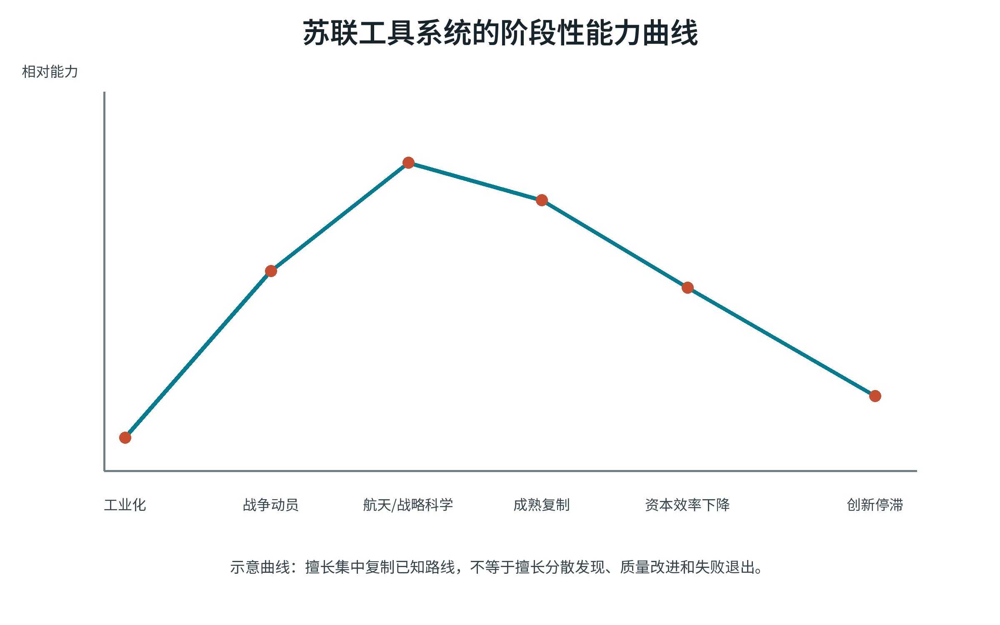

### 能力—代价双重核算

工业产量增长、识字率提升和战略能力必须与农村留粮、消费压缩、迁移限制、政治压制和饥荒死亡同表核算。若只用后来工业产能证明政策正确，是以幸存产出抵销不可逆死亡；若只用灾难否认所有基础设施能力，则无法解释战争动员和技术追赶。严谨结论是：集中配置在一组目标上产生真实能力，同时通过权利不对称把巨大风险转移给无发声者；两者是同一制度过程的不同结果。

### 战争动员的任务边界

战争奖励集中、标准化和服从，却降低消费多样性、开放争论和失败试验的价值。一个能在战争中保住军工供给的制度，未必能在和平期发现更好的消费品、软件或组织。把战时生存当作常态福利最大化，会系统性高估动员并低估信息与退出。

### 案例 21.1：从农业国到工业国的“任务适配”

苏联早期工业化的目标具有集中体制偏好的典型特征：钢铁、煤炭、电力、铁路、机床、化工和军工是可以定义、可以计数、需要跨部门同步投资的关键系统。Allen 认为重工业投资和计划协调对快速工业化有显著贡献，而集体化并未带来相称的额外增长贡献<super>[1]</super>。这一发现意味着，低起点、明确蓝图和外部威胁可以暂时提高集中配置的相对优势，尤其当国家能够压缩消费、动员农村剩余和集中进口设备时。

能集中仍需核算成本和风险。Gregory 与 Harrison 对斯大林档案的研究显示，国家目标、部门利益、信息不对称、管理者激励和行政分配共同塑造结果；中央命令并非一个全知计划者按社会福利函数精确配置资源<super>[54]</super>。Berliner 对企业管理的研究也表明，管理者的奖金、指标、材料保障和政治风险会改变报告与生产行为<super>[55]</super>。因此，工业化能力是真实的，代价也是真实的：消费压缩、强制集体化、政治压制、迁移限制和饥荒不能被后来的钢铁产量抵销。

### 案例 21.2：工业化能力的“能力—代价”双重核算

对集中动员的正确评价应同时列两组账户。能力账户包括重工业基础、铁路与电力、城市和工程教育、战略科学、战时生产能力；代价账户包括农村剩余被过度抽取、消费与住房长期短缺、强制劳动和政治惩罚、环境破坏、机会成本与不可逆死亡。两组账户来自同一制度的不同侧面。

反事实也必须精细。若苏联没有集中重工业投资，它可能在外部威胁下工业更慢，也可能把资源更多用于农业和消费；若集体化更温和、征购更灵活、迁移和贸易更开放，工业化的部分能力可能保留而灾难性代价下降。历史数据无法给出精确权衡，但可以检验关键制度环节：投资是否依赖强制剩余、信息是否允许调整、农民能否退出、地方能否报告坏消息、紧迫目标结束后消费是否恢复。

**表 3-10　苏联集中动员的能力与代价账户**

| 维度 | 能力 | 代价或边界 | 可检验证据 |
|---|---|---|---|
| 投资动员 | 高储蓄、集中投资、互补项目 | 消费压缩、投资效率下降 | 投资率、资本产出比、未完工程 |
| 工业与基础设施 | 钢铁、电力、铁路、机床体系 | 质量、品种、维修和服务不足 | 产品合格率、用户反馈、维护成本 |
| 人才与教育 | 识字、工程教育和科研扩张 | 专业判断受政治约束 | 教育、科研产出、人员流动 |
| 战争动员 | 关键军品和后勤能力 | 民用消费、伤亡与强制 | 军工产量、配给、死亡和债务 |
| 战略科学 | 核、航天和部分高技术突破 | 保密和部门壁垒阻断扩散 | 专利、民用转化、进口依赖 |

## 第二十二章　电气化、教育与战略科学为什么能够形成能力？

电气化、识字教育和战略科学需要大规模互补投资和长期协调，公共体系在其中可以发挥私人资本难以替代的作用。

### 大型工具系统的组织条件

电网、重工业、普及教育、核与航天要求跨部门标准、长期预算和大量专业人才。苏联能够把国家目标、科学院、设计局和军工采购连接起来，尤其适合少数清晰任务。这里的优势来自任务可定义、资源可集中、用户单一和失败保密，并非行政命令本身创造知识。

### 战略岛屿与民用扩散

战略部门的成功可能与民用部门落后并存。保密、部门壁垒和军工优先会形成“创新岛屿”：尖端技术不能顺利转化为机床质量、企业软件、医疗设备和消费服务。专业共同体需要一定自治以筛选真问题；政治命令若预先规定科学结论，就会把同行评议变成忠诚测试。

### OGAS：技术方案需要制度改革

OGAS 设想通过全国计算机网络收集和处理计划信息，被视为对 1965 年经济改革的技术替代或继承<super>[81]</super>。相关研究显示，项目在部委利益、客户需求、算法成熟度和政治决策之间受阻<super>[42]</super>。网络能提高传输速度，却不能自动让企业诚实报告，也不能决定谁有权修改目标。若激励仍奖励夸大需求和隐藏产能，更快的计算只是更快处理失真的输入。

### 案例 22.1：电气化、教育和战略科学的“小目标优势”

苏联能够把电网、重工业、普及教育、核与航天等大型系统连接起来，因为任务具有一些共同特征：目标可由国家定义，技术路线相对明确，用户数量有限，关键专家和资源可以集中，评估标准可以工程化。电气化和识字率提高扩大了工业劳动力与现代组织能力，核和航天则说明专业共同体在清晰任务中具有强大能力。

这个成就应被准确归因。它来自国家目标、科学院和设计局、工程教育、资源集中和专业知识的组合，而不是行政命令本身产生知识。若没有技术专家、科学共同体的筛选和项目组织，即使有预算也无法完成复杂系统。集中体制的优势更多在于“压缩协调时间”，而不是替代知识发现。

### 案例 22.2：OGAS 全国网络为何未能形成

Gerovitch 对苏联全国计算机网络的研究表明，OGAS 及类似方案未能落地，不是因为当时完全没有计算机或网络思想，而是多个行政、军事、经济和技术主体对系统控制权、数据访问、资金来源和改革方向存在冲突。部门拒绝交出信息，地方和军工系统担心权力损失，统一标准和接口难以形成，系统设计又同价格改革、企业自主和计划目标争论绑定<super>[53]</super>。技术网络可以传输数据，但不能自动建立信息可信、激励兼容和组织授权。

这个案例与今天的“数字计划”“全国数据平台”直接相关。现代计算能大幅降低数据存储和算法成本，传感器和软件可以提高实时性，但计算机同样无法决定：企业是否有权隐藏商业信息；地方政府是否如实报告项目收益；平台数据是否属于劳动者和消费者；模型优化目标由谁设定；错误建议如何被推翻；数据垄断如何被竞争和隐私规则约束。

### OGAS 对现代数字治理的六项检验

第一，数据来源能否独立验证，而非只由被考核者上报。第二，目标是否允许多个价值维度，而不是把教育、健康、质量、生态和自由压缩成产量。第三，企业是否有硬预算和真实用户反馈。第四，专业共同体能否公开质疑模型、数据和目标。第五，受影响的劳动者、地方和用户是否有信息、协商和申诉权。第六，项目是否有阶段评估、停止、替换和继承机制。

缺少上述条件，数字化可能让错误指标得到更精细的执行。具备这些条件，公共数据和算法才更有助于协调、采购、预警和公共服务。数据处理能力提高以后，信息的可信度和使用权仍需由制度保障。

## 第二十三章　计划为什么逐渐变成官僚化？

在层级组织中，坏消息常威胁报告者的考核和安全，管理者会围绕指标调整行为。

### 官僚化是可预测的组织均衡

当企业以完成数量指标获得奖金、投入与政治安全时，管理者会选择易完成的品种、争取宽松目标、夸大投入需求、隐藏产能并囤积关键材料。这不是“某些官员品德差”的充分解释，而是目标、信息和惩罚结构共同生成的行为。Kornai 的软预算约束说明，预期上级会救助使企业需求失去价格纪律，短缺从偶发冲击变为系统特征<super>[43]</super>。

### 坏消息的价值与惩罚

在复杂工具系统中，坏消息具有公共品性质：报告者承担职业风险，整个系统获得纠错收益。若计划失败被解释为忠诚问题，基层会把故障、低产和不合格品重新编码为可接受数字。上级随后依据被美化的数据追加错误目标，形成信息—压力正反馈。

| 层级行为 | 局部理性 | 系统后果 | 纠偏机制 |
|---|---|---|---|
| 夸大投入需求 | 降低断供风险 | 总需求虚高、挤压他企 | 独立库存数据、价格与配额复核 |
| 隐藏产能 | 防止目标上调 | 计划低估能力 | 多年激励、免罚试报 |
| 选择易产品 | 完成吨数/件数 | 品种质量恶化 | 用户指标、质量和全周期成本 |
| 囤积材料与劳动 | 自保 | 全局短缺与低流动 | 硬预算、可靠交付、可交易余量 |
| 延期坏项目 | 避免承认失败 | 未完工程累积 | 独立里程碑、终止权 |

### 案例 23.1：管理者的局部理性如何变成系统低效

Berliner 对苏联企业的研究说明，管理者的行为必须放在奖金指标、材料保障和政治风险中理解。若上级以总产出或总产值为主要考核，管理者倾向生产重量大、工艺简单、容易计量或原料成本高的产品，即便用户真正需要的是不同规格、质量和服务；若目标完成不确定，经理会夸大投入需求、隐藏实际产能、拖延技术升级并囤积紧缺材料<super>[55]</super>。这些行为在单个企业内部是自保，但加总后会使需求虚高、供给短缺、库存增加和质量下降。

Gregory 与 Harrison 的档案研究进一步显示，斯大林时代的行政分配同时存在中央目标、部门利益、地方执行、非正式交换和黑市行为；中央并非不知企业操纵，但依赖同一批干部执行，使惩罚和激励陷入矛盾<super>[54]</super>。World Bank 对改革前苏联经济的分析也记录了软预算、投入品短缺、信息不足、配送失灵和零部件不匹配如何共同降低生产率<super>[44]</super>。因此，计划失误不能只用“官僚愚蠢”解释，而是一个信息、激励与权力结构重复生成的组织均衡。

### 案例 23.2：坏消息为什么是公共品

在一个高度不确定的系统中，坏消息具有正外部性：一个人报告设备故障、产品缺陷或目标不可行，所有下游单位都能避免损失；但报告者个人可能面临降职、扣奖金、政治调查或同事压力。若上层把忠诚等同于报喜，普通员工的最优策略就是沉默、推诿或修改数字。上级收到的数据越漂亮，重新分配的任务就越重，基层又更倾向隐藏能力，形成正反馈。

让坏消息进入决策，需要改变报告者的风险和收益。免罚试报、独立审计、用户投诉、质量抽检、维护记录、项目终止权以及专业和媒体监督，都是可能的渠道。它们的作用，是尽早发现错误并降低纠正成本。

**表 3-11　计划官僚化的行为链条**

| 观察行为 | 局部理由 | 系统后果 | 可能的纠偏 |
|---|---|---|---|
| 选择易完成产品 | 提高奖金和避免惩罚 | 品种与质量偏离需求 | 用户评价、质量退货、全周期成本 |
| 夸大投入需求 | 防止材料断供 | 总需求虚高、挤占他企 | 独立库存、价格与配额复核 |
| 隐藏真实产能 | 防止目标上调 | 计划低估生产可能 | 多年期规则、试报免罚、审计 |
| 囤积材料和劳动 | 降低不确定性 | 全局短缺、流动性下降 | 硬预算、可靠交付、可交易余量 |
| 延期失败项目 | 避免承认错误 | 未完工程与债务累积 | 里程碑、终止权、公开复盘 |

## 第二十四章　端到端资源为什么总是对不上？

吨数、账面产出和计划指标并不等于可用产品；库存短缺、维修不足和未完工程可以同时出现。

### 物资平衡的维度缺失

物资计划必须同时满足总量资源约束和关键投入要求，最短缺的必要投入会限制实际生产。除此之外，品种、规格、质量、地点和时点也要匹配。钢的吨数相等不意味着钢号、板厚和交付期可用；一台缺轴承的机器在总量统计中仍可能计为高完成率。

衡量短缺时还应纳入品种不符和交付延误造成的损失。世界银行对苏联经济的研究记录了软预算、投入品短缺、企业缺少市场信息、零部件不足和配送失灵<super>[44]</super>。

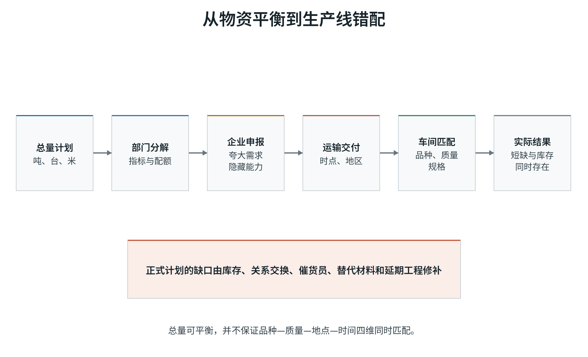

### 库存与短缺为何共存

企业囤积自己可能需要的材料，却缺少当期真正需要的零件；部门完成总量计划，却未在正确地点交付正确规格。于是库存高并不否定短缺，而是对不可靠供给的理性自保。催货员、企业间关系交换和替代材料修补正式计划，既提高局部韧性，也把资源分配变成关系和权力网络。

### 数字化计划的条件

现代传感器、云计算和优化算法能降低数据和计算成本，但仍不能消除偏好变化、创新未知、战略报告和政治目标冲突。数字计划有效的必要条件是可验证数据、分散试验、用户反馈、硬预算、开放接口与终止权。否则“更多数据”可能强化中心对错误指标的精细控制。

### 案例 24.1：吨数平衡如何遗漏可用钢材

假设计划要求钢铁总供给等于建筑、机械和军工总需求。即使吨数满足，若钢板厚度、钢号、强度、表面质量和交付地点不匹配，机器仍无法组装，建筑仍会停工。企业可能把易生产的普通钢完成在报表上，把困难规格延期；用户可以收到数量相同但无法替代的投入品。库存与短缺因此可以同时存在：企业囤积“以后可能用得上”的材料，却缺少“今天必须使用”的零件。

这个例子说明物资平衡的制度边界。计划中心需要知道的不只是总量，还包括替代弹性、工艺配方、运输时点、质量检验和用户偏好。信息越分散，中央统一计算的误差越大；如果企业隐藏能力或夸大需求，计算精度还会下降。计算机可以提高处理速度，却无法自动创造真实报告和硬预算。

### 案例 24.2：未完工程、维修与资本效率

投资计划若奖励开工和投资额，而不惩罚延期和低回报，企业就会争取更多项目，形成同时在建的工程群。项目延期占用土地、设备、劳动和材料，新增产能尚未形成却已计入投资；已建成设备若缺少维修和备件，又会提高停产频率。由此，投资率上升可以与资本效率下降并存。

Kukic 的研究将苏联后期增长放缓更多地联系到资本效率，尤其是建筑物和未完工程效率的下降；维修占投资比重由 1930 年代约 10% 升至 1980 年代约 20%<super>[2]</super>。投资构成、工程周期、维护负担和资产质量，因此需要与劳动效率分别考察。

### 案例 24.3：非正式协调为何既修补又扭曲

当正式供给不可靠时，企业会派出催货员、建立关系网络、交换稀缺材料、接受替代品或私下交易。这些活动能够挽救短期生产，证明社会网络在行政系统中具有真实协调功能；但它们也把资源配置从计划规则转向关系、权力和回报。拥有关系、政治资源或关键材料的企业得到优先供给，缺少关系的企业和消费者承担短缺。

因此，对非正式协调不能只做道德评价。它既是对正式计划失败的适应，也是新的不平等来源。若制度引入价格、可靠合同、硬预算和开放供应商，非正式网络可能转为正常商业关系；若继续压制价格和退出，只会把稀缺转移到关系和腐败中。

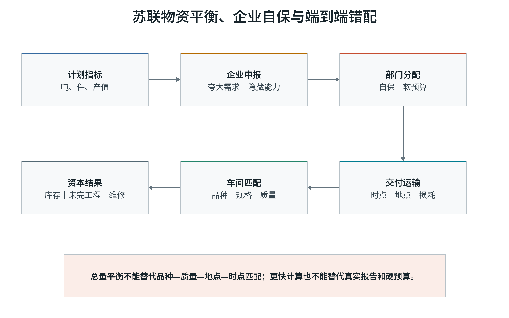

**表 3-12　端到端错配的四个层级**

| 层级 | 总量可能平衡 | 实际失败点 | 纠偏工具 |
|---|---|---|---|
| 企业申报 | 总额可能满足 | 夸大需求、隐藏产能 | 独立审计、多年规则、硬预算 |
| 部门分配 | 配额可执行 | 部门自保、优先关系 | 竞争性供应、公开规则、跨部门标准 |
| 运输交付 | 数量已发运 | 时点、地点和损耗 | 物流信息、合同责任、基础设施 |
| 车间使用 | 入库数量足够 | 品种、规格、质量不匹配 | 用户反馈、质量抽检、替代设计 |

## 第二十五章　旧优势为什么会在创新阶段变成约束？

复制成熟路线的能力很强，不等于发现未知路线。资本效率下降、维护不足和创新退出困难会逐渐累积。

### 增长核算与资本效率

增长可分解为技术效率、资本和劳动贡献：

第二项进一步扣除折旧和未完工程。Kukic 的新研究认为，苏联增长放缓主要与资本效率、尤其建筑物和未完工程效率下降有关，不能简单归因于劳动效率崩塌；资本维修占投资比重由 1930 年代约 10% 升至 1980 年代约 20%<super>[2]</super>。这一修正把问题从“工人不努力”转向投资构成、工程周期和资产维护。

### 复制已知路线与发现未知路线

钢厂、电站和标准化教育可以按既有蓝图复制；复杂消费品、软件、生物技术和持续工艺改进需要多样试验、用户反馈、质量竞争与快速退出。数量指标奖励规模而非可用性，部委边界阻断跨领域组合，失败项目因政治与预算承诺而延续。于是制度从“集中解决明确问题”进入“无法发现问题是什么”的阶段。

### 反例、边界与最终比较

四组经验中都存在例外：苏联有科学突破，美国有长期获得支持的失败企业，欧洲协商可能遗漏外部人，中国行政协调也可能避免重复投资。公共、市场、专业和非正式网络如何组合，决定了具体结果。以下归纳其适用条件：

| 能力维度 | 美国 | 欧洲 | 中国 | 苏联历史基准 |
|---|---|---|---|---|
| 分散发现 | 强，但受平台集中限制 | 中强，受碎片化限制 | 中强，行业差异大 | 弱，战略部门例外 |
| 集中动员 | 危机时较强 | 欧盟与成员国分层 | 强 | 极强 |
| 劳动发声 | 覆盖较弱、退出主导 | 正式制度较强但异质 | 企业和地区差异大 | 独立发声弱 |
| 长期公共目标 | 科研与采购强 | 任务与规则强、财政分散 | 方向与基础设施强 | 既定战略目标强 |
| 错误发现 | 市场退出与公共审查并存 | 协商和监管、多层迟缓 | 试点与竞争并存、坏消息风险 | 纵向信息扭曲显著 |
| 失败退出 | 破产快但“大而不倒” | 较慢、重协商 | 硬软预算并存 | 项目与企业退出困难 |
| 主要分配风险 | 地区、教育、种族、资产 | 内外部人、南北与代际 | 户籍、地区、平台与财产 | 农村、消费与无发声群体 |

平稳时期需要需求发现、参与和长期投资；一般危机需要缓冲、支付连续和有选择地保存生产关系；剧烈震荡则首先要求关键供给与秩序重建，同时限制紧急权力的期限。各类任务都离不开可信信息、受影响者参与、损失保障和停止失败的能力。

### 案例 25.1：苏联增长放缓的“资本—维护—创新”链条

苏联后期增长放缓不能用“劳动力变懒”解释。Kukic 发现资本效率，尤其建筑和未完工程的效率下降，比劳动效率崩塌更能解释增长回落；维修投资占比显著上升，说明大量资源被用于维持旧资产而不是形成新能力<super>[2]</super>。这一结果与前文的物资错配、软预算、项目延期和质量问题彼此印证：投资越多，不代表净资本存量越有效；设备越多，不代表可靠产能越强。

增长核算必须扣除维修、折旧、未完工程和质量贬值。其制度版本是：如果企业以投资额和开工项目争取资源，却不必承担延期、低回报和维护成本，资本积累会从能力形成转向指标完成。反过来，硬预算、用户付款、竞争性供应商、设备维护和项目终止能够提高资本效率，即使投资总量较低。

### 案例 25.2：战略科学为什么会与民用创新脱节

苏联在核、航天、军工和部分计算技术中取得突破，但这些突破并未普遍转化为消费品、机床质量、医疗设备和企业软件。原因不止是“技术落后”，还包括保密、部门封闭、军事优先、价格不传递质量、企业缺少用户反馈、创新失败不能退出和战略项目的特殊资源保障。少数创新岛屿可以证明科学能力，却不能证明整个经济具有扩散能力。

Gerovitch 对全国计算机网络的研究显示，即使全国信息协调在技术上具有设想，部门权力、数据控制、经济改革方向和组织标准仍可能阻断系统实现<super>[53]</super>。这提供了一个重要反例：先进工具不会自动改革组织，反而会被原有权力结构重新解释。要形成扩散，公共研究必须有开放知识、标准、竞争供应商、用户反馈和民用需求；否则科研能力会被锁在少数受保护领域。

### 案例 25.3：美国、欧洲、中国与苏联的最终比较

四个案例是不同历史任务中的制度组合。美国内部有公共科研、国防采购、平台垄断和地区衰落；欧洲内部有北欧、德语区、南欧和中东欧；中国内部有中央方向、地方竞争、国有、民营、外资和平台；苏联内部也有战略科学、非正式网络、地方差异和后期改革争论。比较的价值在于识别能力组合。

美国的长处在分散发现、资本市场规模化和公共科研嵌入，风险在平台权力、短期回报、地区与群体分配和公共回报截留。欧洲的长处在协商、技能和社会保护，风险在内部人、碎片化和创新扩散速度。中国的长处在方向协调、基础设施和快速规模扩散，风险在地方激励、软预算、重复投资和劳动保障分割。苏联的长处在明确任务的集中动员，风险在信息失真、品类错配、资本效率、创新扩散和失败退出。

这些差异可以压缩为五个制度问题：谁设定目标；谁承担失败；谁拥有数据、专利和平台；谁在损失发生时获得保障；谁能停止错误并重新配置资源。回答这五个问题，比争论“市场还是计划”更能解释同一技术在不同社会状态下为何产生不同结果。

### 第三部结论　比较制度完成不同任务的能力

美国、欧洲、中国和苏联都由多种制度机制组成。它们在发现分散需求、承担长期风险、传递坏消息、分配调整成本、组织危机协调和退出失败项目上各有能力与盲点。

美国展示了公共科研、风险资本、平台集中和地区调整断裂的组合。欧洲展示了社会协商、岗位保留、技能形成与外部人风险并存的组合。中国展示了国家方向、地方竞争、企业扩散、多层国情和反馈能力之间的张力。苏联展示了集中动员在追赶任务中的真实能力，也展示了信息压缩、指标替代、软预算和创新退出困难如何把旧优势变成新约束。

这些经验提示，坏消息长期被过滤、成本不断被转嫁、申诉不能改变决定、失败项目难以终止，都会削弱技术收益向人的生活改善转化的可能。

## 第六编 跨国综合 案例档案与制度判断

## 综合章一 六种能力的跨国矩阵

下表逐项比较动员、发现、信息、参与、分配和退出。动员涉及关键资源集中，发现涉及需求与技术路线，信息涉及稀缺和坏消息的传递，参与涉及劳动者与用户的决策权，分配涉及收益与损失，退出则涉及失败项目和非常权力的终止。

**表 3-X1 四个地区的能力来源与典型缺口**

| 地区 | 动员来源 | 发现来源 | 参与来源 | 主要缺口 |
|---|---|---|---|---|
| 美国 | 联邦采购、金融和科研 | 企业竞争、资本和用户 | 企业内部与地方制度差异大 | 地区损失、平台集中、公共回报弱 |
| 欧洲 | 欧盟与国家财政、社会保险 | 企业网络、专业机构和市场 | 行业谈判、工作委员会和法律 | 内部人外部人、财政碎片和重组慢 |
| 中国 | 中央方向、地方执行、国企基础设施 | 企业竞争、地方试验、全球供应链 | 劳动制度和地方执行覆盖不均 | 数据聚合、户籍成本、重复投资和退出 |
| 苏联 | 行政计划、国有资本和战略组织 | 专业共同体与非正式修补 | 正式参与受政治和指标限制 | 坏消息、品种质量、软预算和持续创新 |

矩阵描述能力的来源及其条件。美国公共采购可以高度集中，中国消费品市场可以高度竞争，欧洲成员国的紧急权力安排各不相同，苏联企业也曾借助非正式网络寻找资源。每一项能力都需要回到具体规则。

## 综合章二 机器换人判断的跨国检验

同一台机器人在美国汽车集群、德国共同决定企业、中国出口工厂和苏联式计划企业中产生不同结果。技术性能相同，融资期限、需求弹性、工人参与、供应链和退出不同。机器换人因此不是技术规律，而是任务和制度共同产生的可能路径。

美国研究常强调地区制造就业和工资损失，德国研究发现制造岗位减少可由服务业吸收且企业内部调整更平滑，中国研究同时观察到采用企业扩张和地区劳动者受损，苏联历史则显示自动化在设备供给、维护和指标激励下可能难以扩散。跨国差异要求统一口径而非统一结论。

**表 3-X2 自动化结果的必要分解**

| 环节 | 问题 | 数据 | 错误替代 |
|---|---|---|---|
| 技术供给 | 能否生产或进口设备 | 产量、贸易、价格 | 以产量代替采用 |
| 企业采用 | 谁真正安装使用 | 企业采购、设备地点 | 以行业暴露代替使用 |
| 任务变化 | 哪些任务被替代或增强 | 工序、职业和时间使用 | 以岗位名称代替任务 |
| 企业结果 | 产量、质量和就业怎样变 | 财报、生产与员工数据 | 以采用企业代替行业 |
| 重配结果 | 竞争者和供应商怎样变 | 企业网络、进入退出 | 忽略市场份额转移 |
| 劳动者结果 | 工资、工时、健康和迁移 | 链接调查、社保和家庭 | 以总就业代替福利 |

## 综合章三 公共方向和竞争纪律

美国公共科研、中国产业方向、欧洲绿色任务和苏联计划都说明公共目标可以集中长期资源。差异在于公共方向如何与竞争、专业自治、用户反馈和退出连接。方向越强，越需要公开目标、阶段里程碑、多路线和损失披露；否则错误也会按规模扩散。

竞争纪律同时要求质量、成本与退出。公共任务可以用性能采购、开放标准、用户结果和成本下降形成竞争；基础科学可以依靠同行评议和多机构组合；基础设施可以比较全寿命成本和服务可靠性。关键是失败能被识别并停止，成功者不能永久封闭入口。

## 综合章四 劳动参与是信息制度

美国弱谈判、欧洲共同决定、中国企业和平台规则、苏联企业指标显示，劳动参与既是权利也是信息来源。工人了解异常、维护、节拍和安全，排除他们会使管理者高估设备能力、低估调整成本。参与不能保证每个技术项目正确，却能增加坏消息渠道。

参与可能被内部人利用以阻止有社会价值的重组，因此需要与新进入者、消费者和公共目标平衡。有效制度保护信息、咨询、协商和申诉权，不赋予任何单一群体无条件否决权；同时给受损劳动者收入和转岗保障，避免把同意建立在失业威胁上。

## 综合章五 数据国家与可纠错治理

数字化使政府和企业能够实时观察交易、物流和劳动过程，也提高监控、目标替代和单点错误风险。苏联OGAS、中国平台和行政数据、美国大型平台与欧洲算法监管都显示，更多数据不自动产生更好决策。数据需要定义、权限、审计和争议程序。

可纠错治理至少包含来源独立、指标多维、原始记录可追溯、模型可审计、受影响者可申诉和政策可退出。国家统计、企业平台和专业研究应相互校验。集中数据标准可以提高互操作，分散分析和公开复核可以减少一个指标支配全部行为。

## 综合章六 第三部可检验判断

判断 13 状态放大器判断：相同外部冲击在缓冲、支付、基本供给和反馈较弱的制度中更容易从S1转为S2。若跨国事件研究显示控制冲击后这些能力与状态恶化无关，判断被削弱。

判断 14 公共创新回报判断：公共科研对产品链贡献越大而可及、竞争和财政接口越弱，私人控制与社会出资之间的张力越高。若公共贡献与控制、价格和分配长期无关，判断不成立。

判断 15 协商式调整判断：在暂时冲击和企业专用技能较高时，可信岗位保留与劳动参与可减少匹配损失；在永久需求变化时，缺少退出的保护会拖延重配。若岗位保留在各种冲击下都不影响匹配或锁定，判断被推翻。

判断 16 中国混合协调判断：中央方向、地方试验、企业竞争和全球学习互补时，成熟工具扩散更快；缺少竞争、数据或退出时，规模转化为重复与过剩。若单一中央投入能在没有这些接口时持续产生质量和生产率，互补判断需修正。

判断 17 复杂计划匹配判断：经济复杂度提高时，品种、质量、地点、时点和维护匹配比总量计算更约束绩效。若集中系统在不增加真实反馈和退出的条件下长期解决这些维度，判断被推翻。

判断 18 多尺度劳动判断：采用企业就业增长可以与受暴露劳动者工资或参与下降同时出现。若链接企业劳动者数据表明各尺度结果总是同向，尺度分离判断需收缩。

判断 19 国情可测量判断：多源独立校验和公开修订提高政策对地区与群体损失的发现能力。若增加独立数据不改善预测、纠错或资源配置，数据多元的制度价值被削弱。

## 综合结论 各项制度能力如何配合

第三部的最终结论强调任务与制度组合。美国说明公共科学可以与私人商业化共存，也会产生公共风险与私人控制断裂；欧洲说明劳动协商和社会保险可以保存匹配，也会形成内部人保护；中国说明国家方向、地方试验和企业竞争能够加速规模扩散，也会在信息、退出和分配不足时产生重复与不平等；苏联说明集中体系可以完成清楚的追赶和战略任务，却难以在复杂需求中持续匹配与发现。

第一部建立评价标准，第二部解释资本的技术选择，第三部进一步展示这些机制怎样受到具体制度与社会状态的影响。第四部由此讨论几项配套安排：公共方向中的竞争和审计，市场调整中的社会保障和反垄断，劳动参与中的信息与执行，以及紧急动员中的期限和退出。

# 参考文献

[1] Allen, R. C. (1998). Capital Accumulation, the Soft Budget Constraint and Soviet Industrialisation. *European Review of Economic History*, 2(1), 1-24. https://doi.org/10.1017/S136149169800001X

[2] Kukic, L. (2024). Technical change and the postwar slowdown in Soviet economic growth in a long run perspective, 1885–2019. *Economic History Review*, 77(2), 644–674. https://doi.org/10.1111/ehr.13284

[3] NBER. (n.d.). *Business Cycle Dating Procedure: Frequently Asked Questions*. Retrieved 2026-09-23 from https://www.nber.org/research/business-cycle-dating/business-cycle-dating-procedure-frequently-asked-questions

[4] Laeven, L., & Valencia, F. (2018). Systemic Banking Crises Revisited. *IMF Working Paper 18/206*. https://doi.org/10.5089/9781484376379.001

[5] IPC Global Support Unit (IPC-GSU). (2012). *IPC and Famine: Using the Appropriate Terminology and Scientific Thresholds*

[6] UNHCR. (n.d.). *Figures at a Glance*. Retrieved 2026-09-23 from https://www.unhcr.org/about-unhcr/overview/figures-glance

[7] Romer, C. D. (1993). The Nation in Depression. *Journal of Economic Perspectives*, 7(2), 19–39. https://www.aeaweb.org/articles?id=10.1257/jep.7.2.19

[8] Bernanke, B. S., & James, H. (1990). The Gold Standard, Deflation, and Financial Crisis in the Great Depression. *NBER Working Paper 3488*. https://www.nber.org/papers/w3488

[9] Eichengreen, B. (2002). Still Fettered After All These Years. *NBER Working Paper 9276*. https://www.nber.org/papers/w9276

[10] U.S. Bureau of Labor Statistics. (2020). *The Employment Situation—April 2020*. https://www.bls.gov/news.release/archives/empsit_05082020.pdf

[11] OECD. (2021). Job Retention Schemes during the COVID-19 Crisis. In *OECD Employment Outlook 2021*. https://doi.org/10.1787/5a700c4b-en

[12] European Commission. (2023). *SURE after its Sunset: Final Bi-Annual Report*. https://economy-finance.ec.europa.eu/system/files/2023-10/ip256_en.pdf

[13] World Bank. (2013). *East Asia Pacific Economic Update: Rebuilding Policy Buffers, Reinvigorating Growth*. https://www.worldbank.org/content/dam/Worldbank/document/EAP/region/eap-update-october-2013.pdf

[14] Davies, R. W., & Wheatcroft, S. G. (2009). *The Years of Hunger: Soviet Agriculture, 1931–1933*. Palgrave Macmillan. https://doi.org/10.1057/9780230273979

[15] Naumenko, N. (2021). The Causes of Ukrainian Famine Mortality, 1932–33. *NBER Working Paper 29089*. https://www.nber.org/papers/w29089

[16] Meng, X., Qian, N., & Yared, P. (2015). The Institutional Causes of China’s Great Famine, 1959–1961. *Review of Economic Studies*, 82(4), 1568–1611. https://doi.org/10.1093/restud/rdv027

[17] Rockoff, H. (2004). Until It’s Over, Over There: The U.S. Economy in World War I. *NBER Working Paper 10580*. https://www.nber.org/papers/w10580

[18] Rockoff, H. (2016). The U.S. Economy in WWII as a Model for Coping with Climate Change. *NBER Working Paper 22590*. https://www.nber.org/papers/w22590

[19] National Center for Science and Engineering Statistics. (2026). National Patterns of R&D Resources: 2023–24 Data Update. NSF 26-313. https://ncses.nsf.gov/data-collections/national-patterns/2023-2024

[20] National Center for Science and Engineering Statistics. (2025). Business R&D Performance in the United States Increases to $722 Billion in 2023. NSF 25-353. https://www.ncses.nsf.gov/pubs/nsf25353

[21] National Science Board, National Science Foundation. (2025). Discovery: R&D Activity and Research Publications. *Science and Engineering Indicators 2026*. NSB-2025-7. https://ncses.nsf.gov/pubs/nsb20257

[22] Autor, D. H., Dorn, D., & Hanson, G. H. (2013). The China Syndrome. *American Economic Review*, 103(6), 2121–2168. https://www.aeaweb.org/articles?id=10.1257/aer.103.6.2121

[23] National Institutes of Health. (n.d.). *Budget*. Retrieved 2026-09-23 from https://www.nih.gov/about-nih/what-we-do/budget

[24] U.S. Government Accountability Office. (2026). Technology Transfer: Funding Recipients Keep Most Federally Funded Inventions, but Some Cited Reporting Challenges. GAO-26-107971. https://www.gao.gov/products/gao-26-107971

[25] Jäger, S., Noy, S., & Schoefer, B. (2022). The German Model of Industrial Relations: Balancing Flexibility and Collective Action. *Journal of Economic Perspectives*, 36(4), 53–80. https://doi.org/10.1257/jep.36.4.53

[26] OECD/AIAS. (2025). *ICTWSS Database*. Retrieved 2026-09-23 from https://www.oecd.org/en/data/datasets/oecdaias-ictwss-database.html

[27] OECD. (2023). *The Future of Rural Manufacturing*. OECD Rural Studies. OECD Publishing. https://doi.org/10.1787/e065530c-en

[28] Eurostat. (2026). EU’s Employment Rate Grew above 76% in 2025. https://ec.europa.eu/eurostat/web/products-eurostat-news/w/ddn-20260417-1

[29] Eurostat. (2026). EU Unemployment Rate in 2025: 6.0%. https://ec.europa.eu/eurostat/web/products-eurostat-news/w/ddn-20260610-3

[30] Eurostat. (2026). Fewer Young People Not in Work or Education in 2025. https://ec.europa.eu/eurostat/en/web/products-eurostat-news/w/ddn-20260528-2

[31] European Union. (2024). Directive (EU) 2024/2831 on Improving Working Conditions in Platform Work. *Official Journal of the European Union*. https://eur-lex.europa.eu/eli/dir/2024/2831/oj

[32] European Commission. (n.d.). *Horizon Europe*. Retrieved 2026-09-23 from https://research-and-innovation.ec.europa.eu/funding/funding-opportunities/funding-programmes-and-open-calls/horizon-europe_en

[33] European Union. (2024). Regulation (EU) 2024/1735 Establishing a Framework of Measures for Strengthening Europe’s Net-Zero Technology Manufacturing Ecosystem. *Official Journal of the European Union*. https://eur-lex.europa.eu/eli/reg/2024/1735/oj

[34] European Commission. (2025). *European Innovation Scoreboard 2025*. https://research-and-innovation.ec.europa.eu/knowledge-publications-tools-and-data/publications/all-publications/european-innovation-scoreboard-2025_en

[35] 国家统计局（2026）：《新型工业化迈出坚实步伐 新质生产力积蓄强劲动力——“十四五”经济社会发展成就系列报告之十》。https://www.stats.gov.cn/zt_18555/ztfx/sswjjshfzcjbg/202606/t20260601_1963842.html

[36] International Federation of Robotics. (2025). *World Robotics 2025: Industrial Robots—Executive Summary*. https://ifr.org/img/worldrobotics/Executive_Summary_WR_2025_Industrial_Robots.pdf

[37] 国家统计局、科学技术部、财政部. (2025). 《2024年全国科技经费投入统计公报》. https://www.stats.gov.cn/xxgk/sjfb/zxfb2020/202509/t20250929_1961429.html

[38] National Bureau of Statistics of China. (2026). *Statistical Communiqué of the People’s Republic of China on the 2025 National Economic and Social Development*. https://www.stats.gov.cn/english/PressRelease/202602/t20260228_1962661.html

[39] Aghion, P., Cai, J., Dewatripont, M., Du, L., Harrison, A., & Legros, P. (2015). Industrial Policy and Competition. *American Economic Journal: Macroeconomics*, 7(4), 1–32. https://www.aeaweb.org/articles?id=10.1257/mac.20120103

[40] Huang, Y., Li, H., Ma, Y., & Xu, L. C. (2017). Entrepreneurship and State-Owned Enterprises. *American Economic Review*, 107(2), 415–435. https://pubs.aeaweb.org/doi/10.1257/aer.20150592

[41] Cave, M. (1980). *Computers and Economic Planning: The Soviet Experience*. Cambridge University Press

[42] Safronov, V. (2020). Computerization of the Planned Economy in the USSR: Projects of Scientists and the Needs of Practitioners. https://sst.nw.ru/11-3/kompyuterizaciya-upravleniya-planovoj-ekonomikoj-v-sssr/

[43] Kornai, J. (1980). *Economics of Shortage*. North-Holland

[44] World Bank. (1992). *The Soviet Economy under Perestroika*. https://documents1.worldbank.org/curated/en/379991468134386346/pdf/777730v30Box370f0the0soviet0economy.pdf

[45] OECD. (2026). Global value chain repositioning: Insights from the 2023–24 TiVA nowcasting exercise. *OECD Statistics Briefs*, No. 2026/01. https://doi.org/10.1787/8c97068d-en

[46] Calomiris, C. W., & Mason, J. R. (2003). Consequences of Bank Distress During the Great Depression. *American Economic Review*, 93(3), 937–947. https://doi.org/10.1257/000282803322157188

[47] Romer, C. D., & Romer, D. H. (2017). New Evidence on the Aftermath of Financial Crises in Advanced Countries. *American Economic Review*, 107(10), 3072–3118. https://doi.org/10.1257/aer.20150320

[48] Dustmann, C., Fitzenberger, B., Schönberg, U., & Spitz-Oener, A. (2014). From Sick Man of Europe to Economic Superstar: Germany’s Resurgent Economy. *Journal of Economic Perspectives*, 28(1), 167–188. https://doi.org/10.1257/jep.28.1.167

[49] Galkina Cleary, E., Beierlein, J. M., Khanuja, N. S., McNamee, L. M., & Ledley, F. D. (2018). Contribution of NIH Funding to New Drug Approvals 2010–2016. *Proceedings of the National Academy of Sciences*, 115(10), 2329–2334. https://doi.org/10.1073/pnas.1715368115

[50] Block, F., & Keller, M. R. (2009). Where Do Innovations Come From? Transformations in the US Economy, 1970–2006. *Socio-Economic Review*, 7(3), 459–483. https://doi.org/10.1093/ser/mwp013

[51] Hsieh, C.-T., & Song, Z. (2015). *Grasp the Large, Let Go of the Small: The Transformation of the State Sector in China*. NBER Working Paper 21006. https://doi.org/10.3386/w21006

[52] Juhász, R., Lane, N., & Rodrik, D. (2024). The New Economics of Industrial Policy. *Annual Review of Economics*, 16, 213–242. https://doi.org/10.1146/annurev-economics-081023-024638

[53] Gerovitch, S. (2008). InterNyet: Why the Soviet Union Did Not Build a Nationwide Computer Network. *History and Technology*, 24(4), 335–350. https://doi.org/10.1080/07341510802044736

[54] Gregory, P., & Harrison, M. (2005). Allocation under Dictatorship: Research in Stalin’s Archives. *Journal of Economic Literature*, 43(3), 721–761. https://doi.org/10.1257/002205105774431225

[55] Berliner, J. S. (1957). *Factory and Manager in the USSR*. Harvard University Press. https://doi.org/10.4159/harvard.9780674188273

[56] Lin, J. Y., & Yang, D. T. (2000). Food Availability, Entitlements and the Chinese Famine of 1959–61. *The Economic Journal*, 110(460), 136–158. https://doi.org/10.1111/1468-0297.00494

[57] International Energy Agency. (2025). *Global EV Outlook 2025*. https://www.iea.org/reports/global-ev-outlook-2025

[58] Xu, C. (2011). The Fundamental Institutions of China’s Reforms and Development. *Journal of Economic Literature*, 49(4), 1076–1151. https://doi.org/10.1257/jel.49.4.1076

[59] Heilmann, S. (2008). From Local Experiments to National Policy: The Origins of China’s Distinctive Policy Process. *The China Journal*, 59, 1–30. https://doi.org/10.1086/tcj.59.20066378

[60] 国家统计局. (2026). 《中华人民共和国2025年国民经济和社会发展统计公报》. https://www.stats.gov.cn/sj/zxfb/202602/t20260228_1962660.html

[61] 国家统计局（2025）：《2024年农民工监测调查报告》。https://www.stats.gov.cn/sj/zxfb/202504/t20250430_1959490.html

[62] International Federation of Robotics. (2025). Global Robot Demand in Factories Doubles Over 10 Years. https://ifr.org/ifr-press-releases/news/global-robot-demand-in-factories-doubles-over-10-years

[63] Fan, H., Hu, Y., & Tang, L. (2021). Labor Costs and the Adoption of Robots in China. *Journal of Economic Behavior & Organization*, 186, 608–631. https://doi.org/10.1016/j.jebo.2020.11.024

[64] Wang, T., Zhang, Y., & Liu, C. (2024). Robot adoption and employment adjustment: Firm-level evidence from China. *China Economic Review*, 84, 102137. https://doi.org/10.1016/j.chieco.2024.102137

[65] Giuntella, O., Lu, Y., & Wang, T. (2022). How Do Workers and Households Adjust to Robots? Evidence from China. *NBER Working Paper 30707*. https://doi.org/10.3386/w30707

[66] Mao, Q., & Guo, C. (2025). Industrial robots, supply chain spillover effect and firm employment: Evidence from China. *Journal of Economic Behavior & Organization*, 229, 106858. https://doi.org/10.1016/j.jebo.2024.106858

[67] Deng, Y., Feng, A., & Hu, D. (2025). Gender earnings gap in Chinese firms: Can it be narrowed by industrial robots? *China Economic Review*, 89, 102328. https://doi.org/10.1016/j.chieco.2024.102328

[68] World Bank. (2024). *China Economic Update: Reviving Demand, Regaining Momentum*. https://www.worldbank.org/en/country/china/publication/china-economic-update-december-2024

[69] Tu, W., & Wang, X. (2024). New Forms of Employment and Labour Protection in China. *ILO Working Paper 103*. https://doi.org/10.54394/EKJK7740

[70] 人力资源社会保障部办公厅（2023）：《新就业形态劳动者休息和劳动报酬权益保障指引》等文件，人社厅发〔2023〕50号。https://www.mohrss.gov.cn/SYrlzyhshbzb/laodongguanxi/zcwj/202402/t20240223_513995.html

[71] World Bank. (2025). *China Economic Update, June 2025*. https://www.worldbank.org/en/country/china/publication/china-economic-update-june-2025

[72] Zeng, J., & Zhou, Q. (2024). Mayors’ promotion incentives and subnational-level GDP manipulation. *Journal of Urban Economics*, 143, 103679. https://doi.org/10.1016/j.jue.2024.103679

[73] 国家统计局. (2020). 《地区生产总值统一核算改革有关问题解答》. https://www.stats.gov.cn/sj/zxfb/202001/t20200105_1752041.html

[74] Clark, H., Pinkovskiy, M., & Sala-i-Martin, X. (2017). China’s GDP Growth May Be Understated. *NBER Working Paper 23323*. https://doi.org/10.3386/w23323

[75] 工业和信息化部等七部门. (2024). 《推动工业领域设备更新实施方案》. https://www.gov.cn/zhengce/zhengceku/202404/content_6945444.htm

[76] 工业和信息化部等十五部门. (2021). 《“十四五”机器人产业发展规划》. https://www.gov.cn/zhengce/zhengceku/2021-12/28/content_5664988.htm

[77] 国家市场监督管理总局. (2025). 《全国私营企业数量超过5800万户》. https://www.samr.gov.cn/xw/zj/art/2025/art_2d83cf47e9f946ea9df225642f546f88.html

[78] 国务院国有资产监督管理委员会. (2025). 《2024年中央企业战略性新兴产业投资2.7万亿元》. https://www.sasac.gov.cn/n2588025/n2643314/c32924955/content.html

[79] 国家统计局. (2025). 《第五次全国经济普查公报（第六号）》. https://www.stats.gov.cn/sj/zxfb/202501/t20250123_1958426.html

[80] International Labour Organization. (2019). *Extending Social Protection to Internal Migrant Workers in China*. https://www.ilo.org/publications/extending-social-protection-internal-migrant-workers-china

[81] Conyngham, W. J. (1980). Technology and Decision Making: Some Aspects of the Development of OGAS. *Slavic Review*, 39(3), 426–445. https://doi.org/10.2307/2497163
