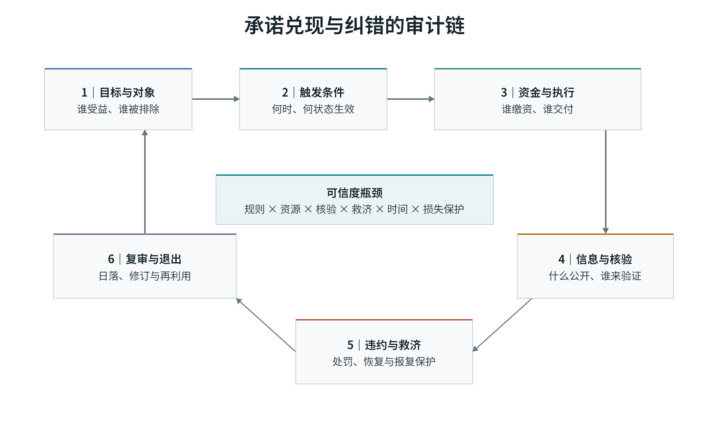
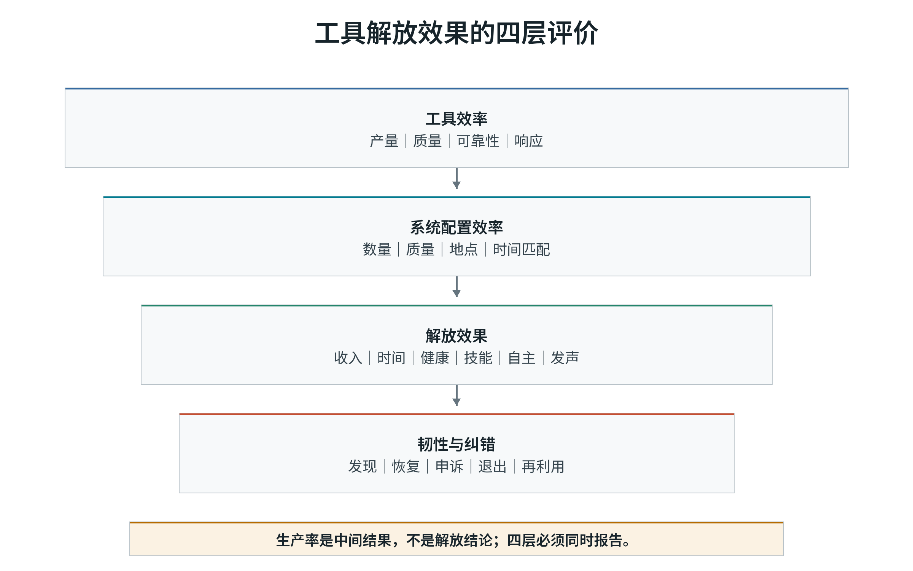
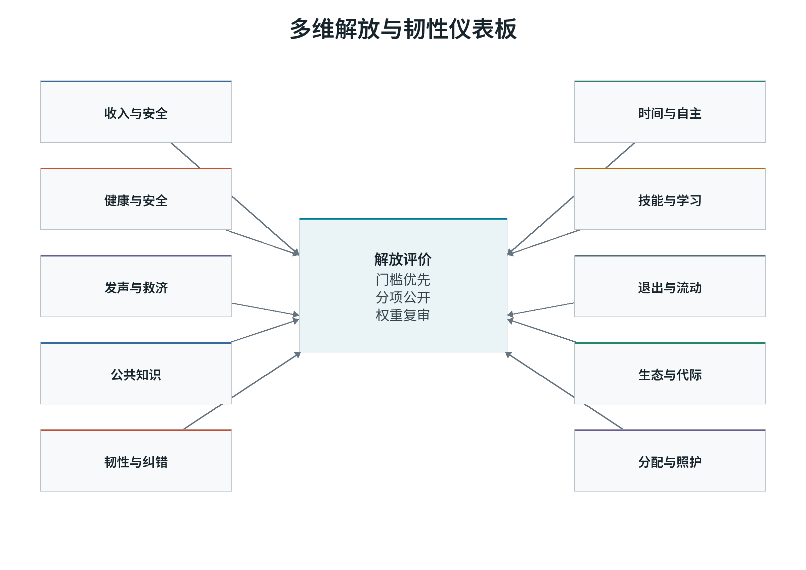

# 第五卷　什么才算进步

## 本卷导读

第五卷考察技术转型的承诺如何兑现，生产率增长是否改善了人的生活，以及受影响者怎样参与评价进步。承诺、生活指标和复审程序，需要在同一套评价中相互核对。

# 第五部　什么才算进步

## 第五部导言　什么才算进步

第五部处理三个问题。第一，为什么人们会相信或不相信技术转型中的承诺？第二，怎样判断技术是否真的改善了人的生活？第三，谁有资格定义进步，又如何允许这个定义被修改？

可信承诺需要预算、执行、独立核验、违约救济、时间一致性和损失保护。没有这些条件，支持率或宣传不能证明制度值得相信。技术进步也不能只用生产率衡量，收入、工时、健康、安全、技能、自主、发声、退出、公共知识和生态边界需要分别呈现。

资本、公共机构、专家和公众，都能为进步评价提供信息，也各有局限。知识审查、权利底线、受影响者参与、权重公开和定期复审，应共同约束这种评价。

## 第三十一章　为什么有人相信技术转型的承诺，有人不信？

同一项技术转型承诺，有人相信，有人不相信；差别通常在于资格、预算、执行、救济和时间一致性是否可核验。

### 承诺为何需要可核验的制度预期

自动化部署前，企业和政府可能同时承诺“提高生产率”“不会让劳动者独自承担成本”“提供培训”“保障数据权利”。这些句子在文本上相近，对劳动者却可能意味着完全不同的未来。如果企业有稳定现金流、工会共同决定、利润分享和违约金，工资与岗位承诺可能改变行为；如果政府有法定资格、税收来源、自动支付和地方执行能力，保障承诺可能形成安全感；如果专家共同体能够独立核验、公开反对并撤回错误建议，技术安全承诺可能可信；如果集体协定覆盖外包、平台和非典型劳动者，收益分享才不只是核心员工的内部人安排。

反过来，缺少资金、核验和救济的承诺会把风险继续留给最弱的一方。劳动者可能被要求先接受设备更新、技能转换和组织重组，等待未来收益，却无法确认企业是否会分享利润、政府是否会持续支付培训、算法是否会公开变更、失败项目是否会被终止。承诺不能消除不确定性，它只能改变谁承担不确定性，以及当事人能否在信息变化后重新谈判。

资本、政府、专业机构和集体协定，依靠不同的资源与规则履行承诺。支持率可能反映习惯、依赖或缺少退出选择；判断承诺是否可靠，则要检查资源、验证、执行、期限和损失保护。

### 承诺问题：未来执行者不一定愿意履行今天的承诺

承诺能否持续，要看未来的决定者是否有履行义务和激励。政府换届可能改变长期收入支持的预算，企业并购可能改变不外包的安排，商业部门可能限制科研机构披露风险。收益分享协议也可能遗漏派遣、平台和供应链劳动者。今天的承诺需要对这些变化作出安排。

承诺问题至少包含五类来源。

| 来源 | 机制 | 典型表现 | 可信化条件 |
|---|---|---|---|
| 时间不一致 | 事前承诺在事后变得昂贵 | 投资补贴获批后改变税收或价格规则 | 法定权利、独立执行、违约成本 |
| 政治或管理层更替 | 新决策者不继承旧政治资本 | 换届、并购、重组后推翻协定 | 跨期预算、合同继承、共同治理 |
| 信息不对称 | 承诺方知道成本、风险和履约能力，外部人不知道 | 夸大收入、隐藏债务、选择性披露 | 独立审计、数据访问、复现 |
| 执行能力不足 | 规则存在但基层无人员、资金和系统 | 名义资格、长期排队、地区差异 | 预算与责任匹配、行政数据 |
| 集体行动与退出成本 | 个体无法有效惩罚违约 | 单户申诉成本高、离职成本高 | 集体代表、救济、可携带权利 |

Fearon 对承诺问题的分析表明，当事人即使都偏好避免最坏结果，也可能无法可信地保证未来不会利用权力优势，使合作失败<super>[35]</super>。制度承诺之所以重要，不是因为它让人变成道德圣人，而是因为它改变未来行动的收益结构。Elster 关于预先约束的讨论也提示，今天的多数可能用规则约束未来的冲动，但规则本身必须保留审议和纠错，否则约束会变成上一代人控制下一代人的工具<super>[37]</super>。Levi 对国家收入制度的研究说明，统治者能否取得资源取决于其与纳税者之间的议价、监督和正当化，强制并非零成本<super>[38]</super>。

这些经典论证的共同结论是：承诺可信度不能从言辞推断，必须从约束和重复互动观察。若违约没有被发现、没有仲裁、没有赔偿、没有退出或集体报复，承诺对未来行为的约束力很弱。

### 可信度的六项短缺条件

本部把一项承诺 j 的可信度定义为六项条件的短缺结构：

六项条件分别衡量不同环节。

**规则具体性 Sj** 要求资格、金额、期限、触发事件、责任主体和例外被明确。只说“加强培训”无法让人判断失业后能否进入、课程是否符合当地技能需求、期间收入由谁承担。“对受影响劳动者提供六个月、覆盖百分之七十工资、由失业保险和企业共同融资、地方就业机构在三十日内发放”才具备可执行内容。

**兑现资源 Fj** 包括财政、人员、设备、数据和组织能力。法律可以规定权利，财政和基层执行决定权利是否到达。养老金缴费记录、失业保险资格、培训席位、数据可携带系统、算法审计人员和法院容量都属于资源。若资源不足，承诺很容易从普遍权利转为排队和选择性执行。

**核验能力 Vj** 要求外部主体能够看到兑现、成本和分配。企业只公布平均工资，无法判断自动化收益是否被分享；政府只公布支出总额，无法判断是否漏保；平台只公布“算法优化”，无法说明排班、处罚和收入变化；科研机构只公布成功项目，无法评估失败和资源集中。

**执行与救济 Ej** 决定违约是否留下后果。仲裁、劳动监察、法院、集体谈判、监管处罚和选举问责都可以是救济路径。若申诉需要个人承担高成本、举证责任倒置、报复风险和信息不透明，名义权利无法形成可信预期。

**时间一致性 Tj** 要求规则跨越政治周期、管理层更替和技术波动。独立预算、自动稳定器、长期合同、可携带权利、共同决定和司法保护有助于降低政策反转。但过强的跨期锁定也可能限制新一代对目标、技术和价值的修正，因此需要定期复审，而不是永久冻结。

**损失保护 Lj** 关注承诺失效时谁承担最后风险。若企业收益下降时先裁减派遣工、女性、年长劳动者或低技能者，平均承诺仍然兑现，脆弱群体却承担了全部调整。可信承诺必须预先说明逆序承担、基本保障和重新分配规则。

承诺形成预期后，行动者会根据新信息修正判断。

一次支付可以是长期兑现的开始，也可能只是短期垫付。若两种情形产生相同信号，单靠支付本身很难区分；独立审计确认覆盖、预算与资格的稳定性，才能提供更强证据。无解释的资格收缩会削弱信任，其程度取决于既有经验和信息质量。调查应记录信号到达时间、来源和受访者接触情况。

兑现、纠错后的恢复、违约或掩盖，会持续改变承诺的可信度。恢复信任需要承担责任、赔偿、修改制度和后续兑现。一个组织如果能够公开错误、保护报告者、补偿受损者并改变规则，长期可信度可能高于从不承认错误的组织。反过来，频繁用“个别问题”解释系统性违约，会让新信号失去价值。

### 资本承诺：所有权和治理权决定承诺边界

资本内部包含不同行动主体。大企业、初创企业、平台、银行、风险资本、机构投资者和家族企业的目标、期限和治理结构不同。资本承诺也不能只理解为“老板保证不裁员”。至少包括六类：

1. 就业或收入承诺；
2. 培训、再就业和时间安排承诺；
3. 数据、隐私和算法说明承诺；
4. 自动化收益分享和利润分享承诺；
5. 安全、健康和工时承诺；
6. 供应链劳动与环境责任承诺。

资本承诺的可信度取决于谁有权改变它，以及改变时谁能够阻止。若承诺写在管理层公开信中，董事会、债权人或新所有者可以改变；若承诺进入集体协定、债务契约、监管许可、员工所有权和共同决定，违约成本更高。信息权同样关键：没有产品和财务信息，劳动者无法判断企业是真的面临需求下降，还是借自动化重新分配权力。

资本承诺有真实边界。企业面临竞争、技术不确定性和需求波动，不可能对所有岗位提供永久保证。要求企业单独承担全部社会风险，会造成招聘保守、外包和进入壁垒；要求劳动者先接受风险，又会把创新成本单方面转移给最缺少流动性的人。可信设计因此不追求“企业永不调整”，而追求调整规则可预期、影响者可参与、收益和成本有对应、被淘汰能力可以保存和转移。

共同决定和集体谈判能够把企业信息、调整方案和补偿放入可执行程序。德国共同决定和工作委员会研究显示，劳动者代表可以改善信息传递和调整合作，但覆盖范围、议题权限和内部人保护会影响结果<super>[5]</super><super>[21]</super><super>[22]</super>。利润分享和员工持股在广泛、稳定、可理解且与工资安全分离时可能改善信息和留任，但若要求劳动者把工资、养老金和储蓄同时押在同一企业，风险反而集中<super>[17]</super>—<super>[18]</super>。

资本承诺的最低可信组合通常是：

| 承诺领域 | 仅靠声明 | 中等可信 | 较高可信 |
|---|---|---|---|
| 就业与工资 | 管理层保证 | 书面计划、定期报告 | 集体协定、最低收入、违约金、共同决定 |
| 培训与转岗 | 培训口号 | 课程和预算 | 带薪学习权、可携带账户、需求匹配、完成和就业跟踪 |
| 数据与算法 | “遵守法律” | 告知和内部审计 | 数据访问、解释、人工复核、申诉、独立审计 |
| 收益分享 | 奖金承诺 | 年度利润分成 | 公式化分享、财务信息、广泛覆盖、治理权 |
| 健康与工时 | 安全承诺 | 指标监测 | 风险暴露数据、工作场所代表、停止作业权、外部检查 |
| 供应链 | 行为准则 | 供应商问卷 | 可追溯合同、联合检查、采购激励、申诉和退出 |

资本承诺不能仅由资本单方定义。第四部提出的信息、协商、共同决定、解释、申诉和退出六层权利，是把资本承诺转为可执行预期的条件。

### 政府承诺：法定权利、财政能力与行政可靠性

政府承诺覆盖社会保险、就业支持、教育、公共采购、基础研究、基础设施、生态修复和危机救助。其可信度来源与资本不同。政府可以依法征税、普遍授权和跨代融资，也可能因政治更替、财政危机、执行层级和资格排斥削弱承诺。

政府承诺不能只看法律文本。需要区分至少五个环节：

Besley 与 Persson 关于国家能力的研究把财政和集体行动能力置于发展条件的重要位置，说明法律目标、资源汲取和公共供给之间需要相互支持<super>[36]</super>。该研究并不证明任何国家规模都能产生可信承诺，而是说明承诺若没有财政和组织基础，很难跨越危机和政治周期。

| 环节 | 需要观察 | 常见失真 |
|---|---|---|
| 法律资格 | 谁能申请、条件、期限、权利内容 | 权利碎片化、例外过宽、非正规劳动排除 |
| 财政承诺 | 税收或缴费来源、预算额度、自动稳定机制 | 未列预算、依赖年度竞争、地方财力差距 |
| 行政交付 | 人员、系统、支付时间、办理距离 | 排队、材料复杂、数字排斥、地区不均 |
| 执行救济 | 复核、申诉、法院、监察、信息公开 | 程序空转、投诉报复、法律责任不清 |
| 分配结果 | 覆盖率、替代率、受益分布、劳动结果 | 中高收入内部人获益，最需要者漏保 |

失业保险可以平滑消费、分担风险，但适当的给付、期限和再就业激励取决于风险厌恶、借贷约束、劳动需求与财政外部性<super>[12]</super>—<super>[13]</super>。非标准劳动者还面临资格、缴费记录、收入波动和平台责任的分割<super>[14]</super><super>[15]</super>。承诺是否可信，因而需要同时核对资格、融资、实际交付和救济。

德国短时工作说明，法定保险、社会伙伴协商、企业申请和公共补贴可以在需求暂时下降时共同保留匹配资本。其成功依赖冲击可逆、覆盖清晰、培训和条件约束，以及对永久需求下降的退出处理<super>[16]</super>。若企业把短时工作当作长期补贴，岗位保留会延缓重组并保护内部人。可信度来自制度兑现，也来自知道何时停止。

中国的社会保险和公共服务承诺面临人口流动、城乡差异、地方财政、单位类型和平台就业的多层结构。国家政策已经推进异地结算、社会保险关系转移和服务可携带，但户籍、缴费连续性和地方待遇仍会影响劳动者实际获得<super>[8]</super><super>[9]</super><super>[10]</super>。这一差异说明“法律全国适用”与“个人能够平滑携带”不是同一判断。可信度的改进方向不只是增加宣传，而是减少资格断点、统一必要记录、明确平台和用工方责任、提高跨地区系统可靠性。

政府承诺还必须处理政治时间不一致。政策不确定会抑制投资、招聘和消费。Baker、Bloom 与 Davis 构建的经济政策不确定性指标显示，税收、支出、监管和货币政策预期波动与经济活动存在关系；该指标是文本和预期构造，不能单独证明某项政策造成具体福利损失<super>[39]</super>。Bloom 对不确定性冲击的研究进一步表明，企业在高不确定状态下会推迟不可逆投资和招聘<super>[40]</super>。可信政策不是不变，而是变化具有可解释规则、过渡期、损失分担和复审程序。

政府承诺也不能被浪漫化为当然正确。国家可能通过许可、采购、信息和强制扩大控制；财政可持续性、竞争纪律、专业自治和司法问责需要同时存在。Acemoglu 与 Robinson 对“狭窄走廊”的讨论强调，国家能力和社会约束必须同时发展；其历史框架具有启发意义，但不能替代具体政策评估<super>[11]</super>。

### 专业共同体承诺：知识标准、自治与外部问责

专业共同体承诺包括医学安全、工程标准、科学研究、会计审计、数据安全和人工智能风险管理。其可信度来自方法透明、同行评审、复现、职业规范、利益冲突披露和资格惩戒。专业知识不能被政治宣传替代：疫苗、桥梁安全、污染阈值和统计推断有独立于权力偏好的证据要求。

专业权威也会失灵。Merton 所讨论的普遍主义、公有性、无私利性和有组织怀疑，是科学共同体的理想规范；资源、声望和职业激励则会影响实践<super>[30]</super>。评审过度集中、数据封闭、负面结果不发表和利益冲突不披露，都会削弱专业承诺。算法审计同样需要外部访问、明确标准、整改责任和申诉程序；公开模型卡只是其中一项<super>[33]</super>—<super>[34]</super>。

专业承诺应聚焦知识判断，价值权重仍需公共审议。医生可以判断治疗风险，不能单独决定有限的医疗资源优先给谁；工程师可以判断模型误差，不能单独决定就业和隐私的交换；科学家可以判断气候证据，不能单独决定减排成本如何分配。专业知识负责说明手段、风险和不确定性，公共程序负责选择目标、权利底线和成本分配。

专业承诺的可信架构应同时满足：

1. 方法、数据、冲突和不确定性公开；
2. 独立复现与反方审查；
3. 专业资格与持续能力要求；
4. 受影响者的信息和申诉入口；
5. 错误更正、撤回和责任承担；
6. 目标与权重回到立法、协商或公共审议。

### 集体协定承诺：覆盖、权力与外部人保护

集体协定可以约束工资、工时、培训、自动化调整、数据使用、裁员顺序和收益分享。其可信度取决于组织覆盖、谈判层级、议题权限、执行能力和争议解决。Freeman 与 Medoff 的经典研究把工会作用区分为垄断工资与集体发声，强调退出和发声机制的组合<super>[21]</super>。工作委员会研究显示，协商可以传递基层信息并影响调整过程，但制度设计和覆盖范围决定其是合作还是内部人保护<super>[22]</super>。

集体协定面临三类边界。

第一，**覆盖边界**。行业谈判可能覆盖正式大企业，却遗漏平台、派遣、家政和微型企业劳动者。内部人获得稳定保障，外部人承担更差条件，会削弱普遍可信度。

第二，**议题与信息边界**。若工会只能讨论工资，不能接触自动化计划、算法指标和企业财务，承诺仍然被动。信息权、技术变更协商和提前通知必须进入议题。

第三，**执行与权力边界**。没有罢工、仲裁、普遍适用和法律责任的支持，协定容易被转移、外包和文字化。强执行又可能形成进入壁垒和创新封锁，需要通过时限、外部代表、竞争政策和重新谈判平衡。

集体协定的优势是能够把承诺写成多方共同拥有而非单方恩惠。其风险是把集体权力变成新的排除机制。可信标准应包括未覆盖者影响评估、青年和新进入者代表、申诉和退出、共同目标与期限，以及失败后的重新谈判。

### 四类承诺组合：替代、互补与责任转移

资本、政府、专业共同体和集体协定不是四选一，也不是简单相加。它们在不同任务上有比较优势。

| 任务 | 资本单独承诺的风险 | 政府单独承诺的风险 | 专业或集体补充 |
|---|---|---|---|
| 企业内部岗位调整 | 所有者更替、外包、信息不对称 | 远程行政难知任务细节 | 工作场所代表、提前通知、共同审计 |
| 社会保险和再就业 | 企业选择性覆盖、竞争削弱 | 资格分割、地方执行差异 | 行业协定、职业标准、地方服务 |
| 算法和人工智能 | 商业秘密、模型变更 | 技术能力不足、许可俘获 | 独立审计、劳动者数据权、司法 |
| 基础研究与公共知识 | 过度占有、短期回报 | 政治指标、行政评价 | 同行评审、开放数据、公众任务审议 |
| 绿色转型 | 成本外包、锁定高碳资产 | 补贴俘获、地区就业冲击 | 社会对话、地方转型计划、生态门槛 |

责任转移是组合设计中最常见的失败。企业以“政府会培训”为理由加速裁员，却不为培训缴资；政府以“市场会创造新岗位”为理由减少收入支持，却不提供过渡融资；专家以“证据不足”拒绝讨论价值冲突；集体协定以“内部人已经协商”为理由排除非正规劳动者。可信组合必须对每项风险指定最后责任主体和不可转移的底线。

### 案例 31.1：德国短时工作的可信度来自何处

德国短时工作由法定保险、社会伙伴协定、企业需求和公共行政共同支持。危机中，企业减少工时并申请补贴，劳动者保留劳动关系和部分收入，政府分担工资成本。明确的资格、支付和共同治理规则，使这种安排有可能形成稳定预期。

其可信度也有限。

第一，需求下降必须大体可逆。若行业发生永久收缩，保留原岗位可能降低劳动者寻找新职业的速度。

第二，覆盖和条件决定分配。标准就业、缴费记录和企业参与能力较强的劳动者更容易获得；非标准劳动者与中小企业可能不足。

第三，短时工作只处理工资损失的一部分，不自动解决技能更新、地区需求、家庭照护和企业长期投资。

第四，财政成本随持续时间和参与人数上升，需要阶段复审和退出。<super>[4]</super><super>[16]</super>

该案例支持条件性判断：当冲击暂时、资格透明、社会伙伴参与、财政资源可用且退出规则明确时，法定工资保险比不可信的事后补偿更能形成合作预期。它不支持把短时工作永久化为对所有结构调整的统一响应。

### 案例 31.2：中国社会保险可携带性的多层可信度

中国社会保险和公共服务在制度覆盖上持续扩大，但劳动者实际可信度受流动、地方财政、缴费连续性和平台用工影响。跨地区就业者可能面对转移接续、待遇差异和服务平台不连通；农民工和灵活就业人员在缴费能力、单位责任与资格连续性上处于不同位置；平台劳动者还面对任务收入与劳动关系认定之间的边界。<super>[8]</super><super>[9]</super><super>[10]</super>

对可携带承诺的评价不能停在“制度是否建立”，而要追踪：

1. 劳动者是否知道自身权益和记录；
2. 用人单位或平台是否承担责任；
3. 跨地区转移是否能在可预期时间内完成；
4. 断缴是否造成不可逆待遇损失；
5. 申诉和更正是否有效；
6. 不同性别、年龄、地区和就业身份的结果差异。

中国的多层治理能否把法定权利落实为个人可以携带的保障，要看中央规则、地方执行、数字系统与基层争议处理是否衔接。一个环节的改善，仍可能受到其他环节中断的限制。

### 案例 31.3：欧盟平台与人工智能规则中的权利和救济

欧盟平台工作指令、通用数据保护条例和人工智能法建立了信息、数据保护、人工审查、风险评估和劳动权利框架<super>[6]</super><super>[24]</super><super>[25]</super>。这些法律提高了制度的可见约束，但法律通过的边际效果取决于成员国执行、平台合规、劳动者代表、法院容量和技术审计。

以算法管理为例，可信劳动承诺至少需要：

1. 部署前告知用途、指标、数据来源和影响；
2. 对收入、排班、处罚和资格有意义的解释；
3. 人工复核和临时保护；
4. 工会或劳动者代表的数据访问与协商；
5. 独立审计和监管整改；
6. 退出、数据携带和争议解决。

知情需要配合改变决定的权利，个案申诉需要配合对系统性问题的审计，审计又需要劳动者的现场知识。劳动者能否及时发现错误、要求修正、取得补偿并防止重演，是检查法律实施的具体尺度。

### 案例 31.4：美国公共科研承诺的自治与公共回报

美国公共科研承诺的历史基础来自 Bush 对基础研究和国家能力的论证<super>[29]</super>。大学、国家实验室、联邦资助和采购形成长期知识供给。其可信度并非来自政府每一次项目都不失败，而来自同行评审、研究者发起、公开竞争和失败容忍。公共资助产生广泛社会回报，但成功案例存在选择偏误，专利和产品召回不能覆盖教育、数据、公共卫生和知识维护价值<super>[7]</super><super>[31]</super>。

当公共科研承诺转向商业化、专利许可和产业任务时，需要区分三种目标：知识公开、技术转化和公共可及。若没有开放许可、价格、公共回报和可及性条件，纳税人资助的知识可能形成新的私人控制。专业自治可以保护问题选择，公共问责则需要披露利益冲突、成果开放、公共回报和风险。两者缺一，承诺会分别偏离为封闭专业主义或行政指标主义。

### 承诺如何被测量：从态度调查到交付审计

可信度不能只问“你是否相信”。一个可复用的测量框架至少包括五组指标。

| 指标组 | 具体测量 | 解释用途 | 主要风险 |
|---|---|---|---|
| 预期与信念 | 概率预期、政策持续性、就业和收入信心 | 判断当事人是否把承诺纳入决策 | 自报信息偏差、政党身份、调查时点 |
| 规则与资源 | 法定资格、预算、人员、系统、资产负债 | 判断兑现能力和制度约束 | 文本承诺与实际执行分别评估 |
| 交付记录 | 支付率、覆盖、时限、服务完成、处罚和赔偿 | 观察承诺是否到达 | 行政记录可能漏掉非正规劳动 |
| 争议与纠错 | 申诉、仲裁、复审、报复、恢复时间 | 检验违约成本和纠错 | 低申诉可能表示可信或恐惧 |
| 行为反应 | 投资、培训、流动、退出、合作、抵制 | 观察预期如何改变行动 | 行为受多重因素影响 |

经济政策不确定性研究说明，文本和预期指标能够捕捉变化，但不能把不确定性指数直接等同于福利损失<super>[39]</super>。Manski 关于预期测量的研究强调，概率预期、群体异质性和调查设计会影响结论，正式问卷需要避免把模糊“相信”压缩为确定性选择<super>[41]</super>。Rothstein 关于政府质量的研究把腐败、公正执行和社会信任联系起来，但相关性不能自动证明高质量政府导致信任，也可能存在反向或共同因素<super>[42]</super>。

更可靠的设计是三角验证：把法律、预算、行政支付、当事人预期、申诉记录和独立审计连接。若制度成本低、覆盖高、支付稳定、申诉有救济且调查预期改善，可信度判断较强；若文本完整但预算不足、支付延迟、申诉高拒低赔且预期不变，形式承诺不能成立。

### 承诺审计的十个字段

本部将任何重大承诺转为十字段审计。

1. **目标**：承诺改变哪个可观察结果，不把“增强信心”当作目标本身。
2. **受益对象**：谁被覆盖，谁被排除，非正规和无法组织者如何处理。
3. **触发条件**：在何种事件、状态和时间范围生效。
4. **权利内容**：收入、服务、信息、培训、参与、退出或赔偿具体是什么。
5. **资金来源**：谁缴费、谁纳税、谁承担债务和波动。
6. **执行主体**：谁决定、谁交付、谁审核、谁处理争议。
7. **信息与核验**：哪些数据公开，由谁验证，误差和隐私如何处理。
8. **违约与救济**：未履行时谁负责，时限、赔偿和报复保护是什么。
9. **分配后果**：不同群体净收益、成本和风险如何变化。
10. **回顾与退出**：何时复审，何种证据触发修改、降级或终止。

这十个字段不能被“完善配套”“加强落实”等短语代替。若一项承诺无法说明资金来源、违约后果或退出日期，它就仍是政治意图而非制度预期。

### 失败模式：宣传、形式主义与过度承诺

承诺可能以五种方式产生伪可信度。

**第一，宣传替代兑现。** 重复发布愿景、会议和数字目标，使公众接触高频正面信号，却没有资金和执行。若正面宣传在兑现和违约状态下同样出现，其诊断价值很低。

**第二，形式权利替代实际获得。** 法律资格存在，但手续复杂、地方财力不均、数字平台排斥，结果是高覆盖文本与低获得并存。

**第三，专业封装替代公共理由。** 专家用无法核查的模型和术语排除公众质疑，不接受独立复现或价值审议。

**第四，过度承诺。** 承诺覆盖无限事件、金额和期限，超过财政和组织能力。短期支持度可能上升，长期违约会损害所有制度承诺。

**第五，强制服从替代信任。** 对异议和退出施加成本，报告中的满意度、稳定性和低争议率看似很高，实际是基于恐惧或缺乏替代方案。

与五种失败相对，可信制度需要区分不同状态。S0 平稳发展可以依靠法定权利、预算、协商和定期复审；S1 危机需要自动稳定、临时授权和退出时限；S2 剧烈震荡需要保护基本生存和权利底线，但紧急权力必须有证据门槛、分层权限、司法或独立复核和自动日落。任何把 S2 紧急承诺永久化的制度，最终都会在 S0 中形成低信息、高控制的累积成本。

承诺的可信度建立在具体规则、兑现资源、独立核验、救济、时间一致性和损失保护之上。任何关键条件不足，都可能使承诺落空。

资本承诺依靠资产、合同、信息权、共同治理和收益分享；政府承诺依靠法定资格、财政、行政交付、司法和问责；专业承诺依靠方法透明、复现、职业惩戒和外部参与；集体协定依靠覆盖、组织权力、争议解决和外部人保护。四类承诺可以互补，也会转移责任。承诺审计必须说明目标、对象、条件、权利、资金、执行、信息、救济、分配和退出。

**判断 28：在其他条件相同的情况下，包含具体资格、预算、独立核验、可执行救济、时间一致性和损失保护的承诺，比只包含愿景、规模和宣传的承诺更能改变投资、培训和合作行为；承诺维度中最低的一项构成可信度瓶颈。**

该判断可由四类证据推翻或修正：一是高宣传承诺与可核验承诺在行为和交付上没有差异；二是法律和财政条件相同，但文化或政党信任决定大部分预期；三是市场参与者获得的信息比公开指标更充分，使形式核验不相关；四是可信承诺导致过度保险、道德风险或创新下降，抵消分配收益。现有研究支持条件性关系，但尚不足以给出跨制度统一的弹性系数。

**判断 29：同一承诺对不同群体的可信度不同；覆盖、退出成本和损失保护较弱的群体即使表达支持，也可能没有形成以制度约束为基础的安全预期。**

检验该判断需要把投保概率、政策持续预期、申诉行为和流动选择按就业身份、地区、性别、年龄和收入分解。若弱势群体的交付、救济和预期与核心劳动者相同，则群体差异判断不成立；若差异完全由偏好解释而制度条件相同，则可信度机制需要收窄。

## 第三十二章　技术进步以后，人真的更自由了吗？

生产率提高可能带来更高收入、更短工时和更安全工作，也可能带来更严监控、技能退化和风险转移。

### 为什么生产率需要与解放分别评价

一项工具可以采用后提高单位时间产量、降低缺陷率、缩短交付时间，同时延长待命、强化监控、减少技能使用、增加工伤、压低劳动份额并把生态成本转移到其他地区。若研究者只观察企业生产率，这些变化会被平均收益掩盖；若只观察就业总量，个体工资损失、健康恶化和职业断裂又可能被新增岗位抵消；若只观察受访者满意，缺少替代选择和信息的人可能表达低异议。评价工具是否解放人，必须把工具效率、系统配置、人的能力和纠错韧性同时纳入。

解放评价需要能够比较、讨论和执行。应先明确评价目的与权利底线，再选择分项指标、观察尺度、数据来源和权重，并报告敏感性结果。每项结果都应能追溯到具体群体、时期和地区，受影响者也应有机会提出异议。

### 四层评价：工具、系统、人的能力与纠错

评价应分别报告四个层次的结果。

工具效率、系统配置效率、解放效果、韧性与纠错，各自回答不同的问题。

| 层次 | 定义 | 核心指标 | 不能替代的下一层 |
|---|---|---|---|
| 工具效率 E | 给定投入完成任务的效率、质量和可靠性 | 产量、准确率、缺陷、能耗、响应时间 | 工具效率高不代表系统配置和分配合理 |
| 系统配置效率 S | 供给能否在数量、品种、质量、地点、时间上匹配需求 | 短缺、库存、等待、覆盖、交付可靠性 | 平衡表一致不代表人的自由时间、健康和安全改善 |
| 解放效果 L | 收入、时间、健康、技能、自主、发声、退出和公共能力 | 工资、工时、劳动份额、伤害、技能使用、自主、申诉 | 平均解放效果不代表群体公平和生态可持续 |
| 韧性纠错 R | 冲击和错误出现时能否维持关键能力并修正 | 发现时间、恢复、替代路径、申诉、退出和再利用 | 稳定和低误差可能来自隐瞒、压制或停止记录 |

四层不是线性替代。高工具效率可以产生资源去改善解放效果，也可能因为收益集中、组织控制和时间挤压而恶化解放效果。高系统配置效率可以降低短缺和浪费，也可能依靠高强度和不可申诉的调度实现。高韧性可能来自冗余、学习和社会信任，也可能来自压低需求和压制坏消息。评价必须保留每一层，并报告它们之间的冲突。

### 能力方法：资源和结果之间还有转换差异

收入、设备和服务是资源，自由还取决于使用权与选择空间。相同收入对健康状况、家庭照护责任、迁移能力、法律身份和社会歧视不同的人，转换结果不同。Sen 的能力方法把评价重心从资源占有转向人实际能够做和成为什么<super>[1]</super>。Nussbaum 进一步把能力、尊严和基本门槛带入规范框架，强调一些能力不能仅由效用或收入补偿<super>[2]</super>。

能力评价有四个含义。

第一，**结果和目标不能混同**。提高工资是资源改善，扩大健康、学习、参与和休息能力才是目标。第二，**转换因素必须进入模型**。疾病、残障、照护、户籍、性别、交通、数字技能和社会排斥会改变同一资源的可用性。第三，**选择的真实性取决于替代方案**。一个人“选择”超长工时，若没有收入安全、集体谈判和照护服务，这种选择不能自动等同于自由。第四，**公共能力是个人能力的基础**。公共卫生、教育、交通、数据基础设施、司法和开放知识降低个体独立购买服务的门槛。

Fleurbaey 与 Blanchet 对福利和可持续性的研究说明，GDP 可作为市场生产指标，却不能完整代表福利、分配和未来能力；福利评价需要区分当期生活、资源分配和代际存量<super>[43]</super>。Stiglitz、Sen 与 Fitoussi 委员会报告同样主张把生活水平、分配、健康和可持续性从 GDP 中分离<super>[44]</super>。这些研究并不否认 GDP 的用途，而是规定它不能单独承担“进步”结论。

### 解放效果的八个维度

本部将 L 拆为八个相互关联但不完全替代的维度。

| 维度 | 人的能力问题 | 主要指标 | 主要反例 |
|---|---|---|---|
| 收入与安全 | 是否有稳定、可预期且足够的资源 | 实际工资、收入波动、替代率、债务、劳动份额 | 平均工资上升但工时、风险和地区差距恶化 |
| 时间与自主安排 | 是否减少不必要劳动并获得可支配时间 | 周工时、加班、待命、通勤、排班控制权 | 名义工时短但待命和不稳定增加 |
| 健康与安全 | 是否减少身体、心理和社会风险 | 工伤、职业病、心理压力、暴力骚扰、恢复时间 | 伤害下降来自漏报、外包或排除高风险者 |
| 技能与学习 | 是否能发展可迁移、可理解的能力 | 培训权、技能使用、学习时间、任务多样性 | 培训只服务当前企业或无岗位需求 |
| 自主与任务意义 | 是否能够判断、调整和完成完整任务 | 决策权、节奏、任务完整性、目标理由 | 工具增强名义能力却降低实际权限 |
| 发声与救济 | 是否能提问、反对、申诉和改变规则 | 代表覆盖、协商权、数据访问、申诉时限和恢复 | 低申诉来自恐惧或程序不可用 |
| 退出与重新进入 | 是否能安全离开并保留权利 | 可携带福利、离职成本、再就业时间、住房和迁移 | 退出自由迫使劳动者接受更差条件 |
| 公共知识与生态边界 | 是否能获得知识、数据并避免把成本转移给他人 | 开放成果、数字可及、污染、材料、土地和碳 | 本地改善来自外迁高污染和资源开采 |

八个维度用于比较关键能力，具体权重仍需公共审议。它们选择的是与工具控制、分配和生产力直接相关的可观察条件。隐私、家庭关系、文化表达和政治自由同样重要，但需要专门法律、调查和人权框架，不能用一个效率仪表板替代。

### 工时不只看长度，还要看控制权和不稳定性

自由时间是最容易被生产率叙事遗漏的结果。若自动化节省的工时转化为更高产量、更短交付期或更严格绩效目标，劳动者可能付出相同或更长劳动，只是每单位产出更多。评价工时应同时记录：

1. 合同工时和实际工时；
2. 加班、待命、随叫随到和通勤；
3. 排班确定时间和变更通知；
4. 劳动者能否选择班次、请假和拒绝任务；
5. 工时在不同性别、照护者和职业之间的分布；
6. 收入是否因工时缩短而下降。

长时间工作是健康、家庭和民主参与的风险因素。Karasek 的工作要求—控制模型指出，高要求与低决策空间组合更容易产生心理压力，单纯减少体力负荷不能解决控制权问题<super>[45]</super>。工作要求—资源模型进一步说明，工作资源可以缓冲要求并促进投入，但资源分配不均会把同一技术变成不同职业路径<super>[47]</super>。Ryan 与 Deci 的自我决定研究强调自主、胜任和关系需要；它不是工作制度的完整理论，却提醒评价不能只测工资和产出<super>[46]</super>。

Green 对富裕经济中工作质量的研究指出，技能使用、任务自主、努力强度和安全感不能被工资替代<super>[48]</super>。同一自动化设备可能让一组劳动者从重复劳动转向诊断和维护，也可能让另一组劳动者从有技能的操机转为低自主监控。评价应观察任务变化和控制权，而不是把“使用新技术”当作能力提升。

### 健康安全必须包含心理社会风险

职业健康需要同时观察工伤、疾病和心理风险。心理社会风险、肌肉骨骼疾病、暴力骚扰、长时间坐姿、夜班、算法处罚和不可预测排班都可能影响健康。ILO 第 190 号公约确认工作场所暴力和骚扰是劳动权利和健康问题<super>[67]</super>。调查和行政记录需要覆盖：

- 可记录伤害和职业病；
- 心理压力、疲劳和睡眠；
- 工作场所暴力、骚扰和报复；
- 风险报告与停止作业权；
- 医疗和康复服务；
- 不同群体的暴露差异；
- 伤害漏报和外包。

若企业减少正式员工伤害，却把高风险任务外包给承包工和平台劳动者，企业记录会改善而社会风险不降。若自动化降低重物搬运，却提高重复微动作、监控压力和认知负荷，健康收益需要重新判断。健康门槛通常不能由工资增量补偿：骨折、抑郁、听力损失和死亡不能用平均生产率提升交换。

### 技能、自主和有意义的工作

技能需要在岗位实践中形成并持续使用。可迁移知识、判断、问题解决、系统理解和继续学习，都是能力的一部分。自动化可能沿不同方向改变这些能力：

1. 替代低技能任务并提高剩余任务技能；
2. 把完整技能拆成监控和补位；
3. 创造新的诊断、维护、数据和伦理任务；
4. 将学习负担转给劳动者但不给时间和认证；
5. 通过模型评分把判断集中到少数设计者。

评价应同时测量技能使用、任务完整性、决策权、学习时间和证书可携带性。培训若只在企业内有效、课程由企业单方决定、劳动者承担全部时间和费用，即使完成率很高，也不能证明解放。可携带学习账户、行业认证、带薪学习时间、职业指导和真实岗位需求是更可信设计。

自主需要清晰规则和可申诉边界。航空、医疗和核能需要严格标准；现代社会不能把任意操作当作自由。关键是规则是否透明、必要、可申诉，操作者是否能在安全边界内使用专业知识，以及规则制定是否吸收一线信息。若标准同时保护公众和工作者，专业约束可以提高能力；若标准只服务监控和处罚，合规可能降低安全和学习。

### 发声、退出与韧性纠错

自由不仅包括能够说什么，还包括离开后是否保留收入和权利。一个只有发声但无退出选项的参与制度，劳动者可能被迫接受低质量协商；一个只有退出但无集体发声的制度，个体流动会把风险转给最弱成员。两者需要组合。

第四部的六层权利在评价中转化为可观察指标：

| 权利层 | 评价指标 | 对抗解释 |
|---|---|---|
| 信息权 | 部署前通知率、信息可理解程度、变更提前期 | 通知存在但无人阅读或无权改变 |
| 协商权 | 议题覆盖、会议频率、替代方案是否采纳 | 会议多但决定已定 |
| 共同决定权 | 重大变更批准、否决、暂停和联合委员会 | 共同决定只覆盖福利、不覆盖工具 |
| 解释权 | 对收入、排班、处罚和资格的说明 | 技术解释不可用或没有人工复核 |
| 申诉权 | 时限、独立复核、恢复、赔偿和报复保护 | 申诉多但纠错少 |
| 退出权 | 可携带福利、通知期、数据转移和再就业支持 | 退出自由迫使接受次级工作 |

韧性与纠错不能只以故障率评价。一个系统可能因为停止记录、限制报告或不允许申诉而显示低故障。Holling 的生态韧性研究区分稳定与适应、变化能力，提醒稳定状态与可持续性需要分别判断<super>[61]</super>。Carpenter 等把韧性从隐喻推进到“对什么系统、面对什么冲击、在哪个尺度”的可测量问题<super>[62]</super>。社区韧性研究强调资源、网络、信息和组织能力共同作用<super>[63]</super>。工程系统研究则将抵抗、吸收、恢复和适应纳入生命周期<super>[64]</super>。

观察韧性时，需要同时考察坏消息发现速度、反馈有效性、替代路径与冗余、纠错与退出、恢复质量，以及隐瞒、延迟和风险转移。若恢复依赖把成本转给家庭、平台工人或欠发达地区，系统韧性便尚未在社会尺度上成立。

### 分配必须进入每一维度

平均指标会掩盖收益和损失。一个工具可以提高全国平均工资，同时降低低教育群体收入、增加女性照护负担、扩大地区差距。Piketty、Saez 与 Zucman 的分配国民账户工作说明，把税收、转移和国民收入分配到个人和群体，可以显著改变从宏观总量得到的分配图景<super>[58]</super>。Atkinson 的不平等测度研究则提醒，不同福利函数对同样分布给出不同排序<super>[57]</super>。

评价至少按以下维度分解：

1. 收入分位和财富分位；
2. 职业、行业和企业规模；
3. 性别、年龄、教育和残障；
4. 城乡、地区、户籍和迁移身份；
5. 正式、非正规、派遣、平台和照护劳动；
6. 单亲、照护者和多代家庭；
7. 当前劳动者与未来劳动者；
8. 使用收益的地区与被承担污染、资源开采的地区。

分解用于识别人群差异。更重要的是观察交叉位置：低技能女性农民工在平台算法、照护责任、社保可携带和职业退出上可能同时受限；高技能男性标准员工最可能在收益分享和共同决定中占优。若评价只按单一身份分组，会遗漏叠加风险。

### 社会再生产与无偿照护

有酬生产依赖家庭和社区提供的照护、清洁、教育、情感和健康维护。若自动化只替代部分有酬劳动，却不改变无偿照护分配，女性和其他照护者可能面对双重负担。正式评价必须把时间使用、照护缺口、公共服务和家庭内部议价纳入。

工具可能通过远程办公、家务设备和数字服务降低部分照护成本，也可能把学校、医疗和公共服务工作转回家庭。平台工作时间看似灵活，实际可能迫使照护者在夜间、儿童睡眠和随时响应之间拼接任务。评价需要询问：

- 自动化和数字服务改变了谁的照护时间；
- 家庭内议价是否因收入变化改变；
- 公共服务是否替代或外包照护；
- 无偿劳动是否被计入工作时间与压力；
- 照护者能否获得社会保险、培训和退出保护。

世界社会保护报告强调普遍社会保护与气候行动、公正转型的联系，说明家庭和社区风险不能仅靠企业收益解决<super>[15]</super>。若收入提高依赖女性更多进入低保障劳动，同时不增加照护服务，解放指标并未改善。

### 公共知识与数字可及

工具解放不只体现在使用设备的人。公共知识、开放数据、教育和基础设施会扩大许多人的能力。相反，专利、平台封闭、数据垄断和数字排斥会把工具收益锁在少数组织。评价公共知识可以使用：

| 指标 | 需要观察 | 常见误读 |
|---|---|---|
| 开放程度 | 论文、数据、代码、标准和接口是否可用 | 公开链接与实际可理解、可复制分别评估 |
| 可及性 | 价格、许可、语言、残障适配和网络 | 低价格不代表隐私和自主安全 |
| 公共回报 | 纳税人资助成果是否以许可、价格和可及条件回流 | 专利数量不是社会回报 |
| 数字能力 | 使用、创造、申诉和退出能力 | 设备接入与数据控制分别评估 |
| 数据权利 | 访问、携带、更正和集体代表 | 个人下载权限与实际平台权力分别评估 |

世界银行的数据治理研究强调权利、标准、受托责任和争议解决<super>[32]</super>。UNESCO 的人工智能伦理建议关注尊严、透明、公平和监督<super>[26]</super>；算法审计研究进一步强调独立访问、对社会与技术的共同考察，以及整改验证<super>[33]</super>—<super>[34]</super>。评价公共知识，需要看谁能够使用信息、提出质疑并据此采取行动。

### 代际与生态边界

当期生产率可能来自透支未来。不可再生资源开采、碳排放、土壤退化、水压力、生物多样性损失和长期债务都会改变下一代能力。O'Neill 等把国家满足基本人类需要所需的资源与行星边界比较，表明高人类发展并不必然要求超过所有生态边界，但当前多数高收入国家仍存在显著超界<super>[59]</super>。Hickel 的可持续人类发展指标把生态效率纳入发展评价，说明传统发展排名可能奖励高排放路径<super>[60]</super>。

评价代际影响需要四类账户：

1. **自然资本和生态阈值**：排放、材料、土地、水和生物多样性；
2. **人力和知识资本**：教育、健康、开放知识、维护能力；
3. **物质基础设施**：可维护性、寿命、适应性和转换成本；
4. **财政与社会承诺**：债务、养老金、气候适应和未爆风险。

折现率不能解决全部代际问题。市场利率反映当期机会成本，不能代表未来人的偏好、不可逆损害和基本权利。某些生态阈值一旦跨越，货币补偿无法恢复，应作为约束而非普通成本项。绿色转型评价也需包括劳动者：ILO 公正转型指南强调社会对话、技能、社会保障和体面工作与环境目标同时推进<super>[68]</super>。若减排政策把成本压在煤炭地区、低收入家庭和 informal workers，生态指标改善但社会解放恶化。

### 先门槛、后加权：非补偿性评价

一些维度不能被其他维度无限补偿。基本生存、人身安全、非歧视、休息、职业健康、算法申诉和关键生态阈值应设为门槛：

Φd 表示第 d 个维度的门槛，ηd 为允许的测量误差。若结果低于门槛，方案不能被高总分“通过”；若处于误差区间，应报告不确定状态并触发进一步调查。门槛不是永远不可修改，其法律依据、比例、群体影响和复审程序必须公开。

通过门槛后，可以对剩余目标进行加权：

zid 是标准化分项，wd 是公开权重，Di 是组合结果。报告至少包括：

1. 原始分项和分布，不只报告总分；
2. 权重来源和受益者；
3. 合理权重区间的排序变化；
4. 标准化和聚合函数的选择；
5. 数据缺失和测量误差；
6. 被门槛排除的方案；
7. 受影响者能否提出替代指标和权重。

复合指标手册要求透明和稳健，但不会替社会决定权重<super>[56]</super>。Munda 的社会多准则评价把扩展成本收益、利益相关者参与和不可通约价值结合<super>[55]</super>。Alkire 与 Foster 的多维贫困方法通过计数和门槛识别同时缺失多个维度的群体，而不是用平均收入替代<super>[54]</super>。这些方法可以互相补充，但不能消除规范选择。

### 仪表板内容：一份可执行的指标清单

| 维度 | 核心指标 | 推荐来源 | 建议频率 | 主要质量风险 |
|---|---|---|---|---|
| 收入与劳动份额 | 实际工资、收入波动、劳动份额、资本收入集中 | 劳动力调查、税收、国民账户 | 季度至年度 | 顶层漏报、非正规劳动遗漏 |
| 工时与时间 | 实际工时、加班、待命、通勤、照护时间 | 时间使用调查、企业记录、面板 | 年度 | 自报偏差、企业记录只覆盖正式员工 |
| 健康安全 | 工伤、职业病、压力、暴力骚扰、康复 | 行政健康记录、工作条件调查 | 年度至多年 | 漏报、诊断差异、因果归因 |
| 技能与任务 | 培训权、技能使用、任务多样性、认证 | 雇主—雇员调查、职业平台 | 年度 | 培训数量掩盖实际能力 |
| 自主与控制 | 节奏、班次、任务、算法解释和变更权 | 工作条件调查、平台日志、访谈 | 年度 | 代码与规则频繁变化 |
| 发声与救济 | 代表、协商、共同决定、申诉、赔偿 | 组织和行政记录、案件数据 | 季度至年度 | 低申诉可能是恐惧或不可用 |
| 退出与流动 | 可携带福利、离职、再就业、迁移 | 社保、税务、劳动力调查 | 年度 | 流动原因不可观察 |
| 公共知识 | 开放成果、数字可及、公共回报 | 资助数据库、许可、使用日志 | 年度 | 链接与公共可及分别评估 |
| 生态代际 | 碳、材料、土地、水、生物多样性、债务 | 环境账户、卫星、财政账户 | 年度 | 供应链归属和长期阈值不确定 |
| 韧性与纠错 | 发现时间、恢复、替代、退出、再利用 | 事件档案、审计、过程追踪 | 事件驱动 | 成功案例偏重、低频灾难以估计 |

该清单是评价框架，可以按任务调整。应用时需根据工具、任务和社会状态删减和扩展，说明为什么某指标适用于该问题，以及哪些被删除的价值可能因此不可见。

### 测量来源必须三角验证

单一数据源都有系统偏差。行政数据覆盖正式支付，却可能遗漏非正规劳动、未求助者、拒绝申诉者和被算法隐藏的工作时间。调查可以测量自主、压力和照护，却依赖自报、记忆和样本。平台日志能够记录操作，解释同意、恐惧和职业选择仍需其他证据。访谈和过程追踪能够恢复机制，却不能代表总体频率。

推荐的最小组合是：

| 方法 | 最适合回答 | 不应单独回答 |
|---|---|---|
| 行政和平台数据 | 覆盖、支付、工时、任务、申诉和流转 | 自主、意义、隐性压力、同意质量 |
| 代表性调查和面板 | 分布、变化、预期、健康和工作质量 | 平台内部规则和隐藏行为 |
| 时间使用与家庭调查 | 无偿照护、待命、通勤和双重负担 | 企业控制权和收益分配 |
| 组织过程追踪 | 决策、协商、规则改变和纠错 | 全国平均效应 |
| 实验和准实验 | 特定制度或工具的因果效应 | 价值权重和长期普遍性 |
| 审计与公开数据 | 核验兑现、差异、规则和公共知识 | 当事人经验和无法量化伤害 |

测量周期也影响结果。半年一次调查可能错过平台规则每周变化；年度环境账户可能掩盖季节性和地方峰值；危机中的实时面板需要更高频率，但隐私和误差风险上升。制度应根据决策速度选择数据频率，并公开成本和延迟。

### 因果识别：从暴露到解放的六层链

评价工具效果时，必须区分六层：

1. 工具是否存在或能力是否可用；
2. 个体是否接触；
3. 组织是否实际采用；
4. 任务和工作组织是否改变；
5. 企业产量、收入和成本是否改变；
6. 劳动者、家庭、地区和环境结果是否改变。

从第 1 层到第 6 层都可能断链。机器人安装在地区，不代表每个企业采用；企业采用，不代表劳动者接触新任务；企业生产率提高，不代表工资、工时和健康改善。把安装量、暴露率、采用率和劳动结果混用，是自动化研究常见测量错误。

较强识别设计包括：

- 同一企业内部跨岗位的前后比较；
- 分阶段采用、政策门槛和供应链冲击的准实验；
- 设备价格、竞争暴露和外生需求冲击的工具变量，须讨论排除限制；
- 随机化审计、默认设置和信息公开实验；
- 长期行政面板与离职、健康、工资、培训连接；
- 机制组合的过程追踪，用于解释统计结果而非替代总体估计。

任何估计都需要说明样本、处理、结果、时间窗口和外推边界。短期就业稳定可能来自岗位保留，长期可能转为技能锁定；平均工资上升可能与低薪岗位消失或数据覆盖变化有关；健康改善可能来自高风险劳动者退出劳动力市场。因果图必须同时考虑选择、测量、报告和尺度外溢。

### 案例 32.1：工业机器人自动化

工业机器人能提高一致性、速度和危险任务安全性，也可能改变劳动份额、技能结构和地区就业。其效果依赖产业、任务、企业规模、劳动制度和统计尺度。评价不应只问“机器人是否减少就业”，而应连接：

| 层次 | 评价问题 | 可能结果 |
|---|---|---|
| 工具效率 | 产量、质量、能耗和事故是否改善 | 企业生产率上升，危险任务减少 |
| 系统效率 | 供应链、维护、技能和需求是否匹配 | 高产能与缺工、库存和停机并存 |
| 解放效果 | 工资、工时、技能、健康、劳动份额如何变化 | 技术岗位增加，操作岗位降级或流失 |
| 韧性纠错 | 技能能否转移，维护能力是否保留，失败是否退出 | 冗余减少提高短期效率但增加断链风险 |

政策评估应把企业采用、地区产业扩张、劳动者个体路径和公共能力连接。企业减员与地区新增岗位可以同时出现；总就业稳定也可以掩盖被替代劳动者的长期收入和健康损失。税制对资本和劳动的相对处理会影响自动化方向，但机器人税、资本税和所得税的效率与分配效果取决于替代弹性、税基和规避方式<super>[19]</super><super>[20]</super>。

### 案例 32.2：平台算法与劳动质量

平台算法能够降低搜索、匹配和支付成本，扩大消费者选择，也可能集中任务分配、评分、处罚和收入决定权。ILO 对算法管理与工作条件的研究指出，透明度、人工监督、申诉和集体代表会影响劳动质量<super>[23]</super>。欧盟平台工作指令把算法管理、劳动关系和数据权利放入监管，但执行效果取决于成员国和平台实践<super>[6]</super>。中国算法推荐和生成式人工智能规则建立了安全、透明和用户权利要求，实际劳动效果仍需要工作场所层面的证据<super>[27]</super><super>[28]</super>。

对平台工具的评价应同时测量：

1. 每小时净收入与收入波动；
2. 等待、上线、高峰和实际任务时间；
3. 评分、派单、封禁和处罚的解释；
4. 工作节奏和拒单自由；
5. 交通事故、暴力骚扰和健康；
6. 社会保险和工伤责任；
7. 申诉成功率和恢复时间；
8. 数据访问、代表和可携带性。

如果平台提高消费者便利、减少空驶并增加部分劳动者收入，却把等待时间和风险转给劳动者和家庭，工具效率上升与劳动质量改善分别评价。若灵活性使照护者能够工作但缺少社会保险和申诉，需要同时评价进入能力与工作安全，而不是用一个“灵活或不灵活”标签结束。

### 案例 32.3：中国数字劳动与多层结果

中国平台经济和数字劳动研究显示，算法、评分、在线管理和消费者评价会改变劳动控制与工作自主。吴清军与李贞对网约车司机的研究区分平台劳动控制与工作自主，说明同一技术可能同时扩大进入机会并重塑控制<super>[65]</super>。陈龙以外卖骑手为例分析数字控制下劳动秩序的生成，揭示时间、路线、评分和处罚如何组织劳动过程<super>[66]</super>。这些研究支持“劳动控制与自主并存”，不能简化为工具单方面压迫或赋权。

中国劳动者结果还受社会保险、户籍、地方执行、职业伤害和家庭责任影响。国家统计局农民工监测报告持续记录就业、行业、地区、收入和权益状况<super>[8]</super>；新就业形态权益指引把休息和报酬带入政策框架<super>[9]</super>。评价中国数字劳动应至少覆盖正式大企业、民营中小企业、平台、派遣、众包和自营劳动，并把地区与性别差异纳入。

这一案例对“普遍解放指数”的警示是：同一平台协议在不同城市、职业、家庭和社保位置产生不同能力结果。全国平均交易量、平均收入和平均工时不能替代劳动者的转换因素和权利覆盖。

### 案例 32.4：公共科研和绿色转型

公共科研的工具效率常用论文、专利和新产品衡量，但解放效果还包括开放知识、公共健康、教育、数据基础设施和未来选择。若公共资金产生药物或软件，却因许可、价格和数据封闭使公众无法使用，纳税人回报被私人化。若研究者被迫追逐短期可量化指标，长期基础问题、负面结果、数据维护和公共教育投入可能不足。Bush 的基础科学论证强调知识前沿和人才培养，后续研究则显示公共投入与下游应用存在联系，但成功案例选择偏误需要控制<super>[29]</super><super>[31]</super><super>[3]</super>。

绿色转型是另一个多目标案例。减排可以减少未来生态损失，也可能提高能源和交通成本、冲击煤炭地区、改变就业技能。O'Neill 等表明人类基本需要与生态边界之间的关系并非简单不可兼容，但需要结构性变化<super>[59]</super>。Hickel 的指标强调生态效率，防止高收入国家用排放密集型增长占据发展排名<super>[60]</super>。ILO 公正转型指南把社会对话、技能、社会保障和体面劳动列为必要条件<super>[68]</super>。

绿色评价不应把“减少排放”与“人的解放”相互替代。一个转型方案若减少排放却使低收入家庭失去供暖和交通能力，需要重新设计；一个方案若保护现有岗位却锁定高碳基础设施，也不满足代际边界。可分项方案包括净排放、能源可及、就业质量、地区财政、劳动者参与和生态恢复。

### 指标治理：六项质量要求

任何解放仪表板都需要持续制度治理。指标至少满足六项要求。

若指标只用于排名而没有行动机制，会产生“指标治理”而非能力治理。若为了可行动性而无限收集个人数据，又会加强监控。制度需要把个体隐私保护和群体统计问责同时设计，避免用隐私理由阻止群体差异审计，也避免用审计名义扩大个人追踪。

### 权重审议：谁能决定什么重要

权重审议可以采取多种形式：

- 代表性调查中的分配偏好实验；
- 分层随机公民审议小组；
- 劳动者、雇主、专家和公共服务使用者联合委员会；
- 地方参与式预算中的指标优先级；
- 法院或监管机构对基本门槛的审查；
- 公开的数据、模型和敏感性分析。

这些程序各有偏差。调查受问题框架影响；公民审议受组织和专家表述影响；共同委员会可能由组织能力强者主导；法院依赖案件进入和权利语言；市场支付意愿会偏向高收入者。多层组合比依赖单一程序更稳健。

Dryzek 等对民主与审议科学的综合强调，在高度复杂问题上，制度需要把专业知识、包容参与和可问责决策结合<super>[52]</super>。Fishkin 的审议民主研究说明，充分信息、平衡讨论和代表性抽样可以改变偏好，但设计质量决定结果<super>[51]</super>。Fung 提出公共领域设计的关键选择，包括参与范围、权威、问责、权力和议题<super>[50]</super>。Young 对包容与民主的分析强调结构不平等会影响谁能够发声和被听见<super>[49]</super>。Fricker 的认识不正义概念提醒，某些群体的知识可能因身份偏见而被系统性低估<super>[53]</super>。

权重审议聚焦价值冲突和公共规则。它可以分层：

1. 专业共同体界定测量效度、风险和不确定性；
2. 受影响者决定哪些生活经验不可遗漏、哪些门槛重要；
3. 公共代表或公民审议形成权重和优先级；
4. 法院审查基本权利和不可补偿约束；
5. 独立审计和后续调查评估结果。

### 敏感性、误差和不稳健结论

复合指标的排名可能对权重、标准化、缺失处理和聚合函数高度敏感。报告需要包括：

1. **权重扰动**：在合理范围内改变权重，排序反转多少；
2. **门槛扰动**：测量误差是否把方案从合规变成不合规；
3. **缺失机制**：漏报者和未应答者的可能位置；
4. **群体分解**：平均值和总排名是否掩盖弱势群体恶化；
5. **时间窗口**：短期改善是否以长期能力下降换取；
6. **空间边界**：本地改善是否来自成本外移；
7. **模型替换**：替代假设是否改变因果方向和结论。

若排名在广泛合理设定下稳定，可以说结论较稳健；若大量反转，应报告条件排序，而不是指定唯一最佳。稳健性分析用于公开哪些争议会改变结论。

### 证据等级与结论强度

一项解放判断可以分为四个强度。

| 强度 | 所需证据 | 可以表述 |
|---|---|---|
| 存在性 | 过程证据显示能力、风险或控制机制 | 该机制可能发生 |
| 条件相关 | 面板或比较研究显示制度与结果共同变化 | 在特定条件下与结果相关 |
| 因果效应 | 准实验或随机设计识别特定制度影响 | 对特定样本和结果产生估计效应 |
| 普遍解放 | 跨尺度因果、分配、长期和不可补偿约束同时满足 | 极难达到，需要明确范围 |

多数工具案例只能支持存在性、相关性或局部因果。写作者应使用与识别强度匹配的语言：机制可能存在、估计显示、条件性证据支持、在当前范围和窗口内未发现普遍改善。证据不足要求研究议程更具体。

评价工具的解放效果，需要分别检查工具效率、系统配置、人的生活变化与纠错能力，并观察收入、时间、健康、安全、技能、自主、发声、退出、公共知识、照护、代际和生态影响在不同群体中的分布。

单一 GDP、生产率、就业总数或满意度不能完成评价。评价需要先设基本门槛，再对剩余目标加权；公开原始分项、权重来源、群体分布和敏感性。数据必须三角验证，因果语言必须匹配识别设计。指标治理不仅要能发现结果，还要能触发改变和纠错。

**判断 30：在其他条件相同的情况下，同时不损害非补偿性底线、提高多维解放指标并保留纠错能力的工具采用，比只提高工具效率或平均收入的采用更接近人的解放；单项高收益不能自动抵消健康、权利、照护和生态底线的恶化。**

该判断的检验要求预先定义底线、分项和群体分布，并进行权重与时间窗口敏感性。若在合理设定下，底线上没有差异，或多维改善但长期纠错能力显著下降且总福利仍改善，判断需要限定。现有文献支持生产率与福利分别评价，但不可补偿门槛的集合和权重仍有规范争议。

**判断 31：多维仪表板若能影响资源、规则、赔偿和退出，并允许受影响者质疑指标与权重，其治理效果高于只公开总分或年度排名的评价；若不能改变决定，公开仪表板会退化为合规仪式。**

该判断可以通过比较公开前后资源调整、申诉、规则修订、退出和指标操纵来检验。若仪表板改变行为但主要提高指标博弈，或没有仪表板也通过其他问责机制实现同样改变，判断需要修正。

## 第三十三章　谁控制工具，谁定义进步

当生产率提高、风险转移和权力集中同时出现时，谁有资格定义进步？如果受益者可以长期把代价转给他人，失败项目又难以退出，技术进步就会从能力扩展变成权力固化。

一台机器、一套软件或一个平台接管任务后，节省的时间归谁、转型风险由谁承担、收益如何分配、错误由谁纠正，始终是本书追踪的问题。

资本能够发现分散需求、组织大规模投资、降低成本和退出失败项目。公共机构能够建立普遍权利、承担长期风险、提供危机协调和公共知识。专业共同体能够维护方法、标准和长期判断。劳动者与社区掌握现场知识、健康风险、家庭约束和地方经验。每一方都能扩大人的能力，也都能形成新的控制。

评价进步需要不同主体共同参与。资本的支付信号可能遗漏没有购买力的需求，行政指标可能压缩真实反馈，专家判断可能超出知识范围，公众审议也需要可靠信息与少数权利保障。任何一方的判断，都应能够被检查和质疑。

本书主张的进步评价具有五个最低条件。

第一，基本生存、人身安全、非歧视、职业健康、申诉救济和退出权利不能被其他收益抵消。收入提高、产量增加或消费者便利不能证明不可补偿的伤害合理。

第二，收入、工时、健康、安全、技能、自主、发声、公共知识和生态边界必须分项呈现。把冲突压成一个成本收益数字，通常会把最强组织者的目标写成社会总目标。

第三，权重和取舍必须公开。谁受益、谁受损、哪些损失可以补偿、哪些损失不可逆，不能隐藏在未经说明的指数里。

第四，受影响者必须拥有可执行的参与权。信息、协商、共同决定、数据访问、算法申诉和退出需要进入技术采用之前，而不是只在系统上线后征求意见。

第五，定义必须允许复审。技术变化、证据更新、损失分布和政治条件都会改变判断。没有复审机制，今天的“进步”会固化成明天的既得利益。

工具扩展了可完成的任务，却没有预先安排这些能力的用途。缩短工时还是加密考核，扩大公共服务还是集中收益，辅助判断还是取消申诉，开放知识还是封闭数据，仍需通过规则和决策作出选择。

减少痛苦和重复劳动、增加时间与知识的工具，仍需保留人的判断、参与和争论。权力边界、错误和替代方案是否可见，是检验这些改善能否持续的条件。

生产率提高以后，收益必须经过权利、风险与分配安排，才能转化为更高收入、更短工时和更安全的工作。否则，节省的劳动仍可能被更高的指标和更严密的监控填满。

社会需要有能力约束成本转嫁，保障受影响者发声，使坏消息进入决策，并终止失败项目。进步的定义也应随着证据和生活经验接受复审。

做到这些，普通人才有机会从工具带来的能力中受益，并参与决定下一步怎样使用它。

# 附录　研究说明与阅读提示

有关研究设计、识别策略、变量、案例档案、证据审计和形式化推导，可参阅配套《研究附录 v1.7》。本轮润色沿用其方法与资料。

正文中的公式用于说明任务拆解、劳动需求、能力转换与承诺的依赖关系。它们帮助理解机制，具体估计仍需结合数据口径、证据等级和适用条件。

正文中的上标数字对应文后参考文献。分卷采用各卷独立编号，合订本采用全书连续编号。

# 参考文献

[1] Sen, A. (1999). *Development as Freedom*. Oxford University Press

[2] Nussbaum, M. C. (2011). *Creating Capabilities: The Human Development Approach*. Harvard University Press

[3] Hayek, F. A. (1945). The Use of Knowledge in Society. *American Economic Review*, 35(4), 519-530

[4] OECD. (2021). Job Retention Schemes during the COVID-19 Crisis. In *OECD Employment Outlook 2021*. https://doi.org/10.1787/5a700c4b-en

[5] Jäger, S., Noy, S., & Schoefer, B. (2022). The German Model of Industrial Relations: Balancing Flexibility and Collective Action. *Journal of Economic Perspectives*, 36(4), 53–80. https://doi.org/10.1257/jep.36.4.53

[6] European Union. (2024). Directive (EU) 2024/2831 on Improving Working Conditions in Platform Work. *Official Journal of the European Union*. https://eur-lex.europa.eu/eli/dir/2024/2831/oj

[7] Galkina Cleary, E., Beierlein, J. M., Khanuja, N. S., McNamee, L. M., & Ledley, F. D. (2018). Contribution of NIH Funding to New Drug Approvals 2010–2016. *Proceedings of the National Academy of Sciences*, 115(10), 2329–2334. https://doi.org/10.1073/pnas.1715368115

[8] 国家统计局（2025）：《2024年农民工监测调查报告》。https://www.stats.gov.cn/sj/zxfb/202504/t20250430_1959490.html

[9] 人力资源社会保障部办公厅（2023）：《新就业形态劳动者休息和劳动报酬权益保障指引》等文件，人社厅发〔2023〕50号。https://www.mohrss.gov.cn/SYrlzyhshbzb/laodongguanxi/zcwj/202402/t20240223_513995.html

[10] International Labour Organization. (2019). *Extending Social Protection to Internal Migrant Workers in China*. https://www.ilo.org/publications/extending-social-protection-internal-migrant-workers-china

[11] Acemoglu, D., & Robinson, J. A. (2019). *The Narrow Corridor: States, Societies, and the Fate of Liberty*. Penguin Press

[12] Schmieder, J. F., & von Wachter, T. (2016). The Effects of Unemployment Insurance Benefits: New Evidence and Interpretation. *Journal of Economic Literature*, 54(4), 1191–1230. https://doi.org/10.1257/jel.20141127

[13] Baily, M. N. (1978). Some Aspects of Optimal Unemployment Insurance. *Journal of Public Economics*, 10(3), 379–402. https://doi.org/10.1016/0047-2727(78)90053-1

[14] OECD. (2019). *Policy Options for Providing Social Protection to Non-standard Workers*. https://doi.org/10.1787/a2a894e6-en

[15] International Labour Organization. (2024). *World Social Protection Report 2024–26: Universal Social Protection for Climate Action and a Just Transition*. https://www.ilo.org/publications/flagship-reports/world-social-protection-report-2024-26-universal-social

[16] Hijzen, A., & Martin, S. (2013). The Role of Short-time Work Schemes during the Global Financial Crisis and Early Recovery: A Cross-country Analysis. *IZA Journal of Labor Policy*, 2, 5. https://doi.org/10.1186/2193-9004-2-5

[17] Kruse, D. L., Freeman, R. B., & Blasi, J. R. (Eds.). (2010). *Shared Capitalism at Work: Employee Ownership, Profit and Gain Sharing, and Broad-Based Stock Options*. University of Chicago Press

[18] Blasi, J., Freeman, R. B., & Kruse, D. L. (2016). Do Broad-based Employee Ownership, Profit Sharing and Stock Options Help the Best Firms Do Even Better? *British Journal of Industrial Relations*, 54(1), 55–82. https://doi.org/10.1111/bjir.12135

[19] Guerreiro, J., Rebelo, S., & Teles, P. (2022). Should Robots Be Taxed? *Review of Economic Studies*, 89(4), 2067–2097. https://doi.org/10.1093/restud/rdab004

[20] Acemoglu, D., Manera, A., & Restrepo, P. (2020). Does the US Tax Code Favor Automation? *Brookings Papers on Economic Activity*, 2020(1), 231–287. https://doi.org/10.1353/eca.2020.0004

[21] Freeman, R. B., & Medoff, J. L. (1984). *What Do Unions Do?* Basic Books

[22] Rogers, J., & Streeck, W. (Eds.). (1995). *Works Councils: Consultation, Representation, and Cooperation in Industrial Relations*. University of Chicago Press

[23] Baiocco, S., Fernandez-Macías, E., Rani, U., & Pesole, A. (2022). *The Algorithmic Management of Work and its Implications in Different Contexts*. International Labour Organization. https://www.ilo.org/publications/algorithmic-management-work-and-its-implications-different-contexts

[24] European Union. (2024). Regulation (EU) 2024/1689 Laying Down Harmonised Rules on Artificial Intelligence. *Official Journal of the European Union*. https://eur-lex.europa.eu/eli/reg/2024/1689/oj

[25] European Union. (2016). Regulation (EU) 2016/679 on the Protection of Natural Persons with Regard to the Processing of Personal Data and on the Free Movement of Such Data. *Official Journal of the European Union*. https://eur-lex.europa.eu/eli/reg/2016/679/oj

[26] UNESCO. (2021). *Recommendation on the Ethics of Artificial Intelligence*. https://unesdoc.unesco.org/ark:/48223/pf0000381137

[27] 国家互联网信息办公室等. (2022). 《互联网信息服务算法推荐管理规定》. https://www.cac.gov.cn/2022-01/04/c_1642894602182845.htm

[28] 国家互联网信息办公室等. (2023). 《生成式人工智能服务管理暂行办法》. https://www.cac.gov.cn/2023-07/13/c_1690898327029107.htm

[29] Bush, V. (1945). *Science, the Endless Frontier: A Report to the President*. United States Government Printing Office. https://www.nsf.gov/od/lpa/nsf50/vbush1945.htm

[30] Merton, R. K. (1973). *The Sociology of Science: Theoretical and Empirical Investigations*. University of Chicago Press

[31] Li, D., Azoulay, P., & Sampat, B. N. (2017). The Applied Value of Public Investments in Biomedical Research. *Science*, 356(6333), 78–81. https://doi.org/10.1126/science.aal0010

[32] World Bank. (2021). *World Development Report 2021: Data for Better Lives*. https://www.worldbank.org/en/publication/wdr2021

[33] Raji, I. D., Smart, A., White, R. N., Mitchell, M., Gebru, T., Hutchinson, B., Smith-Loud, J., Theron, D., & Barnes, P. (2020). Closing the AI Accountability Gap: Defining an End-to-End Framework for Internal Algorithmic Auditing. *Proceedings of the 2020 Conference on Fairness, Accountability, and Transparency*, 33–44. https://doi.org/10.1145/3351095.3372873

[34] Wieringa, M. (2020). What to Account for When Accounting for Algorithms. *Proceedings of the 2020 Conference on Fairness, Accountability, and Transparency*, 1–18. https://doi.org/10.1145/3351095.3372833

[35] Fearon, J. D. (1995). Rationalist Explanations for War. *International Organization*, 49(3), 379–414. https://doi.org/10.1017/S0020818300033324

[36] Besley, T., & Persson, T. (2011). *Pillars of Prosperity: The Political Economics of Development Clusters*. Princeton University Press. https://doi.org/10.23943/princeton/9780691152684.001.0001

[37] Elster, J. (1979). *Ulysses and the Sirens: Studies in Rationality and Irrationality*. Cambridge University Press

[38] Levi, M. (1988). *Of Rule and Revenue*. University of California Press

[39] Baker, S. R., Bloom, N., & Davis, S. J. (2016). Measuring Economic Policy Uncertainty. *Quarterly Journal of Economics*, 131(4), 1593–1636. https://doi.org/10.1093/qje/qjw024

[40] Bloom, N. (2009). The Impact of Uncertainty Shocks. *Econometrica*, 77(3), 623–685. https://doi.org/10.3982/ECTA6248

[41] Manski, C. F. (2004). Measuring Expectations. *Econometrica*, 72(5), 1329–1376. https://doi.org/10.1111/j.1468-0262.2004.00537.x

[42] Rothstein, B. (2011). *The Quality of Government: Corruption, Social Trust, and Inequality in International Perspective*. University of Chicago Press. https://doi.org/10.7208/chicago/9780226729589.001.0001

[43] Fleurbaey, M., & Blanchet, D. (2013). *Beyond GDP: Measuring Welfare and Assessing Sustainability*. Oxford University Press. https://doi.org/10.1093/acprof:oso/9780199767199.001.0001

[44] Stiglitz, J. E., Sen, A., & Fitoussi, J.-P. (2009). *Report by the Commission on the Measurement of Economic Performance and Social Progress*. https://ec.europa.eu/eurostat/documents/118025/118123/Fitoussi+Commission+report

[45] Karasek, R. A. (1979). Job Demands, Job Decision Latitude, and Mental Strain: Implications for Job Redesign. *Administrative Science Quarterly*, 24(2), 285–308. https://doi.org/10.2307/2392498

[46] Ryan, R. M., & Deci, E. L. (2000). Self-determination Theory and the Facilitation of Intrinsic Motivation, Social Development, and Well-being. *American Psychologist*, 55(1), 68–78. https://doi.org/10.1037/0003-066X.55.1.68

[47] Bakker, A. B., & Demerouti, E. (2007). The Job Demands-Resources Model: State of the Art. *Journal of Managerial Psychology*, 22(3), 309–328. https://doi.org/10.1108/02683940710733115

[48] Green, F. (2006). *Demanding Work: The Paradox of Job Quality in the Affluent Economy*. Princeton University Press

[49] Young, I. M. (2000). *Inclusion and Democracy*. Oxford University Press. https://doi.org/10.1093/0198297556.001.0001

[50] Fung, A. (2003). Recipes for Public Spheres: Eight Institutional Design Choices and Their Consequences. *Journal of Political Philosophy*, 11(3), 338–367. https://doi.org/10.1111/1467-9760.00181

[51] Fishkin, J. S. (2018). *Democracy When the People Are Thinking: Revitalizing Our Politics Through Public Deliberation*. Oxford University Press. https://doi.org/10.1093/oso/9780198820291.001.0001

[52] Dryzek, J. S., Bächtiger, A., Chambers, S., Cohen, J., Druckman, J. N., Felicetti, A., Fishkin, J. S., Farrell, D. M., Fung, A., Gutmann, A., Landemore, H., Mansbridge, J., Marien, S., Neblo, M. A., Niemeyer, S., Setälä, M., Slothuus, R., Suiter, J., Thompson, D., & Warren, M. E. (2019). The Crisis of Democracy and the Science of Deliberation. *Science*, 363(6432), 1144–1146. https://doi.org/10.1126/science.aaw2694

[53] Fricker, M. (2007). *Epistemic Injustice: Power and the Ethics of Knowing*. Oxford University Press. https://doi.org/10.1093/acprof:oso/9780198237907.001.0001

[54] Alkire, S., & Foster, J. (2011). Counting and Multidimensional Poverty Measurement. *Journal of Public Economics*, 95(7–8), 476–487. https://doi.org/10.1016/j.jpubeco.2010.11.006

[55] Munda, G. (2008). *Social Multi-Criteria Evaluation for a Sustainable Economy*. Springer. https://doi.org/10.1007/978-3-540-73703-2

[56] Nardo, M., Saisana, M., Saltelli, A., Tarantola, S., Hoffman, A., & Giovannini, E. (2008). *Handbook on Constructing Composite Indicators: Methodology and User Guide*. OECD. https://doi.org/10.1787/9789264043466-en

[57] Atkinson, A. B. (1970). On the Measurement of Inequality. *Journal of Economic Theory*, 2(3), 244–263. https://doi.org/10.1016/0022-0531(70)90039-6

[58] Piketty, T., Saez, E., & Zucman, G. (2018). Distributional National Accounts: Methods and Estimates for the United States. *Quarterly Journal of Economics*, 133(2), 553–609. https://doi.org/10.1093/qje/qjy013

[59] O'Neill, D. W., Fanning, A. L., Lamb, W. F., & Steinberger, J. K. (2018). A Good Life for All within Planetary Boundaries. *Nature Sustainability*, 1(2), 88–95. https://doi.org/10.1038/s41893-018-0021-4

[60] Hickel, J. (2020). The Sustainable Development Index: Measuring the Ecological Efficiency of Human Development in the Anthropocene. *Ecological Economics*, 167, 106331. https://doi.org/10.1016/j.ecolecon.2019.106331

[61] Holling, C. S. (1973). Resilience and Stability of Ecological Systems. *Annual Review of Ecology and Systematics*, 4, 1–23. https://doi.org/10.1146/annurev.es.04.110173.000245

[62] Carpenter, S., Walker, B., Anderies, J. M., & Abel, N. (2001). From Metaphor to Measurement: Resilience of What to What? *Ecosystems*, 4(8), 765–781. https://doi.org/10.1007/s10021-001-0045-9

[63] Norris, F. H., Stevens, S. P., Pfefferbaum, B., Wyche, K. F., & Pfefferbaum, R. L. (2008). Community Resilience as a Metaphor, Theory, Set of Capacities, and Strategy for Disaster Readiness. *American Journal of Community Psychology*, 41(1–2), 127–150. https://doi.org/10.1007/s10464-007-9156-6

[64] Hosseini, S., Barker, K., & Ramirez-Marquez, J. E. (2016). A Review of Definitions and Measures of System Resilience. *Reliability Engineering & System Safety*, 145, 47–61. https://doi.org/10.1016/j.ress.2015.11.014

[65] 吴清军, 李贞. (2018). 分享经济下的劳动控制与工作自主性——基于网约车司机工作的混合研究. 《社会学研究》, (4), 137–162

[66] 陈龙. (2020). “数字控制”下的劳动秩序——外卖骑手的劳动控制研究. 《社会学研究》, (6), 113–135

[67] International Labour Organization. (2019). *Violence and Harassment Convention, 2019 (No. 190)*. https://www.ilo.org/dyn/normlex/en/f?p=NORMLEXPUB:12100:0::NO::P12100_ILO_CODE:C190

[68] International Labour Organization. (2015). *Guidelines for a Just Transition towards Environmentally Sustainable Economies and Societies for All*. https://www.ilo.org/publications/guidelines-just-transition-towards-environmentally-sustainable-economies
